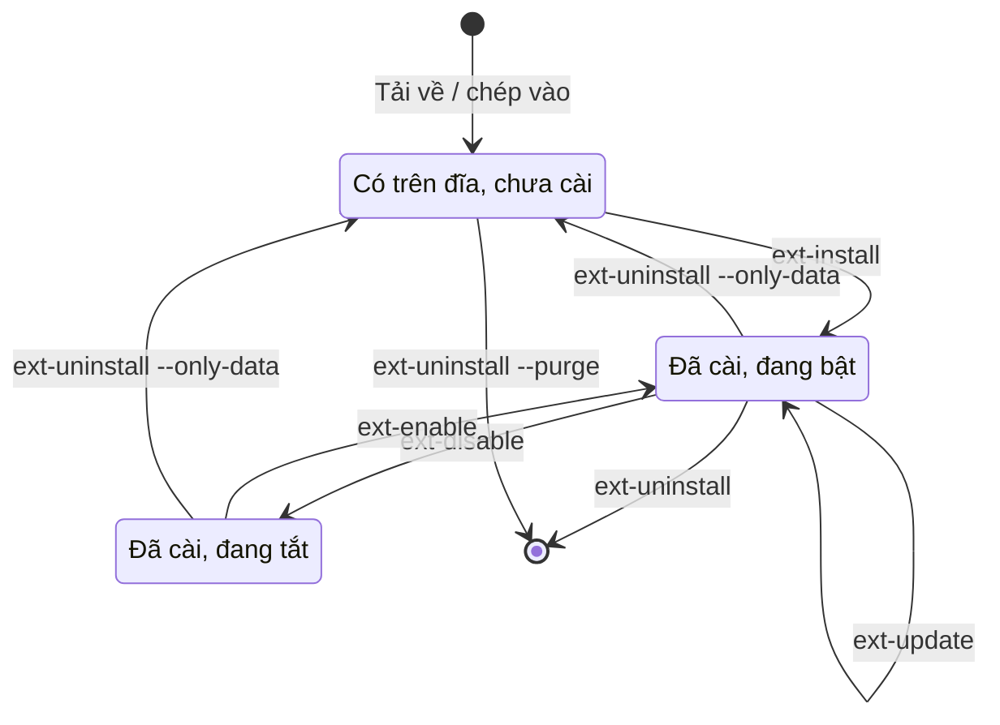

> 🌐 **Ngôn ngữ:** 🇻🇳 Tiếng Việt (hiện tại) · [🇬🇧 English](./cli-extensions.md) · [🇯🇵 日本語](./cli-extensions_ja.md)

# Lệnh quản lý plugin và template (extension)

## Giới thiệu
Họ lệnh `gp247:ext-*` làm bằng dòng lệnh mọi việc của màn **Extension** trong trang quản trị: tìm, cài, bật/tắt, cập nhật,
gỡ plugin và template, quản lý license. Trang này dành cho chủ site có quyền dòng lệnh, người triển khai bằng script hoặc
Docker, và lập trình viên viết extension. Đọc xong, bạn chọn đúng lệnh cho từng bước trong vòng đời một extension và biết
lệnh nào có thể xoá thư mục của nó. Cách cài bằng giao diện (online, tải `.zip`, chép thư mục) có ở
[Cài đặt plugin & template](../extension/install-extension_vi.md).

## Nhìn nhanh
Một extension đi qua các trạng thái sau; mỗi mũi tên là một lệnh:



- **Plugin và template dùng chung một họ lệnh** — chọn bằng `--type=plugin` (mặc định) hoặc `--type=template`.
- **"Đã cài" nghĩa là GP247 đã ghi cấu hình của nó**, không chỉ là có thư mục trên đĩa.
- **`ext-uninstall` mặc định xoá cả thư mục** — muốn giữ file thì thêm `--only-data`.
- **CLI và trang quản trị chạy cùng một bộ máy**, nên kết quả như nhau dù bạn dùng đường nào.

## Trong trang này
- [Chọn loại và chọn extension](#chọn-loại-và-chọn-extension) — `--type`, `--key`, nhiều key một lần
- [Xem và tìm extension](#xem-và-tìm-extension) — `ext-list`, `ext-search`, `ext-check-update`
- [Cài extension](#cài-extension) — từ file, thư mục hoặc thư viện online
- [Bật, tắt, cập nhật](#bật-tắt-cập-nhật) — `ext-enable`, `ext-disable`, `ext-update`
- [Gỡ extension](#gỡ-extension) — ba cách gỡ, cách nào giữ file
- [File tĩnh và license](#file-tĩnh-và-license) — `ext-publish`, hai loại license
- [Tạo khung extension mới](#tạo-khung-extension-mới) — `make-plugin`, `make-template`

## Chọn loại và chọn extension
Mọi lệnh `ext-*` nhận hai tham số chung:

| Tham số | Giá trị | Ý nghĩa |
| --- | --- | --- |
| `--type` | `plugin` (mặc định) hoặc `template` | Loại extension |
| `--key` | tên thư mục, vd `News` | Extension cần thao tác. `ext-install`, `ext-enable`, `ext-disable`, `ext-uninstall`, `ext-publish` nhận **nhiều key**: lặp cờ (`--key=A --key=B`) hoặc ngăn bằng dấu phẩy (`--key=A,B`) |

Khi chạy nhiều key, từng extension được xử lý **riêng rẽ** và báo kết quả riêng; cache route/cấu hình được dựng lại **một
lần** ở cuối; lệnh thoát khác 0 nếu **bất kỳ** extension nào lỗi. Không có "tất cả hoặc không gì": extension đã xong không
bị hoàn tác vì extension sau lỗi.

## Xem và tìm extension
Ba lệnh chỉ đọc, chạy lúc nào cũng được.

| Lệnh | Tham số | Làm gì |
| --- | --- | --- |
| `gp247:ext-list` | `--type` | Liệt kê extension trên site: đã cài chưa, đang bật không, phiên bản, có bản mới không (đọc từ cache, không gọi mạng) |
| `gp247:ext-check-update` | `--type`, `--force` | Báo extension nào có bản cập nhật; `--force` hỏi thư viện ngay thay vì dùng cache |
| `gp247:ext-search` | `--type`, `--keyword=`, `--free`, `--page=` | Tìm trong thư viện extension online; `--free` chỉ hiện bản miễn phí |

```bash
php artisan gp247:ext-list --type=plugin
php artisan gp247:ext-search --keyword=payment --free
```

## Cài extension
`gp247:ext-install` nhận một trong ba nguồn:

| Nguồn | Cờ | Dùng khi |
| --- | --- | --- |
| File nén | `--file=<đường-dẫn.zip>` | Bạn có file `.zip` của extension |
| Thư mục đã giải nén | `--dir=<thư-mục>` | Thư mục chứa `<Tên>/gp247.json` |
| Theo key | `--key=<Tên>` | Extension **đã có trên đĩa** (chép bằng FTP, `git clone`, có sẵn trong bộ cài) → cài tại chỗ; **chưa có** → tải từ thư viện |

1. (Chỉ khi tải từ thư viện, làm **một lần** cho mỗi site) Đặt `APP_URL` trong `.env` là tên miền thật, rồi đăng ký API
   License miễn phí:

   ```bash
   php artisan gp247:ext-register-license
   ```

2. Cài extension:

   ```bash
   php artisan gp247:ext-install --type=plugin --key=News
   ```

   Nếu thành công, plugin được **bật sẵn** và cache tự làm mới. Thư mục `public/` của extension (CSS/JS/ảnh) được chép ra
   `public/GP247/...`.
3. Extension **trả phí**: cài **từng cái một**, kèm license của nó:

   ```bash
   php artisan gp247:ext-install --type=plugin --key=TenPluginPro --paid --license=<license-cua-ban>
   ```

4. Template: sau khi cài, kích hoạt ở trang quản trị → **Thông tin website** (không có lệnh cho bước này).

> ⚠️ **Lưu ý:** `ext-install` chỉ **kiểm tra** phụ thuộc, không tự cài. Extension cần package Composer khác hoặc cần một
> extension khác (ví dụ bản Pro cần bản Free) thì cài phụ thuộc trước.

## Bật, tắt, cập nhật
| Lệnh | Tham số | Làm gì |
| --- | --- | --- |
| `gp247:ext-enable` | `--type`, `--key` | Bật extension **đã cài** |
| `gp247:ext-disable` | `--type`, `--key` | Tắt extension đã cài; từ chối template đang được dùng |
| `gp247:ext-update` | `--type`, `--key` hoặc `--all` | Tải bản mới từ thư viện, **sao lưu** bản cũ, cài đè; lỗi thì tự hoàn tác |
| `gp247:ext-update --local` | `--type`, `--key` hoặc `--all`, `--dry-run` | **Không tải gì**: chạy phần cập nhật dữ liệu cho extension mà bạn đã tự thay file |

Hai cách cập nhật dành cho hai tình huống:

- **Cập nhật từ thư viện** (`ext-update --key=News`) — site cài extension từ thư viện online. GP247 tải bản mới, giữ bản
  sao lưu ở `storage/backups/extensions/`, và tự trả lại bản cũ nếu cài lỗi.
- **Cập nhật tại chỗ** (`ext-update --local`) — bạn đã thay file bằng `git pull`, Composer hay chép tay. GP247 so phiên
  bản trong `gp247.json` với phiên bản nó ghi nhớ lúc cài, rồi chạy phần cập nhật dữ liệu của extension. `gp247:update`
  đã tự làm bước này cho mọi plugin và template.

```bash
php artisan gp247:ext-update --local --all --dry-run
php artisan gp247:ext-update --local --type=plugin --key=News
```

> ⚠️ **Lưu ý:** **không** dùng `ext-update` (không `--local`) cho một thư mục extension là mã nguồn bạn đang phát triển:
> lệnh xoá thư mục rồi chép bản tải về đè vào, mất cả lịch sử git và thay đổi chưa lưu.

`ext-update` cũng chụp bản sao lưu dữ liệu trước khi cập nhật nếu tính năng sao lưu đang bật; `--skip-pre-change` bỏ bước
này.

## Gỡ extension
`gp247:ext-uninstall` có ba cách, khác nhau ở chỗ **có xoá thư mục hay không**:

| Lệnh | Extension | Xoá cấu hình | Xoá thư mục |
| --- | --- | --- | --- |
| `ext-uninstall --key=X` | đã cài | Có | **Có** |
| `ext-uninstall --key=X --only-data` | đã cài | Có | Không — giữ file để cài lại |
| `ext-uninstall --key=X --purge` | chưa cài, có trên đĩa | — | **Có** |

```bash
php artisan gp247:ext-uninstall --type=plugin --key=News --only-data
```

- **Extension được bảo vệ** và **template đang dùng / mặc định** bị từ chối gỡ (ở cả CLI lẫn trang quản trị).
- **Thư mục extension là mã nguồn bạn đang phát triển?** Chỉ dùng `--only-data` — gỡ mặc định xoá cả thư mục, gồm `.git`.

## File tĩnh và license

### Chép lại file tĩnh: `gp247:ext-publish`
Trình duyệt chỉ đọc được thư mục `public/`, nên CSS/JS/ảnh của extension phải được chép từ
`app/GP247/<Plugins|Templates>/<Key>/public/` ra `public/GP247/<Plugins|Templates>/<Key>/`. Cài đặt đã làm việc này; chạy
lại khi `gp247:doctor` báo mục `extension_assets` (giao diện extension báo lỗi 404 CSS/JS).

```bash
php artisan gp247:ext-publish --type=template --key=MyTheme
php artisan gp247:ext-publish --type=plugin --all
```

### Hai loại license
| | API License | License của extension trả phí |
| --- | --- | --- |
| Để làm gì | Cho site kết nối thư viện extension online | Mở khoá một extension trả phí |
| Giá | Miễn phí | Mua theo extension |
| Lệnh | `gp247:ext-register-license` | `--license=` khi cài, hoặc `gp247:ext-license` |
| Lưu ở | `GP247_API_LICENSE` trong `.env` | Cấu hình của site (database) |
| Gắn với | Tên miền `APP_URL` | Extension và tên miền |

`gp247:ext-license` đặt / xem / xoá license của một extension:

```bash
php artisan gp247:ext-license --type=plugin --key=TenPluginPro --license=<license-cua-ban>
php artisan gp247:ext-license --type=plugin --key=TenPluginPro --delete
```

## Tạo khung extension mới
Hai lệnh cho lập trình viên, tạo sẵn cấu trúc thư mục chuẩn để khỏi tạo tay từng file.

| Lệnh | Tham số | Kết quả |
| --- | --- | --- |
| `gp247:make-plugin` | `--name=` (bắt buộc), `--download=0\|1` | Khung plugin: Controller admin, Model, Livewire mẫu, ngôn ngữ, Provider, Route, `gp247.json`, `AppConfig`. Có `gp247/front` thì có thêm phần storefront |
| `gp247:make-template` | `--name=` (bắt buộc), `--download=0\|1` | Khung template storefront: `AppConfig`, ngôn ngữ, Provider, `gp247.json` |

- `--download=0` (mặc định): chép thẳng vào `app/GP247/<Plugins|Templates>/<Tên>` và `public/GP247/...` để dùng ngay.
- `--download=1`: không chép vào site, đóng gói thành file `.zip` trong `storage/tmp` (đường dẫn ở `data.path` khi dùng `--json`).

```bash
php artisan gp247:make-plugin --name=MyBlog
```

Hướng dẫn viết extension: [Tạo plugin](../extension/create-plugin_vi.md), [Tạo template](../extension/create-template_vi.md).

## Điều kiện & ràng buộc (hiểu trước khi thao tác)

**Khi cài**
- **Extension đã cài thì `ext-install` từ chối** ("đã tồn tại", kiểm trước khi tải nên không tốn băng thông) — muốn làm mới
  thì `ext-update`, muốn cài lại thì gỡ trước.
- **Tải từ thư viện cần API License** gắn đúng tên miền; để `APP_URL=http://localhost` thì thư viện từ chối
  (`domain_not_authorized`).
- **Extension trả phí cài từng cái một** — `--paid` kèm nhiều `--key` bị từ chối ngay (`paid_multi_not_allowed`), vì một
  license không thể áp cho nhiều extension.
- **Ghi `.env` thất bại** khi đăng ký API License → lệnh báo `env_write_failed` và in khoá để bạn tự dán. Giữ bí mật khoá này.

**Khi bật / tắt / gỡ**
- **Extension chưa cài thì không bật / tắt được** — tránh "bật" một thư mục chưa có cấu hình.
- **Không tắt / gỡ được template đang dùng hoặc mặc định** — site sẽ mất giao diện.
- **`--only-data` và `--purge` không dùng chung** — một cái giữ file, một cái xoá file.

## Hỏi & Đáp (Q&A)
**Câu 1: Cài xong mà giao diện plugin vỡ, CSS/JS báo 404?**

→ File tĩnh chưa được chép ra `public/`. Chạy `php artisan gp247:ext-publish --type=plugin --key=<Tên>` rồi tải lại trang.

**Câu 2: `ext-install --key` báo "not found in the marketplace"?**

→ Thư viện không có key đó (kiểm lại chữ hoa/thường), và thư mục cũng không có trên đĩa. Tìm đúng tên bằng
`php artisan gp247:ext-search --keyword=<từ-khoá>`.

**Câu 3: Báo `api_license_required` hoặc `domain_not_authorized`?**

→ Site chưa có API License hoặc license không khớp tên miền. Sửa `APP_URL` thành tên miền thật rồi chạy lại
`php artisan gp247:ext-register-license`.

**Câu 4: Tôi `git pull` plugin xong thì có cần chạy gì không?**

→ Có: `php artisan gp247:ext-update --local --type=plugin --key=<Tên>` (hoặc `gp247:update`, lệnh này làm cho mọi
extension). `gp247:doctor` nhắc bằng mục `extension_data_pending` khi bạn quên.

**Câu 5: Gỡ plugin có mất dữ liệu nó đã tạo không?**

→ Tuỳ plugin: lệnh gỡ gọi phần gỡ của chính plugin đó, plugin quyết định có giữ bảng của mình hay không. Đọc README của
plugin, và sao lưu trước khi gỡ.

**Câu 6: Làm sao cài lại một plugin mà giữ nguyên file?**

→ `gp247:ext-uninstall --key=<Tên> --only-data` rồi `gp247:ext-install --key=<Tên>` — key có trên đĩa nên được cài tại chỗ.

**Câu 7: Template cài bằng lệnh nhưng storefront vẫn hiện giao diện cũ?**

→ Cài chưa đủ: vào trang quản trị → **Thông tin website** và chọn template mới cho cửa hàng.

**Câu 8: `make-plugin` báo `Command error`?**

→ Thiếu `--name`. Gõ lại kèm tên, ví dụ `php artisan gp247:make-plugin --name=MyBlog`.

---

<sub>📅 **Cập nhật lần cuối:** 2026-11-08 · ✍️ **Tác giả (Author):** GP247</sub>
