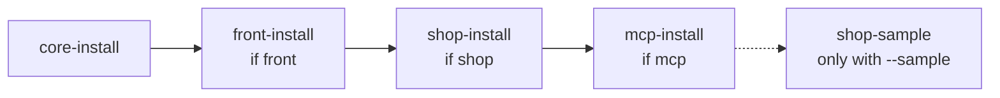
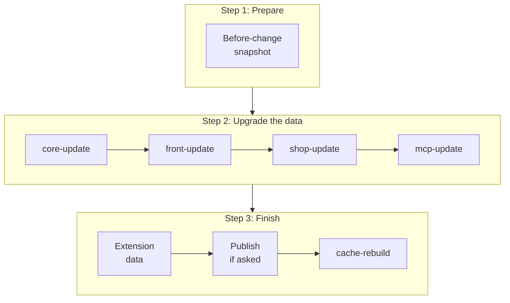

> 🌐 **Language:** [🇻🇳 Tiếng Việt](./cli-install-update_vi.md) · 🇬🇧 English (current) · [🇯🇵 日本語](./cli-install-update_ja.md)

# Install and update commands

## Introduction
This page describes the commands that take a GP247 site from nothing to running (`gp247:install`) and keep it current after
every package upgrade (`gp247:update`), plus the install / update / uninstall commands of each package — core, front, shop,
mcp. It is for site owners with command-line access and for developers. After reading it you know which command to run on a
new site, which one on a running site, and which ones **never** to run on a live site. The full install / update procedures
(preparing the server, Composer, checks afterwards) are in the [Installation guide](../install-upgrade/install.md) and
[Updating a site](../install-upgrade/update.md).

## At a glance
`gp247:install` and `gp247:update` are "orchestrator" commands: they detect which packages the site has and call the
sub-commands in the right order. This is the `gp247:install` chain:



- **New site → `gp247:install`; running site → `gp247:update`.** No exceptions on a site with real data.
- **`install` recreates the front and shop tables** — running it on a selling site loses categories, products, orders.
- **`update` only adds and upgrades**, it deletes no data; running it again is safe.
- **You rarely need to type the sub-commands** (`core-update`, `shop-update`…): the two orchestrators call them.

## On this page
- [Pick the right command: install or update](#pick-the-right-command-install-or-update) — the two commands compared
- [`gp247:install` — install a new site](#gp247install--install-a-new-site) — options, administrator password
- [`gp247:update` — update a running site](#gp247update--update-a-running-site) — the steps, options
- [Refresh published files (`--publish`)](#refresh-published-files---publish) — which tokens are safe
- [Commands of each package](#commands-of-each-package) — when to type a sub-command yourself
- [Translations and sample data](#translations-and-sample-data) — `language-update`, `shop-sample`

## Pick the right command: install or update
The two commands look alike but serve opposite situations.

| | `gp247:install` | `gp247:update` |
| --- | --- | --- |
| Use when | **New** site, empty database | **Running** site, after `composer update` |
| Data tables | Created; front/shop are **dropped and recreated** | Only the upgrade part runs, data is **kept** |
| Asks for confirmation | Yes (default **no**) | No, unless you pick a `--publish` token that overwrites |
| Running it again | Loses front/shop data | Harmless |
| Safety | 🛑 on a site with data | ✅ |

## `gp247:install` — install a new site
Full install for a new site: core, then front, shop, mcp when those packages are in `vendor/`. Package selection is
**automatic** — there is no flag like `--with-shop`.

| Option | Value | Meaning |
| --- | --- | --- |
| `--force` | `0` (default) or `1` | `1`: install without asking — for Docker, scripts. `0`: ask for confirmation, and **refuse** when not interactive |
| `--admin-password` | string | Password of the administrator account (12–64 characters). Left out: the command generates a random one |
| `--sample` | flag | Also create sample shop data — **dev/demo machines only** |

1. Prepare the `.env` file with the database connection (see the [Installation guide](../install-upgrade/install.md)).
2. In the site folder, type:

   ```bash
   php artisan gp247:install
   ```

3. The command prints the install plan and a data-loss warning, then asks `Proceed with installation?`. Type `yes` to go on.
4. When it finishes, the last block prints the admin URL, the user name and the **password — shown only once**. Copy it now,
   then change the account email to a real address so **Forgot password** works.

Install without questions (Docker, scripts), with your own password:

```bash
php artisan gp247:install --force=1 --admin-password="at-least-12-characters"
```

> ⚠️ **Warning:** a password typed on the command line stays in the terminal history. On a shared machine, let the command
> generate the password and change it in the admin.

> 💡 **Tip:** missed the password? Freshly installed site with no data: run `gp247:install` again. Site with data: use
> `gp247:admin-password` — see [Maintenance](./cli-maintenance.md#reset-an-administrator-password).

## `gp247:update` — update a running site
`composer update` only replaces the code in `vendor/`; the site's data and published files stay at the old version.
`gp247:update` brings them in line with the new code, in three stages:



- **Before-change snapshot**: when the backup feature is on, GP247 snapshots the data about to be touched before changing
  anything — see [Backup & restore](../backup/backup-and-restore.md#automatic-snapshot-before-a-risky-change).
- **Each package is updated only when installed**: a site without shop skips `shop-update`. If a step fails, the command stops
  and says which step.
- **Extension data**: plugins/templates whose files you replaced with `git pull`, Composer or a manual copy get their data
  update run (`ext-update --local`). A failing extension only produces a warning; it does not block the next steps.
- **The reinstall step never runs** — your data is kept.

| Option | Meaning |
| --- | --- |
| `--overwrite-lang` | Also run `gp247:language-update`: reset translations to the package defaults — **overwrites** the ones you edited |
| `--publish=<token>` | Copy published files (assets, views) again by token — see [below](#refresh-published-files---publish) |
| `--skip-pre-change` | Skip the before-change snapshot. Only when you just made your own backup |

Day-to-day use:

1. Back up: `php artisan gp247:backup-run` (or back up the database your own way).
2. Update the packages:

   ```bash
   composer update
   ```

3. Update the site:

   ```bash
   php artisan gp247:update
   ```

   If it works, each step prints a `==> gp247:...` line and the command ends without errors.
4. Check again: `php artisan gp247:doctor`.

> ℹ️ **Info:** since GP247 went public at v2.1, every data-structure change ships with an upgrade migration run through
> `gp247:update`. You do **not** need to type `php artisan migrate` yourself.

## Refresh published files (`--publish`)
Some files are copied from the packages into the site (admin CSS/JS, views you took out to edit). `composer update` does
not refresh them. By default `gp247:update` **copies nothing**; add `--publish=` with one or more tokens, comma-separated.

| Token | Copies to | Safety |
| --- | --- | --- |
| `core-public` | `public/GP247` — admin CSS/JS | ✅ regenerated files, nobody edits them |
| `front-public` | `public/GP247/Templates/GP247Front` — storefront CSS/JS | ✅ usually refreshes itself, rarely needed |
| `core-view` | `resources/views/vendor/gp247-admin` | 🛑 overwrites admin views you edited |
| `shop-view-admin` | `resources/views/vendor/gp247-shop-admin` | 🛑 overwrites shop admin views you edited |
| `front-template` | `app/GP247/Templates/GP247Front` — template shell (`AppConfig`, `Provider`, `Route`, `config.php`, `Lang/`…) | 🛑 overwrites the template shell |
| `front-view` | `app/GP247/Templates/GP247Front` — the **whole** Blade tree | 🛑 overwrites, and from then on these files **stop receiving fixes** |
| `shop-view-front` | like `front-view`, for the shop views | 🛑 as above |
| `all` | every token above | 🛑 |

```bash
php artisan gp247:update --publish=core-public
```

- **To edit one storefront screen, do not use `front-view`** — use `gp247:template-publish --file=` to take out just that
  file ([Templates](./cli-templates.md)).
- **`all` skips GP247Front when the site uses another template**: the four GP247Front tokens are skipped with a notice.
  Naming a token explicitly still copies it.
- **In a terminal**, 🛑 tokens are warned about and confirmed (default **no**); declining only skips the copy, the update
  steps still run. **In a script / with `--json`**, 🛑 tokens are copied straight away — typing the token name is the consent.
- A destination folder that cannot be written (read-only hosting) only produces a warning; it does not break the command.

## Commands of each package
Each package has its own commands that `gp247:install` / `gp247:update` call internally. Type them yourself when you
deliberately want exactly one part, for example adding the shop to a site that only has the CMS.

| Package | Install | Update | Uninstall |
| --- | --- | --- | --- |
| core | `gp247:core-install` 🛑 | `gp247:core-update` ✅ | — |
| front | `gp247:front-install` 🛑 | `gp247:front-update` ✅ | `gp247:front-uninstall` 🛑 |
| shop | `gp247:shop-install` 🛑 | `gp247:shop-update` ✅ | `gp247:shop-uninstall` 🛑 |
| mcp | `gp247:mcp-install` ✅ | `gp247:mcp-update` ✅ | `gp247:mcp-uninstall` 🛑 |

### Install commands (`*-install`)
- **`core-install`** — creates the core tables, default data, assets, the `storage` link, and marks the site installed. An
  installed site is refused ("GP247 has been installed"); `--force=1` skips both this check and the question. Accepts
  `--admin-password` like `gp247:install`. Creates `APP_KEY` if it is missing.
- **`front-install`, `shop-install`** — **uninstall first, then install**: drop the package's old tables, recreate them, load
  the default data. This is also how to "clean reinstall" a package. `shop` needs `core` and `front` installed first.
- **`mcp-install`** — only creates settings, menu, permissions; MCP owns no table, so nothing is deleted. The MCP endpoint
  **stays off** until you turn it on in the admin — see [MCP](../mcp/mcp-introduction.md).

### Update commands (`*-update`)
Each command only runs the migrations in the package's `upgrade/` folder — never the create-tables part — so data is kept
and migrations already applied are skipped.

- **`core-update`** — runs the core upgrade migrations, then reloads the default and locale data in **add-what-is-missing**
  mode, then prints the core version.
- **`front-update`, `shop-update`** — the front / shop upgrade migrations. On error they print `... upgrade failed` and log it.
- **`mcp-update`** — updates the MCP settings, menu, permissions and moves the data of the old McpServer plugin (if any).

### Uninstall commands (`*-uninstall`)
- **`front-uninstall`, `shop-uninstall`** — drop the package's tables: all data of that part is lost (for shop: categories,
  products, orders…). Back up first.
- **`mcp-uninstall`** — removes the MCP settings, menu, permissions and **revokes every MCP token**: agents lose access at
  once. Asks for confirmation; scripts need `--force`. Run it **before** `composer remove gp247/mcp`.

## Translations and sample data
These two commands are not part of the default install / update chain, and both overwrite data.

- **`gp247:language-update`** ⚠️ — resets every translation of core, front, shop (whichever are installed) to exactly the
  package default. Unlike `core-update`, it **overwrites** the strings you edited in the admin too. Use it when an update
  fixes translations and you want the standard ones; if you customised a lot of text, back up first.
- **`gp247:shop-sample`** 🛑 — creates sample data (multi-level categories, brands, suppliers, single / bundle / group
  products, promotions) after **wiping** the current shop data. Dev or demo machines only.

```bash
php artisan gp247:language-update
```

## Conditions & Rules (know before you act)

**When installing**
- **No front / shop without core** — front and shop write into core tables.
- **Administrator password of 12–64 characters** — a wrong length stops the command **before** installing, so no half-built
  site is left behind.
- **Without `--force=1`, installing from a script is refused** (error code `confirmation_required`) — so an automated command
  can never wipe data by accident.
- **`core-install` refuses a site that carries the installed marker** (`storage/app/private/gp247-installed.txt`) — no
  installing over an existing site.

**When updating**
- **A misspelled `--publish` token stops the command at once, before anything runs** (`invalid_publish_target`) — a typo must
  not cost an update run.
- **If the before-change snapshot fails, the command stops** (`pre_change_stopped`); in a terminal you are asked whether to
  continue without a snapshot (default **no**).
- **If one package's step fails, the next steps do not run** — fix the cause and run it again; finished steps are skipped.

**When uninstalling**
- **`mcp-uninstall` needs `--force` in a script** — because it cuts every agent's access immediately.

## Q&A
**Q1: I ran `gp247:install` on a running site by mistake. What now?**

→ If you did not type `yes`, nothing changed. If it installed, the front/shop data has been recreated: stop all work and
restore from the latest backup — see the [Restore guide](../backup/restore-guide.md).

**Q2: After `composer update`, do I run `core-update`, `shop-update` one by one?**

→ No. `gp247:update` runs all of them in the right order. Only type a sub-command when you deliberately want one part.

**Q3: Does `gp247:update` run `php artisan migrate` itself?**

→ Yes, but only the upgrade part of each GP247 package (`upgrade/`). Migrations of your own Laravel project still run with
`php artisan migrate` as usual.

**Q4: New translations from the update do not show?**

→ `core-update` only adds missing strings. If the package **changed** an existing string, run
`php artisan gp247:update --overwrite-lang` (note: it overwrites strings you edited).

**Q5: The admin looks unchanged after updating?**

→ Run `php artisan gp247:update --publish=core-public` to copy the admin CSS/JS again, then reload the page (Ctrl+F5).

**Q6: I want to add the shop to a site that only has the CMS.**

→ `composer require gp247/shop`, then `php artisan gp247:shop-install`. Do not run `gp247:install`, it reinstalls the front
too. Full guide: [Add front or shop to an existing site](../install-upgrade/install.md#add-front-or-shop-to-an-existing-site).

**Q7: `gp247:update` reports `front_update_failed` (or `shop_update_failed`)?**

→ An upgrade migration of that package failed. Read the message and the log (`storage/logs`), fix the cause (often database
permissions or duplicate data), then run `gp247:update` again.

**Q8: Can I preview what `gp247:update` will do?**

→ There is no dry run for the whole command. The extension data part can be previewed with
`php artisan gp247:ext-update --local --all --dry-run`. Always back up before updating a live site.

---

<sub>📅 **Last updated:** 2026-11-08 · ✍️ **Author:** GP247</sub>
