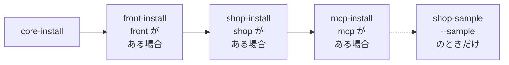
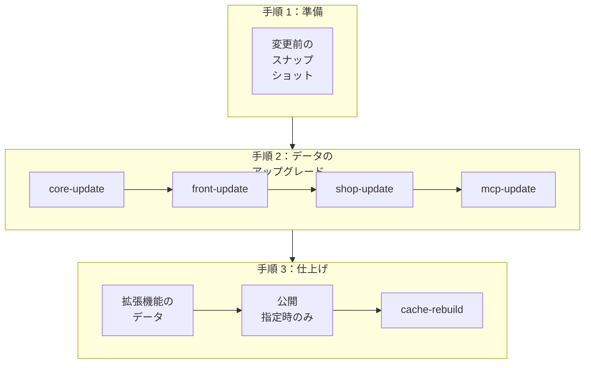

> 🌐 **言語:** [🇻🇳 Tiếng Việt](./cli-install-update_vi.md) · [🇬🇧 English](./cli-install-update.md) · 🇯🇵 日本語（現在）

# インストールと更新のコマンド

## はじめに
このページでは、GP247 のサイトをゼロから動く状態にするコマンド（`gp247:install`）と、パッケージを上げるたびに最新の状態に
保つコマンド（`gp247:update`）、さらに core、front、shop、mcp の各パッケージのインストール／更新／アンインストールの
コマンドを説明します。対象は、コマンドラインを使えるサイトオーナーと開発者です。読み終えると、新しいサイトで実行するコマンド、
稼働中のサイトで実行するコマンド、本番サイトでは**決して**実行してはいけないコマンドが分かります。インストール／更新の
全手順（サーバーの準備、Composer、インストール後の確認）は [インストールガイド](../install-upgrade/install_ja.md) と
[サイトの更新](../install-upgrade/update_ja.md) にあります。

## ひと目でわかる
`gp247:install` と `gp247:update` は「まとめ役」のコマンドです。サイトにあるパッケージを自動で調べ、下位のコマンドを
正しい順序で呼び出します。`gp247:install` の流れは次のとおりです。



- **新しいサイト → `gp247:install`、稼働中のサイト → `gp247:update`。** 実データのあるサイトに例外はありません。
- **`install` は front と shop のテーブルを作り直します** — 販売中のサイトで実行すると、カテゴリー、商品、注文が失われます。
- **`update` は追加とアップグレードだけ**を行い、データは削除しません。何度実行しても安全です。
- **下位のコマンド**（`core-update`、`shop-update` など）**を自分で入力することはほとんどありません**。まとめ役の 2 つが呼び出します。

## このページの内容
- [install と update の選び方](#install-と-update-の選び方) — 2 つのコマンドの比較
- [`gp247:install` — 新しいサイトをインストール](#gp247install--新しいサイトをインストール) — オプション、管理者パスワード
- [`gp247:update` — 稼働中のサイトを更新](#gp247update--稼働中のサイトを更新) — 手順、オプション
- [公開済みファイルの更新（`--publish`）](#公開済みファイルの更新--publish) — 安全なトークンはどれか
- [パッケージごとのコマンド](#パッケージごとのコマンド) — 下位のコマンドを自分で入力する場面
- [翻訳とサンプルデータ](#翻訳とサンプルデータ) — `language-update`、`shop-sample`

## install と update の選び方
2 つのコマンドは似ていますが、正反対の場面で使います。

| | `gp247:install` | `gp247:update` |
| --- | --- | --- |
| 使う場面 | **新しい**サイト、空のデータベース | **稼働中**のサイト、`composer update` の後 |
| データのテーブル | 新規作成。front／shop は**削除して作り直す** | アップグレード部分だけを実行し、データは**そのまま** |
| 確認 | あり（既定は**いいえ**） | なし（上書きする `--publish` トークンを選んだ場合を除く） |
| 再実行 | front／shop のデータを失う | 問題なし |
| 安全度 | データのあるサイトでは 🛑 | ✅ |

## `gp247:install` — 新しいサイトをインストール
新しいサイト向けの一括インストールです。core を入れた後、`vendor/` にあれば front、shop、mcp を入れます。パッケージの
選択は**自動**です。`--with-shop` のようなフラグはありません。

| オプション | 値 | 意味 |
| --- | --- | --- |
| `--force` | `0`（既定）または `1` | `1`：確認せずにインストール（Docker、スクリプト向け）。`0`：確認を求め、対話できない環境では**拒否** |
| `--admin-password` | 文字列 | 管理者アカウントのパスワード（12〜64 文字）。省略すると、コマンドがランダムに生成します |
| `--sample` | フラグ | shop のサンプルデータも作成 — **開発／デモ用マシン専用** |

1. データベース接続を記入した `.env` ファイルを用意します（[インストールガイド](../install-upgrade/install_ja.md) を参照）。
2. サイトのフォルダーで、次のように入力します。

   ```bash
   php artisan gp247:install
   ```

3. コマンドがインストール計画とデータ消失の警告を表示し、`Proceed with installation?` と尋ねます。続けるには `yes` と入力します。
4. 完了すると、最後のブロックに管理画面の URL、ユーザー名、**パスワード（一度だけ表示されます）**が表示されます。すぐに
   控え、アカウントのメールアドレスを実在するものに変更して、「**パスワードをお忘れの方**」を使えるようにしてください。

確認なしでインストールし（Docker、スクリプト）、パスワードを自分で指定する場合：

```bash
php artisan gp247:install --force=1 --admin-password="12文字以上のパスワード"
```

> ⚠️ **注意:** コマンドラインに入力したパスワードは、ターミナルの履歴に残ります。共有マシンでは、コマンドに生成させてから
> 管理画面で変更してください。

> 💡 **ヒント:** パスワードを控え忘れた場合：インストールしたばかりでデータがないサイトなら `gp247:install` をもう一度実行します。
> データのあるサイトなら `gp247:admin-password` を使います — [メンテナンス](./cli-maintenance_ja.md#管理者パスワードの再設定) を参照してください。

## `gp247:update` — 稼働中のサイトを更新
`composer update` は `vendor/` のコードを入れ替えるだけで、サイトのデータと公開済みファイルは古いバージョンのままです。
`gp247:update` は、これらを新しいコードに合わせます。流れは 3 段階です。



- **変更前のスナップショット**：バックアップ機能が有効なら、GP247 は何かを変える前に、影響を受けるデータのスナップショットを
  自動で取ります — [バックアップと復元](../backup/backup-and-restore_ja.md#リスクのある変更の前の自動スナップショット) を参照してください。
- **各パッケージはインストール済みのときだけ更新されます**：shop のないサイトでは `shop-update` を飛ばします。途中の手順が
  失敗すると、コマンドは止まり、どの手順かを表示します。
- **拡張機能のデータ**：`git pull`、Composer、手動コピーでファイルを入れ替えたプラグイン／テンプレートは、データの更新
  （`ext-update --local`）が実行されます。失敗した拡張機能は警告だけで、後の手順は止まりません。
- **再インストールの手順は実行されません** — データはそのまま残ります。

| オプション | 意味 |
| --- | --- |
| `--overwrite-lang` | `gp247:language-update` も実行：翻訳をパッケージの既定値に戻します — 編集した翻訳は**上書き**されます |
| `--publish=<トークン>` | 公開済みファイル（アセット、ビュー）をトークン単位で再コピー — [後述](#公開済みファイルの更新--publish) |
| `--skip-pre-change` | 変更前のスナップショットを取らない。自分でバックアップした直後のときだけ使います |

普段の使い方：

1. バックアップ：`php artisan gp247:backup-run`（または自分の方法でデータベースをバックアップ）。
2. パッケージを更新します。

   ```bash
   composer update
   ```

3. サイトを更新します。

   ```bash
   php artisan gp247:update
   ```

   成功すると、手順ごとに `==> gp247:...` の行が表示され、エラーなく終了します。
4. もう一度点検します：`php artisan gp247:doctor`。

> ℹ️ **情報:** GP247 が v2.1 で公開されて以来、データ構造の変更にはすべて、`gp247:update` で実行されるアップグレード用
> マイグレーションが付いています。`php artisan migrate` を自分で入力する必要は**ありません**。

## 公開済みファイルの更新（`--publish`）
一部のファイルは、パッケージからサイトへコピーされています（管理画面の CSS／JS、編集のために取り出したビュー）。
`composer update` ではこれらは更新されません。既定の `gp247:update` は**何もコピーしません**。`--publish=` に 1 つ以上の
トークンをカンマ区切りで指定します。

| トークン | コピー先 | 安全度 |
| --- | --- | --- |
| `core-public` | `public/GP247` — 管理画面の CSS／JS | ✅ 再生成されるファイルで、手で編集しない |
| `front-public` | `public/GP247/Templates/GP247Front` — ストアフロントの CSS／JS | ✅ 通常は自動で更新されるので、指定はまれ |
| `core-view` | `resources/views/vendor/gp247-admin` | 🛑 編集した管理画面のビューを上書き |
| `shop-view-admin` | `resources/views/vendor/gp247-shop-admin` | 🛑 編集した shop 管理画面のビューを上書き |
| `front-template` | `app/GP247/Templates/GP247Front` — テンプレートの外枠（`AppConfig`、`Provider`、`Route`、`config.php`、`Lang/` など） | 🛑 テンプレートの外枠を上書き |
| `front-view` | `app/GP247/Templates/GP247Front` — Blade の**ツリー全体** | 🛑 上書きし、以後これらのファイルは**修正を受け取れなくなる** |
| `shop-view-front` | `front-view` と同様（shop のビュー） | 🛑 同上 |
| `all` | 上のすべてのトークン | 🛑 |

```bash
php artisan gp247:update --publish=core-public
```

- **ストアフロントの 1 画面を編集したいときは `front-view` を使わないでください** — `gp247:template-publish --file=` で、
  そのファイルだけを取り出します（[テンプレート](./cli-templates_ja.md)）。
- **サイトが別のテンプレートを使っている場合、`all` は GP247Front を飛ばします**：GP247Front の 4 つのトークンは通知つきで
  スキップされます。トークンを明示すればコピーされます。
- **ターミナルでは**、🛑 のトークンは警告のうえ確認を求めます（既定は**いいえ**）。断るとコピーだけが省かれ、更新の手順は
  実行されます。**スクリプト／`--json` では**、🛑 のトークンはそのままコピーされます — トークン名を入力したことが同意になります。
- 書き込めないコピー先（読み取り専用のホスティング）は警告だけで、コマンド全体は失敗しません。

## パッケージごとのコマンド
各パッケージには、`gp247:install`／`gp247:update` が内部で呼び出す専用のコマンドがあります。CMS だけのサイトに shop を
追加するときなど、意図して 1 つの部分だけを扱いたいときに自分で入力します。

| パッケージ | インストール | 更新 | アンインストール |
| --- | --- | --- | --- |
| core | `gp247:core-install` 🛑 | `gp247:core-update` ✅ | — |
| front | `gp247:front-install` 🛑 | `gp247:front-update` ✅ | `gp247:front-uninstall` 🛑 |
| shop | `gp247:shop-install` 🛑 | `gp247:shop-update` ✅ | `gp247:shop-uninstall` 🛑 |
| mcp | `gp247:mcp-install` ✅ | `gp247:mcp-update` ✅ | `gp247:mcp-uninstall` 🛑 |

### インストールのコマンド（`*-install`）
- **`core-install`** — core のテーブル、既定データ、アセット、`storage` リンクを作成し、インストール済みの印を付けます。
  インストール済みのサイトでは拒否します（「GP247 has been installed」）。`--force=1` はこのチェックと確認の両方を省きます。
  `gp247:install` と同じく `--admin-password` を受け付けます。`APP_KEY` がなければ自動で作成します。
- **`front-install`、`shop-install`** — **先にアンインストールしてからインストール**します。パッケージの古いテーブルを削除し、
  作り直し、既定データを読み込みます。パッケージを「きれいに再インストール」する方法でもあります。`shop` には `core` と
  `front` のインストールが先に必要です。
- **`mcp-install`** — 設定、メニュー、権限を作成するだけです。MCP は自分のテーブルを持たないので、何も削除しません。MCP の
  エンドポイントは、管理画面で有効にするまで**無効のまま**です — [MCP](../mcp/mcp-introduction_ja.md) を参照してください。

### 更新のコマンド（`*-update`）
各コマンドは、パッケージの `upgrade/` フォルダーのマイグレーションだけを実行します（テーブル作成部分は決して実行しません）。
そのためデータは残り、適用済みのマイグレーションは飛ばされます。

- **`core-update`** — core のアップグレード用マイグレーションを実行し、既定データとロケールデータを**足りないものだけ追加する**
  方式で読み込み直し、core のバージョンを表示します。
- **`front-update`、`shop-update`** — front／shop のアップグレード用マイグレーション。エラー時は `... upgrade failed` と表示し、
  ログに記録します。
- **`mcp-update`** — MCP の設定、メニュー、権限を更新し、旧 McpServer プラグインのデータ（あれば）を移します。

### アンインストールのコマンド（`*-uninstall`）
- **`front-uninstall`、`shop-uninstall`** — パッケージのテーブルを削除します。その部分のデータはすべて失われます（shop なら
  カテゴリー、商品、注文など）。先にバックアップしてください。
- **`mcp-uninstall`** — MCP の設定、メニュー、権限を削除し、**すべての MCP トークンを無効化**します。エージェントは直ちに
  アクセスできなくなります。確認を求めます。スクリプトでは `--force` が必要です。`composer remove gp247/mcp` の**前に**実行してください。

## 翻訳とサンプルデータ
この 2 つのコマンドは既定のインストール／更新の流れには含まれず、どちらもデータを上書きします。

- **`gp247:language-update`** ⚠️ — core、front、shop（インストール済みのもの）のすべての翻訳を、パッケージの既定値どおりに
  戻します。`core-update` と違い、管理画面で編集した文字列も**上書き**します。更新で翻訳が修正され、標準の翻訳を使いたいときに
  使います。テキストを多くカスタマイズしている場合は、先にバックアップしてください。
- **`gp247:shop-sample`** 🛑 — 現在の shop データを**すべて消した後**、サンプルデータ（多階層のカテゴリー、ブランド、仕入先、
  単品／セット／グループ商品、プロモーション）を作成します。開発用またはデモ用のマシンだけで使ってください。

```bash
php artisan gp247:language-update
```

## 条件と制約（操作の前に確認）

**インストールするとき**
- **core なしでは front／shop をインストールできません** — front と shop は core のテーブルに書き込むためです。
- **管理者パスワードは 12〜64 文字です** — 長さが合わないとインストールの**前に**止まるので、中途半端なサイトは残りません。
- **`--force=1` がないと、スクリプトからのインストールは拒否されます**（エラーコード `confirmation_required`） — 自動実行の
  コマンドが誤ってデータを消すことがないようにするためです。
- **`core-install` は、インストール済みの印**（`storage/app/private/gp247-installed.txt`）**があるサイトを拒否します** —
  既存のサイトに上書きインストールしないためです。

**更新するとき**
- **`--publish` のトークン名を間違えると、何も実行せずにすぐ止まります**（`invalid_publish_target`） — 入力ミスで更新を
  1 回無駄にしないためです。
- **変更前のスナップショットが失敗すると、コマンドは止まります**（`pre_change_stopped`）。ターミナルでは、スナップショット
  なしで続けるかを尋ねます（既定は**いいえ**）。
- **あるパッケージの手順が失敗すると、後の手順は実行されません** — 原因を直して再実行してください。完了した手順は飛ばされます。

**アンインストールするとき**
- **スクリプトでの `mcp-uninstall` には `--force` が必要です** — すべてのエージェントのアクセスを直ちに断つためです。

## よくある質問（Q&A）
**Q1: 稼働中のサイトで誤って `gp247:install` を実行してしまいました。**

→ `yes` を入力していなければ、何も変わっていません。インストールされてしまった場合、front／shop のデータは作り直されています。
すべての操作を止め、最新のバックアップから復元してください — [状況別の復元ガイド](../backup/restore-guide_ja.md) を参照してください。

**Q2: `composer update` の後、`core-update`、`shop-update` を 1 つずつ実行しますか？**

→ いいえ。`gp247:update` がすべてを正しい順序で実行します。意図して 1 つの部分だけを扱うときだけ、下位のコマンドを入力します。

**Q3: `gp247:update` は `php artisan migrate` を自動で実行しますか？**

→ はい。ただし各 GP247 パッケージのアップグレード部分（`upgrade/`）だけです。自分の Laravel プロジェクトのマイグレーションは、
これまでどおり `php artisan migrate` で実行します。

**Q4: 更新で追加された翻訳が表示されません。**

→ `core-update` は足りない文字列を追加するだけです。パッケージが既存の文字列を**変更**した場合は、
`php artisan gp247:update --overwrite-lang` を実行してください（注意：編集した文字列は上書きされます）。

**Q5: 更新後も管理画面の見た目が変わりません。**

→ `php artisan gp247:update --publish=core-public` で管理画面の CSS／JS を再コピーし、ページを再読み込み（Ctrl+F5）してください。

**Q6: CMS だけのサイトに販売機能を追加したいです。**

→ `composer require gp247/shop` の後、`php artisan gp247:shop-install` を実行します。`gp247:install` は front も再インストール
するので実行しないでください。詳しくは [既存サイトに front または shop を追加](../install-upgrade/install_ja.md#既存サイトに-front-または-shop-を追加) を参照してください。

**Q7: `gp247:update` が `front_update_failed`（または `shop_update_failed`）を報告します。**

→ そのパッケージのアップグレード用マイグレーションが失敗しています。メッセージとログ（`storage/logs`）を読み、原因（多くは
データベースの権限や重複データ）を直してから、`gp247:update` を再実行してください。

**Q8: `gp247:update` が何をするか、事前に確認できますか？**

→ コマンド全体の試行モードはありません。拡張機能のデータ部分は `php artisan gp247:ext-update --local --all --dry-run` で
確認できます。本番サイトを更新する前には、必ずバックアップしてください。

---

<sub>📅 **最終更新:** 2026-11-08 · ✍️ **作成者 (Author):** GP247</sub>
