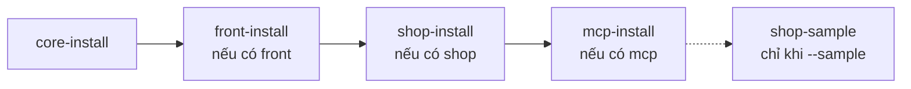
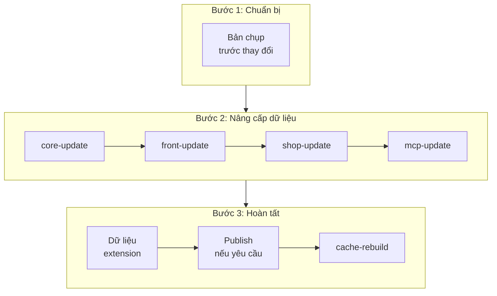

> 🌐 **Ngôn ngữ:** 🇻🇳 Tiếng Việt (hiện tại) · [🇬🇧 English](./cli-install-update.md) · [🇯🇵 日本語](./cli-install-update_ja.md)

# Lệnh cài đặt và cập nhật

## Giới thiệu
Trang này mô tả các lệnh đưa một site GP247 từ con số không tới chạy được (`gp247:install`) và giữ nó luôn mới sau mỗi
lần nâng package (`gp247:update`), cùng các lệnh cài / cập nhật / gỡ của từng package core, front, shop, mcp. Tài liệu
dành cho chủ site có quyền dòng lệnh và lập trình viên. Đọc xong, bạn biết chạy lệnh nào cho site mới, lệnh nào cho site
đang chạy, và lệnh nào **không bao giờ** chạy trên site thật. Các bước cài / cập nhật trọn vẹn (chuẩn bị máy chủ, Composer,
kiểm tra sau cài) nằm ở [Hướng dẫn cài đặt](../install-upgrade/install_vi.md) và [Cập nhật site](../install-upgrade/update_vi.md).

## Nhìn nhanh
`gp247:install` và `gp247:update` là hai lệnh "điều phối": chúng tự nhận site có package nào rồi gọi các lệnh con theo
đúng thứ tự. Đây là chuỗi của `gp247:install`:



- **Site mới → `gp247:install`; site đang chạy → `gp247:update`.** Không có ngoại lệ trên site có dữ liệu thật.
- **`install` tạo lại bảng của front và shop** — chạy trên site đang bán hàng là mất danh mục, sản phẩm, đơn hàng.
- **`update` chỉ thêm và nâng cấp**, không xoá dữ liệu; chạy lại nhiều lần vẫn an toàn.
- **Bạn hiếm khi cần gõ lệnh con** (`core-update`, `shop-update`…): hai lệnh điều phối đã gọi chúng.

## Trong trang này
- [Chọn đúng lệnh: install hay update](#chọn-đúng-lệnh-install-hay-update) — so sánh hai lệnh
- [`gp247:install` — cài site mới](#gp247install--cài-site-mới) — tham số, mật khẩu quản trị
- [`gp247:update` — cập nhật site đang chạy](#gp247update--cập-nhật-site-đang-chạy) — các bước, tuỳ chọn
- [Làm mới file đã publish (`--publish`)](#làm-mới-file-đã-publish---publish) — token nào an toàn
- [Lệnh của từng package](#lệnh-của-từng-package) — khi nào gõ riêng lệnh con
- [Ngôn ngữ và dữ liệu mẫu](#ngôn-ngữ-và-dữ-liệu-mẫu) — `language-update`, `shop-sample`

## Chọn đúng lệnh: install hay update
Hai lệnh trông giống nhau nhưng phục vụ hai tình huống ngược nhau.

| | `gp247:install` | `gp247:update` |
| --- | --- | --- |
| Dùng khi | Site **mới**, database trống | Site **đang chạy**, sau `composer update` |
| Với bảng dữ liệu | Tạo mới; front/shop bị **xoá và tạo lại** | Chỉ chạy phần nâng cấp, **giữ nguyên** dữ liệu |
| Hỏi xác nhận | Có (mặc định **không** đồng ý) | Không, trừ khi bạn chọn token `--publish` có ghi đè |
| Chạy lại | Mất dữ liệu front/shop | Vô hại |
| Mức an toàn | 🛑 trên site có dữ liệu | ✅ |

## `gp247:install` — cài site mới
Lệnh cài trọn bộ cho site mới: core, rồi front, shop, mcp nếu các package đó có mặt trong `vendor/`. Việc chọn package
là **tự động** — không có cờ kiểu `--with-shop`.

| Tham số | Giá trị | Ý nghĩa |
| --- | --- | --- |
| `--force` | `0` (mặc định) hoặc `1` | `1`: cài luôn, không hỏi — dùng cho Docker, script. `0`: hỏi xác nhận, và **từ chối** khi chạy không tương tác |
| `--admin-password` | chuỗi | Mật khẩu tài khoản quản trị (12–64 ký tự). Bỏ trống: lệnh sinh mật khẩu ngẫu nhiên |
| `--sample` | cờ | Tạo thêm dữ liệu shop mẫu — **chỉ cho máy dev/demo** |

1. Chuẩn bị file `.env` có kết nối database (xem [Hướng dẫn cài đặt](../install-upgrade/install_vi.md)).
2. Tại thư mục site, gõ:

   ```bash
   php artisan gp247:install
   ```

3. Lệnh in kế hoạch cài và cảnh báo mất dữ liệu, rồi hỏi `Proceed with installation?`. Gõ `yes` để tiếp tục.
4. Khi xong, khối cuối cùng in đường dẫn trang quản trị, tên đăng nhập và **mật khẩu — chỉ hiện một lần**. Chép lại ngay,
   rồi đổi email tài khoản sang email thật để dùng được **Quên mật khẩu**.

Cài không cần hỏi (Docker, script), tự đặt mật khẩu:

```bash
php artisan gp247:install --force=1 --admin-password="mat-khau-du-12-ky-tu"
```

> ⚠️ **Lưu ý:** mật khẩu gõ trên dòng lệnh nằm lại trong lịch sử Terminal. Trên máy dùng chung, hãy để lệnh tự sinh mật
> khẩu rồi đổi trong trang quản trị.

> 💡 **Mẹo:** lỡ không chép được mật khẩu? Site vừa cài, chưa có dữ liệu: chạy lại `gp247:install`. Site đã có dữ liệu:
> dùng `gp247:admin-password` — xem [Bảo trì](./cli-maintenance_vi.md#đặt-lại-mật-khẩu-quản-trị).

## `gp247:update` — cập nhật site đang chạy
`composer update` chỉ thay mã trong `vendor/`; dữ liệu và file đã publish của site vẫn ở phiên bản cũ. `gp247:update`
đưa chúng lên khớp mã mới, theo ba chặng:



- **Bản chụp trước thay đổi**: nếu tính năng sao lưu đang bật, GP247 tự chụp phần dữ liệu sắp bị chạm tới trước khi sửa
  gì — xem [Sao lưu & phục hồi](../backup/backup-and-restore_vi.md#bản-chụp-tự-động-trước-thay-đổi-rủi-ro).
- **Mỗi package chỉ được cập nhật khi đã cài**: site không có shop thì bỏ qua `shop-update`. Một bước lỗi thì lệnh dừng
  và báo bước nào.
- **Dữ liệu extension**: plugin/template bạn đã thay file bằng `git pull`, Composer hay chép tay được chạy phần cập nhật
  dữ liệu (`ext-update --local`). Extension lỗi chỉ được cảnh báo, không chặn các bước sau.
- **Không bao giờ chạy bước cài lại** — dữ liệu của bạn được giữ nguyên.

| Tham số | Ý nghĩa |
| --- | --- |
| `--overwrite-lang` | Chạy thêm `gp247:language-update`: đưa chuỗi ngôn ngữ về bản mặc định — **ghi đè** chuỗi bạn đã sửa |
| `--publish=<token>` | Chép lại file đã publish (asset, view) theo token — xem [mục dưới](#làm-mới-file-đã-publish---publish) |
| `--skip-pre-change` | Không chụp bản trước thay đổi. Chỉ dùng khi bạn vừa tự sao lưu |

Cách dùng thường ngày:

1. Sao lưu: `php artisan gp247:backup-run` (hoặc sao lưu database theo cách của bạn).
2. Cập nhật package:

   ```bash
   composer update
   ```

3. Cập nhật site:

   ```bash
   php artisan gp247:update
   ```

   Nếu thành công, mỗi bước in một dòng `==> gp247:...` và lệnh kết thúc không báo lỗi.
4. Kiểm tra lại: `php artisan gp247:doctor`.

> ℹ️ **Thông tin:** từ khi GP247 công khai ở v2.1, mọi thay đổi cấu trúc dữ liệu đều đi kèm migration nâng cấp chạy qua
> `gp247:update`. Bạn **không** cần tự gõ `php artisan migrate`.

## Làm mới file đã publish (`--publish`)
Một số file được chép từ package ra site (CSS/JS quản trị, view bạn đã lấy ra để sửa). `composer update` không làm mới
chúng. Mặc định `gp247:update` **không chép gì**; thêm `--publish=` với một hoặc nhiều token, ngăn cách bằng dấu phẩy.

| Token | Chép tới | Mức an toàn |
| --- | --- | --- |
| `core-public` | `public/GP247` — CSS/JS trang quản trị | ✅ file tái sinh, không ai sửa tay |
| `front-public` | `public/GP247/Templates/GP247Front` — CSS/JS storefront | ✅ thường tự làm mới, hiếm khi cần gõ |
| `core-view` | `resources/views/vendor/gp247-admin` | 🛑 ghi đè view quản trị bạn đã sửa |
| `shop-view-admin` | `resources/views/vendor/gp247-shop-admin` | 🛑 ghi đè view quản trị shop bạn đã sửa |
| `front-template` | `app/GP247/Templates/GP247Front` — vỏ template (`AppConfig`, `Provider`, `Route`, `config.php`, `Lang/`…) | 🛑 ghi đè vỏ template |
| `front-view` | `app/GP247/Templates/GP247Front` — **cả cây** Blade | 🛑 ghi đè, và từ đó các file này **không còn nhận bản vá** |
| `shop-view-front` | như `front-view`, cho phần view của shop | 🛑 như trên |
| `all` | mọi token trên | 🛑 |

```bash
php artisan gp247:update --publish=core-public
```

- **Muốn sửa một màn storefront, đừng dùng `front-view`** — dùng `gp247:template-publish --file=` để chỉ lấy đúng file đó
  ([Template](./cli-templates_vi.md)).
- **`all` bỏ qua GP247Front khi site dùng template khác**: bốn token của GP247Front tự được bỏ qua kèm thông báo. Gõ đích
  danh token thì vẫn chép.
- **Trong Terminal**, token 🛑 được cảnh báo rồi hỏi xác nhận (mặc định **không**); từ chối chỉ bỏ phần chép, các bước
  cập nhật vẫn chạy. **Trong script / `--json`**, token 🛑 được chép luôn — tự gõ tên token chính là đồng ý.
- Một thư mục đích không ghi được (hosting chỉ-đọc) chỉ bị cảnh báo, không làm hỏng cả lệnh.

## Lệnh của từng package
Mỗi package có bộ lệnh riêng mà `gp247:install` / `gp247:update` gọi bên trong. Gõ riêng chúng khi bạn cố ý làm đúng một
phần, ví dụ thêm shop vào một site đang chỉ có CMS.

| Package | Cài | Cập nhật | Gỡ |
| --- | --- | --- | --- |
| core | `gp247:core-install` 🛑 | `gp247:core-update` ✅ | — |
| front | `gp247:front-install` 🛑 | `gp247:front-update` ✅ | `gp247:front-uninstall` 🛑 |
| shop | `gp247:shop-install` 🛑 | `gp247:shop-update` ✅ | `gp247:shop-uninstall` 🛑 |
| mcp | `gp247:mcp-install` ✅ | `gp247:mcp-update` ✅ | `gp247:mcp-uninstall` 🛑 |

### Lệnh cài (`*-install`)
- **`core-install`** — tạo bảng core, dữ liệu mặc định, asset, link `storage`, và đánh dấu đã cài. Site đã cài thì từ
  chối (báo "GP247 has been installed"); `--force=1` bỏ qua cả kiểm tra này lẫn câu hỏi. Nhận `--admin-password` như
  `gp247:install`. Chưa có `APP_KEY` thì lệnh tự tạo.
- **`front-install`, `shop-install`** — **gỡ trước rồi cài lại**: xoá bảng cũ của package, tạo lại, nạp dữ liệu mặc định.
  Đây cũng là cách "cài lại sạch" một package. `shop` cần `core` và `front` đã cài trước.
- **`mcp-install`** — chỉ tạo cấu hình, menu, quyền; MCP không có bảng riêng nên không xoá gì. Endpoint MCP **vẫn tắt**
  cho tới khi bạn bật ở trang quản trị — xem [MCP](../mcp/mcp-introduction_vi.md).

### Lệnh cập nhật (`*-update`)
Mỗi lệnh chỉ chạy các migration trong thư mục `upgrade/` của package — không bao giờ chạy phần tạo bảng — nên dữ liệu
giữ nguyên, migration đã chạy được bỏ qua.

- **`core-update`** — chạy migration nâng cấp của core, rồi nạp lại dữ liệu mặc định và ngôn ngữ ở chế độ **chỉ thêm phần
  còn thiếu**, rồi in phiên bản core.
- **`front-update`, `shop-update`** — migration nâng cấp của front / shop. Lỗi thì in `... upgrade failed` và ghi log.
- **`mcp-update`** — cập nhật cấu hình, menu, quyền của MCP và chuyển dữ liệu từ plugin McpServer cũ (nếu có).

### Lệnh gỡ (`*-uninstall`)
- **`front-uninstall`, `shop-uninstall`** — xoá bảng của package: mất toàn bộ dữ liệu của phần đó (với shop: danh mục, sản
  phẩm, đơn hàng…). Sao lưu trước.
- **`mcp-uninstall`** — xoá cấu hình, menu, quyền MCP và **thu hồi mọi token MCP**: agent mất quyền truy cập ngay. Hỏi xác
  nhận; trong script cần `--force`. Chạy lệnh này **trước** `composer remove gp247/mcp`.

## Ngôn ngữ và dữ liệu mẫu
Hai lệnh này không thuộc chuỗi cài / cập nhật mặc định, và cả hai đều ghi đè dữ liệu.

- **`gp247:language-update`** ⚠️ — đưa mọi chuỗi ngôn ngữ của core, front, shop (package nào đã cài) về đúng bản mặc định
  của package. Khác `core-update` ở chỗ nó **ghi đè** cả chuỗi bạn đã sửa trong trang quản trị. Dùng khi bản cập nhật sửa
  chuỗi dịch và bạn muốn lấy bản chuẩn; đã tuỳ biến nhiều chữ thì sao lưu trước.
- **`gp247:shop-sample`** 🛑 — tạo dữ liệu mẫu (danh mục nhiều cấp, thương hiệu, nhà cung cấp, sản phẩm đơn / bộ / nhóm,
  khuyến mãi) sau khi **xoá sạch** dữ liệu shop đang có. Chỉ dùng trên máy dev hoặc demo.

```bash
php artisan gp247:language-update
```

## Điều kiện & ràng buộc (hiểu trước khi thao tác)

**Khi cài**
- **Chưa cài core thì không cài được front / shop** — front và shop ghi dữ liệu vào bảng của core.
- **Mật khẩu quản trị 12–64 ký tự** — sai độ dài thì lệnh dừng **trước khi** cài, không để lại site nửa chừng.
- **Không có `--force=1` thì cài trong script bị từ chối** (mã lỗi `confirmation_required`) — để một lệnh tự động không thể
  vô tình xoá dữ liệu.
- **`core-install` từ chối site đã có dấu đã cài** (`storage/app/private/gp247-installed.txt`) — tránh cài đè.

**Khi cập nhật**
- **Token `--publish` sai tên thì lệnh dừng ngay, chưa làm gì** (`invalid_publish_target`) — một lỗi gõ không được tốn một
  lượt cập nhật.
- **Bản chụp trước thay đổi thất bại thì lệnh dừng** (`pre_change_stopped`); trong Terminal bạn được hỏi có cập nhật tiếp
  mà không có bản chụp không (mặc định **không**).
- **Bước của một package lỗi thì các bước sau không chạy** — sửa nguyên nhân rồi chạy lại; các bước đã xong được bỏ qua.

**Khi gỡ**
- **`mcp-uninstall` trong script cần `--force`** — vì nó cắt quyền truy cập của mọi agent ngay lập tức.

## Hỏi & Đáp (Q&A)
**Câu 1: Tôi lỡ chạy `gp247:install` trên site đang chạy, làm sao?**

→ Nếu chưa gõ `yes` thì chưa có gì thay đổi. Nếu đã cài, dữ liệu front/shop đã bị tạo lại: dừng mọi thao tác và phục hồi
từ bản sao lưu gần nhất — xem [Phục hồi theo tình huống](../backup/restore-guide_vi.md).

**Câu 2: Sau `composer update`, có cần chạy `core-update`, `shop-update` từng cái không?**

→ Không. `gp247:update` gọi đủ và đúng thứ tự. Chỉ gõ lệnh con khi bạn cố ý làm riêng một phần.

**Câu 3: `gp247:update` có tự chạy `php artisan migrate` không?**

→ Có, nhưng chỉ phần nâng cấp của từng package GP247 (`upgrade/`). Migration riêng của dự án Laravel bạn tự viết vẫn chạy
bằng `php artisan migrate` như thường.

**Câu 4: Chuỗi ngôn ngữ mới trong bản cập nhật không hiện?**

→ `core-update` chỉ thêm chuỗi còn thiếu. Nếu package **sửa** chuỗi đã có, chạy `php artisan gp247:update --overwrite-lang`
(lưu ý: ghi đè chuỗi bạn đã sửa).

**Câu 5: Giao diện quản trị không đổi sau khi cập nhật?**

→ Chạy `php artisan gp247:update --publish=core-public` để chép lại CSS/JS quản trị, rồi tải lại trang (Ctrl+F5).

**Câu 6: Muốn thêm phần bán hàng vào site đang chỉ có CMS?**

→ `composer require gp247/shop` rồi `php artisan gp247:shop-install`. Không chạy `gp247:install` vì nó cài lại cả front.
Hướng dẫn đầy đủ: [Thêm front hoặc shop vào site đang có](../install-upgrade/install_vi.md#thêm-front-hoặc-shop-vào-site-đang-có).

**Câu 7: `gp247:update` báo `front_update_failed` (hoặc `shop_update_failed`)?**

→ Một migration nâng cấp của package đó lỗi. Đọc thông báo và log (`storage/logs`), sửa nguyên nhân (thường là quyền
database hoặc dữ liệu trùng), rồi chạy lại `gp247:update`.

**Câu 8: Có cách nào xem trước `gp247:update` sẽ làm gì không?**

→ Không có chế độ chạy thử cho cả lệnh. Phần dữ liệu extension thì xem trước được bằng
`php artisan gp247:ext-update --local --all --dry-run`. Luôn sao lưu trước khi cập nhật site thật.

---

<sub>📅 **Cập nhật lần cuối:** 2026-11-08 · ✍️ **Tác giả (Author):** GP247</sub>
