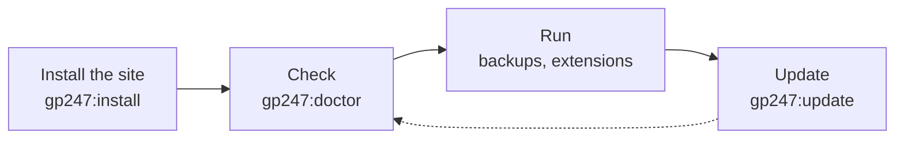

> 🌐 **Language:** [🇻🇳 Tiếng Việt](./cli-introduction_vi.md) · 🇬🇧 English (current) · [🇯🇵 日本語](./cli-introduction_ja.md)

# GP247 command line (CLI)

## Introduction
GP247 ships a set of `php artisan gp247:...` commands to install, update, check, back up and manage extensions without
opening the admin. This page is the **entry point** of the command-line documentation: how to type a command, how to find
the right command for the job, and a table of every command with its safety level. It is for site owners with server access
(VPS, Docker) and for developers. After reading it you know **which command does which job** and which detail page to open.

## At a glance
A GP247 site goes through four stages; each stage has its main command:



- **Three commands are enough to remember** — `gp247:install` (first install), `gp247:update` (after every
  `composer update`) and `gp247:doctor` (health check). The others are for specific jobs.
- **`install` is for a new site, `update` is for a running site** — mixing them up is the easiest way to lose data.
- **Commands that can delete data always ask for confirmation**, and refuse to run in a script unless you add the consent flag.
- **Every command has `--json`** so scripts, CI and Docker can read the result — see [Scripts, CI and Docker](./cli-automation.md).

## On this page
- [How to type a command](#how-to-type-a-command) — where to open the terminal, how to get help
- [Which command do I need](#which-command-do-i-need) — look up by the job you want done
- [Pages in this set](#pages-in-this-set) — which command group each page covers
- [How safe a command is](#how-safe-a-command-is) — what the three icons ✅ ⚠️ 🛑 mean
- [All commands at a glance](#all-commands-at-a-glance) — every `gp247:*` command, by group

## How to type a command
Every command runs in a **terminal** (on Windows: *Command Prompt* or *PowerShell*), in the **root folder of the site** — the
folder that contains a file named `artisan`.

1. Open the terminal and go to the site folder, for example:

   ```bash
   cd /var/www/my-shop
   ```

2. List every GP247 command available on your site:

   ```bash
   php artisan list gp247
   ```

   If it works, you see the commands that start with `gp247:`, each with a one-line description.
3. Show the detailed usage of one command (arguments, flags):

   ```bash
   php artisan gp247:update --help
   ```

General syntax: `php artisan <command> [arguments] [--flags]`. With Docker, put `docker compose exec app` in front of the
command (the service name depends on your `docker-compose.yml`).

> ℹ️ **Info:** hosting without a command line can still run GP247 — most jobs here have a matching button in the admin. The
> commands that only work from the command line are marked on their detail page.

## Which command do I need
Look up the job you want done; the last column leads to the page with full instructions.

| I want to… | Command | Page |
| --- | --- | --- |
| Install a new site | `gp247:install` | [Install & update](./cli-install-update.md) |
| Update after `composer update` | `gp247:update` | [Install & update](./cli-install-update.md) |
| Check the server and the security configuration | `gp247:doctor` | [Checks & diagnostics](./cli-diagnostics.md) |
| Know which version the site runs | `gp247:info` | [Checks & diagnostics](./cli-diagnostics.md) |
| Install, enable, disable, remove a plugin or template | `gp247:ext-install`, `ext-enable`, `ext-disable`, `ext-uninstall` | [Extensions](./cli-extensions.md) |
| Edit one screen of the storefront | `gp247:template-publish` | [Templates](./cli-templates.md) |
| Reset a lost administrator password | `gp247:admin-password` | [Maintenance](./cli-maintenance.md) |
| Create or restore a backup | `gp247:backup-run`, `gp247:backup-restore` | [Maintenance](./cli-maintenance.md) |
| Change the encryption key for secrets | `gp247:encryption-key-rotate` | [Maintenance](./cli-maintenance.md) |
| Run commands in a deploy script, CI, Docker | add `--json` | [Scripts, CI & Docker](./cli-automation.md) |

## Pages in this set
The documentation is split by job; each page makes sense on its own.

| Page | Content |
| --- | --- |
| [Install & update](./cli-install-update.md) | `gp247:install`, `gp247:update` and the install / update / uninstall commands of each package (core, front, shop, mcp) |
| [Extensions](./cli-extensions.md) | The `gp247:ext-*` family: find, install, enable/disable, update, remove plugins and templates; licenses; scaffold a new plugin/template |
| [Templates](./cli-templates.md) | Customise the storefront one file at a time, hand unedited files back to the package, the `vendor:publish` tags |
| [Checks & diagnostics](./cli-diagnostics.md) | `gp247:doctor` and every check it runs, `gp247:info`, `gp247:cache-rebuild` |
| [Maintenance](./cli-maintenance.md) | Reset an administrator password, change the encryption key, backup & restore, clear expired carts |
| [Scripts, CI & Docker](./cli-automation.md) | `--json` output, exit codes, error codes, how to run commands that need confirmation when nobody is at the keyboard |

## How safe a command is
Each command in the table below carries one of three icons. Read the icon before running a command on a live site.

| Icon | Meaning | Example |
| --- | --- | --- |
| ✅ | **Safe** — read only, or only adds what is missing; running it again does no harm | `gp247:doctor`, `gp247:update` |
| ⚠️ | **Deliberate change** — overwrites one thing (translations, published files, a password); the command asks first or only acts when you name the target | `gp247:language-update`, `gp247:admin-password` |
| 🛑 | **Deletes data** — drops tables, deletes files or overwrites data; **back up first**, do not run on a live site unless you are sure | `gp247:shop-sample`, `gp247:shop-uninstall` |

> ⚠️ **Warning:** `gp247:install` is 🛑 on a site **that already has data**, because it recreates the front and shop tables.
> A running site always uses `gp247:update`.

## All commands at a glance
Grouped by job. The "Package" column says which package the site needs for the command to exist; a site without
`gp247/shop` has no `shop-*` commands.

### Install & update
| Command | What it does | Safety | Package |
| --- | --- | --- | --- |
| [`gp247:install`](./cli-install-update.md#gp247install--install-a-new-site) | Full install, detects the packages present | 🛑 on a site with data | core |
| [`gp247:update`](./cli-install-update.md#gp247update--update-a-running-site) | Update after `composer update`, keeps the data | ✅ | core |
| `gp247:core-install` | Install the core part only | 🛑 | core |
| `gp247:core-update` | Update the core part only | ✅ | core |
| `gp247:front-install` | (Re)install the front part | 🛑 | front |
| `gp247:front-update` | Update the front part | ✅ | front |
| `gp247:front-uninstall` | Remove the front part, drop its tables | 🛑 | front |
| `gp247:shop-install` | (Re)install the shop part | 🛑 | shop |
| `gp247:shop-update` | Update the shop part | ✅ | shop |
| `gp247:shop-uninstall` | Remove the shop part, drop its tables | 🛑 | shop |
| `gp247:shop-sample` | Create sample data, deleting the current shop data | 🛑 | shop |
| `gp247:mcp-install` | Create the MCP server settings, menu, permissions | ✅ | mcp |
| `gp247:mcp-update` | Update the MCP data | ✅ | mcp |
| `gp247:mcp-uninstall` | Remove the MCP data, revoke every MCP token | 🛑 | mcp |
| `gp247:language-update` | Reset translations to the package defaults | ⚠️ | core |

Details: [Install & update](./cli-install-update.md).

### Extensions (plugins and templates)
| Command | What it does | Safety |
| --- | --- | --- |
| `gp247:ext-list` | List the extensions on the site, their status, whether an update exists | ✅ |
| `gp247:ext-search` | Search the online extension library | ✅ |
| `gp247:ext-check-update` | Show which extensions have an update | ✅ |
| `gp247:ext-install` | Install from a `.zip` file, a folder or the online library | ✅ |
| `gp247:ext-enable` / `gp247:ext-disable` | Enable / disable an installed extension | ✅ |
| `gp247:ext-update` | Update from the library (with backup, rolls back on error), or `--local` after you replaced the files yourself | ⚠️ |
| `gp247:ext-uninstall` | Remove an extension; by default **deletes its folder too** | 🛑 |
| `gp247:ext-publish` | Copy an extension's CSS/JS/images to `public/` again | ✅ |
| `gp247:ext-register-license` | Register the (free) API License to connect to the library | ✅ |
| `gp247:ext-license` | Set / show / remove the license of a paid extension | ⚠️ |
| `gp247:make-plugin` | Scaffold a new plugin | ✅ |
| `gp247:make-template` | Scaffold a new template | ✅ |

Details: [Extensions](./cli-extensions.md).

### Templates
| Command | What it does | Safety |
| --- | --- | --- |
| `gp247:template-publish` | Copy one template file out so you can edit it | ✅ (⚠️ with `--force`) |
| `gp247:template-prune` | Hand published but unedited files back to the package | ⚠️ |
| `gp247:template-setup` | Apply the default template to the root store | ⚠️ |

Details: [Templates](./cli-templates.md).

### Checks & diagnostics
| Command | What it does | Safety |
| --- | --- | --- |
| `gp247:doctor` | Check the server, the installation and the security configuration | ✅ |
| `gp247:info` | Package versions, install status, number of extensions | ✅ |
| `gp247:core-info` | Core information and version | ✅ |
| `gp247:cache-rebuild` | Rebuild the route and config cache | ✅ |

Details: [Checks & diagnostics](./cli-diagnostics.md).

### Maintenance: accounts, keys, backups, clean-up
| Command | What it does | Safety |
| --- | --- | --- |
| `gp247:admin-password` | Reset the password of an administrator account | ⚠️ |
| `gp247:encryption-key-rotate` | Re-encrypt stored secrets with the new key | ⚠️ |
| `gp247:backup-run` | Create an encrypted backup and verify it | ✅ |
| `gp247:backup-list` | List backups | ✅ |
| `gp247:backup-verify` | Re-check the integrity of a backup | ✅ |
| `gp247:backup-pin` | Pin / unpin a backup | ✅ |
| `gp247:backup-import` | Add a `.gp247bak` file to the list | ✅ |
| `gp247:backup-offsite` | External destination: test, list, copy out, fetch back | ✅ |
| `gp247:backup-export-sql` | Export the data of a backup as an **unencrypted** `.sql` file | ⚠️ |
| `gp247:backup-restore` | Restore data / files from a backup | 🛑 |
| `gp247:backup-delete` | Delete a backup | 🛑 |
| `gp247:shop-clear-cart` | Clear expired carts, wishlists and comparisons | ✅ |

Details: [Maintenance](./cli-maintenance.md).

## Q&A
**Q1: The command says "Could not open input file: artisan". Why?**

→ You are in the wrong folder. Go to the root folder of the site (where the `artisan` file is) and type it again.

**Q2: Typing `gp247:...` says "Command is not defined"?**

→ The command belongs to a package the site has not installed (for example `shop-*` without `gp247/shop`), or the site runs
an older version without that command. Run `php artisan list gp247` to see what exists and `php artisan gp247:info` for the
versions.

**Q3: I only have shared hosting without a terminal. What now?**

→ Use the admin: updates, extensions and backups all have matching buttons. Only **installing** and **resetting the
administrator password** need the command line — see the [Installation guide](../install-upgrade/install.md) for how to do it
on hosting.

**Q4: Which command do I run after `composer update`?**

→ `php artisan gp247:update`. It runs every update step of core, front, shop, mcp and the extensions in the right order,
without deleting data. Full steps: [Updating a site](../install-upgrade/update.md).

**Q5: Can I run `gp247:install` again to repair a broken site?**

→ Not on a site with data: the command recreates the front and shop tables. Run `gp247:doctor` to find the cause, then
`gp247:update` to bring data and files back in line with the version.

**Q6: How do I know whether a command deletes data?**

→ Look at the "Safety" column in [All commands at a glance](#all-commands-at-a-glance). 🛑 commands always ask for
confirmation when run by hand; when in doubt, back up first with `gp247:backup-run`.

**Q7: Which commands can run from cron?**

→ The ✅ commands that ask nothing, such as `gp247:shop-clear-cart` or `gp247:backup-run --scheduled`. Usually you need just
**one** cron line running `schedule:run` — see [Schedule and queue](../system/schedule-and-queue.md).

**Q8: The output is too long. Is there a tidier way to read it?**

→ Add `--json` to get a single JSON block, then filter it with a tool such as `jq`. See [Scripts, CI & Docker](./cli-automation.md).

---

<sub>📅 **Last updated:** 2026-11-08 · ✍️ **Author:** GP247</sub>
