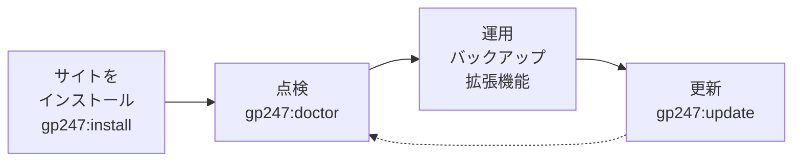

> 🌐 **言語:** [🇻🇳 Tiếng Việt](./cli-introduction_vi.md) · [🇬🇧 English](./cli-introduction.md) · 🇯🇵 日本語（現在）

# GP247 のコマンドライン（CLI）

## はじめに
GP247 には、管理画面を開かずにインストール、更新、点検、バックアップ、拡張機能の管理を行うための
`php artisan gp247:...` コマンドが用意されています。このページはコマンドラインのドキュメントの**入口**です。コマンドの
入力方法、目的に合ったコマンドの探し方、そして安全度つきの全コマンド一覧を掲載しています。対象は、サーバーにアクセス
できるサイトオーナー（VPS、Docker）と開発者です。読み終えると、**どの作業にどのコマンドを使うか**が分かり、詳しい
ページを開けるようになります。

## ひと目でわかる
GP247 のサイトは 4 つの段階を通ります。段階ごとに主なコマンドがあります。



- **覚えるのは 3 つのコマンドだけ** — `gp247:install`（最初のインストール）、`gp247:update`（`composer update` の
  たびに）、`gp247:doctor`（健全性の点検）です。ほかのコマンドは特定の作業のときに使います。
- **`install` は新しいサイト用、`update` は稼働中のサイト用です** — この 2 つを取り違えるのが、データを失う一番の原因です。
- **データを削除しうるコマンドは必ず確認を求め**、同意フラグを付けない限りスクリプトでは実行を拒否します。
- **すべてのコマンドに `--json` があります** — スクリプト、CI、Docker が結果を読めます。
  [スクリプト・CI・Docker での利用](./cli-automation_ja.md)を参照してください。

## このページの内容
- [コマンドの入力方法](#コマンドの入力方法) — ターミナルを開く場所、ヘルプの見方
- [やりたいこと別のコマンド](#やりたいこと別のコマンド) — 作業から探す
- [このドキュメント群のページ](#このドキュメント群のページ) — 各ページが扱うコマンドのグループ
- [コマンドの安全度](#コマンドの安全度) — ✅ ⚠️ 🛑 の 3 つのアイコンの意味
- [全コマンド一覧](#全コマンド一覧) — すべての `gp247:*` コマンド（グループ別）

## コマンドの入力方法
すべてのコマンドは**ターミナル**（Windows では *コマンドプロンプト* または *PowerShell*）で、**サイトのルートフォルダー**
— `artisan` という名前のファイルがあるフォルダー — で実行します。

1. ターミナルを開き、サイトのフォルダーへ移動します。例：

   ```bash
   cd /var/www/my-shop
   ```

2. サイトで使える GP247 コマンドをすべて表示します。

   ```bash
   php artisan list gp247
   ```

   成功すると、`gp247:` で始まるコマンドが 1 行の説明つきで一覧表示されます。
3. 1 つのコマンドの詳しい使い方（引数、フラグ）を表示します。

   ```bash
   php artisan gp247:update --help
   ```

基本の書式は `php artisan <コマンド名> [引数] [--フラグ]` です。Docker の場合は、コマンドの前に
`docker compose exec app` を付けます（サービス名は `docker-compose.yml` によって異なります）。

> ℹ️ **情報:** コマンドラインのないホスティングでも GP247 は使えます。ここで扱う作業のほとんどは、管理画面に対応する
> ボタンがあります。コマンドラインでしかできない作業は、詳しいページに明記しています。

## やりたいこと別のコマンド
やりたい作業から探してください。最後の列が手順の載ったページです。

| やりたいこと | コマンド | ページ |
| --- | --- | --- |
| 新しいサイトをインストールする | `gp247:install` | [インストールと更新](./cli-install-update_ja.md) |
| `composer update` の後に更新する | `gp247:update` | [インストールと更新](./cli-install-update_ja.md) |
| サーバーとセキュリティ設定を点検する | `gp247:doctor` | [点検と診断](./cli-diagnostics_ja.md) |
| サイトのバージョンを知る | `gp247:info` | [点検と診断](./cli-diagnostics_ja.md) |
| プラグイン・テンプレートのインストール、有効化、無効化、削除 | `gp247:ext-install`、`ext-enable`、`ext-disable`、`ext-uninstall` | [拡張機能](./cli-extensions_ja.md) |
| ストアフロントの 1 画面を編集する | `gp247:template-publish` | [テンプレート](./cli-templates_ja.md) |
| 失った管理者パスワードを再設定する | `gp247:admin-password` | [メンテナンス](./cli-maintenance_ja.md) |
| バックアップを作成・復元する | `gp247:backup-run`、`gp247:backup-restore` | [メンテナンス](./cli-maintenance_ja.md) |
| 機密情報の暗号鍵を変更する | `gp247:encryption-key-rotate` | [メンテナンス](./cli-maintenance_ja.md) |
| デプロイスクリプト、CI、Docker で実行する | `--json` を付ける | [スクリプト・CI・Docker](./cli-automation_ja.md) |

## このドキュメント群のページ
作業ごとにページを分けています。どのページも単独で読めます。

| ページ | 内容 |
| --- | --- |
| [インストールと更新](./cli-install-update_ja.md) | `gp247:install`、`gp247:update`、各パッケージ（core、front、shop、mcp）のインストール／更新／アンインストール |
| [拡張機能](./cli-extensions_ja.md) | `gp247:ext-*` 系：プラグイン・テンプレートの検索、インストール、有効化／無効化、更新、削除、ライセンス、新しいプラグイン・テンプレートのひな形作成 |
| [テンプレート](./cli-templates_ja.md) | ストアフロントをファイル単位でカスタマイズ、未編集ファイルをパッケージに戻す、`vendor:publish` のタグ |
| [点検と診断](./cli-diagnostics_ja.md) | `gp247:doctor` とその各チェック、`gp247:info`、`gp247:cache-rebuild` |
| [メンテナンス](./cli-maintenance_ja.md) | 管理者パスワードの再設定、暗号鍵の変更、バックアップと復元、期限切れカートの削除 |
| [スクリプト・CI・Docker](./cli-automation_ja.md) | `--json` の出力、終了コード、エラーコード、誰もいないときに確認が必要なコマンドを実行する方法 |

## コマンドの安全度
下の一覧の各コマンドには、3 つのアイコンのどれかが付いています。本番サイトで実行する前にアイコンを確認してください。

| アイコン | 意味 | 例 |
| --- | --- | --- |
| ✅ | **安全** — 読み取りのみ、または足りないものを追加するだけ。何度実行しても問題ありません | `gp247:doctor`、`gp247:update` |
| ⚠️ | **意図した変更** — 一部を上書きします（翻訳、公開済みファイル、パスワード）。確認を求めるか、対象を明示したときだけ実行します | `gp247:language-update`、`gp247:admin-password` |
| 🛑 | **データを削除** — テーブル削除、ファイル削除、データの上書き。**先にバックアップ**し、確信がない限り本番サイトでは実行しないでください | `gp247:shop-sample`、`gp247:shop-uninstall` |

> ⚠️ **注意:** **すでにデータがある**サイトでは `gp247:install` は 🛑 です。front と shop のテーブルを作り直すためです。
> 稼働中のサイトでは必ず `gp247:update` を使います。

## 全コマンド一覧
作業ごとにまとめています。「パッケージ」列は、そのコマンドが使えるために必要なパッケージです。`gp247/shop` のない
サイトには `shop-*` コマンドはありません。

### インストールと更新
| コマンド | 内容 | 安全度 | パッケージ |
| --- | --- | --- | --- |
| [`gp247:install`](./cli-install-update_ja.md#gp247install--新しいサイトをインストール) | 一括インストール。存在するパッケージを自動検出 | データのあるサイトでは 🛑 | core |
| [`gp247:update`](./cli-install-update_ja.md#gp247update--稼働中のサイトを更新) | `composer update` 後の更新。データはそのまま | ✅ | core |
| `gp247:core-install` | core 部分だけをインストール | 🛑 | core |
| `gp247:core-update` | core 部分だけを更新 | ✅ | core |
| `gp247:front-install` | front 部分を（再）インストール | 🛑 | front |
| `gp247:front-update` | front 部分を更新 | ✅ | front |
| `gp247:front-uninstall` | front 部分を削除し、テーブルを削除 | 🛑 | front |
| `gp247:shop-install` | shop 部分を（再）インストール | 🛑 | shop |
| `gp247:shop-update` | shop 部分を更新 | ✅ | shop |
| `gp247:shop-uninstall` | shop 部分を削除し、テーブルを削除 | 🛑 | shop |
| `gp247:shop-sample` | サンプルデータを作成（現在の shop データは削除） | 🛑 | shop |
| `gp247:mcp-install` | MCP サーバーの設定、メニュー、権限を作成 | ✅ | mcp |
| `gp247:mcp-update` | MCP のデータを更新 | ✅ | mcp |
| `gp247:mcp-uninstall` | MCP のデータを削除し、すべての MCP トークンを無効化 | 🛑 | mcp |
| `gp247:language-update` | 翻訳をパッケージの既定値に戻す | ⚠️ | core |

詳しくは [インストールと更新](./cli-install-update_ja.md) を参照してください。

### 拡張機能（プラグインとテンプレート）
| コマンド | 内容 | 安全度 |
| --- | --- | --- |
| `gp247:ext-list` | サイトの拡張機能、状態、更新の有無を一覧表示 | ✅ |
| `gp247:ext-search` | オンラインの拡張機能ライブラリを検索 | ✅ |
| `gp247:ext-check-update` | 更新のある拡張機能を表示 | ✅ |
| `gp247:ext-install` | `.zip` ファイル、フォルダー、オンラインライブラリからインストール | ✅ |
| `gp247:ext-enable` / `gp247:ext-disable` | インストール済みの拡張機能を有効化／無効化 | ✅ |
| `gp247:ext-update` | ライブラリから更新（バックアップあり、失敗時は自動で元に戻す）、または自分でファイルを入れ替えた後の `--local` | ⚠️ |
| `gp247:ext-uninstall` | 拡張機能を削除。既定では**フォルダーも削除** | 🛑 |
| `gp247:ext-publish` | 拡張機能の CSS／JS／画像を `public/` に再コピー | ✅ |
| `gp247:ext-register-license` | ライブラリに接続するための API ライセンス（無料）を登録 | ✅ |
| `gp247:ext-license` | 有料拡張機能のライセンスを設定／表示／削除 | ⚠️ |
| `gp247:make-plugin` | 新しいプラグインのひな形を作成 | ✅ |
| `gp247:make-template` | 新しいテンプレートのひな形を作成 | ✅ |

詳しくは [拡張機能](./cli-extensions_ja.md) を参照してください。

### テンプレート
| コマンド | 内容 | 安全度 |
| --- | --- | --- |
| `gp247:template-publish` | テンプレートのファイルを 1 つ取り出して編集できるようにする | ✅（`--force` 付きは ⚠️） |
| `gp247:template-prune` | 公開したが編集していないファイルをパッケージに戻す | ⚠️ |
| `gp247:template-setup` | 既定のテンプレートをルートストアに適用 | ⚠️ |

詳しくは [テンプレート](./cli-templates_ja.md) を参照してください。

### 点検と診断
| コマンド | 内容 | 安全度 |
| --- | --- | --- |
| `gp247:doctor` | サーバー、インストール状態、セキュリティ設定を点検 | ✅ |
| `gp247:info` | パッケージのバージョン、インストール状態、拡張機能の数 | ✅ |
| `gp247:core-info` | core の情報とバージョン | ✅ |
| `gp247:cache-rebuild` | ルートと設定のキャッシュを再構築 | ✅ |

詳しくは [点検と診断](./cli-diagnostics_ja.md) を参照してください。

### メンテナンス：アカウント、鍵、バックアップ、整理
| コマンド | 内容 | 安全度 |
| --- | --- | --- |
| `gp247:admin-password` | 管理者アカウントのパスワードを再設定 | ⚠️ |
| `gp247:encryption-key-rotate` | 保存済みの機密情報を新しい鍵で暗号化し直す | ⚠️ |
| `gp247:backup-run` | 暗号化したバックアップを作成し、検証 | ✅ |
| `gp247:backup-list` | バックアップを一覧表示 | ✅ |
| `gp247:backup-verify` | バックアップの完全性を再検証 | ✅ |
| `gp247:backup-pin` | バックアップを固定／固定解除 | ✅ |
| `gp247:backup-import` | `.gp247bak` ファイルを一覧に追加 | ✅ |
| `gp247:backup-offsite` | 外部の保存先：接続確認、一覧、コピー、取り戻し | ✅ |
| `gp247:backup-export-sql` | バックアップのデータを**暗号化されていない** `.sql` ファイルに書き出す | ⚠️ |
| `gp247:backup-restore` | バックアップからデータ／ファイルを復元 | 🛑 |
| `gp247:backup-delete` | バックアップを削除 | 🛑 |
| `gp247:shop-clear-cart` | 期限切れのカート、お気に入り、比較リストを削除 | ✅ |

詳しくは [メンテナンス](./cli-maintenance_ja.md) を参照してください。

## よくある質問（Q&A）
**Q1: 「Could not open input file: artisan」と表示されるのはなぜですか？**

→ フォルダーが違います。サイトのルートフォルダー（`artisan` ファイルがある場所）に移動して、もう一度入力してください。

**Q2: `gp247:...` を入力すると「Command is not defined」と表示されます。**

→ そのコマンドは、サイトにインストールされていないパッケージのものです（例：`gp247/shop` がないのに `shop-*`）。または、
そのコマンドがない古いバージョンです。`php artisan list gp247` で使えるコマンドを、`php artisan gp247:info` でバージョンを
確認してください。

**Q3: ターミナルのない共有ホスティングしかありません。**

→ 管理画面を使ってください。更新、拡張機能、バックアップには対応するボタンがあります。**インストール**と**管理者パスワードの
再設定**だけはコマンドラインが必要です。ホスティングでの方法は [インストールガイド](../install-upgrade/install_ja.md) を
参照してください。

**Q4: `composer update` の後はどのコマンドを実行しますか？**

→ `php artisan gp247:update` です。core、front、shop、mcp、拡張機能の更新手順をすべて正しい順序で実行し、データは削除しません。
詳しい手順は [サイトの更新](../install-upgrade/update_ja.md) を参照してください。

**Q5: 壊れたサイトを直すために `gp247:install` をもう一度実行してもよいですか？**

→ データのあるサイトでは避けてください。front と shop のテーブルを作り直します。`gp247:doctor` で原因を探し、
`gp247:update` でデータとファイルをバージョンに合わせてください。

**Q6: コマンドがデータを削除するかどうかは、どう見分けますか？**

→ [全コマンド一覧](#全コマンド一覧) の「安全度」列を見てください。🛑 のコマンドは手動で実行すると必ず確認を求めます。迷ったら、
先に `gp247:backup-run` でバックアップしてください。

**Q7: cron で実行できるコマンドはどれですか？**

→ 何も聞いてこない ✅ のコマンドです（例：`gp247:shop-clear-cart`、`gp247:backup-run --scheduled`）。通常は、`schedule:run`
を実行する cron の行が **1 行**あれば十分です。[スケジュールとキュー](../system/schedule-and-queue_ja.md) を参照してください。

**Q8: 出力が長すぎます。もっと読みやすくする方法はありますか？**

→ `--json` を付けると JSON のブロックが 1 つだけ出力されるので、`jq` などのツールで絞り込めます。
[スクリプト・CI・Docker](./cli-automation_ja.md) を参照してください。

---

<sub>📅 **最終更新:** 2026-11-08 · ✍️ **作成者 (Author):** GP247</sub>
