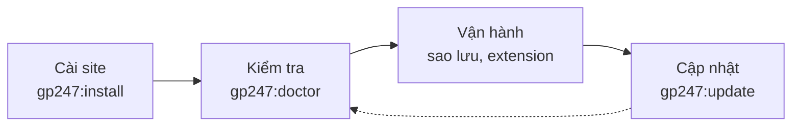

> 🌐 **Ngôn ngữ:** 🇻🇳 Tiếng Việt (hiện tại) · [🇬🇧 English](./cli-introduction.md) · [🇯🇵 日本語](./cli-introduction_ja.md)

# Dòng lệnh GP247 (CLI)

## Giới thiệu
GP247 có sẵn một bộ lệnh `php artisan gp247:...` để cài đặt, cập nhật, kiểm tra, sao lưu và quản lý extension
mà không cần mở trang quản trị. Trang này là **điểm vào** của bộ tài liệu dòng lệnh: cách gõ lệnh, cách tìm đúng
lệnh cho việc bạn cần, và bảng tra toàn bộ lệnh kèm mức độ an toàn. Tài liệu dành cho chủ site có quyền vào máy chủ
(VPS, Docker) và lập trình viên. Đọc xong, bạn biết **việc nào dùng lệnh nào** và mở đúng trang chi tiết.

## Nhìn nhanh
Một site GP247 đi qua bốn chặng; mỗi chặng có lệnh chính của nó:



- **Chỉ cần nhớ ba lệnh** — `gp247:install` (cài lần đầu), `gp247:update` (sau mỗi `composer update`) và
  `gp247:doctor` (kiểm tra sức khoẻ). Các lệnh còn lại dùng khi cần một việc cụ thể.
- **`install` dành cho site mới, `update` dành cho site đang chạy** — nhầm hai lệnh này là cách dễ mất dữ liệu nhất.
- **Lệnh có thể xoá dữ liệu luôn hỏi xác nhận**, và từ chối chạy trong script nếu bạn không thêm cờ đồng ý.
- **Mọi lệnh có `--json`** để script, CI và Docker đọc kết quả — xem [Dùng lệnh trong script, CI và Docker](./cli-automation_vi.md).

## Trong trang này
- [Cách gõ một lệnh](#cách-gõ-một-lệnh) — mở Terminal ở đâu, xem trợ giúp thế nào
- [Tôi muốn làm việc này thì dùng lệnh nào](#tôi-muốn-làm-việc-này-thì-dùng-lệnh-nào) — tra theo việc cần làm
- [Các trang của bộ tài liệu](#các-trang-của-bộ-tài-liệu) — mỗi trang nói về nhóm lệnh nào
- [Mức an toàn của lệnh](#mức-an-toàn-của-lệnh) — ý nghĩa ba biểu tượng ✅ ⚠️ 🛑
- [Bảng tra toàn bộ lệnh](#bảng-tra-toàn-bộ-lệnh) — mọi lệnh `gp247:*`, theo nhóm

## Cách gõ một lệnh
Mọi lệnh đều chạy trong **Terminal** (trên Windows là *Command Prompt* hoặc *PowerShell*), tại **thư mục gốc của
site** — thư mục có file tên `artisan`.

1. Mở Terminal và chuyển vào thư mục site, ví dụ:

   ```bash
   cd /var/www/my-shop
   ```

2. Xem toàn bộ lệnh GP247 đang có trên site của bạn:

   ```bash
   php artisan list gp247
   ```

   Nếu thành công, màn hình liệt kê các lệnh bắt đầu bằng `gp247:` kèm một dòng mô tả.
3. Xem cách dùng chi tiết của một lệnh (tham số, cờ):

   ```bash
   php artisan gp247:update --help
   ```

Cú pháp chung: `php artisan <tên-lệnh> [tham số] [--cờ]`. Với Docker, đặt `docker compose exec app` trước lệnh
(tên dịch vụ tuỳ file `docker-compose.yml` của bạn).

> ℹ️ **Thông tin:** hosting không có dòng lệnh vẫn dùng được GP247 — hầu hết việc ở đây đều có nút tương ứng trong trang
> quản trị. Những lệnh chỉ chạy được bằng dòng lệnh được ghi rõ ở trang chi tiết.

## Tôi muốn làm việc này thì dùng lệnh nào
Tra theo việc cần làm; cột cuối dẫn tới trang có hướng dẫn đầy đủ.

| Tôi muốn… | Lệnh | Trang |
| --- | --- | --- |
| Cài một site mới | `gp247:install` | [Cài đặt & cập nhật](./cli-install-update_vi.md) |
| Cập nhật sau `composer update` | `gp247:update` | [Cài đặt & cập nhật](./cli-install-update_vi.md) |
| Kiểm tra máy chủ và cấu hình bảo mật | `gp247:doctor` | [Kiểm tra & chẩn đoán](./cli-diagnostics_vi.md) |
| Biết site đang chạy phiên bản nào | `gp247:info` | [Kiểm tra & chẩn đoán](./cli-diagnostics_vi.md) |
| Cài, bật, tắt, gỡ plugin hoặc template | `gp247:ext-install`, `ext-enable`, `ext-disable`, `ext-uninstall` | [Extension](./cli-extensions_vi.md) |
| Sửa một màn hình của giao diện storefront | `gp247:template-publish` | [Template](./cli-templates_vi.md) |
| Đặt lại mật khẩu quản trị bị mất | `gp247:admin-password` | [Bảo trì](./cli-maintenance_vi.md) |
| Tạo hoặc phục hồi bản sao lưu | `gp247:backup-run`, `gp247:backup-restore` | [Bảo trì](./cli-maintenance_vi.md) |
| Đổi khoá mã hoá bí mật | `gp247:encryption-key-rotate` | [Bảo trì](./cli-maintenance_vi.md) |
| Chạy lệnh trong script deploy, CI, Docker | thêm `--json` | [Script, CI & Docker](./cli-automation_vi.md) |

## Các trang của bộ tài liệu
Bộ tài liệu chia theo nhóm việc; mỗi trang đọc riêng vẫn hiểu.

| Trang | Nội dung |
| --- | --- |
| [Cài đặt & cập nhật](./cli-install-update_vi.md) | `gp247:install`, `gp247:update` và các lệnh cài / cập nhật / gỡ của từng package (core, front, shop, mcp) |
| [Extension](./cli-extensions_vi.md) | Họ lệnh `gp247:ext-*`: tìm, cài, bật/tắt, cập nhật, gỡ plugin và template; license; tạo khung plugin/template mới |
| [Template](./cli-templates_vi.md) | Tuỳ biến giao diện storefront theo từng file, trả file chưa sửa về cho package, các tag `vendor:publish` |
| [Kiểm tra & chẩn đoán](./cli-diagnostics_vi.md) | `gp247:doctor` và từng mục nó kiểm, `gp247:info`, `gp247:cache-rebuild` |
| [Bảo trì](./cli-maintenance_vi.md) | Đặt lại mật khẩu quản trị, đổi khoá mã hoá, sao lưu & phục hồi, dọn giỏ hàng hết hạn |
| [Script, CI & Docker](./cli-automation_vi.md) | Kết quả `--json`, mã thoát, mã lỗi, cách chạy lệnh cần xác nhận khi không có người ngồi trước màn hình |

## Mức an toàn của lệnh
Mỗi lệnh trong bảng tra bên dưới mang một trong ba biểu tượng. Đọc biểu tượng trước khi chạy lệnh trên site thật.

| Biểu tượng | Nghĩa | Ví dụ |
| --- | --- | --- |
| ✅ | **An toàn** — chỉ đọc, hoặc chỉ thêm phần còn thiếu; chạy lại nhiều lần không sao | `gp247:doctor`, `gp247:update` |
| ⚠️ | **Thay đổi có chủ đích** — ghi đè một phần (chuỗi ngôn ngữ, file đã publish, mật khẩu); lệnh hỏi xác nhận hoặc chỉ làm khi bạn gõ đích danh | `gp247:language-update`, `gp247:admin-password` |
| 🛑 | **Xoá dữ liệu** — xoá bảng, xoá file hoặc ghi đè dữ liệu; **sao lưu trước**, không chạy trên site thật trừ khi bạn chắc chắn | `gp247:shop-sample`, `gp247:shop-uninstall` |

> ⚠️ **Lưu ý:** `gp247:install` là 🛑 trên một site **đã có dữ liệu** vì nó tạo lại bảng của front và shop. Site đang
> chạy luôn dùng `gp247:update`.

## Bảng tra toàn bộ lệnh
Bảng gom theo nhóm việc. Cột "Package" cho biết lệnh có mặt khi site cài package nào; site không cài `gp247/shop` sẽ
không có nhóm lệnh `shop-*`.

### Cài đặt & cập nhật
| Lệnh | Làm gì | An toàn | Package |
| --- | --- | --- | --- |
| [`gp247:install`](./cli-install-update_vi.md#gp247install--cài-site-mới) | Cài trọn bộ, tự nhận các package có mặt | 🛑 trên site có dữ liệu | core |
| [`gp247:update`](./cli-install-update_vi.md#gp247update--cập-nhật-site-đang-chạy) | Cập nhật sau `composer update`, giữ nguyên dữ liệu | ✅ | core |
| `gp247:core-install` | Cài riêng phần core | 🛑 | core |
| `gp247:core-update` | Cập nhật riêng phần core | ✅ | core |
| `gp247:front-install` | Cài (lại) phần giao diện | 🛑 | front |
| `gp247:front-update` | Cập nhật phần giao diện | ✅ | front |
| `gp247:front-uninstall` | Gỡ phần giao diện, xoá bảng | 🛑 | front |
| `gp247:shop-install` | Cài (lại) phần bán hàng | 🛑 | shop |
| `gp247:shop-update` | Cập nhật phần bán hàng | ✅ | shop |
| `gp247:shop-uninstall` | Gỡ phần bán hàng, xoá bảng | 🛑 | shop |
| `gp247:shop-sample` | Tạo dữ liệu mẫu, xoá dữ liệu shop đang có | 🛑 | shop |
| `gp247:mcp-install` | Tạo cấu hình, menu, quyền của MCP server | ✅ | mcp |
| `gp247:mcp-update` | Cập nhật dữ liệu MCP | ✅ | mcp |
| `gp247:mcp-uninstall` | Gỡ dữ liệu MCP, thu hồi mọi token MCP | 🛑 | mcp |
| `gp247:language-update` | Đưa chuỗi ngôn ngữ về bản mặc định của package | ⚠️ | core |

Chi tiết từng lệnh: [Cài đặt & cập nhật](./cli-install-update_vi.md).

### Extension (plugin và template)
| Lệnh | Làm gì | An toàn |
| --- | --- | --- |
| `gp247:ext-list` | Liệt kê extension trên site, trạng thái, có bản mới không | ✅ |
| `gp247:ext-search` | Tìm trong thư viện extension online | ✅ |
| `gp247:ext-check-update` | Xem extension nào có bản cập nhật | ✅ |
| `gp247:ext-install` | Cài từ file `.zip`, thư mục hoặc thư viện online | ✅ |
| `gp247:ext-enable` / `gp247:ext-disable` | Bật / tắt extension đã cài | ✅ |
| `gp247:ext-update` | Cập nhật từ thư viện (có sao lưu, tự hoàn tác khi lỗi), hoặc `--local` sau khi bạn tự thay file | ⚠️ |
| `gp247:ext-uninstall` | Gỡ extension; mặc định **xoá cả thư mục** | 🛑 |
| `gp247:ext-publish` | Chép lại CSS/JS/ảnh của extension ra `public/` | ✅ |
| `gp247:ext-register-license` | Đăng ký API License (miễn phí) để kết nối thư viện | ✅ |
| `gp247:ext-license` | Đặt / xem / xoá license của extension trả phí | ⚠️ |
| `gp247:make-plugin` | Tạo khung một plugin mới | ✅ |
| `gp247:make-template` | Tạo khung một template mới | ✅ |

Chi tiết: [Extension](./cli-extensions_vi.md).

### Template
| Lệnh | Làm gì | An toàn |
| --- | --- | --- |
| `gp247:template-publish` | Lấy một file template ra để sửa | ✅ (`--force` thì ⚠️) |
| `gp247:template-prune` | Trả các file đã publish mà chưa sửa về cho package | ⚠️ |
| `gp247:template-setup` | Áp template mặc định cho cửa hàng gốc | ⚠️ |

Chi tiết: [Template](./cli-templates_vi.md).

### Kiểm tra & chẩn đoán
| Lệnh | Làm gì | An toàn |
| --- | --- | --- |
| `gp247:doctor` | Kiểm tra máy chủ, cài đặt và cấu hình bảo mật | ✅ |
| `gp247:info` | Phiên bản các package, trạng thái cài đặt, số extension | ✅ |
| `gp247:core-info` | Thông tin và phiên bản core | ✅ |
| `gp247:cache-rebuild` | Dựng lại cache route và cấu hình | ✅ |

Chi tiết: [Kiểm tra & chẩn đoán](./cli-diagnostics_vi.md).

### Bảo trì: tài khoản, khoá, sao lưu, dọn dẹp
| Lệnh | Làm gì | An toàn |
| --- | --- | --- |
| `gp247:admin-password` | Đặt lại mật khẩu một tài khoản quản trị | ⚠️ |
| `gp247:encryption-key-rotate` | Mã hoá lại bí mật đã lưu bằng khoá mới | ⚠️ |
| `gp247:backup-run` | Tạo bản sao lưu đã mã hoá rồi tự kiểm | ✅ |
| `gp247:backup-list` | Liệt kê bản sao lưu | ✅ |
| `gp247:backup-verify` | Kiểm lại toàn vẹn một bản | ✅ |
| `gp247:backup-pin` | Ghim / bỏ ghim một bản | ✅ |
| `gp247:backup-import` | Đưa file `.gp247bak` vào danh sách | ✅ |
| `gp247:backup-offsite` | Đích ngoài: kiểm kết nối, liệt kê, chép ra, kéo về | ✅ |
| `gp247:backup-export-sql` | Xuất dữ liệu một bản thành file `.sql` **không mã hoá** | ⚠️ |
| `gp247:backup-restore` | Phục hồi dữ liệu / file từ một bản | 🛑 |
| `gp247:backup-delete` | Xoá một bản sao lưu | 🛑 |
| `gp247:shop-clear-cart` | Dọn giỏ hàng, yêu thích, so sánh đã hết hạn | ✅ |

Chi tiết: [Bảo trì](./cli-maintenance_vi.md).

## Hỏi & Đáp (Q&A)
**Câu 1: Gõ lệnh báo "Could not open input file: artisan" là sao?**

→ Bạn đang đứng sai thư mục. Chuyển vào thư mục gốc của site (nơi có file `artisan`) rồi gõ lại.

**Câu 2: Gõ `gp247:...` báo "Command is not defined"?**

→ Lệnh đó thuộc một package site chưa cài (ví dụ `shop-*` khi không có `gp247/shop`), hoặc site đang ở phiên bản cũ
chưa có lệnh. Chạy `php artisan list gp247` để xem lệnh nào đang có và `php artisan gp247:info` để xem phiên bản.

**Câu 3: Tôi chỉ có hosting chia sẻ, không có Terminal thì sao?**

→ Dùng trang quản trị: cập nhật, extension, sao lưu đều có nút tương ứng. Riêng việc **cài đặt** và **đặt lại mật khẩu
quản trị** cần dòng lệnh — xem [Hướng dẫn cài đặt](../install-upgrade/install_vi.md) cho cách làm trên hosting.

**Câu 4: Sau `composer update` tôi chạy lệnh nào?**

→ `php artisan gp247:update`. Lệnh này gọi đúng thứ tự mọi bước cập nhật của core, front, shop, mcp và extension,
không xoá dữ liệu. Các bước đầy đủ: [Cập nhật site](../install-upgrade/update_vi.md).

**Câu 5: Có thể chạy lại `gp247:install` để sửa site bị lỗi không?**

→ Không nên trên site có dữ liệu: lệnh tạo lại bảng của front và shop. Chạy `gp247:doctor` để tìm nguyên nhân, rồi
`gp247:update` để đưa dữ liệu và file về đúng phiên bản.

**Câu 6: Làm sao biết một lệnh có xoá dữ liệu không?**

→ Xem cột "An toàn" ở [Bảng tra toàn bộ lệnh](#bảng-tra-toàn-bộ-lệnh). Lệnh 🛑 luôn hỏi xác nhận khi chạy tay; khi
không chắc, sao lưu trước bằng `gp247:backup-run`.

**Câu 7: Lệnh nào dùng được trong cron?**

→ Các lệnh ✅ không hỏi gì, ví dụ `gp247:shop-clear-cart` hay `gp247:backup-run --scheduled`. Thường bạn chỉ cần **một**
dòng cron chạy `schedule:run` — xem [Lịch chạy và hàng đợi](../system/schedule-and-queue_vi.md).

**Câu 8: Kết quả lệnh dài quá, có cách nào đọc gọn hơn?**

→ Thêm `--json` để nhận một khối JSON duy nhất, rồi lọc bằng công cụ như `jq`. Xem [Script, CI & Docker](./cli-automation_vi.md).

---

<sub>📅 **Cập nhật lần cuối:** 2026-11-08 · ✍️ **Tác giả (Author):** GP247</sub>
