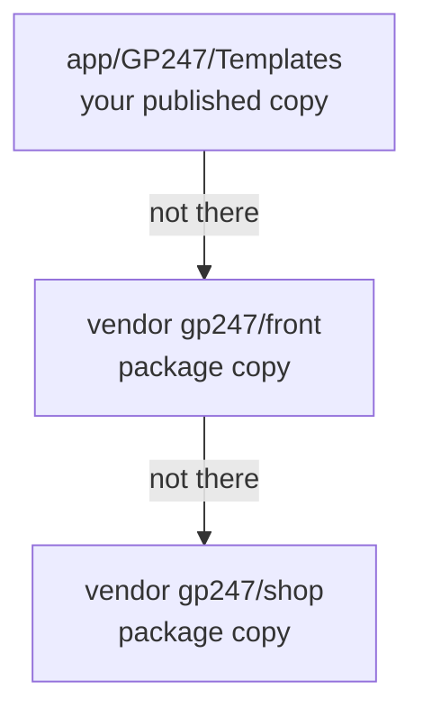

> 🌐 **Language:** [🇻🇳 Tiếng Việt](./cli-templates_vi.md) · 🇬🇧 English (current) · [🇯🇵 日本語](./cli-templates_ja.md)

# Storefront customisation (template) commands

## Introduction
This page explains how to change the storefront from the command line and still receive the packages' fixes when you update:
take out only the file you need to edit (`gp247:template-publish`), hand unedited files back to the package
(`gp247:template-prune`), and apply the default template to the store (`gp247:template-setup`). It is for developers and
people who work on the look of the site. After reading it you know why you **should not copy the whole template tree**, and
how to customise one screen safely. Writing a brand-new template: see [Create a template](../extension/create-template.md).

## At a glance
When the storefront needs a view file, GP247 looks in this order and uses **the first one that exists**:



- **A file in `app/` wins** — it is the copy you took out to edit.
- **A file that is not in `app/` is read straight from the package**, so `composer update` fixes it immediately.
- **Once a file is published, the package can no longer fix it** — even if you changed nothing. So publish only the files you edit.
- **Your own template** (a name other than `GP247Front`) is never overwritten and never falls back to GP247Front files.

## On this page
- [Edit one screen: `gp247:template-publish`](#edit-one-screen-gp247template-publish) — take a file out to edit
- [Hand back unedited files: `gp247:template-prune`](#hand-back-unedited-files-gp247template-prune) — for sites installed from older versions
- [Apply the default template: `gp247:template-setup`](#apply-the-default-template-gp247template-setup) — when the install step failed
- [The `vendor:publish` tags](#the-vendorpublish-tags) — Laravel commands often used alongside

## Edit one screen: `gp247:template-publish`
The command copies template files **from the package that ships them** into `app/GP247/Templates/<Name>/` so you can edit
them. The other files are still read from the package and still receive fixes.

| Argument / option | Value | Meaning |
| --- | --- | --- |
| `<template>` | e.g. `GP247Front` | Template name (case-sensitive) |
| `--file=` | relative path | Take out exactly one file, e.g. `screen/home.blade.php` |
| `--all` | flag | Take out every file the packages provide for this template |
| `--force` | flag | Overwrite a file already in `app/` (default: **keep** your copy) |

1. Find the path of the file you want to edit (from the template root); the home page, for example, is `screen/home.blade.php`.
2. Take the file out:

   ```bash
   php artisan gp247:template-publish GP247Front --file=screen/home.blade.php
   ```

   If it works, the file appears at `app/GP247/Templates/GP247Front/screen/home.blade.php`.
3. Edit that file. The storefront uses your copy on the next page load.

> 💡 **Tip:** files prefixed `shop_` (like `screen/shop_cart.blade.php`) and the folders `account/`, `auth/`, `email/`,
> `livewire/`, `partials/` come from `gp247/shop`; everything else comes from `gp247/front`. The command knows which
> package to copy from.

- **A wrong path** → error `template_file_not_found` with suggestions of similarly named files.
- **A file already in `app/`** → kept and reported as skipped; to get the package original back, add `--force`.
- **`--all`** amounts to copying the whole tree — those files will stop receiving fixes. Only use it when you really intend to
  rewrite most of the look.

## Hand back unedited files: `gp247:template-prune`
Sites installed before templates were read straight from the packages hold a **full copy** in
`app/GP247/Templates/<Name>/` — that copy hides the package version forever. `template-prune` deletes the files that are
**byte-for-byte identical** to the package copy so they are read from the package again.

| Argument / option | Meaning |
| --- | --- |
| `<template>` | Template name, e.g. `GP247Front` |
| `--dry-run` | Only list what would be deleted and kept — touches nothing on disk |

1. Preview:

   ```bash
   php artisan gp247:template-prune GP247Front --dry-run
   ```

2. Read the list: "would delete" are files identical to the package; "kept — edited" and "kept — not in a package" are yours.
3. Run it for real; the command asks `Delete N unmodified file(s)?` (default **no**):

   ```bash
   php artisan gp247:template-prune GP247Front
   ```

4. Check: `php artisan gp247:doctor` — the `template_source` check reports that templates are served from their package.

The command **never deletes**:
- **Files you edited** — compared by content (hash), not by name or modification date.
- **Files no package provides** — blocks added by plugins, files you wrote yourself.
- **The template's extension shell** — `AppConfig.php`, `Provider.php`, `Route.php`, `config.php`, `function.php`,
  `gp247.json`, `Lang/`. Deleting `AppConfig.php` would make the template disappear from the system.

> ⚠️ **Warning:** with `--json` or `--no-interaction` the command **deletes straight away, without asking** — that is the
> path for scripts. Always run `--dry-run` first. `gp247:update` only **suggests** this command, it never deletes for you.

## Apply the default template: `gp247:template-setup`
The command writes the display configuration of the default template for the **root store**. `gp247:front-install` already
calls it at the end; you only run it by hand when that step failed.

```bash
php artisan gp247:template-setup
```

If it says `Class template Default not found`, the template's **extension shell** (`AppConfig.php` and its companion files) is
missing from `app/GP247/Templates/<Name>/`. Copy the shell again and rerun the command:

```bash
php artisan vendor:publish --tag=gp247:front-template --force
php artisan gp247:template-setup
```

> ℹ️ **Info:** changing the template of a store is done in the admin → **Website information**; there is no command for it.

## The `vendor:publish` tags
These are standard Laravel commands that pick a group of files with `--tag`. On a running site, prefer
`gp247:update --publish=<token>` (the same groups, with warnings and confirmation) — see
[Install & update](./cli-install-update.md#refresh-published-files---publish).

| Command | Copies what, where | Safety |
| --- | --- | --- |
| `php artisan vendor:publish --tag=gp247:core-public --force` | Admin CSS/JS → `public/GP247` | ✅ |
| `php artisan vendor:publish --tag=gp247:front-public --force` | Storefront CSS/JS → `public/GP247/Templates/GP247Front` (usually refreshes itself) | ✅ |
| `php artisan vendor:publish --tag=gp247:front-template --force` | GP247Front extension shell → `app/GP247/Templates/GP247Front` | 🛑 overwrites the shell |
| `php artisan vendor:publish --tag=gp247:front-view --force` | The **whole** GP247Front Blade tree → `app/GP247/Templates/GP247Front` | 🛑 overwrites, freezes the files |
| `php artisan vendor:publish --tag=gp247:shop-view-front --force` | The whole GP247Front shop view tree → `app/GP247/Templates/GP247Front` | 🛑 as above |
| `php artisan vendor:publish --tag=gp247:shop-view-admin` | Shop admin views → `resources/views/vendor/gp247-shop-admin` | ⚠️ for overriding |

## Conditions & Rules (know before you act)
- **Template names are case-sensitive** — `gp247front` is not `GP247Front`; a wrong name → `template_source_missing`.
- **`template-publish` needs `--file` or `--all`** — without either it reports `target_required` and copies nothing.
- **A template no package provides cannot be pruned** (your own theme) → `template_source_missing`: there is no copy to hand
  back to, so deleting would lose the files.
- **Pruning a template that was never published** → `template_not_published`: there is nothing to clean.

## Q&A
**Q1: Can I just edit the file in `vendor/gp247/front`?**

→ Better not: `composer update` overwrites it. Take the file out with `template-publish --file=` and edit the copy in `app/`.

**Q2: I edited a published file but the storefront does not change?**

→ Clear the view cache: `php artisan view:clear`, then reload. If it still does not change, check that you edited the template
selected for the store.

**Q3: I want to drop a customisation and go back to the package original.**

→ Delete that file in `app/GP247/Templates/<Name>/`. On the next page load, GP247 reads the package copy again.

**Q4: Does `template-prune` delete files I edited?**

→ No. It only deletes files byte-for-byte identical to the package copy. Run `--dry-run` to see the list yourself first.

**Q5: What does `template_source` in `gp247:doctor` mean?**

→ Some published template files are identical to the package — they will never receive fixes. Run `template-prune` to hand
them back.

**Q6: My plugin wants to add a block to the storefront. Do I need to publish the template?**

→ No. A plugin registers its block through the layout block mechanism — see [Layout block system](../system/layout-block-system.md).

---

<sub>📅 **Last updated:** 2026-11-08 · ✍️ **Author:** GP247</sub>
