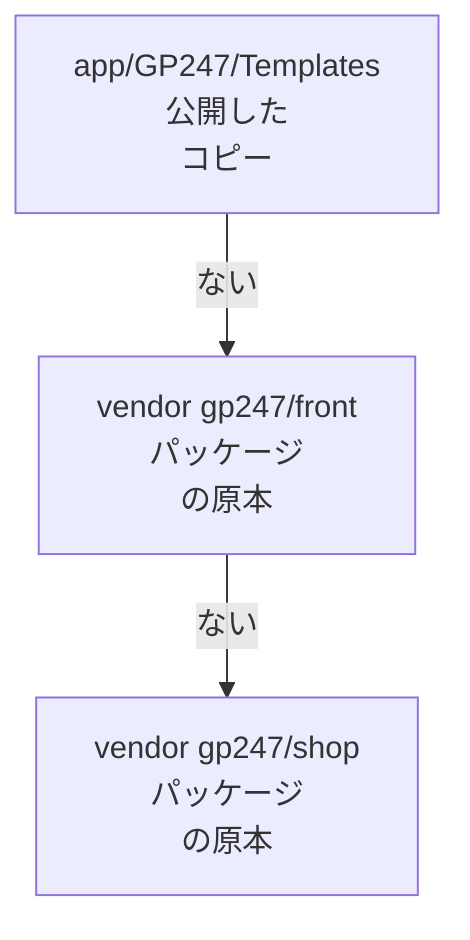

> 🌐 **言語:** [🇻🇳 Tiếng Việt](./cli-templates_vi.md) · [🇬🇧 English](./cli-templates.md) · 🇯🇵 日本語（現在）

# ストアフロントのカスタマイズ（テンプレート）のコマンド

## はじめに
このページでは、コマンドラインでストアフロントを変更しつつ、更新時にパッケージの修正を受け取り続ける方法を説明します。
編集するファイルだけを取り出す（`gp247:template-publish`）、編集していないファイルをパッケージに戻す（`gp247:template-prune`）、
既定のテンプレートをストアに適用する（`gp247:template-setup`）の 3 つです。対象は、開発者とサイトのデザインを担当する方です。
読み終えると、**テンプレートのツリー全体をコピーしてはいけない**理由と、1 画面を安全にカスタマイズする方法が分かります。
まったく新しいテンプレートを作る場合は [テンプレート作成ガイド](../extension/create-template_ja.md) を参照してください。

## ひと目でわかる
ストアフロントがビューファイルを必要とすると、GP247 は次の順に探し、**最初に見つかったファイル**を使います。



- **`app/` にあるファイルが優先されます** — 編集のために取り出したコピーです。
- **`app/` にないファイルはパッケージから直接読まれる**ので、`composer update` ですぐに修正が反映されます。
- **一度公開したファイルは、パッケージが修正できなくなります** — 何も変えていなくてもです。編集するファイルだけを公開してください。
- **独自のテンプレート**（`GP247Front` 以外の名前）は上書きされず、GP247Front のファイルに切り替わることもありません。

## このページの内容
- [1 画面を編集する：`gp247:template-publish`](#1-画面を編集するgp247template-publish) — ファイルを取り出して編集
- [未編集ファイルを戻す：`gp247:template-prune`](#未編集ファイルを戻すgp247template-prune) — 古いバージョンからインストールしたサイト向け
- [既定のテンプレートを適用：`gp247:template-setup`](#既定のテンプレートを適用gp247template-setup) — インストール手順が失敗したとき
- [`vendor:publish` のタグ](#vendorpublish-のタグ) — よく一緒に使う Laravel のコマンド

## 1 画面を編集する：`gp247:template-publish`
このコマンドは、テンプレートのファイルを**それを提供するパッケージから** `app/GP247/Templates/<名前>/` へコピーし、編集できるように
します。ほかのファイルは引き続きパッケージから読まれ、修正も受け取ります。

| 引数／オプション | 値 | 意味 |
| --- | --- | --- |
| `<template>` | 例：`GP247Front` | テンプレート名（大文字・小文字を区別） |
| `--file=` | 相対パス | 1 ファイルだけを取り出す（例：`screen/home.blade.php`） |
| `--all` | フラグ | パッケージがこのテンプレート用に提供するファイルをすべて取り出す |
| `--force` | フラグ | `app/` にすでにあるファイルを上書き（既定では自分のコピーを**残す**） |

1. 編集したいファイルのパス（テンプレートのルートから）を確認します。例えばトップページは `screen/home.blade.php` です。
2. ファイルを取り出します。

   ```bash
   php artisan gp247:template-publish GP247Front --file=screen/home.blade.php
   ```

   成功すると、`app/GP247/Templates/GP247Front/screen/home.blade.php` にファイルができます。
3. そのファイルを編集します。次にページを読み込んだときから、ストアフロントはあなたのコピーを使います。

> 💡 **ヒント:** `shop_` で始まるファイル（`screen/shop_cart.blade.php` など）と、`account/`、`auth/`、`email/`、
> `livewire/`、`partials/` のフォルダーは `gp247/shop` のものです。それ以外は `gp247/front` のものです。どちらから
> コピーするかは、コマンドが自動で判断します。

- **パスが間違っている** → エラー `template_file_not_found` と、名前の似たファイルの候補が表示されます。
- **`app/` にすでにファイルがある** → そのまま残し、スキップしたと表示します。パッケージの原本に戻すには `--force` を付けます。
- **`--all`** はツリー全体のコピーと同じです — それらのファイルは修正を受け取れなくなります。見た目の大部分を書き直すつもりの
  ときだけ使ってください。

## 未編集ファイルを戻す：`gp247:template-prune`
テンプレートがパッケージから直接読まれるようになる前にインストールしたサイトでは、`app/GP247/Templates/<名前>/` に
**完全なコピー**が残っており、そのコピーがパッケージ版をずっと覆い隠しています。`template-prune` は、パッケージの原本と
**1 バイトも違わない**ファイルを削除し、再びパッケージから読まれるようにします。

| 引数／オプション | 意味 |
| --- | --- |
| `<template>` | テンプレート名（例：`GP247Front`） |
| `--dry-run` | 削除するもの・残すものを表示するだけ — ディスクには触れません |

1. 事前に確認します。

   ```bash
   php artisan gp247:template-prune GP247Front --dry-run
   ```

2. 一覧を読みます。「削除予定」はパッケージと同一のファイル、「保持 — 編集済み」と「保持 — パッケージにない」はあなたのファイルです。
3. 実際に実行します。コマンドが `Delete N unmodified file(s)?` と尋ねます（既定は**いいえ**）。

   ```bash
   php artisan gp247:template-prune GP247Front
   ```

4. 確認：`php artisan gp247:doctor` — `template_source` のチェックが、テンプレートがパッケージから提供されていると報告します。

このコマンドが**決して削除しない**もの：
- **編集したファイル** — 名前や更新日時ではなく、内容（ハッシュ）で比較します。
- **どのパッケージも提供していないファイル** — プラグインが追加したブロック、自分で作ったファイル。
- **テンプレートの拡張機能としての外枠** — `AppConfig.php`、`Provider.php`、`Route.php`、`config.php`、`function.php`、
  `gp247.json`、`Lang/`。`AppConfig.php` を消すと、テンプレートがシステムから消えてしまいます。

> ⚠️ **注意:** `--json` または `--no-interaction` を付けると、**確認せずにすぐ削除します** — これはスクリプト向けの使い方です。
> 必ず先に `--dry-run` を実行してください。`gp247:update` はこのコマンドを**勧める**だけで、代わりに削除することはありません。

## 既定のテンプレートを適用：`gp247:template-setup`
このコマンドは、既定のテンプレートの表示設定を**ルートストア**に書き込みます。`gp247:front-install` が最後に自動で呼び出す
ので、手動で実行するのはその手順が失敗したときだけです。

```bash
php artisan gp247:template-setup
```

`Class template Default not found` と表示された場合、テンプレートの**外枠**（`AppConfig.php` と関連ファイル）が
`app/GP247/Templates/<名前>/` にありません。外枠をコピーし直してから、コマンドを再実行します。

```bash
php artisan vendor:publish --tag=gp247:front-template --force
php artisan gp247:template-setup
```

> ℹ️ **情報:** ストアのテンプレートの変更は、管理画面の「**サイト情報**」で行います。そのためのコマンドはありません。

## `vendor:publish` のタグ
これは Laravel の標準コマンドで、`--tag` でファイルのグループを選びます。稼働中のサイトでは、同じグループを警告と確認つきで
扱える `gp247:update --publish=<トークン>` を優先してください — [インストールと更新](./cli-install-update_ja.md#公開済みファイルの更新--publish) を参照してください。

| コマンド | 何をどこへコピーするか | 安全度 |
| --- | --- | --- |
| `php artisan vendor:publish --tag=gp247:core-public --force` | 管理画面の CSS／JS → `public/GP247` | ✅ |
| `php artisan vendor:publish --tag=gp247:front-public --force` | ストアフロントの CSS／JS → `public/GP247/Templates/GP247Front`（通常は自動で更新） | ✅ |
| `php artisan vendor:publish --tag=gp247:front-template --force` | GP247Front の外枠 → `app/GP247/Templates/GP247Front` | 🛑 外枠を上書き |
| `php artisan vendor:publish --tag=gp247:front-view --force` | GP247Front の Blade **ツリー全体** → `app/GP247/Templates/GP247Front` | 🛑 上書きし、ファイルを固定 |
| `php artisan vendor:publish --tag=gp247:shop-view-front --force` | GP247Front の shop ビューのツリー全体 → `app/GP247/Templates/GP247Front` | 🛑 同上 |
| `php artisan vendor:publish --tag=gp247:shop-view-admin` | shop の管理画面ビュー → `resources/views/vendor/gp247-shop-admin` | ⚠️ 上書き用 |

## 条件と制約（操作の前に確認）
- **テンプレート名は大文字・小文字を区別します** — `gp247front` は `GP247Front` ではありません。名前が違うと `template_source_missing` になります。
- **`template-publish` には `--file` か `--all` が必要です** — どちらもないと `target_required` を報告し、何もコピーしません。
- **どのパッケージも提供していないテンプレート**（独自のテーマ）**は prune できません** → `template_source_missing`：戻す先の
  原本がないので、削除するとファイルが失われるためです。
- **一度も公開していないテンプレートを prune する** → `template_not_published`：整理するものがありません。

## よくある質問（Q&A）
**Q1: `vendor/gp247/front` のファイルを直接編集してもよいですか？**

→ おすすめしません。`composer update` で上書きされます。`template-publish --file=` でファイルを取り出し、`app/` のコピーを
編集してください。

**Q2: 公開したファイルを編集したのに、ストアフロントが変わりません。**

→ ビューのキャッシュを消してください：`php artisan view:clear` の後、再読み込みします。それでも変わらない場合は、ストアで選択
されているテンプレートを編集したか確認してください。

**Q3: カスタマイズをやめて、パッケージの原本に戻したいです。**

→ `app/GP247/Templates/<名前>/` のそのファイルを削除します。次にページを読み込んだとき、GP247 はパッケージの原本を読みます。

**Q4: `template-prune` は編集したファイルを削除しますか？**

→ いいえ。パッケージの原本と 1 バイトも違わないファイルだけを削除します。先に `--dry-run` で一覧を確認してください。

**Q5: `gp247:doctor` の `template_source` は何を意味しますか？**

→ 公開済みのテンプレートファイルの中に、パッケージと同一のものがあります。それらは修正を受け取れません。`template-prune` で
パッケージに戻してください。

**Q6: プラグインからストアフロントにブロックを追加したい場合、テンプレートを公開する必要がありますか？**

→ いいえ。プラグインはレイアウトブロックの仕組みでブロックを登録します — [レイアウトブロック](../system/layout-block-system_ja.md) を参照してください。

---

<sub>📅 **最終更新:** 2026-11-08 · ✍️ **作成者 (Author):** GP247</sub>
