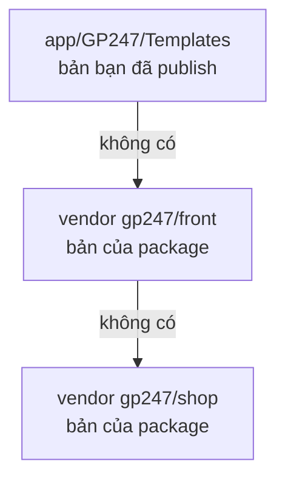

> 🌐 **Ngôn ngữ:** 🇻🇳 Tiếng Việt (hiện tại) · [🇬🇧 English](./cli-templates.md) · [🇯🇵 日本語](./cli-templates_ja.md)

# Lệnh tuỳ biến giao diện (template)

## Giới thiệu
Trang này giải thích cách sửa giao diện storefront bằng dòng lệnh mà vẫn nhận được bản vá của package khi cập nhật: lấy
đúng file cần sửa ra (`gp247:template-publish`), trả các file không sửa về cho package (`gp247:template-prune`), và áp
template mặc định cho cửa hàng (`gp247:template-setup`). Tài liệu dành cho lập trình viên và người làm giao diện. Đọc xong,
bạn biết vì sao **không nên chép cả cây template**, và cách tuỳ biến từng màn an toàn. Viết một template hoàn toàn mới:
xem [Tạo template](../extension/create-template_vi.md).

## Nhìn nhanh
Khi storefront cần một file giao diện, GP247 tìm theo thứ tự này và dùng **file đầu tiên có**:



- **File nằm trong `app/` thắng** — đó là bản bạn đã lấy ra để sửa.
- **File không có trong `app/` được đọc thẳng từ package**, nên `composer update` vá chúng ngay.
- **Một file đã publish thì package không vá được nữa** — kể cả khi bạn không sửa gì. Vì vậy chỉ publish đúng file cần sửa.
- **Template tự viết của bạn** (tên khác `GP247Front`) không bao giờ bị ghi đè hay rơi về file của GP247Front.

## Trong trang này
- [Sửa một màn: `gp247:template-publish`](#sửa-một-màn-gp247template-publish) — lấy file ra để sửa
- [Trả file chưa sửa: `gp247:template-prune`](#trả-file-chưa-sửa-gp247template-prune) — cho site cài từ bản cũ
- [Áp template mặc định: `gp247:template-setup`](#áp-template-mặc-định-gp247template-setup) — khi bước cài lỗi
- [Các tag `vendor:publish`](#các-tag-vendorpublish) — lệnh Laravel hay dùng kèm

## Sửa một màn: `gp247:template-publish`
Lệnh chép file template **từ package phát hành nó** ra `app/GP247/Templates/<Tên>/` để bạn sửa. Các file còn lại vẫn được
đọc từ package và vẫn nhận bản vá.

| Tham số | Giá trị | Ý nghĩa |
| --- | --- | --- |
| `<template>` | vd `GP247Front` | Tên template (phân biệt hoa/thường) |
| `--file=` | đường dẫn tương đối | Lấy đúng một file, vd `screen/home.blade.php` |
| `--all` | cờ | Lấy toàn bộ file mà các package cung cấp cho template này |
| `--force` | cờ | Ghi đè file đã có trong `app/` (mặc định: **giữ** bản của bạn) |

1. Tìm đường dẫn file muốn sửa (tính từ thư mục gốc template), ví dụ trang chủ là `screen/home.blade.php`.
2. Lấy file ra:

   ```bash
   php artisan gp247:template-publish GP247Front --file=screen/home.blade.php
   ```

   Nếu thành công, file xuất hiện ở `app/GP247/Templates/GP247Front/screen/home.blade.php`.
3. Sửa file đó. Storefront dùng bản của bạn ngay ở lần tải trang kế tiếp.

> 💡 **Mẹo:** file có tiền tố `shop_` (như `screen/shop_cart.blade.php`) và các thư mục `account/`, `auth/`, `email/`,
> `livewire/`, `partials/` đến từ `gp247/shop`; phần còn lại đến từ `gp247/front`. Lệnh tự biết lấy từ package nào.

- **Gõ sai đường dẫn** → lỗi `template_file_not_found` kèm gợi ý các file tên gần giống.
- **File đã có trong `app/`** → được giữ nguyên và báo là bỏ qua; muốn lấy lại bản gốc của package thì thêm `--force`.
- **`--all`** tương đương chép cả cây — các file đó sẽ không còn nhận bản vá. Chỉ dùng khi bạn thật sự định viết lại gần
  hết giao diện.

## Trả file chưa sửa: `gp247:template-prune`
Site cài từ trước khi template được đọc thẳng từ package đang giữ **bản sao đầy đủ** trong `app/GP247/Templates/<Tên>/` —
bản sao đó che mất bản của package mãi mãi. `template-prune` xoá những file **giống hệt từng byte** với bản của package để
chúng được đọc lại từ package.

| Tham số | Ý nghĩa |
| --- | --- |
| `<template>` | Tên template, vd `GP247Front` |
| `--dry-run` | Chỉ liệt kê sẽ xoá gì, giữ gì — không chạm vào đĩa |

1. Xem trước:

   ```bash
   php artisan gp247:template-prune GP247Front --dry-run
   ```

2. Đọc danh sách: "sẽ xoá" là file giống hệt package; "giữ — đã sửa" và "giữ — không có ở package" là file của bạn.
3. Chạy thật; lệnh hỏi `Delete N unmodified file(s)?` (mặc định **không**):

   ```bash
   php artisan gp247:template-prune GP247Front
   ```

4. Kiểm tra: `php artisan gp247:doctor` — mục `template_source` báo các template đã được phục vụ từ package.

Lệnh **không bao giờ xoá**:
- **File bạn đã sửa** — so bằng nội dung (hash), không theo tên hay ngày sửa.
- **File không package nào cung cấp** — block do plugin thêm vào, file bạn tự viết.
- **Vỏ extension của template** — `AppConfig.php`, `Provider.php`, `Route.php`, `config.php`, `function.php`, `gp247.json`,
  `Lang/`. Xoá `AppConfig.php` sẽ làm template biến mất khỏi hệ thống.

> ⚠️ **Lưu ý:** chạy với `--json` hoặc `--no-interaction` thì lệnh **xoá luôn, không hỏi** — đó là cách cho script. Luôn
> chạy `--dry-run` trước. `gp247:update` chỉ **gợi ý** lệnh này, không tự xoá giúp bạn.

## Áp template mặc định: `gp247:template-setup`
Lệnh ghi cấu hình hiển thị của template mặc định cho **cửa hàng gốc**. `gp247:front-install` đã tự gọi nó ở cuối; bạn chỉ
chạy tay khi bước đó lỗi.

```bash
php artisan gp247:template-setup
```

Nếu báo `Class template Default not found`, nghĩa là **vỏ extension** của template (`AppConfig.php` và các file đi kèm)
chưa có trong `app/GP247/Templates/<Tên>/`. Chép lại vỏ rồi chạy lại lệnh:

```bash
php artisan vendor:publish --tag=gp247:front-template --force
php artisan gp247:template-setup
```

> ℹ️ **Thông tin:** đổi template cho một cửa hàng làm ở trang quản trị → **Thông tin website**; không có lệnh cho việc này.

## Các tag `vendor:publish`
Đây là lệnh chuẩn của Laravel, chọn nhóm file bằng `--tag`. Với site đang chạy, ưu tiên `gp247:update --publish=<token>`
(cùng các nhóm này, có cảnh báo và xác nhận) — xem [Cài đặt & cập nhật](./cli-install-update_vi.md#làm-mới-file-đã-publish---publish).

| Lệnh | Chép gì, tới đâu | Mức an toàn |
| --- | --- | --- |
| `php artisan vendor:publish --tag=gp247:core-public --force` | CSS/JS quản trị → `public/GP247` | ✅ |
| `php artisan vendor:publish --tag=gp247:front-public --force` | CSS/JS storefront → `public/GP247/Templates/GP247Front` (thường tự làm mới) | ✅ |
| `php artisan vendor:publish --tag=gp247:front-template --force` | Vỏ extension của GP247Front → `app/GP247/Templates/GP247Front` | 🛑 ghi đè vỏ |
| `php artisan vendor:publish --tag=gp247:front-view --force` | **Cả cây** Blade của GP247Front → `app/GP247/Templates/GP247Front` | 🛑 ghi đè, đóng băng file |
| `php artisan vendor:publish --tag=gp247:shop-view-front --force` | Cả cây view shop của GP247Front → `app/GP247/Templates/GP247Front` | 🛑 như trên |
| `php artisan vendor:publish --tag=gp247:shop-view-admin` | View quản trị của shop → `resources/views/vendor/gp247-shop-admin` | ⚠️ để override |

## Điều kiện & ràng buộc (hiểu trước khi thao tác)
- **Tên template phân biệt hoa/thường** — `gp247front` không phải `GP247Front`; sai tên → `template_source_missing`.
- **`template-publish` cần `--file` hoặc `--all`** — thiếu cả hai thì báo `target_required`, không chép gì.
- **Không prune được template không package nào cung cấp** (theme của chính bạn) → `template_source_missing`: không có bản
  nào để trả về, nên xoá là mất file.
- **Prune một template chưa từng publish** → `template_not_published`: không có gì để dọn.

## Hỏi & Đáp (Q&A)
**Câu 1: Tôi sửa file trong `vendor/gp247/front` cho nhanh được không?**

→ Không nên: `composer update` sẽ ghi đè. Lấy file ra bằng `template-publish --file=` rồi sửa bản trong `app/`.

**Câu 2: Sửa file đã publish mà storefront không đổi?**

→ Xoá cache view: `php artisan view:clear`, rồi tải lại trang. Nếu vẫn không đổi, kiểm tra bạn sửa đúng template đang được
chọn cho cửa hàng.

**Câu 3: Muốn bỏ tuỳ biến, quay về bản gốc của package?**

→ Xoá file đó trong `app/GP247/Templates/<Tên>/`. Lần tải trang sau, GP247 đọc lại bản của package.

**Câu 4: `template-prune` có xoá file tôi đã sửa không?**

→ Không. Lệnh chỉ xoá file giống hệt từng byte với bản của package. Chạy `--dry-run` để tự xem danh sách trước.

**Câu 5: `gp247:doctor` báo `template_source` là sao?**

→ Có file template đã publish nhưng giống hệt package — chúng sẽ không bao giờ nhận bản vá. Chạy `template-prune` để trả chúng
về cho package.

**Câu 6: Plugin của tôi muốn thêm một block vào storefront thì có cần publish template không?**

→ Không. Plugin đăng ký block của mình qua cơ chế layout block — xem [Hệ thống layout block](../system/layout-block-system_vi.md).

---

<sub>📅 **Cập nhật lần cuối:** 2026-11-08 · ✍️ **Tác giả (Author):** GP247</sub>
