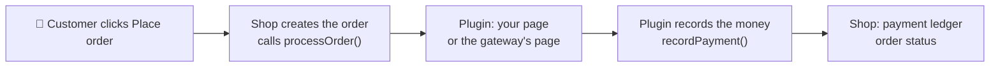
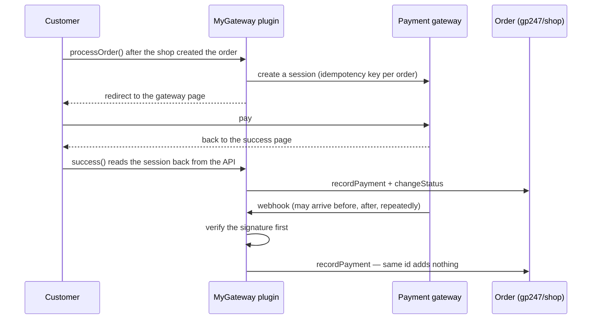

> 🌐 **Language:** [🇻🇳 Tiếng Việt](./create-payment-plugin_vi.md) · 🇬🇧 English (current) · [🇯🇵 日本語](./create-payment-plugin_ja.md)

# Creating a payment plugin for GP247 — step by step, with complete code

## Introduction

This document guides developers through writing a **payment plugin** for GP247 / S-Cart. Part 1 builds a **bank transfer**
plugin that works right away, with no outside account — so you learn how a plugin plugs into checkout. Part 2 connects an
**online payment gateway** with an API (the gateway's payment page, the return page, webhooks), with skeleton code already
wired to `gp247/shop`'s money seams. After reading, you have a working plugin and know exactly where to use the built-in
functions so money is never recorded wrongly or twice.

> 💡 **Working with an AI agent?** Use the **`gp247-payment-plugin-create`** skill from the
> [gp247-skills](https://github.com/gp247net/gp247-skills) repository: it probes the site's version, asks for what it needs and
> builds the plugin following the steps below, and it is updated together with `gp247/shop`.

---

## 1. Before you start

- A GP247 3.x website with `gp247/shop` (the selling part) installed. Check the core version:

  ```bash
  php artisan gp247:info
  ```

  The `core` line (e.g. `3.1`) is what you write in `requireCore` in Step 2.
- Know how to build a basic plugin: [Creating a plugin](./create-plugin.md). This document only covers what is specific to payments.
- Understand how payments run on the store side: [Payments in GP247](../s-cart/payment/payment.md).

**Who does what** — most of it already exists in `gp247/shop`; the plugin only does its part:

| `gp247/shop` handles | Your plugin handles |
|---|---|
| Listing methods at checkout, creating the order before calling the plugin | Declaring `configCode: "Payment"`, the display name |
| The order's payment ledger, *Received* / *Balance*, payment status | Calling `recordPayment()` with the amount the gateway **confirmed** |
| Changing the order status with stock return and history | Calling `changeStatus()` and checking its result |
| Completing the order (clearing the cart, mails, success page) | Calling `completeOrder()` / `cancelOrder()` at the right time |
| Encrypting secrets on the settings screen | Declaring secret fields as `password` |



---

## 2. Part 1 — Bank transfer plugin (works right away)

Result: checkout offers **Bank transfer**. After placing the order, the customer is taken to an instructions page (bank,
account number, amount, reference = order number); clicking finish leads to the order-success page. The order stays unpaid;
when the money arrives, you record it in the order admin.

### Step 1 — Scaffold and remove unused files

1. Open a terminal in the website's root folder (where `artisan` is) and run:

   ```bash
   php artisan gp247:make-plugin --name=MyBankTransfer --download=0
   ```

   Expected result: a `Success` line and the folder `app/GP247/Plugins/MyBankTransfer`.
2. In that folder, **delete** the unused sample files: the `Admin/` and `Models/` folders, the files `Seo.php`, `config.php`,
   `function.php`, and everything inside `Views/` (step 5 creates a new view).

After the steps below, the plugin has exactly these files:

```
MyBankTransfer/
├── gp247.json                    ← Step 2
├── AppConfig.php                 ← Step 3
├── Livewire/AdminLivewire.php    ← Step 4
├── Controllers/FrontController.php  ← Step 5
├── Views/instructions.blade.php     ← Step 5
├── Route.php · Provider.php      ← Step 6
├── Lang/vi/lang.php · Lang/en/lang.php  ← Step 6
└── public/images/logo.jpg
```

### Step 2 — `gp247.json`

Replace the whole file:

```json
{
    "name": "My bank transfer",
    "image": "images/logo.jpg",
    "auth": "Your name",
    "email": "you@example.com",
    "link": "https://example.com",
    "configGroup": "Plugins",
    "configCode": "Payment",
    "configKey": "MyBankTransfer",
    "version": "1.0",
    "requireCore": ["3.1"],
    "requireUpdateFrom": "1.0",
    "requireComposerPackages": ["gp247/shop"],
    "requireGp247Extensions": [],
    "requireLivewire": false,
    "storeScope": "store"
}
```

- `configCode: "Payment"` — this is how checkout recognises the plugin as a **payment method**.
- `requireCore` — write the `core` line of `php artisan gp247:info` (e.g. `["3.1"]`). Each `"X.Y"` value means "from X.Y upward,
  within the major line X": `"3.1"` runs on every 3.x from 3.1, but **not** on 4.x.
- `storeScope: "store"` — each store (with several stores) has its own account number.

### Step 3 — `AppConfig.php`: install, uninstall, update

Replace the whole file. The store owner's settings live in the **database** (the `admin_config` table), one row per field keyed
`MyBankTransfer_<name>` — so updating the plugin to a new version (which overwrites every file) **does not lose** them.

```php
<?php

namespace App\GP247\Plugins\MyBankTransfer;

use GP247\Core\ExtensionConfigDefault;
use GP247\Core\Models\AdminConfig;
use GP247\Core\Models\AdminHome;

class AppConfig extends ExtensionConfigDefault
{
    /** Settings the site owner edits: key => default. */
    public const SETTINGS = [
        'bank_name'      => '',
        'account_name'   => '',
        'account_number' => '',
        'note'           => '', // extra instructions shown to the customer
    ];

    public function __construct()
    {
        $config = json_decode(file_get_contents(__DIR__.'/gp247.json'), true);
        $this->configGroup = $config['configGroup'];
        $this->configKey = $config['configKey'];
        $this->configCode = $config['configCode'];
        $this->requireCore = $config['requireCore'] ?? [];
        $this->requireComposerPackages = $config['requireComposerPackages'] ?? [];
        $this->requireGp247Extensions = $config['requireGp247Extensions'] ?? [];
        $this->appPath = $this->configGroup.'/'.$this->configKey;
        $this->title = trans($this->appPath.'::lang.title');
        $this->image = $this->appPath.'/'.$config['image'];
        $this->version = $config['version'];
        $this->auth = $config['auth'];
        $this->link = $config['link'];
    }

    /**
     * Every admin_config row this plugin owns: the on/off row + one row per setting.
     */
    private function seedRows(): array
    {
        $rows = [[
            'group' => $this->configGroup, 'code' => $this->configCode, 'key' => $this->configKey,
            'sort' => 0, 'store_id' => GP247_STORE_ID_GLOBAL, 'value' => self::ON,
            'security' => 0, 'detail' => $this->appPath.'::lang.title',
        ]];
        $sort = 0;
        foreach (self::SETTINGS as $key => $default) {
            $rows[] = [
                'group' => $this->configGroup, 'code' => $this->configKey.'_config',
                'key' => $this->configKey.'_'.$key, 'sort' => ++$sort,
                'store_id' => GP247_STORE_ID_GLOBAL, 'value' => $default,
                'security' => 0, 'detail' => $this->appPath.'::lang.'.$key,
            ];
        }

        return $rows;
    }

    public function install()
    {
        if (AdminConfig::where('group', $this->configGroup)->where('key', $this->configKey)->exists()) {
            return ['error' => 1, 'msg' => gp247_language_render('admin.extension.plugin_exist')];
        }
        try {
            AdminConfig::insert($this->seedRows());

            return ['error' => 0, 'msg' => gp247_language_render('admin.extension.install_success')];
        } catch (\Throwable $e) {
            return ['error' => 1, 'msg' => $e->getMessage()];
        }
    }

    /**
     * Add the rows a newer version introduced; never touch a value the site owner saved.
     */
    public function update(?string $fromVersion = null)
    {
        try {
            foreach ($this->seedRows() as $row) {
                $exists = AdminConfig::where('group', $row['group'])->where('key', $row['key'])
                    ->where('store_id', (string) $row['store_id'])->exists();
                if (!$exists) {
                    AdminConfig::insert($row);
                }
            }

            return ['error' => 0, 'msg' => ''];
        } catch (\Throwable $e) {
            return ['error' => 1, 'msg' => $e->getMessage()];
        }
    }

    public function uninstall()
    {
        try {
            AdminConfig::where('group', $this->configGroup)->where(function ($q) {
                $q->where('key', $this->configKey)
                    ->orWhere('key', 'like', $this->configKey.'\_%')
                    ->orWhere('code', $this->configKey.'_config');
            })->delete();
            AdminHome::where('extension', $this->appPath)->delete();

            return ['error' => 0, 'msg' => gp247_language_render('admin.extension.uninstall_success')];
        } catch (\Throwable $e) {
            return ['error' => 1, 'msg' => $e->getMessage()];
        }
    }

    public function enable()
    {
        AdminConfig::where('group', $this->configGroup)->where('key', $this->configKey)->update(['value' => self::ON]);

        return ['error' => 0, 'msg' => gp247_language_render('admin.extension.enable_success')];
    }

    public function disable()
    {
        AdminConfig::where('group', $this->configGroup)->where('key', $this->configKey)->update(['value' => self::OFF]);

        return ['error' => 0, 'msg' => ''];
    }

    // The ⚙ (Config) button on the Plugins list appears only when this returns a redirect.
    public function clickApp()
    {
        return redirect(gp247_route_admin('admin_mybanktransfer.index'));
    }

    public function setupStore($storeId = null)
    {
    }

    public function removeStore($storeId = null)
    {
    }

    /**
     * A setting for a store (falls back to the shared value).
     */
    public function setting(string $key, $storeId = null): string
    {
        $storeId ??= gp247_plugin_store_id();

        return (string) gp247_config($this->configKey.'_'.$key, $storeId, self::SETTINGS[$key] ?? '');
    }

    public function getInfo()
    {
        return [
            'title' => $this->title,
            'key' => $this->configKey,
            'code' => $this->configCode,
            'image' => $this->image,
            'permission' => self::ALLOW,
            'version' => $this->version,
            'auth' => $this->auth,
            'link' => $this->link,
            'appPath' => $this->appPath,
        ];
    }
}
```

Points to note:

- `install()` writes the on/off row (key `MyBankTransfer`, `code` = `Payment`) and one row per setting.
- `update()` only **adds** missing rows and never touches a value the store owner saved — safe to run again and again, and works
  when `$fromVersion` is `null`.
- `clickApp()` — the ⚙ **Config** button on the Plugins list only appears when this returns a redirect.
- `setting()` reads a value for a store, falling back to the shared value.
- To show the customer a short message **right on the checkout page** (under the method when selected, and on the
  confirm step), add `'note' => $this->setting('note')` to the array `getInfo()` returns (gp247/shop 3.1.4 or later). The
  message is plain text with no amount or order number — which is why this plugin still needs the page in Step 5.

### Step 4 — Settings screen (`Livewire/AdminLivewire.php`)

The settings screen extends the core's `ConfigForm`: layout, permissions, store picker and saving come for free.

```php
<?php

namespace App\GP247\Plugins\MyBankTransfer\Livewire;

use App\GP247\Plugins\MyBankTransfer\AppConfig;
use GP247\Core\AdminShell\Infrastructure\ConfigForm;

/**
 * Settings screen: one field per row seeded by AppConfig::install().
 */
class AdminLivewire extends ConfigForm
{
    protected ?string $permission = null;

    protected function group(): string
    {
        return 'Plugins';
    }

    protected function heading(): string
    {
        return trans('Plugins/MyBankTransfer::lang.title');
    }

    // Each store may receive money on its own account.
    protected function storeScoped(): bool
    {
        return true;
    }

    // Required: without keys() the screen would list — and save — nothing of yours.
    protected function keys(): array
    {
        return array_map(fn ($key) => 'MyBankTransfer_'.$key, array_keys(AppConfig::SETTINGS));
    }
}
```

> `keys()` is **required**: without it the screen shows and saves none of the plugin's fields.

### Step 5 — Transfer instructions page

`Controllers/FrontController.php` — `processOrder()` is the function the shop calls **right after creating the order**:

```php
<?php

namespace App\GP247\Plugins\MyBankTransfer\Controllers;

use App\GP247\Plugins\MyBankTransfer\AppConfig;
use GP247\Front\Controllers\RootFrontController;
use GP247\Shop\Controllers\ShopCartController;
use GP247\Shop\Models\ShopOrder;

class FrontController extends RootFrontController
{
    /**
     * Called by the shop right after it created the order (session('orderID')).
     * We show the transfer instructions before finishing the checkout.
     */
    public function processOrder()
    {
        if (!$this->currentOrder()) {
            return redirect(gp247_route_front('front.home'));
        }

        return redirect(gp247_route_front('mybanktransfer.instructions'));
    }

    /**
     * Page with the bank details, the amount and the transfer reference.
     */
    public function instructions()
    {
        $order = $this->currentOrder();
        if (!$order) {
            return redirect(gp247_route_front('front.home'));
        }
        $config = new AppConfig();

        return view('Plugins/MyBankTransfer::instructions', [
            'title' => $config->title,
            'order' => $order,
            'bank' => [
                'bank_name' => $config->setting('bank_name', $order->store_id),
                'account_name' => $config->setting('account_name', $order->store_id),
                'account_number' => $config->setting('account_number', $order->store_id),
                'note' => $config->setting('note', $order->store_id),
            ],
            'layout_page' => '',
        ]);
    }

    /**
     * The customer confirmed: finish the checkout the shop's way (clear cart, mails, success page).
     */
    public function finish()
    {
        if (!$this->currentOrder()) {
            return redirect(gp247_route_front('front.home'));
        }

        return (new ShopCartController)->completeOrder();
    }

    /**
     * The order this browser just placed with this method — never an id from the URL.
     */
    private function currentOrder(): ?ShopOrder
    {
        $order = ShopOrder::find(session('orderID'));

        return ($order && $order->payment_method === 'MyBankTransfer') ? $order : null;
    }
}
```

`Views/instructions.blade.php` — it uses the running template's layout, so the page looks like the rest of the store:

```blade
@extends($GP247TemplatePath.'.layout')

@section('block_main_content_center')
<div class="lg:col-span-12 w-full max-w-xl mx-auto py-10">
    <h1 class="section-title mb-4">{{ trans('Plugins/MyBankTransfer::lang.instructions_title') }}</h1>
    <p class="mb-6">{{ trans('Plugins/MyBankTransfer::lang.instructions_intro') }}</p>

    <dl class="card p-6 space-y-3 mb-6">
        <div><dt class="text-sm text-ink-500">{{ trans('Plugins/MyBankTransfer::lang.bank_name') }}</dt><dd class="font-semibold">{{ $bank['bank_name'] }}</dd></div>
        <div><dt class="text-sm text-ink-500">{{ trans('Plugins/MyBankTransfer::lang.account_name') }}</dt><dd class="font-semibold">{{ $bank['account_name'] }}</dd></div>
        <div><dt class="text-sm text-ink-500">{{ trans('Plugins/MyBankTransfer::lang.account_number') }}</dt><dd class="font-semibold">{{ $bank['account_number'] }}</dd></div>
        <div><dt class="text-sm text-ink-500">{{ trans('Plugins/MyBankTransfer::lang.amount') }}</dt><dd class="font-semibold">{{ gp247_currency_render_symbol($order->total, $order->currency) }}</dd></div>
        <div><dt class="text-sm text-ink-500">{{ trans('Plugins/MyBankTransfer::lang.reference') }}</dt><dd class="font-semibold">{{ $order->id }}</dd></div>
    </dl>

    @if ($bank['note'] !== '')
        <p class="mb-6">{{ $bank['note'] }}</p>
    @endif

    <a href="{{ gp247_route_front('mybanktransfer.finish') }}" class="btn-primary" data-testid="mybanktransfer-instructions-finish">
        {{ trans('Plugins/MyBankTransfer::lang.finish') }}
    </a>
</div>
@endsection
```

Why not take the order number from the page address? `currentOrder()` only reads the order that **this browser** just placed
(`session('orderID')`) with this method — someone guessing an order number cannot see your order.

### Step 6 — `Route.php`, `Provider.php`, languages

`Route.php`:

```php
<?php

use Illuminate\Support\Facades\Route;

$config = json_decode(file_get_contents(__DIR__.'/gp247.json'), true);

if (gp247_extension_check_active($config['configGroup'], $config['configKey'])) {
    // Pages the customer sees: inside the storefront middleware (session, language, store).
    Route::group(
        [
            'middleware' => GP247_FRONT_MIDDLEWARE,
            'prefix' => 'plugin/mybanktransfer',
        ],
        function () {
            Route::get('instructions', [\App\GP247\Plugins\MyBankTransfer\Controllers\FrontController::class, 'instructions'])
                ->name('mybanktransfer.instructions');
            Route::get('finish', [\App\GP247\Plugins\MyBankTransfer\Controllers\FrontController::class, 'finish'])
                ->name('mybanktransfer.finish');
        }
    );

    // Settings screen.
    Route::group(
        [
            'prefix' => GP247_ADMIN_PREFIX.'/mybanktransfer',
            'middleware' => GP247_ADMIN_MIDDLEWARE,
        ],
        function () {
            Route::get('/', \App\GP247\Plugins\MyBankTransfer\Livewire\AdminLivewire::class)
                ->name('admin_mybanktransfer.index');
        }
    );
}
```

`Provider.php`:

```php
<?php

$config = json_decode(file_get_contents(__DIR__.'/gp247.json'), true);
$extensionPath = $config['configGroup'].'/'.$config['configKey'];

$this->loadTranslationsFrom(__DIR__.'/Lang', $extensionPath);

if (gp247_extension_check_active($config['configGroup'], $config['configKey'])) {
    $this->loadViewsFrom(__DIR__.'/Views', $extensionPath);

    if (class_exists(\Livewire\Livewire::class)) {
        \Livewire\Livewire::addNamespace('MyBankTransfer', classNamespace: 'App\\GP247\\Plugins\\MyBankTransfer\\Livewire');
    }
}
```

`Lang/en/lang.php` (create `Lang/vi/lang.php` the same way, in Vietnamese):

```php
<?php

return [
    'title'              => 'Bank transfer',
    'bank_name'          => 'Bank',
    'account_name'       => 'Account holder',
    'account_number'     => 'Account number',
    'note'               => 'Extra message to the customer',
    'amount'             => 'Amount',
    'reference'          => 'Transfer reference (order number)',
    'instructions_title' => 'How to pay by bank transfer',
    'instructions_intro' => 'Please transfer the exact amount with the order number as the reference. The order is processed once the store receives the money.',
    'finish'             => 'I have noted the details — complete my order',
];
```

### Step 7 — Install and try it

1. Clear the caches to load the new files:

   ```bash
   php artisan optimize:clear
   ```

2. Install the plugin: **Admin → Plugins → MyBankTransfer → Install** (or with a command):

   ```bash
   php artisan gp247:ext-install --type=plugin --key=MyBankTransfer
   ```

3. Click ⚙ **Config**, enter the bank, account holder and account number, click **Save**.
4. On the storefront, place an order and choose **Bank transfer**.
   Expected result: after placing it, the instructions page shows the right amount and order number; the finish button leads to
   the order-success page.
5. In **Admin → Orders**, the order is unpaid. When the money arrives, click **Record money received** on the order.

> ⚠️ When testing uninstall on a plugin **you are developing**, always use `--only-data`:
> `php artisan gp247:ext-uninstall --type=plugin --key=MyBankTransfer --only-data`. A plain uninstall **also deletes the source folder**.

---

## 3. Part 2 — Connecting an online payment gateway (skeleton code)

This part builds a `MyGateway` plugin for a **fictitious** gateway with an API: create a payment page, read the result back, send
signed webhooks. Replace the addresses, field names and signing method with your real gateway's documentation. The plugin
skeleton, `gp247.json` (`configCode: "Payment"`) and `AppConfig.php` are done as in Part 1.



### 3.1. Settings: test / live keys are secret fields

In `AppConfig.php`, turn the settings list into *default value + is it secret*, and when creating rows write
`'security' => $secret ? 1 : 0` (the core encrypts rows with `security = 1`):

```php
public const SETTINGS = [
    'test_mode'            => ['1', false],
    'api_key_test'         => ['', true],
    'webhook_secret_test'  => ['', true],
    'api_key_live'         => ['', true],
    'webhook_secret_live'  => ['', true],
    'order_status_success' => ['2', false], // 2 = Processing
];
```

In `Livewire/AdminLivewire.php`, declare the field types — a `password` field never sends the saved value to the browser:

```php
protected function fieldTypes(): array
{
    return [
        'MyGateway_test_mode'            => 'bool',
        'MyGateway_api_key_test'         => 'password',
        'MyGateway_webhook_secret_test'  => 'password',
        'MyGateway_api_key_live'         => 'password',
        'MyGateway_webhook_secret_live'  => 'password',
        'MyGateway_order_status_success' => 'select',
    ];
}

protected function fieldOptions(): array
{
    return ['MyGateway_order_status_success' => \GP247\Shop\Models\ShopOrderStatus::getIdAll()];
}
```

To group the fields into "Test environment" / "Live environment" blocks, add `sections()` — see the `StripePayment` reference plugin.

### 3.2. Calling the gateway API — `Services/GatewayApi.php`

```php
<?php

namespace App\GP247\Plugins\MyGateway\Services;

use Illuminate\Support\Facades\Http;

/**
 * Thin client for the (fictitious) gateway API. Replace URLs and fields with your gateway's.
 */
class GatewayApi
{
    private string $key;
    private string $baseUrl;

    public function __construct($storeId = null)
    {
        $live = !gp247_config('MyGateway_test_mode', $storeId);
        $this->key = (string) gp247_config($live ? 'MyGateway_api_key_live' : 'MyGateway_api_key_test', $storeId);
        $this->baseUrl = $live ? 'https://api.mygateway.example' : 'https://sandbox.mygateway.example';
    }

    public function configured(): bool
    {
        return $this->key !== '';
    }

    /** Create a hosted payment page. The idempotency key makes a repeated call return the same session. */
    public function createSession(array $params, string $idempotencyKey): array
    {
        return Http::timeout(10)->withToken($this->key)
            ->withHeaders(['Idempotency-Key' => $idempotencyKey])
            ->post($this->baseUrl.'/v1/sessions', $params)
            ->throw()->json();
    }

    /** Read a session back from the gateway — the only trustworthy source of "paid". */
    public function retrieveSession(string $sessionId): array
    {
        return Http::timeout(10)->withToken($this->key)
            ->get($this->baseUrl.'/v1/sessions/'.urlencode($sessionId))
            ->throw()->json();
    }
}
```

### 3.3. Recording money exactly once — `Services/PaymentRecorder.php`

This is the **only place** the plugin touches money. Both the return page and the webhook call it, in any order, any number of times:

```php
<?php

namespace App\GP247\Plugins\MyGateway\Services;

use GP247\Shop\Models\ShopOrder;
use GP247\Shop\Models\ShopOrderStatus;
use Illuminate\Database\UniqueConstraintViolationException;

/**
 * Records money the gateway CONFIRMED on the order — the only place the plugin touches money.
 * Called from the return page and from the webhook; both may run, in any order, many times.
 */
class PaymentRecorder
{
    public static function record(ShopOrder $order, float $paid, string $currency, string $txnId): void
    {
        $matches = strcasecmp($currency, (string) $order->currency) === 0
            && abs($paid - (float) $order->total) < 0.005;
        $note = $matches ? null : "Gateway took $paid $currency, order is {$order->total} {$order->currency}";

        try {
            // Keyed by the gateway's transaction id: a repeated report records nothing new.
            $order->recordPayment($paid, 'MyGateway', $txnId, null, $note);
        } catch (UniqueConstraintViolationException $e) {
            // Two reports at the same instant: the other one recorded it.
        }

        if (!$matches) {
            gp247_report('MyGateway: order '.$order->id.': '.$note); // a human reconciles; status unchanged
            return;
        }

        $order = ShopOrder::find($order->id);
        // Only an order still New moves: a late report must not undo what the admin did.
        // Also runs on a replay, so a first delivery that failed before this line is completed now.
        if ((int) $order->status === ShopOrderStatus::NEW) {
            $target = (int) gp247_config('MyGateway_order_status_success', $order->store_id) ?: ShopOrderStatus::PROCESSING;
            $refused = $order->changeStatus($target, ['content' => 'MyGateway payment '.$txnId]);
            if ($refused !== null) {
                gp247_report('MyGateway: order '.$order->id.' status not changed: '.$refused);
            }
        }
    }
}
```

- Money is recorded in the **order's currency**, the amount the gateway actually took. A mismatch with the order total is
  recorded with a note and the status is **not** changed — so a person reconciles instead of the difference being hidden.
- Same transaction id → the ledger adds nothing. Two reports **at the same instant** may raise a duplicate-key error — catch it
  and treat it as "already recorded".
- Only an order still *New* changes status; this part also runs on a replay, so a first attempt that failed halfway is finished
  by the next one.

### 3.4. Sending the customer to the gateway, the return page, the webhook — `Controllers/FrontController.php`

```php
<?php

namespace App\GP247\Plugins\MyGateway\Controllers;

use App\GP247\Plugins\MyGateway\Services\GatewayApi;
use App\GP247\Plugins\MyGateway\Services\PaymentRecorder;
use GP247\Front\Controllers\RootFrontController;
use GP247\Shop\Controllers\ShopCartController;
use GP247\Shop\Models\ShopOrder;
use GP247\Shop\Models\ShopOrderStatus;
use Illuminate\Http\Request;

class FrontController extends RootFrontController
{
    /** The shop created the order; send the customer to the gateway. */
    public function processOrder()
    {
        $order = ShopOrder::find(session('orderID'));
        $api = new GatewayApi($order?->store_id);
        if (!$order || !$api->configured()) {
            return redirect(gp247_route_front('cart'))->with('error', trans('Plugins/MyGateway::lang.error_not_available'));
        }

        try {
            $session = $api->createSession([
                'amount' => (float) $order->total,
                'currency' => $order->currency,
                'reference' => $order->id,
                'return_url' => gp247_route_front('mygateway.success'),
                'cancel_url' => gp247_route_front('mygateway.cancel'),
            ], 'order-'.$order->id); // same order twice => same session
        } catch (\Throwable $e) {
            gp247_report('MyGateway: create session for order '.$order->id.' failed: '.$e->getMessage());
            return redirect(gp247_route_front('cart'))->with('error', trans('Plugins/MyGateway::lang.error_not_available'));
        }

        $order->update(['transaction' => $session['id']]); // the gateway reference, not money

        return redirect()->away($session['url']);
    }

    /** Customer is back. Never trust the URL: read the session from the gateway. */
    public function success()
    {
        $order = ShopOrder::find(session('orderID'));
        if (!$order || (string) $order->transaction === '') {
            return redirect(gp247_route_front('front.home'));
        }

        try {
            $session = (new GatewayApi($order->store_id))->retrieveSession((string) $order->transaction);
        } catch (\Throwable $e) {
            gp247_report('MyGateway: read session of order '.$order->id.' failed: '.$e->getMessage());
            return redirect(gp247_route_front('front.home'))->with('error', trans('Plugins/MyGateway::lang.error_verify'));
        }

        if (($session['reference'] ?? '') === $order->id && ($session['status'] ?? '') === 'paid') {
            PaymentRecorder::record($order, (float) $session['amount'], (string) $session['currency'], (string) $session['payment_id']);
        }
        // Not paid yet (slow methods): the order is placed, the webhook records the money later.

        return (new ShopCartController)->completeOrder();
    }

    /** Customer cancelled on the gateway page. */
    public function cancel()
    {
        $order = ShopOrder::find(session('orderID'));
        if ($order && (float) $order->received > 0) {
            return (new ShopCartController)->completeOrder(); // paid after all
        }
        if ($order && (int) $order->status !== ShopOrderStatus::NEW) {
            return redirect(gp247_route_front('front.home'));
        }

        return (new ShopCartController)->cancelOrder(); // the shop cancels and returns the stock
    }

    /** Server-to-server notification. Verify FIRST, on the raw body. */
    public function webhook(Request $request)
    {
        $payload = (string) $request->getContent();
        $test = (bool) gp247_config('MyGateway_test_mode');
        $secret = (string) gp247_config($test ? 'MyGateway_webhook_secret_test' : 'MyGateway_webhook_secret_live');
        $expected = hash_hmac('sha256', $payload, $secret);
        if ($secret === '' || !hash_equals($expected, (string) $request->header('X-Signature'))) {
            return response('Invalid signature', 400);
        }

        $event = json_decode($payload, true);
        if (($event['type'] ?? '') !== 'payment.succeeded') {
            return response('OK', 200); // not an event this plugin acts on
        }

        $order = ShopOrder::find((string) ($event['data']['reference'] ?? ''));
        if (!$order) {
            return response('OK', 200);
        }

        try {
            PaymentRecorder::record($order, (float) $event['data']['amount'], (string) $event['data']['currency'], (string) $event['data']['payment_id']);
        } catch (\Throwable $e) {
            gp247_report('MyGateway: webhook for order '.$order->id.' failed: '.$e->getMessage());
            return response('Error', 500); // the gateway retries
        }

        return response('OK', 200);
    }
}
```

### 3.5. Routes — the webhook sits **outside** the storefront group

```php
use Illuminate\Support\Facades\Route;

$config = json_decode(file_get_contents(__DIR__.'/gp247.json'), true);

if (gp247_extension_check_active($config['configGroup'], $config['configKey'])) {
    Route::group(['middleware' => GP247_FRONT_MIDDLEWARE, 'prefix' => 'plugin/mygateway'], function () {
        Route::get('success', [\App\GP247\Plugins\MyGateway\Controllers\FrontController::class, 'success'])
            ->middleware('throttle:30,1')->name('mygateway.success');
        Route::get('cancel', [\App\GP247\Plugins\MyGateway\Controllers\FrontController::class, 'cancel'])
            ->name('mygateway.cancel');
    });

    // Server-to-server: no session, no CSRF token. Inside the storefront group it could get a
    // redirect or a maintenance page back, which the gateway would count as "delivered".
    Route::post('plugin/mygateway/webhook', [\App\GP247\Plugins\MyGateway\Controllers\FrontController::class, 'webhook'])
        ->middleware('throttle:600,1')->name('mygateway.webhook');

    Route::group(['prefix' => GP247_ADMIN_PREFIX.'/mygateway', 'middleware' => GP247_ADMIN_MIDDLEWARE], function () {
        Route::get('/', \App\GP247\Plugins\MyGateway\Livewire\AdminLivewire::class)->name('admin_mygateway.index');
    });
}
```

Show the webhook address for the store owner to paste into the gateway's dashboard: `route('mygateway.webhook')`.

### 3.6. (Optional) Payment links and refunds

For your gateway to collect [payment links](../s-cart/order-processing/payment-request.md) and refund from the *Payment
requests* screen: write a class implementing `GP247\Shop\Payment\Contracts\PaymentGateway` (`key`, `capabilities`,
`availableFor`, `collect`, `refund`) and register it in `Provider.php` (write the whole array, because a key with a dot would be
split):

```php
if (interface_exists(\GP247\Shop\Payment\Contracts\PaymentGateway::class)) {
    $gateways = (array) config('gp247-config.payment.gateways', []);
    $gateways['MyGateway'] = [
        'label' => 'MyGateway',
        'capabilities' => ['collect', 'refund'],
        'driver' => \App\GP247\Plugins\MyGateway\Services\MyGatewayPaymentGateway::class,
    ];
    config(['gp247-config.payment.gateways' => $gateways]);
}
```

Money of a payment link is recorded with `PaymentRequestService::recordMovement()` (not the order ledger). Full reference code:
the `StripePayment` plugin (`Services/StripePaymentRequestGateway.php`).

### 3.7. Testing without calling the real gateway

Never call the real gateway in tests. Use `Http::fake()` for the API and sign sample webhooks yourself:

```php
<?php

namespace Tests\Feature\MyGateway;

use App\GP247\Plugins\MyGateway\Controllers\FrontController;
use GP247\Core\Models\AdminConfig;
use GP247\Shop\Models\ShopOrder;
use GP247\Shop\Models\ShopOrderStatus;
use Illuminate\Foundation\Testing\DatabaseTransactions;
use Illuminate\Http\Request;
use Tests\TestCase;

class MyGatewayWebhookTest extends TestCase
{
    use DatabaseTransactions; // run against a TEST database only

    private function webhook(array $event, string $secret)
    {
        $body = json_encode($event);
        $request = Request::create('/plugin/mygateway/webhook', 'POST', [], [], [], [
            'CONTENT_TYPE' => 'application/json',
            'HTTP_X_SIGNATURE' => hash_hmac('sha256', $body, $secret),
        ], $body);

        return (new FrontController())->webhook($request);
    }

    public function test_a_payment_reported_twice_is_recorded_once(): void
    {
        foreach (['MyGateway_test_mode' => '1', 'MyGateway_webhook_secret_test' => 'test-secret'] as $key => $value) {
            AdminConfig::updateOrInsert(['group' => 'Plugins', 'key' => $key, 'store_id' => GP247_STORE_ID_GLOBAL], ['value' => $value, 'code' => 'MyGateway_config']);
        }
        $order = ShopOrder::where('status', ShopOrderStatus::NEW)->firstOrFail(); // or create one for the test
        $event = ['type' => 'payment.succeeded', 'data' => [
            'reference' => $order->id, 'amount' => (float) $order->total,
            'currency' => $order->currency, 'payment_id' => 'pay_123',
        ]];

        $this->assertSame(200, $this->webhook($event, 'test-secret')->getStatusCode());
        $this->assertSame(200, $this->webhook($event, 'test-secret')->getStatusCode()); // replay

        $order = ShopOrder::find($order->id);
        $this->assertEquals((float) $order->total, (float) $order->received);
        $this->assertSame(ShopOrderStatus::PROCESSING, (int) $order->status);
    }

    public function test_a_wrong_signature_writes_nothing(): void
    {
        $this->assertSame(400, $this->webhook(['type' => 'payment.succeeded'], 'not-the-secret')->getStatusCode());
    }
}
```

---

## 4. Pre-release checklist

- [ ] `gp247.json`: `configCode: "Payment"`, `configKey` equals the folder name, `requireCore` from `gp247:info`, has `gp247/shop`.
- [ ] Settings live in `admin_config`; secrets are `password` fields (`security = 1`); `update()` is safe to re-run.
- [ ] `clickApp()` opens the settings screen; `keys()` lists every field.
- [ ] Money only through `recordPayment()` / `recordRefund()`, status only through `changeStatus()`; never `update()` `status`, `payment_status`, `received` directly.
- [ ] The return page reads the result back from the gateway; the webhook is outside the storefront group and verifies the signature before touching the database.
- [ ] Tests cover a repeat, a bad signature and a wrong amount — without calling the real gateway.
- [ ] Uninstall only deletes settings, **never** recorded money.

---

## 5. Quick reference — what `gp247/shop` provides, and where

Payments live in `vendor/gp247/shop/src/`. **Do not edit inside `vendor/`** — every customisation goes through a plugin.

| Component | Location | What it does (you do not rewrite it) |
|---|---|---|
| Checkout hand-off | `Controllers/ShopCartController.php` (after the order is created) | Creates the order, sets `session('orderID')`, calls the plugin's `processOrder()` if any, otherwise completes the order; `completeOrder()` / `cancelOrder()` for return pages |
| Shown at checkout | `Front/Livewire/CheckoutWizard.php` + view `GP247Front/livewire/shop_checkout-wizard.blade.php` | Lists enabled `configCode: "Payment"` plugins, prints `getInfo()['title']` and `note` (plain text, under the selected method + confirm step — gp247/shop 3.1.4+) |
| Payment ledger | `Models/ShopOrder.php` → `recordPayment()`, `recordRefund()`; table `shop_order_transaction` | Writes one payment/refund line, de-duplicated by transaction id, recomputes *Received*, *Balance*, payment status |
| Status change | `ShopOrder::changeStatus()` | Returns stock on cancel, writes history, fires events; refuses an invalid transition |
| Payment requests | `Payment/` — `PaymentRequestService.php`, `GatewayRegistry.php`, `Contracts/PaymentGateway.php` | Pay links and refunds outside the cart; gateways join by registering a driver (section 3.6) |
| Gateway list | config key `gp247-config.payment.gateways` | Where plugins declare their driver and `collect` / `refund` / `payout` capabilities |
| Cash on delivery | config key `gp247-config.shop.cod_payment_methods` | Which methods mean "pay on delivery" so the shipment carries the COD amount — add your plugin key if it is COD |
| Secret encryption | `password` fields of the core `ConfigForm`, flag `security = 1` | Gateway keys encrypted at rest, never sent back to the browser |

**Other cases**

- **Upgrading an old payment plugin**: remove every place that writes the order's status/amount directly, move to the
  payment ledger and `changeStatus()`; move the webhook outside the storefront group — [Converting a plugin from v1 to
  v2](./convert-plugin-v1-to-v2.md), Step 8d.
- **Writing your own theme that overrides the payment step**: keep the method list (`$paymentPlugins`), the
  method-selection call and the `note` output (read `$info['note'] ?? ''`, print with `{{ }}`) as in the original at
  `vendor/gp247/shop/src/Views/templates/GP247Front/livewire/shop_checkout-wizard.blade.php`. See also [Creating a
  template](./create-template.md).
- **Public reference code**: `CashPayment` (no gateway call), `StripePayment` and `PaypalExpress` (gateway + webhook + pay links).

---

## Conditions & Rules (know before you act)

**Declaring the plugin**
- **`configKey` must equal the folder name and never change after release** — the system uses it to tell the old version from the new.
- **`requireCore` is a range per major version** — `"3.1"` cannot be installed on a 4.x core; write the core you tested on.
- **Every release must increase `version`** — otherwise the 1-click update refuses.

**Recording money**
- **The amount is in the order's currency and is what the gateway confirmed** — any other amount makes the store's books wrong.
- **Only orders still *New* change status automatically** — a late webhook must not overwrite what the admin did.
- **`changeStatus()` may refuse** (e.g. re-opening an order without enough stock) — always check its result.

**Webhook**
- **Verify the signature on the raw body before reading the database**, comparing with `hash_equals` — against forgery and probing.
- **Return 500 on an internal error** so the gateway retries; return 200 for events you do not handle.

---

## Q&A

**Q1: The plugin is installed but does not show at checkout?**

→ Check the plugin is **Enabled** (for the right store), `configCode` is `"Payment"`, the on/off row has `code` = `Payment`
(written by `install()`), then run `php artisan optimize:clear`.

**Q2: No ⚙ Config button on the Plugins list?**

→ `AppConfig::clickApp()` must return a redirect to the settings screen; the skeleton returns `null`.

**Q3: The settings screen is empty, or Save saves nothing?**

→ `keys()` is missing in the settings screen, or `install()` did not create rows for those keys.

**Q4: Why may I not write the order's `received` or `payment_status` myself?**

→ Both are computed from the payment ledger. Writing them directly gets overwritten by the next computation, and skips the history
and stock handling of a status change.

**Q5: My webhook gets a redirect page or a 419 error?**

→ The webhook route is inside the storefront middleware group. Move it outside as in 3.5.

**Q6: What if the gateway sends the webhook twice?**

→ Nothing bad: the same transaction id adds nothing to the ledger; the second time only finishes the status change if the first stopped halfway.

**Q7: After saving a secret, the field is empty again?**

→ By design: a `password` field never sends the saved value to the browser, it only shows "a value is set". Leaving it empty on
save keeps the old secret.

**Q8: Can each store receive money on its own account?**

→ Yes: `storeScope: "store"` in `gp247.json` and `storeScoped()` returning `true` on the settings screen; read settings for the
**order's** store (`$order->store_id`).

**Q9: How do I test without spending real money?**

→ Automated tests use `Http::fake()` and self-signed webhooks (3.7); manual tests use the gateway's sandbox.

**Q10: Is there a faster way with an AI agent?**

→ Use the `gp247-payment-plugin-create` skill — it builds the plugin following these steps and is updated together with `gp247/shop`.

---

## Change history
<!-- Only when logic/behavior changed. Newest row on top. One row per day: merge same-day changes into the existing row, never add a new row for the same date. -->

| Date | GP247 version | Change |
| --- | --- | --- |
| 2026-10-18 | gp247/shop 3.1.4 | New document: a bank transfer plugin that works right away + a skeleton for connecting an online payment gateway; `getInfo()['note']` shows on the checkout page |

---

<sub>📅 **Last updated:** 2026-10-22 · ✍️ **Author:** GP247</sub>
