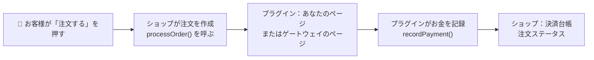
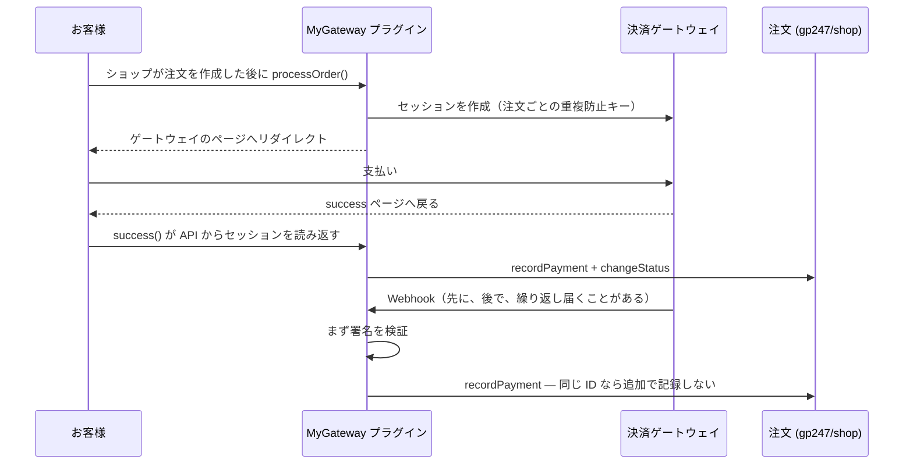

> 🌐 **言語:** [🇻🇳 Tiếng Việt](./create-payment-plugin_vi.md) · [🇬🇧 English](./create-payment-plugin.md) · 🇯🇵 日本語（現在）

# GP247 の決済プラグインを作る — ステップごとに、完全なコード付き

## はじめに

このドキュメントは、開発者が GP247 / S-Cart の **決済プラグイン** を自分で書くためのガイドです。パート 1 では、外部アカウントなしで
すぐに動く **銀行振込** プラグインを作ります。これで、プラグインが決済ページにどう組み込まれるかを理解できます。パート 2 では、
API を持つ **オンライン決済ゲートウェイ**（ゲートウェイの決済ページ、戻りページ、Webhook）に接続します。スケルトンコードは、
`gp247/shop` のお金の接続ポイントに正しく配置済みです。読み終えると、動くプラグインが手に入り、お金が誤って記録されたり
二重に記録されたりしないよう、どこで既存の関数を使うべきかが正確に分かります。

> 💡 **AI エージェントと一緒に作業しますか？** [gp247-skills](https://github.com/gp247net/gp247-skills) リポジトリのスキル
> **`gp247-payment-plugin-create`** を使ってください。スキルはサイトのバージョンを自動で調べ、必要な情報を質問してから、
> 以下の手順どおりにプラグインを作ります。スキルは `gp247/shop` と一緒に更新されます。

---

## 1. 始める前に

- `gp247/shop`（販売機能）をインストールした GP247 3.x のウェブサイト。コアのバージョンを確認します。

  ```bash
  php artisan gp247:info
  ```

  `core` の行（例：`3.1`）が、手順 2 で `requireCore` に書く値です。
- 基本的なプラグインの作り方を知っていること：[プラグイン作成ガイド](./create-plugin_ja.md)。このドキュメントは決済に固有の部分だけを扱います。
- ストア側で決済がどう動くかを理解していること：[GP247 の決済](../s-cart/payment/payment_ja.md)。

**誰が何をするか** — ほとんどは `gp247/shop` にすでにあり、プラグインは自分の担当部分だけを行います。

| `gp247/shop` が担当 | あなたのプラグインが担当 |
|---|---|
| 決済ページで決済方法を一覧表示し、プラグインを呼ぶ前に注文を作る | `configCode: "Payment"` と表示名を宣言する |
| 注文の決済台帳、*入金済み* / *残額*、支払いステータス | ゲートウェイが **確認した** 金額で `recordPayment()` を呼ぶ |
| 在庫戻しと履歴を伴う注文ステータスの変更 | `changeStatus()` を呼び、結果を確認する |
| 注文の完了（カートを空にする、メール送信、完了ページ） | 適切なタイミングで `completeOrder()` / `cancelOrder()` を呼ぶ |
| 設定画面での秘密鍵の暗号化 | 秘密の項目を `password` と宣言する |



---

## 2. パート 1 — 銀行振込プラグイン（すぐに動く）

結果：決済ページに **銀行振込** の選択肢が表示されます。お客様が注文すると、振込案内ページ（銀行、口座番号、金額、
振込名義 = 注文番号）に移動し、完了ボタンを押すと注文完了ページに戻ります。注文は未払いの状態です。入金を確認したら、
注文の管理画面で記録します。

### 手順 1 — スケルトンを生成し、不要なファイルを削除する

1. ウェブサイトのルートフォルダー（`artisan` ファイルがある場所）でターミナルを開き、次を実行します。

   ```bash
   php artisan gp247:make-plugin --name=MyBankTransfer --download=0
   ```

   期待する結果：`Success` の行が表示され、フォルダー `app/GP247/Plugins/MyBankTransfer` が作成されます。
2. そのフォルダーの中で、使わないサンプルファイルを **削除** します：`Admin/` フォルダー、`Models/` フォルダー、`Seo.php`、`config.php`、
   `function.php` の各ファイル、そして `Views/` の中身すべて（手順 5 で新しいビューを作ります）。

以下の手順を終えると、プラグインには次のファイルだけが残ります。

```
MyBankTransfer/
├── gp247.json                    ← 手順 2
├── AppConfig.php                 ← 手順 3
├── Livewire/AdminLivewire.php    ← 手順 4
├── Controllers/FrontController.php  ← 手順 5
├── Views/instructions.blade.php     ← 手順 5
├── Route.php · Provider.php      ← 手順 6
├── Lang/vi/lang.php · Lang/en/lang.php  ← 手順 6
└── public/images/logo.jpg
```

### 手順 2 — `gp247.json`

ファイルの内容をすべて置き換えます。

```json
{
    "name": "My bank transfer",
    "image": "images/logo.jpg",
    "auth": "Your name",
    "email": "you@example.com",
    "link": "https://example.com",
    "configGroup": "Plugins",
    "configCode": "Payment",
    "configKey": "MyBankTransfer",
    "version": "1.0",
    "requireCore": ["3.1"],
    "requireUpdateFrom": "1.0",
    "requireComposerPackages": ["gp247/shop"],
    "requireGp247Extensions": [],
    "requireLivewire": false,
    "storeScope": "store"
}
```

- `configCode: "Payment"` — 決済ページは、これによってプラグインが **決済方法** であると認識します。
- `requireCore` — `php artisan gp247:info` の `core` の行をそのまま書きます（例：`["3.1"]`）。各値 `"X.Y"` は「同じメジャーバージョン X の中で、
  X.Y 以上」という意味です。`"3.1"` は 3.1 以降のすべての 3.x で動きますが、4.x では **動きません**。
- `storeScope: "store"` — 各ストア（複数ストアを使う場合）が、それぞれ別の口座番号を持てます。

### 手順 3 — `AppConfig.php`：インストール、アンインストール、更新

ファイルの内容をすべて置き換えます。ストアオーナーの設定は **データベース**（`admin_config` テーブル）にあり、項目ごとに
キー `MyBankTransfer_<name>` の 1 行です。これにより、プラグインを新しいバージョンに更新（すべてのファイルを上書き）しても、設定は **失われません**。

```php
<?php

namespace App\GP247\Plugins\MyBankTransfer;

use GP247\Core\ExtensionConfigDefault;
use GP247\Core\Models\AdminConfig;
use GP247\Core\Models\AdminHome;

class AppConfig extends ExtensionConfigDefault
{
    /** サイトオーナーが編集する設定：key => 既定値。 */
    public const SETTINGS = [
        'bank_name'      => '',
        'account_name'   => '',
        'account_number' => '',
        'note'           => '', // お客様に表示する追加の案内
    ];

    public function __construct()
    {
        $config = json_decode(file_get_contents(__DIR__.'/gp247.json'), true);
        $this->configGroup = $config['configGroup'];
        $this->configKey = $config['configKey'];
        $this->configCode = $config['configCode'];
        $this->requireCore = $config['requireCore'] ?? [];
        $this->requireComposerPackages = $config['requireComposerPackages'] ?? [];
        $this->requireGp247Extensions = $config['requireGp247Extensions'] ?? [];
        $this->appPath = $this->configGroup.'/'.$this->configKey;
        $this->title = trans($this->appPath.'::lang.title');
        $this->image = $this->appPath.'/'.$config['image'];
        $this->version = $config['version'];
        $this->auth = $config['auth'];
        $this->link = $config['link'];
    }

    /**
     * このプラグインが持つすべての admin_config 行：有効／無効の行 + 設定ごとに 1 行。
     */
    private function seedRows(): array
    {
        $rows = [[
            'group' => $this->configGroup, 'code' => $this->configCode, 'key' => $this->configKey,
            'sort' => 0, 'store_id' => GP247_STORE_ID_GLOBAL, 'value' => self::ON,
            'security' => 0, 'detail' => $this->appPath.'::lang.title',
        ]];
        $sort = 0;
        foreach (self::SETTINGS as $key => $default) {
            $rows[] = [
                'group' => $this->configGroup, 'code' => $this->configKey.'_config',
                'key' => $this->configKey.'_'.$key, 'sort' => ++$sort,
                'store_id' => GP247_STORE_ID_GLOBAL, 'value' => $default,
                'security' => 0, 'detail' => $this->appPath.'::lang.'.$key,
            ];
        }

        return $rows;
    }

    public function install()
    {
        if (AdminConfig::where('group', $this->configGroup)->where('key', $this->configKey)->exists()) {
            return ['error' => 1, 'msg' => gp247_language_render('admin.extension.plugin_exist')];
        }
        try {
            AdminConfig::insert($this->seedRows());

            return ['error' => 0, 'msg' => gp247_language_render('admin.extension.install_success')];
        } catch (\Throwable $e) {
            return ['error' => 1, 'msg' => $e->getMessage()];
        }
    }

    /**
     * 新しいバージョンで追加された行を足す。サイトオーナーが保存した値には決して触れない。
     */
    public function update(?string $fromVersion = null)
    {
        try {
            foreach ($this->seedRows() as $row) {
                $exists = AdminConfig::where('group', $row['group'])->where('key', $row['key'])
                    ->where('store_id', (string) $row['store_id'])->exists();
                if (!$exists) {
                    AdminConfig::insert($row);
                }
            }

            return ['error' => 0, 'msg' => ''];
        } catch (\Throwable $e) {
            return ['error' => 1, 'msg' => $e->getMessage()];
        }
    }

    public function uninstall()
    {
        try {
            AdminConfig::where('group', $this->configGroup)->where(function ($q) {
                $q->where('key', $this->configKey)
                    ->orWhere('key', 'like', $this->configKey.'\_%')
                    ->orWhere('code', $this->configKey.'_config');
            })->delete();
            AdminHome::where('extension', $this->appPath)->delete();

            return ['error' => 0, 'msg' => gp247_language_render('admin.extension.uninstall_success')];
        } catch (\Throwable $e) {
            return ['error' => 1, 'msg' => $e->getMessage()];
        }
    }

    public function enable()
    {
        AdminConfig::where('group', $this->configGroup)->where('key', $this->configKey)->update(['value' => self::ON]);

        return ['error' => 0, 'msg' => gp247_language_render('admin.extension.enable_success')];
    }

    public function disable()
    {
        AdminConfig::where('group', $this->configGroup)->where('key', $this->configKey)->update(['value' => self::OFF]);

        return ['error' => 0, 'msg' => ''];
    }

    // プラグイン一覧の ⚙（設定）ボタンは、この関数がリダイレクトを返すときだけ表示される。
    public function clickApp()
    {
        return redirect(gp247_route_admin('admin_mybanktransfer.index'));
    }

    public function setupStore($storeId = null)
    {
    }

    public function removeStore($storeId = null)
    {
    }

    /**
     * ストアの設定値（なければ共通の値を使う）。
     */
    public function setting(string $key, $storeId = null): string
    {
        $storeId ??= gp247_plugin_store_id();

        return (string) gp247_config($this->configKey.'_'.$key, $storeId, self::SETTINGS[$key] ?? '');
    }

    public function getInfo()
    {
        return [
            'title' => $this->title,
            'key' => $this->configKey,
            'code' => $this->configCode,
            'image' => $this->image,
            'permission' => self::ALLOW,
            'version' => $this->version,
            'auth' => $this->auth,
            'link' => $this->link,
            'appPath' => $this->appPath,
        ];
    }
}
```

注意すべき点：

- `install()` は有効／無効の行（キー `MyBankTransfer`、`code` = `Payment`）と、設定ごとに 1 行を書き込みます。
- `update()` は足りない行を **追加** するだけで、ストアオーナーが保存した値には触れません — 何度実行しても安全で、
  `$fromVersion` が `null` でも動きます。
- `clickApp()` — プラグイン一覧の ⚙ 「設定」(Config) ボタンは、この関数がリダイレクトを返すときだけ表示されます。
- `setting()` はストアごとの値を読み、なければ共通の値を使います。
- お客様に短いメッセージを **決済ページ上で直接**（選択した決済方法の下と、確認ステップで）見せたい場合は、
  `getInfo()` の配列に `'note' => $this->setting('note')` を追加します（gp247/shop 3.1.4 以降）。メッセージはプレーンテキストで、
  金額や注文番号は含みません — そのため、このプラグインには手順 5 の案内ページが引き続き必要です。

### 手順 4 — 設定画面（`Livewire/AdminLivewire.php`）

設定画面はコアの `ConfigForm` を継承します。画面表示、権限、ストア選択、項目ごとの保存が最初から備わっています。

```php
<?php

namespace App\GP247\Plugins\MyBankTransfer\Livewire;

use App\GP247\Plugins\MyBankTransfer\AppConfig;
use GP247\Core\AdminShell\Infrastructure\ConfigForm;

/**
 * 設定画面：AppConfig::install() が作った行ごとに 1 項目。
 */
class AdminLivewire extends ConfigForm
{
    protected ?string $permission = null;

    protected function group(): string
    {
        return 'Plugins';
    }

    protected function heading(): string
    {
        return trans('Plugins/MyBankTransfer::lang.title');
    }

    // 各ストアが自分の口座で入金を受けられる。
    protected function storeScoped(): bool
    {
        return true;
    }

    // 必須：keys() がないと、画面にはあなたの項目が何も表示されず、何も保存されない。
    protected function keys(): array
    {
        return array_map(fn ($key) => 'MyBankTransfer_'.$key, array_keys(AppConfig::SETTINGS));
    }
}
```

> `keys()` は **必須** です。これがないと、画面にはプラグインの項目が 1 つも表示されず、保存もされません。

### 手順 5 — 振込案内ページ

`Controllers/FrontController.php` — `processOrder()` は、ストアが **注文を作成した直後** に呼ぶ関数です。

```php
<?php

namespace App\GP247\Plugins\MyBankTransfer\Controllers;

use App\GP247\Plugins\MyBankTransfer\AppConfig;
use GP247\Front\Controllers\RootFrontController;
use GP247\Shop\Controllers\ShopCartController;
use GP247\Shop\Models\ShopOrder;

class FrontController extends RootFrontController
{
    /**
     * ショップが注文（session('orderID')）を作成した直後に呼ばれる。
     * 決済を完了する前に、振込案内を表示する。
     */
    public function processOrder()
    {
        if (!$this->currentOrder()) {
            return redirect(gp247_route_front('front.home'));
        }

        return redirect(gp247_route_front('mybanktransfer.instructions'));
    }

    /**
     * 銀行情報、金額、振込名義を表示するページ。
     */
    public function instructions()
    {
        $order = $this->currentOrder();
        if (!$order) {
            return redirect(gp247_route_front('front.home'));
        }
        $config = new AppConfig();

        return view('Plugins/MyBankTransfer::instructions', [
            'title' => $config->title,
            'order' => $order,
            'bank' => [
                'bank_name' => $config->setting('bank_name', $order->store_id),
                'account_name' => $config->setting('account_name', $order->store_id),
                'account_number' => $config->setting('account_number', $order->store_id),
                'note' => $config->setting('note', $order->store_id),
            ],
            'layout_page' => '',
        ]);
    }

    /**
     * お客様が確認した：ショップの方法で決済を完了する（カートを空にする、メール、完了ページ）。
     */
    public function finish()
    {
        if (!$this->currentOrder()) {
            return redirect(gp247_route_front('front.home'));
        }

        return (new ShopCartController)->completeOrder();
    }

    /**
     * このブラウザーがこの決済方法でたった今出した注文 — URL の id は決して使わない。
     */
    private function currentOrder(): ?ShopOrder
    {
        $order = ShopOrder::find(session('orderID'));

        return ($order && $order->payment_method === 'MyBankTransfer') ? $order : null;
    }
}
```

`Views/instructions.blade.php` — 稼働中のテンプレートのレイアウトを使うので、ページはストアと同じデザインになります。

```blade
@extends($GP247TemplatePath.'.layout')

@section('block_main_content_center')
<div class="lg:col-span-12 w-full max-w-xl mx-auto py-10">
    <h1 class="section-title mb-4">{{ trans('Plugins/MyBankTransfer::lang.instructions_title') }}</h1>
    <p class="mb-6">{{ trans('Plugins/MyBankTransfer::lang.instructions_intro') }}</p>

    <dl class="card p-6 space-y-3 mb-6">
        <div><dt class="text-sm text-ink-500">{{ trans('Plugins/MyBankTransfer::lang.bank_name') }}</dt><dd class="font-semibold">{{ $bank['bank_name'] }}</dd></div>
        <div><dt class="text-sm text-ink-500">{{ trans('Plugins/MyBankTransfer::lang.account_name') }}</dt><dd class="font-semibold">{{ $bank['account_name'] }}</dd></div>
        <div><dt class="text-sm text-ink-500">{{ trans('Plugins/MyBankTransfer::lang.account_number') }}</dt><dd class="font-semibold">{{ $bank['account_number'] }}</dd></div>
        <div><dt class="text-sm text-ink-500">{{ trans('Plugins/MyBankTransfer::lang.amount') }}</dt><dd class="font-semibold">{{ gp247_currency_render_symbol($order->total, $order->currency) }}</dd></div>
        <div><dt class="text-sm text-ink-500">{{ trans('Plugins/MyBankTransfer::lang.reference') }}</dt><dd class="font-semibold">{{ $order->id }}</dd></div>
    </dl>

    @if ($bank['note'] !== '')
        <p class="mb-6">{{ $bank['note'] }}</p>
    @endif

    <a href="{{ gp247_route_front('mybanktransfer.finish') }}" class="btn-primary" data-testid="mybanktransfer-instructions-finish">
        {{ trans('Plugins/MyBankTransfer::lang.finish') }}
    </a>
</div>
@endsection
```

なぜページのアドレスから注文番号を取らないのでしょうか？ `currentOrder()` は、**このブラウザー自身** がたった今出した注文
（`session('orderID')`）で、かつこの決済方法のものだけを読みます。他の人が注文番号を推測しても、あなたの注文は見られません。

### 手順 6 — `Route.php`、`Provider.php`、言語

`Route.php`：

```php
<?php

use Illuminate\Support\Facades\Route;

$config = json_decode(file_get_contents(__DIR__.'/gp247.json'), true);

if (gp247_extension_check_active($config['configGroup'], $config['configKey'])) {
    // お客様が見るページ：ストアフロントの middleware（セッション、言語、ストア）の中。
    Route::group(
        [
            'middleware' => GP247_FRONT_MIDDLEWARE,
            'prefix' => 'plugin/mybanktransfer',
        ],
        function () {
            Route::get('instructions', [\App\GP247\Plugins\MyBankTransfer\Controllers\FrontController::class, 'instructions'])
                ->name('mybanktransfer.instructions');
            Route::get('finish', [\App\GP247\Plugins\MyBankTransfer\Controllers\FrontController::class, 'finish'])
                ->name('mybanktransfer.finish');
        }
    );

    // 設定画面。
    Route::group(
        [
            'prefix' => GP247_ADMIN_PREFIX.'/mybanktransfer',
            'middleware' => GP247_ADMIN_MIDDLEWARE,
        ],
        function () {
            Route::get('/', \App\GP247\Plugins\MyBankTransfer\Livewire\AdminLivewire::class)
                ->name('admin_mybanktransfer.index');
        }
    );
}
```

`Provider.php`：

```php
<?php

$config = json_decode(file_get_contents(__DIR__.'/gp247.json'), true);
$extensionPath = $config['configGroup'].'/'.$config['configKey'];

$this->loadTranslationsFrom(__DIR__.'/Lang', $extensionPath);

if (gp247_extension_check_active($config['configGroup'], $config['configKey'])) {
    $this->loadViewsFrom(__DIR__.'/Views', $extensionPath);

    if (class_exists(\Livewire\Livewire::class)) {
        \Livewire\Livewire::addNamespace('MyBankTransfer', classNamespace: 'App\\GP247\\Plugins\\MyBankTransfer\\Livewire');
    }
}
```

`Lang/en/lang.php`（`Lang/vi/lang.php` もベトナム語で同じように作ります。日本語が必要なら `Lang/ja/lang.php` も同様です）：

```php
<?php

return [
    'title'              => 'Bank transfer',
    'bank_name'          => 'Bank',
    'account_name'       => 'Account holder',
    'account_number'     => 'Account number',
    'note'               => 'Extra message to the customer',
    'amount'             => 'Amount',
    'reference'          => 'Transfer reference (order number)',
    'instructions_title' => 'How to pay by bank transfer',
    'instructions_intro' => 'Please transfer the exact amount with the order number as the reference. The order is processed once the store receives the money.',
    'finish'             => 'I have noted the details — complete my order',
];
```

### 手順 7 — インストールして試す

1. 新しいファイルを読み込むため、キャッシュを削除します。

   ```bash
   php artisan optimize:clear
   ```

2. プラグインをインストールします：**Admin → 「プラグイン」(Plugins) → MyBankTransfer → 「インストール」(Install)**（またはコマンドで）。

   ```bash
   php artisan gp247:ext-install --type=plugin --key=MyBankTransfer
   ```

3. ⚙ 「設定」(Config) を押し、銀行、口座名義、口座番号を入力して、「保存」(Save) を押します。
4. ストアのページで注文し、**銀行振込** (Bank transfer) を選びます。
   期待する結果：注文後、正しい金額と注文番号が入った案内ページが表示されます。完了ボタンを押すと、注文完了ページに
   戻ります。
5. **Admin → 「注文」(Orders)** では、注文は未払いの状態です。入金があったら、注文画面で「入金を記録」(Record money received) を押します。

> ⚠️ **注意:** **開発中の** プラグインのアンインストールを試すときは、必ず `--only-data` を使ってください：
> `php artisan gp247:ext-uninstall --type=plugin --key=MyBankTransfer --only-data`。通常のアンインストールでは **ソースフォルダーまで削除されます**。

---

## 3. パート 2 — オンライン決済ゲートウェイに接続する（スケルトンコード）

このパートでは、API を持つ **架空の** ゲートウェイ向けに `MyGateway` プラグインを作ります。このゲートウェイは、決済ページを作り、結果を読み返し、
署名付きの Webhook を送ります。アドレス、フィールド名、署名の方法は、実際のゲートウェイのドキュメントに合わせて置き換えてください。プラグインのスケルトン、
`gp247.json`（`configCode: "Payment"`）、`AppConfig.php` はパート 1 と同じように作ります。



### 3.1. 設定：テスト用キー／本番用キーは秘密の項目にする

`AppConfig.php` で、設定の一覧を *既定値 + 秘密かどうか* の形に変え、行を作るときに
`'security' => $secret ? 1 : 0` と書きます（コアは `security = 1` の行を暗号化します）。

```php
public const SETTINGS = [
    'test_mode'            => ['1', false],
    'api_key_test'         => ['', true],
    'webhook_secret_test'  => ['', true],
    'api_key_live'         => ['', true],
    'webhook_secret_live'  => ['', true],
    'order_status_success' => ['2', false], // 2 = 処理中 (Processing)
];
```

`Livewire/AdminLivewire.php` で項目の型を宣言します — `password` 項目は、保存済みの値をブラウザーに送ることはありません。

```php
protected function fieldTypes(): array
{
    return [
        'MyGateway_test_mode'            => 'bool',
        'MyGateway_api_key_test'         => 'password',
        'MyGateway_webhook_secret_test'  => 'password',
        'MyGateway_api_key_live'         => 'password',
        'MyGateway_webhook_secret_live'  => 'password',
        'MyGateway_order_status_success' => 'select',
    ];
}

protected function fieldOptions(): array
{
    return ['MyGateway_order_status_success' => \GP247\Shop\Models\ShopOrderStatus::getIdAll()];
}
```

項目を「テスト環境」／「本番環境」のブロックに分けたい場合は、`sections()` を追加します — サンプルプラグイン `StripePayment` を参照してください。

### 3.2. ゲートウェイの API を呼ぶ — `Services/GatewayApi.php`

```php
<?php

namespace App\GP247\Plugins\MyGateway\Services;

use Illuminate\Support\Facades\Http;

/**
 * （架空の）ゲートウェイ API 用の薄いクライアント。URL とフィールドはあなたのゲートウェイのものに置き換える。
 */
class GatewayApi
{
    private string $key;
    private string $baseUrl;

    public function __construct($storeId = null)
    {
        $live = !gp247_config('MyGateway_test_mode', $storeId);
        $this->key = (string) gp247_config($live ? 'MyGateway_api_key_live' : 'MyGateway_api_key_test', $storeId);
        $this->baseUrl = $live ? 'https://api.mygateway.example' : 'https://sandbox.mygateway.example';
    }

    public function configured(): bool
    {
        return $this->key !== '';
    }

    /** ホスト型の決済ページを作る。冪等キーにより、繰り返し呼んでも同じセッションが返る。 */
    public function createSession(array $params, string $idempotencyKey): array
    {
        return Http::timeout(10)->withToken($this->key)
            ->withHeaders(['Idempotency-Key' => $idempotencyKey])
            ->post($this->baseUrl.'/v1/sessions', $params)
            ->throw()->json();
    }

    /** ゲートウェイからセッションを読み返す — 「支払い済み」を信頼できる唯一の情報源。 */
    public function retrieveSession(string $sessionId): array
    {
        return Http::timeout(10)->withToken($this->key)
            ->get($this->baseUrl.'/v1/sessions/'.urlencode($sessionId))
            ->throw()->json();
    }
}
```

### 3.3. お金を一度だけ記録する — `Services/PaymentRecorder.php`

ここが、プラグインがお金に触れる **唯一の場所** です。戻りページと Webhook の両方がこれを、どんな順番でも、何回でも呼びます。

```php
<?php

namespace App\GP247\Plugins\MyGateway\Services;

use GP247\Shop\Models\ShopOrder;
use GP247\Shop\Models\ShopOrderStatus;
use Illuminate\Database\UniqueConstraintViolationException;

/**
 * ゲートウェイが確認したお金を注文に記録する — プラグインがお金に触れる唯一の場所。
 * 戻りページと Webhook から呼ばれる。どちらも、どんな順番でも、何回でも実行されうる。
 */
class PaymentRecorder
{
    public static function record(ShopOrder $order, float $paid, string $currency, string $txnId): void
    {
        $matches = strcasecmp($currency, (string) $order->currency) === 0
            && abs($paid - (float) $order->total) < 0.005;
        $note = $matches ? null : "Gateway took $paid $currency, order is {$order->total} {$order->currency}";

        try {
            // ゲートウェイの取引 ID をキーにする：同じ報告が繰り返されても新たには記録しない。
            $order->recordPayment($paid, 'MyGateway', $txnId, null, $note);
        } catch (UniqueConstraintViolationException $e) {
            // 2 つの報告が同時に届いた：もう一方が記録済み。
        }

        if (!$matches) {
            gp247_report('MyGateway: order '.$order->id.': '.$note); // 人が照合する。ステータスは変えない
            return;
        }

        $order = ShopOrder::find($order->id);
        // まだ「新規」の注文だけを動かす：遅れて届いた報告で管理者の操作を取り消してはならない。
        // 繰り返しの報告でも実行されるので、初回がこの行の前で失敗していても、ここで完了する。
        if ((int) $order->status === ShopOrderStatus::NEW) {
            $target = (int) gp247_config('MyGateway_order_status_success', $order->store_id) ?: ShopOrderStatus::PROCESSING;
            $refused = $order->changeStatus($target, ['content' => 'MyGateway payment '.$txnId]);
            if ($refused !== null) {
                gp247_report('MyGateway: order '.$order->id.' status not changed: '.$refused);
            }
        }
    }
}
```

- お金は **注文の通貨** で、ゲートウェイが実際に受け取った金額どおりに記録します。注文の合計と違う場合は注記を付けて記録し、ステータスは **変えません** —
  人が照合できるようにし、差額を隠さないためです。
- 同じ取引 ID なら、台帳には追加で記録されません。2 つの報告が **同時に** 届くと、キーの重複エラーが起きることがあります — そのエラーを捕まえて「記録済み」として扱います。
- ステータスを変えるのは、まだ *新規* (New) の注文だけです。この部分は繰り返しの報告でも実行されるので、前回が途中で失敗していても、次の回で最後まで処理されます。

### 3.4. お客様をゲートウェイに送る、戻りページ、Webhook — `Controllers/FrontController.php`

```php
<?php

namespace App\GP247\Plugins\MyGateway\Controllers;

use App\GP247\Plugins\MyGateway\Services\GatewayApi;
use App\GP247\Plugins\MyGateway\Services\PaymentRecorder;
use GP247\Front\Controllers\RootFrontController;
use GP247\Shop\Controllers\ShopCartController;
use GP247\Shop\Models\ShopOrder;
use GP247\Shop\Models\ShopOrderStatus;
use Illuminate\Http\Request;

class FrontController extends RootFrontController
{
    /** ショップが注文を作成した。お客様をゲートウェイへ送る。 */
    public function processOrder()
    {
        $order = ShopOrder::find(session('orderID'));
        $api = new GatewayApi($order?->store_id);
        if (!$order || !$api->configured()) {
            return redirect(gp247_route_front('cart'))->with('error', trans('Plugins/MyGateway::lang.error_not_available'));
        }

        try {
            $session = $api->createSession([
                'amount' => (float) $order->total,
                'currency' => $order->currency,
                'reference' => $order->id,
                'return_url' => gp247_route_front('mygateway.success'),
                'cancel_url' => gp247_route_front('mygateway.cancel'),
            ], 'order-'.$order->id); // 同じ注文を 2 回 => 同じセッション
        } catch (\Throwable $e) {
            gp247_report('MyGateway: create session for order '.$order->id.' failed: '.$e->getMessage());
            return redirect(gp247_route_front('cart'))->with('error', trans('Plugins/MyGateway::lang.error_not_available'));
        }

        $order->update(['transaction' => $session['id']]); // ゲートウェイの参照 ID であり、お金ではない

        return redirect()->away($session['url']);
    }

    /** お客様が戻ってきた。URL は決して信用しない：ゲートウェイからセッションを読む。 */
    public function success()
    {
        $order = ShopOrder::find(session('orderID'));
        if (!$order || (string) $order->transaction === '') {
            return redirect(gp247_route_front('front.home'));
        }

        try {
            $session = (new GatewayApi($order->store_id))->retrieveSession((string) $order->transaction);
        } catch (\Throwable $e) {
            gp247_report('MyGateway: read session of order '.$order->id.' failed: '.$e->getMessage());
            return redirect(gp247_route_front('front.home'))->with('error', trans('Plugins/MyGateway::lang.error_verify'));
        }

        if (($session['reference'] ?? '') === $order->id && ($session['status'] ?? '') === 'paid') {
            PaymentRecorder::record($order, (float) $session['amount'], (string) $session['currency'], (string) $session['payment_id']);
        }
        // まだ支払われていない（時間のかかる決済方法）：注文は作成済みで、お金は後で Webhook が記録する。

        return (new ShopCartController)->completeOrder();
    }

    /** お客様がゲートウェイのページでキャンセルした。 */
    public function cancel()
    {
        $order = ShopOrder::find(session('orderID'));
        if ($order && (float) $order->received > 0) {
            return (new ShopCartController)->completeOrder(); // 結局は支払われていた
        }
        if ($order && (int) $order->status !== ShopOrderStatus::NEW) {
            return redirect(gp247_route_front('front.home'));
        }

        return (new ShopCartController)->cancelOrder(); // ショップがキャンセルし、在庫を戻す
    }

    /** サーバー間の通知。生のボディで、最初に検証する。 */
    public function webhook(Request $request)
    {
        $payload = (string) $request->getContent();
        $test = (bool) gp247_config('MyGateway_test_mode');
        $secret = (string) gp247_config($test ? 'MyGateway_webhook_secret_test' : 'MyGateway_webhook_secret_live');
        $expected = hash_hmac('sha256', $payload, $secret);
        if ($secret === '' || !hash_equals($expected, (string) $request->header('X-Signature'))) {
            return response('Invalid signature', 400);
        }

        $event = json_decode($payload, true);
        if (($event['type'] ?? '') !== 'payment.succeeded') {
            return response('OK', 200); // このプラグインが処理するイベントではない
        }

        $order = ShopOrder::find((string) ($event['data']['reference'] ?? ''));
        if (!$order) {
            return response('OK', 200);
        }

        try {
            PaymentRecorder::record($order, (float) $event['data']['amount'], (string) $event['data']['currency'], (string) $event['data']['payment_id']);
        } catch (\Throwable $e) {
            gp247_report('MyGateway: webhook for order '.$order->id.' failed: '.$e->getMessage());
            return response('Error', 500); // ゲートウェイが再送する
        }

        return response('OK', 200);
    }
}
```

### 3.5. ルート — Webhook はストアフロントのグループの **外** に置く

```php
use Illuminate\Support\Facades\Route;

$config = json_decode(file_get_contents(__DIR__.'/gp247.json'), true);

if (gp247_extension_check_active($config['configGroup'], $config['configKey'])) {
    Route::group(['middleware' => GP247_FRONT_MIDDLEWARE, 'prefix' => 'plugin/mygateway'], function () {
        Route::get('success', [\App\GP247\Plugins\MyGateway\Controllers\FrontController::class, 'success'])
            ->middleware('throttle:30,1')->name('mygateway.success');
        Route::get('cancel', [\App\GP247\Plugins\MyGateway\Controllers\FrontController::class, 'cancel'])
            ->name('mygateway.cancel');
    });

    // サーバー間通信：セッションも CSRF トークンもない。ストアフロントのグループ内だと、
    // リダイレクトやメンテナンスページが返る可能性があり、ゲートウェイはそれを「配信済み」と数えてしまう。
    Route::post('plugin/mygateway/webhook', [\App\GP247\Plugins\MyGateway\Controllers\FrontController::class, 'webhook'])
        ->middleware('throttle:600,1')->name('mygateway.webhook');

    Route::group(['prefix' => GP247_ADMIN_PREFIX.'/mygateway', 'middleware' => GP247_ADMIN_MIDDLEWARE], function () {
        Route::get('/', \App\GP247\Plugins\MyGateway\Livewire\AdminLivewire::class)->name('admin_mygateway.index');
    });
}
```

ストアオーナーがゲートウェイの管理画面にコピーできるよう、Webhook のアドレスを表示します：`route('mygateway.webhook')`。

### 3.6. （任意）支払いリンクと返金

あなたのゲートウェイで [支払いリンク](../s-cart/order-processing/payment-request_ja.md) の入金を受け、*「支払いリクエスト」(Payment requests)*
画面から返金できるようにするには：`GP247\Shop\Payment\Contracts\PaymentGateway` を実装するクラス（`key`、`capabilities`、`availableFor`、
`collect`、`refund`）を書き、`Provider.php` で登録します（ドットを含むキーは分割されてしまうため、配列全体を書きます）。

```php
if (interface_exists(\GP247\Shop\Payment\Contracts\PaymentGateway::class)) {
    $gateways = (array) config('gp247-config.payment.gateways', []);
    $gateways['MyGateway'] = [
        'label' => 'MyGateway',
        'capabilities' => ['collect', 'refund'],
        'driver' => \App\GP247\Plugins\MyGateway\Services\MyGatewayPaymentGateway::class,
    ];
    config(['gp247-config.payment.gateways' => $gateways]);
}
```

支払いリンクのお金は `PaymentRequestService::recordMovement()` で記録します（注文の台帳ではありません）。完全な参考コード：
プラグイン `StripePayment`（`Services/StripePaymentRequestGateway.php`）。

### 3.7. 本物のゲートウェイを呼ばずにテストする

テストでは決して本物のゲートウェイを呼ばないでください。API には `Http::fake()` を使い、サンプルの Webhook は自分で署名します。

```php
<?php

namespace Tests\Feature\MyGateway;

use App\GP247\Plugins\MyGateway\Controllers\FrontController;
use GP247\Core\Models\AdminConfig;
use GP247\Shop\Models\ShopOrder;
use GP247\Shop\Models\ShopOrderStatus;
use Illuminate\Foundation\Testing\DatabaseTransactions;
use Illuminate\Http\Request;
use Tests\TestCase;

class MyGatewayWebhookTest extends TestCase
{
    use DatabaseTransactions; // テスト用データベースでのみ実行する

    private function webhook(array $event, string $secret)
    {
        $body = json_encode($event);
        $request = Request::create('/plugin/mygateway/webhook', 'POST', [], [], [], [
            'CONTENT_TYPE' => 'application/json',
            'HTTP_X_SIGNATURE' => hash_hmac('sha256', $body, $secret),
        ], $body);

        return (new FrontController())->webhook($request);
    }

    public function test_a_payment_reported_twice_is_recorded_once(): void
    {
        foreach (['MyGateway_test_mode' => '1', 'MyGateway_webhook_secret_test' => 'test-secret'] as $key => $value) {
            AdminConfig::updateOrInsert(['group' => 'Plugins', 'key' => $key, 'store_id' => GP247_STORE_ID_GLOBAL], ['value' => $value, 'code' => 'MyGateway_config']);
        }
        $order = ShopOrder::where('status', ShopOrderStatus::NEW)->firstOrFail(); // またはテスト用に作成する
        $event = ['type' => 'payment.succeeded', 'data' => [
            'reference' => $order->id, 'amount' => (float) $order->total,
            'currency' => $order->currency, 'payment_id' => 'pay_123',
        ]];

        $this->assertSame(200, $this->webhook($event, 'test-secret')->getStatusCode());
        $this->assertSame(200, $this->webhook($event, 'test-secret')->getStatusCode()); // 再送

        $order = ShopOrder::find($order->id);
        $this->assertEquals((float) $order->total, (float) $order->received);
        $this->assertSame(ShopOrderStatus::PROCESSING, (int) $order->status);
    }

    public function test_a_wrong_signature_writes_nothing(): void
    {
        $this->assertSame(400, $this->webhook(['type' => 'payment.succeeded'], 'not-the-secret')->getStatusCode());
    }
}
```

---

## 4. リリース前のチェックリスト

- [ ] `gp247.json`：`configCode: "Payment"`、`configKey` がフォルダー名と同じ、`requireCore` が `gp247:info` に合っている、`gp247/shop` がある。
- [ ] 設定は `admin_config` にある。秘密鍵は `password` 項目（`security = 1`）。`update()` は再実行しても安全。
- [ ] `clickApp()` が設定画面を開く。`keys()` がすべての項目を列挙している。
- [ ] お金は `recordPayment()` / `recordRefund()` だけで、ステータスは `changeStatus()` だけで扱う。`status`、`payment_status`、`received` を直接 `update()` しない。
- [ ] 戻りページはゲートウェイから結果を読み返す。Webhook はストアフロントのグループの外にあり、データベースに触れる前に署名を検証する。
- [ ] テストに、繰り返しの報告、誤った署名、誤った金額のケースがある — 本物のゲートウェイは呼ばない。
- [ ] プラグインのアンインストールは設定だけを削除し、記録済みのお金は **削除しない**。

---

## 5. クイックリファレンス — `gp247/shop` に何があり、どこにあるか

決済の機能は `vendor/gp247/shop/src/` にあります。**`vendor/` の中は編集しないでください** — カスタマイズはすべてプラグインで行います。

| 構成要素 | 場所 | 役割（あなたが書き直す必要はない） |
|---|---|---|
| チェックアウトからの引き渡し | `Controllers/ShopCartController.php`（注文作成の後） | 注文を作り、`session('orderID')` を設定し、プラグインに `processOrder()` があれば呼び、なければ注文を完了する。戻りページ用の `completeOrder()` / `cancelOrder()` |
| 決済ページでの表示 | `Front/Livewire/CheckoutWizard.php` + ビュー `GP247Front/livewire/shop_checkout-wizard.blade.php` | 有効な `configCode: "Payment"` プラグインを一覧表示し、`getInfo()['title']` と `note`（プレーンテキスト。選択中の決済方法の下 + 確認ステップ — gp247/shop 3.1.4 以降）を表示する |
| 決済台帳 | `Models/ShopOrder.php` → `recordPayment()`、`recordRefund()`。テーブル `shop_order_transaction` | 入金／返金を 1 行記録し、取引 ID で重複を防ぎ、*入金済み*、*残額*、支払いステータスを再計算する |
| 注文ステータスの変更 | `ShopOrder::changeStatus()` | キャンセル時に在庫を戻し、履歴を書き、イベントを発行する。無効なステータス遷移は拒否する |
| 支払いリクエスト | `Payment/` — `PaymentRequestService.php`、`GatewayRegistry.php`、`Contracts/PaymentGateway.php` | カートの外での支払いリンクと返金。ゲートウェイはドライバーを登録して参加する（セクション 3.6） |
| ゲートウェイ一覧 | config キー `gp247-config.payment.gateways` | プラグインがドライバーと `collect` / `refund` / `payout` の機能を宣言する場所 |
| 代金引換 | config キー `gp247-config.shop.cod_payment_methods` | どの決済方法が「代金引換」で、配送伝票に代引き金額を載せるか — COD なら、あなたのプラグインのキーを追加する |
| 秘密鍵の暗号化 | コアの `ConfigForm` の `password` 項目、フラグ `security = 1` | ゲートウェイの鍵を保存時に暗号化し、ブラウザーには送り返さない |

**その他のケース**

- **古い決済プラグインをアップグレードする**：注文のステータス／金額を自分で書き込んでいる箇所をすべて取り除き、決済台帳と
  `changeStatus()` に移します。Webhook をストアフロントのグループの外に出します — [プラグインを v1 から v2 へ変換する](./convert-plugin-v1-to-v2_ja.md)、手順 8d。
- **決済ステップを上書きする独自テンプレートを書く**：決済方法の一覧（`$paymentPlugins`）、決済方法を選ぶ呼び出し、`note` の出力部分
  （`$info['note'] ?? ''` を読み、`{{ }}` で出力）を、オリジナルの
  `vendor/gp247/shop/src/Views/templates/GP247Front/livewire/shop_checkout-wizard.blade.php` と同じように残します。[テンプレートの作成](./create-template_ja.md) も参照してください。
- **公開されている参考コード**：`CashPayment`（ゲートウェイを呼ばない）、`StripePayment` と `PaypalExpress`（ゲートウェイ + Webhook + 支払いリンク）。

---

## 条件と制約（操作の前に確認）

**プラグインの宣言**
- **`configKey` はフォルダー名と同じにし、公開後は変えないでください** — システムはこれで旧バージョンと新バージョンを見分けます。
- **`requireCore` はメジャーバージョンごとの範囲です** — `"3.1"` は 4.x のコアにはインストールできません。テストしたコアを正しく書いてください。
- **リリースのたびに `version` を上げる必要があります** — 上げないと、ワンクリック更新が拒否されます。

**お金の記録**
- **金額は注文の通貨で、ゲートウェイが確認した金額です** — 別の金額を記録すると、ストアの帳簿が狂います。
- **自動でステータスが変わるのは、まだ *新規* (New) の注文だけです** — 遅れて届いた Webhook で、管理者の操作を上書きしてはいけません。
- **`changeStatus()` は拒否することがあります**（例：在庫が足りないのに注文を再開する）— 必ず戻り値を確認してください。

**Webhook**
- **データベースを読む前に、生のボディで署名を検証し**、`hash_equals` で比較します — なりすましと探索を防ぐためです。
- **内部エラーのときは 500 を返し**、ゲートウェイに再送させます。処理しないイベントには 200 を返します。

---

## よくある質問（Q&A）

**Q1: プラグインをインストールしたのに、決済ページに表示されないのはなぜですか？**

→ プラグインが（正しいストアで）**有効** になっているか、`configCode` が `"Payment"` か、有効／無効の行の `code` が `Payment` か（
`install()` が書き込みます）を確認し、`php artisan optimize:clear` を実行してください。

**Q2: プラグイン一覧に ⚙ 「設定」ボタンが表示されないのはなぜですか？**

→ `AppConfig::clickApp()` は設定画面へのリダイレクトを返す必要があります。スケルトンの既定では `null` を返します。

**Q3: 設定画面が空、または「保存」を押しても何も保存されないのはなぜですか？**

→ 設定画面に `keys()` がないか、`install()` がそれらのキーの行を作っていません。

**Q4: なぜ注文の `received` や `payment_status` を自分で書き込んではいけないのですか？**

→ この 2 つの値は決済台帳から計算されます。直接書き込んでも次の計算で上書きされ、ステータス変更時の履歴や在庫戻しも飛ばされてしまいます。

**Q5: Webhook にリダイレクトページや 419 エラーが返るのはなぜですか？**

→ Webhook のルートがストアフロントの middleware グループの中にあります。セクション 3.5 のように外に出してください。

**Q6: ゲートウェイが Webhook を 2 回送ってきたらどうなりますか？**

→ 問題ありません。同じ取引 ID なら台帳には追加で記録されません。2 回目は、前回が途中で止まっていた場合にステータス変更を仕上げるだけです。

**Q7: 秘密鍵を保存した後、項目が空に戻るのはなぜですか？**

→ 仕様どおりです。`password` 項目は保存済みの値をブラウザーに送らず、「値が設定済み」とだけ表示します。空のまま保存すると、元の鍵が保持されます。

**Q8: ストアごとに別々の口座で入金を受けられますか？**

→ はい。`gp247.json` で `storeScope: "store"` にし、設定画面で `storeScoped()` が `true` を返すようにします。設定は **注文の** ストア
（`$order->store_id`）で読みます。

**Q9: 本物のお金を使わずにテストするには、どうすればよいですか？**

→ 自動テストでは `Http::fake()` と自分で署名した Webhook を使います（セクション 3.7）。手動テストでは、ゲートウェイのサンドボックス環境を使います。

**Q10: AI エージェントを使った、もっと速い方法はありますか？**

→ スキル `gp247-payment-plugin-create` を使ってください — このスキルはここでの手順どおりにプラグインを作り、`gp247/shop` と一緒に更新されます。

---

## 変更履歴
<!-- ロジック／動作が変わったときだけ記録する。最新の行を一番上に。1 日 1 行：同じ日の変更は既存の行にまとめ、新しい行を作らない。 -->

| 日付 | GP247 バージョン | 変更内容 |
| --- | --- | --- |
| 2026-10-18 | gp247/shop 3.1.4 | 新しいドキュメント：すぐに動く銀行振込プラグイン + オンライン決済ゲートウェイに接続するスケルトン。`getInfo()['note']` が決済ページに表示される |

---

<sub>📅 **最終更新:** 2026-10-22 · ✍️ **作成者 (Author):** GP247</sub>
