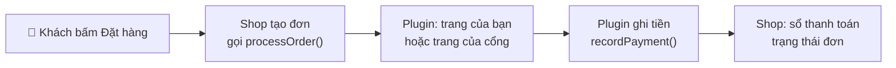
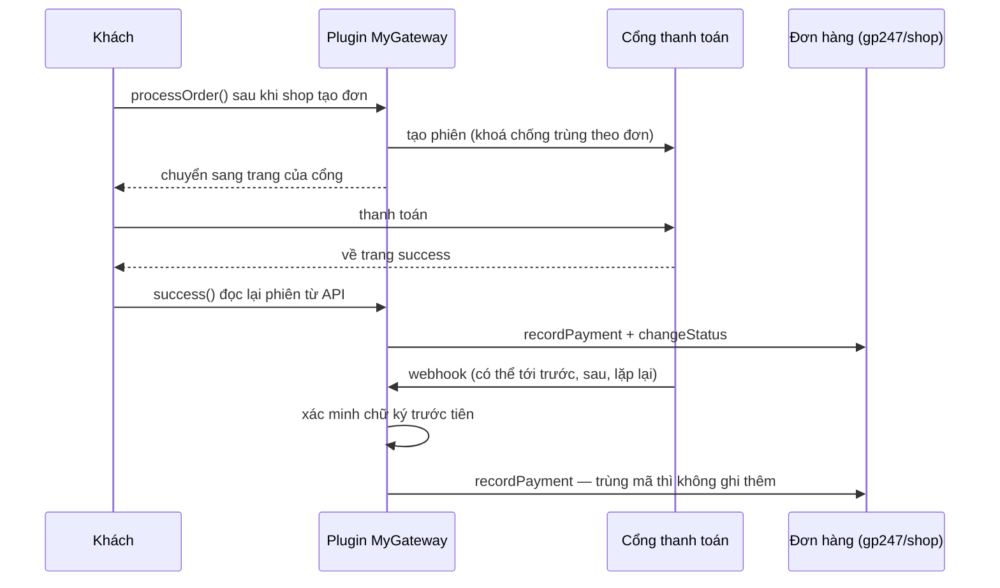

> 🌐 **Ngôn ngữ:** 🇻🇳 Tiếng Việt (hiện tại) · [🇬🇧 English](./create-payment-plugin.md)

# Tạo plugin thanh toán cho GP247 — từng bước, có code đầy đủ

## Giới thiệu

Tài liệu này hướng dẫn lập trình viên tự viết một **plugin thanh toán** cho GP247 / S-Cart. Phần 1 dựng một plugin
**chuyển khoản ngân hàng** chạy được ngay, không cần tài khoản bên ngoài — để bạn nắm cách plugin cắm vào trang thanh
toán. Phần 2 nối một **cổng thanh toán online** có API (trang thanh toán của cổng, trang quay về, webhook), với code
khung đã đặt đúng các điểm nối tiền của `gp247/shop`. Đọc xong, bạn có một plugin chạy được và biết chính xác chỗ nào
phải dùng hàm có sẵn để tiền không bị ghi sai hay ghi hai lần.

> 💡 **Làm cùng AI agent?** Dùng skill **`gp247-payment-plugin-create`** trong repo
> [gp247-skills](https://github.com/gp247net/gp247-skills): skill tự dò phiên bản site, hỏi đủ thông tin rồi dựng plugin theo
> đúng các bước dưới đây, và được cập nhật cùng `gp247/shop`.

---

## 1. Trước khi bắt đầu

- Website GP247 3.x có cài `gp247/shop` (phần bán hàng). Xem phiên bản lõi:

  ```bash
  php artisan gp247:info
  ```

  Dòng `core` (ví dụ `3.1`) là giá trị bạn ghi vào `requireCore` ở Bước 2.
- Biết cách tạo plugin cơ bản: [Hướng dẫn tạo plugin](./create-plugin_vi.md). Tài liệu này chỉ đi vào phần riêng của thanh toán.
- Hiểu thanh toán chạy thế nào ở phía cửa hàng: [Thanh toán trong GP247](../s-cart/payment/payment_vi.md).

**Ai làm gì** — phần lớn đã có sẵn trong `gp247/shop`, plugin chỉ làm phần của nó:

| `gp247/shop` lo | Plugin của bạn lo |
|---|---|
| Liệt kê phương thức ở trang thanh toán, tạo đơn trước khi gọi plugin | Khai `configCode: "Payment"`, tên hiển thị |
| Sổ thanh toán của đơn, *Đã nhận* / *Còn lại*, trạng thái thanh toán | Gọi `recordPayment()` với số tiền cổng **đã xác nhận** |
| Đổi trạng thái đơn kèm hoàn kho, lịch sử | Gọi `changeStatus()` và kiểm tra kết quả |
| Hoàn tất đơn (xoá giỏ, gửi mail, trang thành công) | Gọi `completeOrder()` / `cancelOrder()` đúng lúc |
| Mã hoá khoá bí mật trên màn cấu hình | Khai ô bí mật là `password` |



---

## 2. Phần 1 — Plugin chuyển khoản ngân hàng (chạy được ngay)

Kết quả: ở trang thanh toán có lựa chọn **Chuyển khoản ngân hàng**. Khách đặt đơn xong được đưa tới trang hướng dẫn
(ngân hàng, số tài khoản, số tiền, nội dung = mã đơn), bấm hoàn tất thì về trang đặt hàng thành công. Đơn ở trạng thái
chưa thanh toán; khi nhận được tiền, bạn ghi nhận trong trang quản trị đơn hàng.

### Bước 1 — Sinh khung và dọn file thừa

1. Mở Terminal tại thư mục gốc website (nơi có file `artisan`), chạy:

   ```bash
   php artisan gp247:make-plugin --name=MyBankTransfer --download=0
   ```

   Kết quả mong đợi: dòng `Success` và thư mục `app/GP247/Plugins/MyBankTransfer` được tạo.
2. Trong thư mục đó, **xoá** các file mẫu không dùng: thư mục `Admin/`, `Models/`, các file `Seo.php`, `config.php`,
   `function.php`, và trong `Views/` xoá hết (bước 5 tạo view mới).

Sau các bước dưới, plugin còn đúng các file sau:

```
MyBankTransfer/
├── gp247.json                    ← Bước 2
├── AppConfig.php                 ← Bước 3
├── Livewire/AdminLivewire.php    ← Bước 4
├── Controllers/FrontController.php  ← Bước 5
├── Views/instructions.blade.php     ← Bước 5
├── Route.php · Provider.php      ← Bước 6
├── Lang/vi/lang.php · Lang/en/lang.php  ← Bước 6
└── public/images/logo.jpg
```

### Bước 2 — `gp247.json`

Thay toàn bộ nội dung file:

```json
{
    "name": "My bank transfer",
    "image": "images/logo.jpg",
    "auth": "Your name",
    "email": "you@example.com",
    "link": "https://example.com",
    "configGroup": "Plugins",
    "configCode": "Payment",
    "configKey": "MyBankTransfer",
    "version": "1.0",
    "requireCore": ["3.1"],
    "requireUpdateFrom": "1.0",
    "requireComposerPackages": ["gp247/shop"],
    "requireGp247Extensions": [],
    "requireLivewire": false,
    "storeScope": "store"
}
```

- `configCode: "Payment"` — đây là cách trang thanh toán nhận ra plugin là một **phương thức thanh toán**.
- `requireCore` — ghi đúng dòng `core` của `php artisan gp247:info` (ví dụ `["3.1"]`). Mỗi giá trị `"X.Y"` nghĩa là "từ X.Y
  trở lên, trong cùng phiên bản lớn X": `"3.1"` chạy trên mọi bản 3.x từ 3.1, nhưng **không** chạy trên 4.x.
- `storeScope: "store"` — mỗi cửa hàng (khi dùng nhiều cửa hàng) có số tài khoản riêng.

### Bước 3 — `AppConfig.php`: cài, gỡ, cập nhật

Thay toàn bộ nội dung file. Thiết lập của chủ cửa hàng nằm trong **cơ sở dữ liệu** (bảng `admin_config`), mỗi ô một dòng
khoá `MyBankTransfer_<tên>` — để cập nhật plugin lên bản mới (ghi đè toàn bộ file) **không làm mất** thiết lập.

```php
<?php

namespace App\GP247\Plugins\MyBankTransfer;

use GP247\Core\ExtensionConfigDefault;
use GP247\Core\Models\AdminConfig;
use GP247\Core\Models\AdminHome;

class AppConfig extends ExtensionConfigDefault
{
    /** Settings the site owner edits: key => default. */
    public const SETTINGS = [
        'bank_name'      => '',
        'account_name'   => '',
        'account_number' => '',
        'note'           => '', // extra instructions shown to the customer
    ];

    public function __construct()
    {
        $config = json_decode(file_get_contents(__DIR__.'/gp247.json'), true);
        $this->configGroup = $config['configGroup'];
        $this->configKey = $config['configKey'];
        $this->configCode = $config['configCode'];
        $this->requireCore = $config['requireCore'] ?? [];
        $this->requireComposerPackages = $config['requireComposerPackages'] ?? [];
        $this->requireGp247Extensions = $config['requireGp247Extensions'] ?? [];
        $this->appPath = $this->configGroup.'/'.$this->configKey;
        $this->title = trans($this->appPath.'::lang.title');
        $this->image = $this->appPath.'/'.$config['image'];
        $this->version = $config['version'];
        $this->auth = $config['auth'];
        $this->link = $config['link'];
    }

    /**
     * Every admin_config row this plugin owns: the on/off row + one row per setting.
     */
    private function seedRows(): array
    {
        $rows = [[
            'group' => $this->configGroup, 'code' => $this->configCode, 'key' => $this->configKey,
            'sort' => 0, 'store_id' => GP247_STORE_ID_GLOBAL, 'value' => self::ON,
            'security' => 0, 'detail' => $this->appPath.'::lang.title',
        ]];
        $sort = 0;
        foreach (self::SETTINGS as $key => $default) {
            $rows[] = [
                'group' => $this->configGroup, 'code' => $this->configKey.'_config',
                'key' => $this->configKey.'_'.$key, 'sort' => ++$sort,
                'store_id' => GP247_STORE_ID_GLOBAL, 'value' => $default,
                'security' => 0, 'detail' => $this->appPath.'::lang.'.$key,
            ];
        }

        return $rows;
    }

    public function install()
    {
        if (AdminConfig::where('group', $this->configGroup)->where('key', $this->configKey)->exists()) {
            return ['error' => 1, 'msg' => gp247_language_render('admin.extension.plugin_exist')];
        }
        try {
            AdminConfig::insert($this->seedRows());

            return ['error' => 0, 'msg' => gp247_language_render('admin.extension.install_success')];
        } catch (\Throwable $e) {
            return ['error' => 1, 'msg' => $e->getMessage()];
        }
    }

    /**
     * Add the rows a newer version introduced; never touch a value the site owner saved.
     */
    public function update(?string $fromVersion = null)
    {
        try {
            foreach ($this->seedRows() as $row) {
                $exists = AdminConfig::where('group', $row['group'])->where('key', $row['key'])
                    ->where('store_id', (string) $row['store_id'])->exists();
                if (!$exists) {
                    AdminConfig::insert($row);
                }
            }

            return ['error' => 0, 'msg' => ''];
        } catch (\Throwable $e) {
            return ['error' => 1, 'msg' => $e->getMessage()];
        }
    }

    public function uninstall()
    {
        try {
            AdminConfig::where('group', $this->configGroup)->where(function ($q) {
                $q->where('key', $this->configKey)
                    ->orWhere('key', 'like', $this->configKey.'\_%')
                    ->orWhere('code', $this->configKey.'_config');
            })->delete();
            AdminHome::where('extension', $this->appPath)->delete();

            return ['error' => 0, 'msg' => gp247_language_render('admin.extension.uninstall_success')];
        } catch (\Throwable $e) {
            return ['error' => 1, 'msg' => $e->getMessage()];
        }
    }

    public function enable()
    {
        AdminConfig::where('group', $this->configGroup)->where('key', $this->configKey)->update(['value' => self::ON]);

        return ['error' => 0, 'msg' => gp247_language_render('admin.extension.enable_success')];
    }

    public function disable()
    {
        AdminConfig::where('group', $this->configGroup)->where('key', $this->configKey)->update(['value' => self::OFF]);

        return ['error' => 0, 'msg' => ''];
    }

    // The ⚙ (Config) button on the Plugins list appears only when this returns a redirect.
    public function clickApp()
    {
        return redirect(gp247_route_admin('admin_mybanktransfer.index'));
    }

    public function setupStore($storeId = null)
    {
    }

    public function removeStore($storeId = null)
    {
    }

    /**
     * A setting for a store (falls back to the shared value).
     */
    public function setting(string $key, $storeId = null): string
    {
        $storeId ??= gp247_plugin_store_id();

        return (string) gp247_config($this->configKey.'_'.$key, $storeId, self::SETTINGS[$key] ?? '');
    }

    public function getInfo()
    {
        return [
            'title' => $this->title,
            'key' => $this->configKey,
            'code' => $this->configCode,
            'image' => $this->image,
            'permission' => self::ALLOW,
            'version' => $this->version,
            'auth' => $this->auth,
            'link' => $this->link,
            'appPath' => $this->appPath,
        ];
    }
}
```

Điểm cần chú ý:

- `install()` ghi dòng bật/tắt (khoá `MyBankTransfer`, `code` = `Payment`) và một dòng cho mỗi thiết lập.
- `update()` chỉ **thêm** dòng còn thiếu, không đụng giá trị chủ cửa hàng đã lưu — chạy lại bao nhiêu lần cũng an toàn,
  và chạy được khi `$fromVersion` là `null`.
- `clickApp()` — nút ⚙ **Cấu hình** trên danh sách Plugins chỉ hiện khi hàm này trả về một chuyển hướng.
- `setting()` đọc giá trị theo cửa hàng, không có thì lấy giá trị chung.
- Muốn khách thấy một lời nhắn ngắn **ngay ở trang thanh toán** (dưới phương thức khi được chọn, và ở bước xác nhận),
  thêm `'note' => $this->setting('note')` vào mảng của `getInfo()` (gp247/shop 3.1.4 trở lên). Lời nhắn là chữ thường,
  không có số tiền hay mã đơn — vì thế plugin này vẫn cần trang hướng dẫn ở Bước 5.

### Bước 4 — Màn cấu hình (`Livewire/AdminLivewire.php`)

Màn cấu hình kế thừa `ConfigForm` của lõi: tự có giao diện, phân quyền, chọn cửa hàng, lưu từng ô.

```php
<?php

namespace App\GP247\Plugins\MyBankTransfer\Livewire;

use App\GP247\Plugins\MyBankTransfer\AppConfig;
use GP247\Core\AdminShell\Infrastructure\ConfigForm;

/**
 * Settings screen: one field per row seeded by AppConfig::install().
 */
class AdminLivewire extends ConfigForm
{
    protected ?string $permission = null;

    protected function group(): string
    {
        return 'Plugins';
    }

    protected function heading(): string
    {
        return trans('Plugins/MyBankTransfer::lang.title');
    }

    // Each store may receive money on its own account.
    protected function storeScoped(): bool
    {
        return true;
    }

    // Required: without keys() the screen would list — and save — nothing of yours.
    protected function keys(): array
    {
        return array_map(fn ($key) => 'MyBankTransfer_'.$key, array_keys(AppConfig::SETTINGS));
    }
}
```

> `keys()` là **bắt buộc**: thiếu nó, màn hình không hiện và không lưu ô nào của plugin.

### Bước 5 — Trang hướng dẫn chuyển khoản

`Controllers/FrontController.php` — `processOrder()` là hàm cửa hàng gọi **ngay sau khi tạo đơn**:

```php
<?php

namespace App\GP247\Plugins\MyBankTransfer\Controllers;

use App\GP247\Plugins\MyBankTransfer\AppConfig;
use GP247\Front\Controllers\RootFrontController;
use GP247\Shop\Controllers\ShopCartController;
use GP247\Shop\Models\ShopOrder;

class FrontController extends RootFrontController
{
    /**
     * Called by the shop right after it created the order (session('orderID')).
     * We show the transfer instructions before finishing the checkout.
     */
    public function processOrder()
    {
        if (!$this->currentOrder()) {
            return redirect(gp247_route_front('front.home'));
        }

        return redirect(gp247_route_front('mybanktransfer.instructions'));
    }

    /**
     * Page with the bank details, the amount and the transfer reference.
     */
    public function instructions()
    {
        $order = $this->currentOrder();
        if (!$order) {
            return redirect(gp247_route_front('front.home'));
        }
        $config = new AppConfig();

        return view('Plugins/MyBankTransfer::instructions', [
            'title' => $config->title,
            'order' => $order,
            'bank' => [
                'bank_name' => $config->setting('bank_name', $order->store_id),
                'account_name' => $config->setting('account_name', $order->store_id),
                'account_number' => $config->setting('account_number', $order->store_id),
                'note' => $config->setting('note', $order->store_id),
            ],
            'layout_page' => '',
        ]);
    }

    /**
     * The customer confirmed: finish the checkout the shop's way (clear cart, mails, success page).
     */
    public function finish()
    {
        if (!$this->currentOrder()) {
            return redirect(gp247_route_front('front.home'));
        }

        return (new ShopCartController)->completeOrder();
    }

    /**
     * The order this browser just placed with this method — never an id from the URL.
     */
    private function currentOrder(): ?ShopOrder
    {
        $order = ShopOrder::find(session('orderID'));

        return ($order && $order->payment_method === 'MyBankTransfer') ? $order : null;
    }
}
```

`Views/instructions.blade.php` — dùng bố cục của template đang chạy nên trang mang đúng giao diện cửa hàng:

```blade
@extends($GP247TemplatePath.'.layout')

@section('block_main_content_center')
<div class="lg:col-span-12 w-full max-w-xl mx-auto py-10">
    <h1 class="section-title mb-4">{{ trans('Plugins/MyBankTransfer::lang.instructions_title') }}</h1>
    <p class="mb-6">{{ trans('Plugins/MyBankTransfer::lang.instructions_intro') }}</p>

    <dl class="card p-6 space-y-3 mb-6">
        <div><dt class="text-sm text-ink-500">{{ trans('Plugins/MyBankTransfer::lang.bank_name') }}</dt><dd class="font-semibold">{{ $bank['bank_name'] }}</dd></div>
        <div><dt class="text-sm text-ink-500">{{ trans('Plugins/MyBankTransfer::lang.account_name') }}</dt><dd class="font-semibold">{{ $bank['account_name'] }}</dd></div>
        <div><dt class="text-sm text-ink-500">{{ trans('Plugins/MyBankTransfer::lang.account_number') }}</dt><dd class="font-semibold">{{ $bank['account_number'] }}</dd></div>
        <div><dt class="text-sm text-ink-500">{{ trans('Plugins/MyBankTransfer::lang.amount') }}</dt><dd class="font-semibold">{{ gp247_currency_render_symbol($order->total, $order->currency) }}</dd></div>
        <div><dt class="text-sm text-ink-500">{{ trans('Plugins/MyBankTransfer::lang.reference') }}</dt><dd class="font-semibold">{{ $order->id }}</dd></div>
    </dl>

    @if ($bank['note'] !== '')
        <p class="mb-6">{{ $bank['note'] }}</p>
    @endif

    <a href="{{ gp247_route_front('mybanktransfer.finish') }}" class="btn-primary" data-testid="mybanktransfer-instructions-finish">
        {{ trans('Plugins/MyBankTransfer::lang.finish') }}
    </a>
</div>
@endsection
```

Vì sao không lấy mã đơn từ địa chỉ trang? `currentOrder()` chỉ đọc đơn mà **chính trình duyệt này** vừa đặt
(`session('orderID')`) và đúng phương thức này — người khác đoán mã đơn cũng không xem được đơn của bạn.

### Bước 6 — `Route.php`, `Provider.php`, ngôn ngữ

`Route.php`:

```php
<?php

use Illuminate\Support\Facades\Route;

$config = json_decode(file_get_contents(__DIR__.'/gp247.json'), true);

if (gp247_extension_check_active($config['configGroup'], $config['configKey'])) {
    // Pages the customer sees: inside the storefront middleware (session, language, store).
    Route::group(
        [
            'middleware' => GP247_FRONT_MIDDLEWARE,
            'prefix' => 'plugin/mybanktransfer',
        ],
        function () {
            Route::get('instructions', [\App\GP247\Plugins\MyBankTransfer\Controllers\FrontController::class, 'instructions'])
                ->name('mybanktransfer.instructions');
            Route::get('finish', [\App\GP247\Plugins\MyBankTransfer\Controllers\FrontController::class, 'finish'])
                ->name('mybanktransfer.finish');
        }
    );

    // Settings screen.
    Route::group(
        [
            'prefix' => GP247_ADMIN_PREFIX.'/mybanktransfer',
            'middleware' => GP247_ADMIN_MIDDLEWARE,
        ],
        function () {
            Route::get('/', \App\GP247\Plugins\MyBankTransfer\Livewire\AdminLivewire::class)
                ->name('admin_mybanktransfer.index');
        }
    );
}
```

`Provider.php`:

```php
<?php

$config = json_decode(file_get_contents(__DIR__.'/gp247.json'), true);
$extensionPath = $config['configGroup'].'/'.$config['configKey'];

$this->loadTranslationsFrom(__DIR__.'/Lang', $extensionPath);

if (gp247_extension_check_active($config['configGroup'], $config['configKey'])) {
    $this->loadViewsFrom(__DIR__.'/Views', $extensionPath);

    if (class_exists(\Livewire\Livewire::class)) {
        \Livewire\Livewire::addNamespace('MyBankTransfer', classNamespace: 'App\\GP247\\Plugins\\MyBankTransfer\\Livewire');
    }
}
```

`Lang/vi/lang.php` (tạo tương tự `Lang/en/lang.php` bằng tiếng Anh):

```php
<?php

return [
    'title'              => 'Chuyển khoản ngân hàng',
    'bank_name'          => 'Ngân hàng',
    'account_name'       => 'Chủ tài khoản',
    'account_number'     => 'Số tài khoản',
    'note'               => 'Lời nhắn thêm cho khách',
    'amount'             => 'Số tiền',
    'reference'          => 'Nội dung chuyển khoản (mã đơn)',
    'instructions_title' => 'Hướng dẫn chuyển khoản',
    'instructions_intro' => 'Vui lòng chuyển đúng số tiền với nội dung là mã đơn. Đơn được xử lý khi cửa hàng nhận được tiền.',
    'finish'             => 'Tôi đã ghi lại thông tin — hoàn tất đặt hàng',
];
```

### Bước 7 — Cài và thử

1. Xoá cache để nạp file mới:

   ```bash
   php artisan optimize:clear
   ```

2. Cài plugin: **Admin → Plugins → MyBankTransfer → Cài đặt** (hoặc bằng lệnh):

   ```bash
   php artisan gp247:ext-install --type=plugin --key=MyBankTransfer
   ```

3. Bấm ⚙ **Cấu hình**, nhập ngân hàng, chủ tài khoản, số tài khoản, bấm **Lưu**.
4. Ra trang cửa hàng, đặt một đơn, chọn **Chuyển khoản ngân hàng**.
   Kết quả mong đợi: sau khi đặt, hiện trang hướng dẫn với đúng số tiền và mã đơn; bấm nút hoàn tất thì về trang đặt
   hàng thành công.
5. Trong **Admin → Đơn hàng**, đơn ở trạng thái chưa thanh toán. Khi tiền về, bấm **Ghi nhận tiền đã thu** trên đơn.

> ⚠️ Khi thử gỡ plugin **đang phát triển**, luôn dùng `--only-data`:
> `php artisan gp247:ext-uninstall --type=plugin --key=MyBankTransfer --only-data`. Gỡ thường sẽ **xoá luôn thư mục mã nguồn**.

---

## 3. Phần 2 — Nối cổng thanh toán online (code khung)

Phần này dựng plugin `MyGateway` cho một cổng **giả định** có API: tạo trang thanh toán, đọc lại kết quả, gửi webhook có
chữ ký. Thay địa chỉ, tên trường và cách ký bằng tài liệu của cổng thật. Khung plugin, `gp247.json` (`configCode: "Payment"`)
và `AppConfig.php` làm như Phần 1.



### 3.1. Thiết lập: khoá thử / khoá thật là ô bí mật

Trong `AppConfig.php`, đổi danh sách thiết lập thành dạng *giá trị mặc định + có phải bí mật không*, và khi tạo dòng ghi
`'security' => $secret ? 1 : 0` (lõi mã hoá dòng có `security = 1`):

```php
public const SETTINGS = [
    'test_mode'            => ['1', false],
    'api_key_test'         => ['', true],
    'webhook_secret_test'  => ['', true],
    'api_key_live'         => ['', true],
    'webhook_secret_live'  => ['', true],
    'order_status_success' => ['2', false], // 2 = Đang xử lý
];
```

Trong `Livewire/AdminLivewire.php`, khai kiểu ô — ô `password` không bao giờ gửi giá trị đã lưu ra trình duyệt:

```php
protected function fieldTypes(): array
{
    return [
        'MyGateway_test_mode'            => 'bool',
        'MyGateway_api_key_test'         => 'password',
        'MyGateway_webhook_secret_test'  => 'password',
        'MyGateway_api_key_live'         => 'password',
        'MyGateway_webhook_secret_live'  => 'password',
        'MyGateway_order_status_success' => 'select',
    ];
}

protected function fieldOptions(): array
{
    return ['MyGateway_order_status_success' => \GP247\Shop\Models\ShopOrderStatus::getIdAll()];
}
```

Muốn chia ô thành khối "Môi trường thử" / "Môi trường thật", thêm `sections()` — xem plugin mẫu `StripePayment`.

### 3.2. Gọi API của cổng — `Services/GatewayApi.php`

```php
<?php

namespace App\GP247\Plugins\MyGateway\Services;

use Illuminate\Support\Facades\Http;

/**
 * Thin client for the (fictitious) gateway API. Replace URLs and fields with your gateway's.
 */
class GatewayApi
{
    private string $key;
    private string $baseUrl;

    public function __construct($storeId = null)
    {
        $live = !gp247_config('MyGateway_test_mode', $storeId);
        $this->key = (string) gp247_config($live ? 'MyGateway_api_key_live' : 'MyGateway_api_key_test', $storeId);
        $this->baseUrl = $live ? 'https://api.mygateway.example' : 'https://sandbox.mygateway.example';
    }

    public function configured(): bool
    {
        return $this->key !== '';
    }

    /** Create a hosted payment page. The idempotency key makes a repeated call return the same session. */
    public function createSession(array $params, string $idempotencyKey): array
    {
        return Http::timeout(10)->withToken($this->key)
            ->withHeaders(['Idempotency-Key' => $idempotencyKey])
            ->post($this->baseUrl.'/v1/sessions', $params)
            ->throw()->json();
    }

    /** Read a session back from the gateway — the only trustworthy source of "paid". */
    public function retrieveSession(string $sessionId): array
    {
        return Http::timeout(10)->withToken($this->key)
            ->get($this->baseUrl.'/v1/sessions/'.urlencode($sessionId))
            ->throw()->json();
    }
}
```

### 3.3. Ghi tiền đúng một lần — `Services/PaymentRecorder.php`

Đây là **chỗ duy nhất** plugin chạm vào tiền. Cả trang quay về lẫn webhook đều gọi nó, theo bất kỳ thứ tự nào, bao nhiêu lần:

```php
<?php

namespace App\GP247\Plugins\MyGateway\Services;

use GP247\Shop\Models\ShopOrder;
use GP247\Shop\Models\ShopOrderStatus;
use Illuminate\Database\UniqueConstraintViolationException;

/**
 * Records money the gateway CONFIRMED on the order — the only place the plugin touches money.
 * Called from the return page and from the webhook; both may run, in any order, many times.
 */
class PaymentRecorder
{
    public static function record(ShopOrder $order, float $paid, string $currency, string $txnId): void
    {
        $matches = strcasecmp($currency, (string) $order->currency) === 0
            && abs($paid - (float) $order->total) < 0.005;
        $note = $matches ? null : "Gateway took $paid $currency, order is {$order->total} {$order->currency}";

        try {
            // Keyed by the gateway's transaction id: a repeated report records nothing new.
            $order->recordPayment($paid, 'MyGateway', $txnId, null, $note);
        } catch (UniqueConstraintViolationException $e) {
            // Two reports at the same instant: the other one recorded it.
        }

        if (!$matches) {
            gp247_report('MyGateway: order '.$order->id.': '.$note); // a human reconciles; status unchanged
            return;
        }

        $order = ShopOrder::find($order->id);
        // Only an order still New moves: a late report must not undo what the admin did.
        // Also runs on a replay, so a first delivery that failed before this line is completed now.
        if ((int) $order->status === ShopOrderStatus::NEW) {
            $target = (int) gp247_config('MyGateway_order_status_success', $order->store_id) ?: ShopOrderStatus::PROCESSING;
            $refused = $order->changeStatus($target, ['content' => 'MyGateway payment '.$txnId]);
            if ($refused !== null) {
                gp247_report('MyGateway: order '.$order->id.' status not changed: '.$refused);
            }
        }
    }
}
```

- Tiền ghi theo **đồng tiền của đơn**, đúng số cổng thực thu. Lệch tổng đơn thì ghi kèm ghi chú và **không** đổi trạng thái —
  để người đối chiếu, không che chênh lệch.
- Cùng mã giao dịch → sổ không ghi thêm. Hai lần báo **cùng lúc** có thể gây lỗi trùng khoá — bắt lỗi đó và coi là "đã ghi".
- Chỉ đơn còn *Mới* mới được chuyển trạng thái; đoạn này chạy cả khi báo lặp, nên lần trước lỗi giữa chừng thì lần sau làm nốt.

### 3.4. Chuyển khách sang cổng, trang quay về, webhook — `Controllers/FrontController.php`

```php
<?php

namespace App\GP247\Plugins\MyGateway\Controllers;

use App\GP247\Plugins\MyGateway\Services\GatewayApi;
use App\GP247\Plugins\MyGateway\Services\PaymentRecorder;
use GP247\Front\Controllers\RootFrontController;
use GP247\Shop\Controllers\ShopCartController;
use GP247\Shop\Models\ShopOrder;
use GP247\Shop\Models\ShopOrderStatus;
use Illuminate\Http\Request;

class FrontController extends RootFrontController
{
    /** The shop created the order; send the customer to the gateway. */
    public function processOrder()
    {
        $order = ShopOrder::find(session('orderID'));
        $api = new GatewayApi($order?->store_id);
        if (!$order || !$api->configured()) {
            return redirect(gp247_route_front('cart'))->with('error', trans('Plugins/MyGateway::lang.error_not_available'));
        }

        try {
            $session = $api->createSession([
                'amount' => (float) $order->total,
                'currency' => $order->currency,
                'reference' => $order->id,
                'return_url' => gp247_route_front('mygateway.success'),
                'cancel_url' => gp247_route_front('mygateway.cancel'),
            ], 'order-'.$order->id); // same order twice => same session
        } catch (\Throwable $e) {
            gp247_report('MyGateway: create session for order '.$order->id.' failed: '.$e->getMessage());
            return redirect(gp247_route_front('cart'))->with('error', trans('Plugins/MyGateway::lang.error_not_available'));
        }

        $order->update(['transaction' => $session['id']]); // the gateway reference, not money

        return redirect()->away($session['url']);
    }

    /** Customer is back. Never trust the URL: read the session from the gateway. */
    public function success()
    {
        $order = ShopOrder::find(session('orderID'));
        if (!$order || (string) $order->transaction === '') {
            return redirect(gp247_route_front('front.home'));
        }

        try {
            $session = (new GatewayApi($order->store_id))->retrieveSession((string) $order->transaction);
        } catch (\Throwable $e) {
            gp247_report('MyGateway: read session of order '.$order->id.' failed: '.$e->getMessage());
            return redirect(gp247_route_front('front.home'))->with('error', trans('Plugins/MyGateway::lang.error_verify'));
        }

        if (($session['reference'] ?? '') === $order->id && ($session['status'] ?? '') === 'paid') {
            PaymentRecorder::record($order, (float) $session['amount'], (string) $session['currency'], (string) $session['payment_id']);
        }
        // Not paid yet (slow methods): the order is placed, the webhook records the money later.

        return (new ShopCartController)->completeOrder();
    }

    /** Customer cancelled on the gateway page. */
    public function cancel()
    {
        $order = ShopOrder::find(session('orderID'));
        if ($order && (float) $order->received > 0) {
            return (new ShopCartController)->completeOrder(); // paid after all
        }
        if ($order && (int) $order->status !== ShopOrderStatus::NEW) {
            return redirect(gp247_route_front('front.home'));
        }

        return (new ShopCartController)->cancelOrder(); // the shop cancels and returns the stock
    }

    /** Server-to-server notification. Verify FIRST, on the raw body. */
    public function webhook(Request $request)
    {
        $payload = (string) $request->getContent();
        $test = (bool) gp247_config('MyGateway_test_mode');
        $secret = (string) gp247_config($test ? 'MyGateway_webhook_secret_test' : 'MyGateway_webhook_secret_live');
        $expected = hash_hmac('sha256', $payload, $secret);
        if ($secret === '' || !hash_equals($expected, (string) $request->header('X-Signature'))) {
            return response('Invalid signature', 400);
        }

        $event = json_decode($payload, true);
        if (($event['type'] ?? '') !== 'payment.succeeded') {
            return response('OK', 200); // not an event this plugin acts on
        }

        $order = ShopOrder::find((string) ($event['data']['reference'] ?? ''));
        if (!$order) {
            return response('OK', 200);
        }

        try {
            PaymentRecorder::record($order, (float) $event['data']['amount'], (string) $event['data']['currency'], (string) $event['data']['payment_id']);
        } catch (\Throwable $e) {
            gp247_report('MyGateway: webhook for order '.$order->id.' failed: '.$e->getMessage());
            return response('Error', 500); // the gateway retries
        }

        return response('OK', 200);
    }
}
```

### 3.5. Route — webhook nằm **ngoài** nhóm storefront

```php
use Illuminate\Support\Facades\Route;

$config = json_decode(file_get_contents(__DIR__.'/gp247.json'), true);

if (gp247_extension_check_active($config['configGroup'], $config['configKey'])) {
    Route::group(['middleware' => GP247_FRONT_MIDDLEWARE, 'prefix' => 'plugin/mygateway'], function () {
        Route::get('success', [\App\GP247\Plugins\MyGateway\Controllers\FrontController::class, 'success'])
            ->middleware('throttle:30,1')->name('mygateway.success');
        Route::get('cancel', [\App\GP247\Plugins\MyGateway\Controllers\FrontController::class, 'cancel'])
            ->name('mygateway.cancel');
    });

    // Server-to-server: no session, no CSRF token. Inside the storefront group it could get a
    // redirect or a maintenance page back, which the gateway would count as "delivered".
    Route::post('plugin/mygateway/webhook', [\App\GP247\Plugins\MyGateway\Controllers\FrontController::class, 'webhook'])
        ->middleware('throttle:600,1')->name('mygateway.webhook');

    Route::group(['prefix' => GP247_ADMIN_PREFIX.'/mygateway', 'middleware' => GP247_ADMIN_MIDDLEWARE], function () {
        Route::get('/', \App\GP247\Plugins\MyGateway\Livewire\AdminLivewire::class)->name('admin_mygateway.index');
    });
}
```

Hiện địa chỉ webhook cho chủ cửa hàng chép sang trang quản trị của cổng: `route('mygateway.webhook')`.

### 3.6. (Tuỳ chọn) Link thanh toán và hoàn tiền

Muốn cổng của bạn thu được [link thanh toán](../s-cart/order-processing/payment-request_vi.md) và hoàn tiền từ màn *Yêu cầu
thanh toán*: viết một lớp implement `GP247\Shop\Payment\Contracts\PaymentGateway` (`key`, `capabilities`, `availableFor`,
`collect`, `refund`) rồi đăng ký trong `Provider.php` (ghi cả mảng, vì khoá có dấu chấm sẽ bị tách):

```php
if (interface_exists(\GP247\Shop\Payment\Contracts\PaymentGateway::class)) {
    $gateways = (array) config('gp247-config.payment.gateways', []);
    $gateways['MyGateway'] = [
        'label' => 'MyGateway',
        'capabilities' => ['collect', 'refund'],
        'driver' => \App\GP247\Plugins\MyGateway\Services\MyGatewayPaymentGateway::class,
    ];
    config(['gp247-config.payment.gateways' => $gateways]);
}
```

Tiền của link thanh toán ghi bằng `PaymentRequestService::recordMovement()` (không phải sổ của đơn). Mã tham khảo đầy đủ:
plugin `StripePayment` (`Services/StripePaymentRequestGateway.php`).

### 3.7. Kiểm thử không gọi cổng thật

Không bao giờ gọi cổng thật trong test. Dùng `Http::fake()` cho API và tự ký webhook mẫu:

```php
<?php

namespace Tests\Feature\MyGateway;

use App\GP247\Plugins\MyGateway\Controllers\FrontController;
use GP247\Core\Models\AdminConfig;
use GP247\Shop\Models\ShopOrder;
use GP247\Shop\Models\ShopOrderStatus;
use Illuminate\Foundation\Testing\DatabaseTransactions;
use Illuminate\Http\Request;
use Tests\TestCase;

class MyGatewayWebhookTest extends TestCase
{
    use DatabaseTransactions; // run against a TEST database only

    private function webhook(array $event, string $secret)
    {
        $body = json_encode($event);
        $request = Request::create('/plugin/mygateway/webhook', 'POST', [], [], [], [
            'CONTENT_TYPE' => 'application/json',
            'HTTP_X_SIGNATURE' => hash_hmac('sha256', $body, $secret),
        ], $body);

        return (new FrontController())->webhook($request);
    }

    public function test_a_payment_reported_twice_is_recorded_once(): void
    {
        foreach (['MyGateway_test_mode' => '1', 'MyGateway_webhook_secret_test' => 'test-secret'] as $key => $value) {
            AdminConfig::updateOrInsert(['group' => 'Plugins', 'key' => $key, 'store_id' => GP247_STORE_ID_GLOBAL], ['value' => $value, 'code' => 'MyGateway_config']);
        }
        $order = ShopOrder::where('status', ShopOrderStatus::NEW)->firstOrFail(); // or create one for the test
        $event = ['type' => 'payment.succeeded', 'data' => [
            'reference' => $order->id, 'amount' => (float) $order->total,
            'currency' => $order->currency, 'payment_id' => 'pay_123',
        ]];

        $this->assertSame(200, $this->webhook($event, 'test-secret')->getStatusCode());
        $this->assertSame(200, $this->webhook($event, 'test-secret')->getStatusCode()); // replay

        $order = ShopOrder::find($order->id);
        $this->assertEquals((float) $order->total, (float) $order->received);
        $this->assertSame(ShopOrderStatus::PROCESSING, (int) $order->status);
    }

    public function test_a_wrong_signature_writes_nothing(): void
    {
        $this->assertSame(400, $this->webhook(['type' => 'payment.succeeded'], 'not-the-secret')->getStatusCode());
    }
}
```

---

## 4. Danh sách kiểm tra trước khi phát hành

- [ ] `gp247.json`: `configCode: "Payment"`, `configKey` trùng tên thư mục, `requireCore` theo `gp247:info`, có `gp247/shop`.
- [ ] Thiết lập nằm trong `admin_config`; khoá bí mật là ô `password` (`security = 1`); `update()` chạy lại an toàn.
- [ ] `clickApp()` mở màn cấu hình; `keys()` liệt kê đủ ô.
- [ ] Tiền chỉ qua `recordPayment()` / `recordRefund()`, trạng thái chỉ qua `changeStatus()`; không `update()` thẳng `status`, `payment_status`, `received`.
- [ ] Trang quay về đọc lại kết quả từ cổng; webhook ngoài nhóm storefront, xác minh chữ ký trước khi chạm database.
- [ ] Test có trường hợp báo lặp, sai chữ ký, sai số tiền — không gọi cổng thật.
- [ ] Gỡ plugin chỉ xoá thiết lập, **không** xoá tiền đã ghi.

---

## Điều kiện & ràng buộc (hiểu trước khi thao tác)

**Khai báo plugin**
- **`configKey` phải trùng tên thư mục và không đổi sau khi phát hành** — hệ thống dùng nó để nhận ra bản cũ và bản mới.
- **`requireCore` là một khoảng theo phiên bản lớn** — `"3.1"` không cài được trên lõi 4.x; ghi đúng lõi bạn đã thử.
- **Mỗi bản phát hành phải tăng `version`** — không tăng thì cập nhật 1-click từ chối.

**Ghi tiền**
- **Số tiền theo đồng tiền của đơn và là số cổng đã xác nhận** — ghi số khác thì sổ của cửa hàng sai.
- **Chỉ đơn còn *Mới* mới tự chuyển trạng thái** — webhook muộn không được ghi đè việc người quản trị đã làm.
- **`changeStatus()` có thể từ chối** (ví dụ mở lại đơn mà kho không đủ) — luôn kiểm tra kết quả trả về.

**Webhook**
- **Xác minh chữ ký trên nội dung thô trước khi đọc database**, so sánh bằng `hash_equals` — tránh giả mạo và tránh bị dò.
- **Trả 500 khi lỗi nội bộ** để cổng gửi lại; trả 200 cho sự kiện không xử lý.

---

## Hỏi & Đáp (Q&A)

**Câu 1: Plugin đã cài nhưng không hiện ở trang thanh toán?**

→ Kiểm tra plugin đang **Bật** (cho đúng cửa hàng), `configCode` là `"Payment"`, dòng bật/tắt có `code` = `Payment` (do
`install()` ghi), rồi chạy `php artisan optimize:clear`.

**Câu 2: Không thấy nút ⚙ Cấu hình trên danh sách Plugins?**

→ `AppConfig::clickApp()` phải trả về chuyển hướng tới màn cấu hình; khung mặc định trả `null`.

**Câu 3: Màn cấu hình trống hoặc bấm Lưu không lưu gì?**

→ Thiếu `keys()` trong màn cấu hình, hoặc `install()` chưa tạo dòng cho các khoá đó.

**Câu 4: Sao không được tự ghi `received` hay `payment_status` của đơn?**

→ Hai giá trị đó do sổ thanh toán tính ra. Ghi thẳng sẽ bị tính lại đè lên, và bỏ qua lịch sử, hoàn kho khi đổi trạng thái.

**Câu 5: Webhook của tôi bị trả về trang chuyển hướng hoặc lỗi 419?**

→ Route webhook đang nằm trong nhóm middleware storefront. Đưa nó ra ngoài như mục 3.5.

**Câu 6: Cổng gửi webhook hai lần thì sao?**

→ Không sao: cùng mã giao dịch thì sổ không ghi thêm; lần thứ hai chỉ làm nốt việc đổi trạng thái nếu lần trước dở dang.

**Câu 7: Lưu khoá bí mật xong, ô lại trống?**

→ Đúng thiết kế: ô `password` không gửi giá trị đã lưu ra trình duyệt, chỉ báo "đã có giá trị". Để trống khi lưu nghĩa là giữ khoá cũ.

**Câu 8: Mỗi cửa hàng nhận tiền vào tài khoản riêng được không?**

→ Được: `storeScope: "store"` trong `gp247.json` và `storeScoped()` trả `true` trong màn cấu hình; đọc thiết lập theo cửa
hàng của **đơn** (`$order->store_id`).

**Câu 9: Làm sao test mà không mất tiền thật?**

→ Test tự động dùng `Http::fake()` và webhook tự ký (mục 3.7); thử bằng tay dùng môi trường sandbox của cổng.

**Câu 10: Có cách nào nhanh hơn với AI agent?**

→ Dùng skill `gp247-payment-plugin-create` — skill dựng plugin theo đúng các bước ở đây và được cập nhật cùng `gp247/shop`.

---

## Lịch sử thay đổi
<!-- Chỉ ghi khi có thay đổi về logic/hành vi. Dòng mới nhất ở trên cùng. Mỗi ngày một dòng: cùng ngày thì gộp vào dòng có sẵn, không tách dòng mới. -->

| Ngày | Phiên bản GP247 | Thay đổi |
| --- | --- | --- |
| 2026-10-18 | gp247/shop 3.1.4 | Tài liệu mới: plugin chuyển khoản chạy được ngay + khung nối cổng thanh toán online; `getInfo()['note']` hiện ở trang thanh toán |

---

<sub>📅 **Cập nhật lần cuối:** 2026-10-18 · ✍️ **Tác giả (Author):** GP247</sub>
