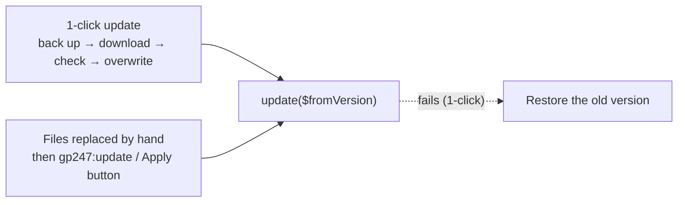

> 🌐 **Language:** [🇻🇳 Tiếng Việt](./create-plugin-update-safety_vi.md) · 🇬🇧 English (current)

# Update-safe plugins — rules, own data tables and the `update()` hook

## Introduction

This document is for GP247 plugin developers who want every new release to **update safely** on other people's sites: no
lost settings, no broken data, and uninstall → reinstall still rebuilds every table. It explains how updates run, the 6
rules to keep, how to create your own data tables and how to write the `update()` hook. Read it after
[Creating a plugin](./create-plugin.md).

---

## How updates run

There are two ways a new version reaches a site:



- 1-click: before overwriting, the system checks the checksum, `configKey`, `version`, `requireUpdateFrom`, `requireCore`; a
  failure while overwriting or in `update()` → the plugin is **restored** from the backup.
- Files replaced by hand (`git pull`, Composer, manual copy; then `gp247:update`, `gp247:ext-update --local` or the **Apply data
  update** button): there is no file backup; a failure in `update()` only leaves the plugin "pending" so it can run again. A
  site installed before GP247 recorded versions calls `update()` **once with `$fromVersion = null`**.

| Location | On update |
|---|---|
| `app/GP247/Plugins/<Name>/…` (code, `config.php`, views) | **Deleted and replaced** with the new version |
| `public/GP247/Plugins/<Name>/…` (the plugin's css, js, images) | **Deleted and replaced** |
| `admin_config` rows (on/off, settings) | **Kept** |
| The plugin's own data tables, menu | **Kept** — the new version tops them up through `update()` |

---

## The 6 rules

| # | Rule | Why |
|---|---|---|
| 1 | `version` increases with every release; `configKey` never changes | The system matches old / new versions with these two values |
| 2 | Settings the store owner edits live in the database | An update overwrites every file |
| 3 | `update()` is safe to re-run and handles `null` | It also runs after `git pull`, possibly several times |
| 4 | Never store user uploads inside the plugin folder | The folder is deleted and replaced on update |
| 5 | Set `requireCore` and `requireUpdateFrom` correctly | Blocks installing on an untested core and jumping from a too-old version |
| 6 | Own data tables can be rebuilt on reinstall | Uninstall → reinstall must create every table again |

### Rule 1 — `version` increases, `configKey` stays

- Every release increases `version` in `gp247.json` (`1.0` → `1.1`). If it is not greater than the installed one, the 1-click
  update refuses ("not newer").
- **Never change `configKey`** after release — changing it means the system treats it as a different plugin.

### Rule 2 — Settings live in the database

**Standard way: one row per setting** in `admin_config`, keyed `<configKey>_<name>`, created in `install()`, topped up in
`update()`, edited through a `ConfigForm` screen — see the full code in [Creating a plugin](./create-plugin.md), Steps 3–4. It is
the only way that can hold **secrets** (`password` fields, encrypted).

**Alternative: one JSON row** — for structured settings (lists, nesting) a table-style settings screen cannot show.
`config.php` keeps the defaults; the skeleton ships 2 sample functions (commented out) in `function.php`:

```php
// Effective config = defaults (config.php) overlaid with the owner's choices (admin_config)
function MyPlugin_effective_config()
{
    $defaults = (array) config('Plugins/MyPlugin.settings', []);
    $row = \GP247\Core\Models\AdminConfig::where('group', 'Plugins')->where('key', 'MyPlugin_config')->first();
    $overrides = $row ? json_decode((string) $row->value, true) : null;

    return is_array($overrides) ? array_merge($defaults, $overrides) : $defaults;
}

// Save the owner's choices in the database (survives updates)
function MyPlugin_save_config(array $settings)
{
    \GP247\Core\Models\AdminConfig::updateOrCreate(
        ['group' => 'Plugins', 'key' => 'MyPlugin_config'],
        ['code' => 'MyPlugin_config', 'store_id' => GP247_STORE_ID_GLOBAL, 'value' => json_encode($settings)]
    );
}
```

> A JSON row **cannot hold a secret** (no per-field encryption). Secrets always go in their own `password` row, even when the rest
> of the settings use JSON.

### Rule 3 — Writing `update()` correctly

```php
public function update(?string $fromVersion = null)
{
    try {
        // 1. Setting rows a newer version introduced; never touch a saved value.
        foreach ($this->seedRows() as $row) {
            $exists = AdminConfig::where('group', $row['group'])->where('key', $row['key'])
                ->where('store_id', (string) $row['store_id'])->exists();
            if (!$exists) {
                AdminConfig::insert($row);
            }
        }

        // 2. A column added in 1.1 — guarded by the CURRENT state, so null and re-runs are safe.
        $table = GP247_DB_PREFIX.'my_plugin_item';
        if (\Illuminate\Support\Facades\Schema::hasTable($table)
            && !\Illuminate\Support\Facades\Schema::hasColumn($table, 'sort')) {
            \Illuminate\Support\Facades\Schema::table($table, function ($t) {
                $t->integer('sort')->default(0);
            });
        }

        return ['error' => 0, 'msg' => ''];
    } catch (\Throwable $e) {
        return ['error' => 1, 'msg' => $e->getMessage()];
    }
}
```

- Check the **real state** (`hasTable`, `hasColumn`, does the row exist) instead of only comparing version numbers.
- **Do not skip when `$fromVersion` is `null`** — treat `null` as "the oldest version".
- Only use `version_compare($fromVersion, …)` for data changes that cannot be detected from the state.
- Return `['error' => 1, ...]` (or throw) when a migration is unsafe — on the 1-click path, the old version is restored.

### Rule 4 — Never store user files inside the plugin folder

Images and files customers upload go in `storage/` or the shared `public/GP247/…` area. The plugin's own `public/` folder only
holds assets shipped with the release (css, js, interface images).

### Rule 5 — `requireCore` and `requireUpdateFrom`

- `requireCore`: each `"X.Y"` value is the range "from X.Y within the X.x line". Write it from `php artisan gp247:info`; to support
  several major lines, one value per line (`["3.1", "4.0"]`); never a patch number.
- `requireUpdateFrom`: the lowest installed version allowed to update straight to this one. `"1.0"` blocks nothing; raise it
  (e.g. `"2.0"`) when `update()` cannot migrate from an older line.

### Rule 6 — Own data tables

**Recommended:** create / drop tables with `Schema` directly in `Models/ExtensionModel.php`. It **re-runs by design**:
`installExtension()` runs on every install, so uninstall → reinstall always rebuilds the table.

```php
public function installExtension()
{
    $table = GP247_DB_PREFIX.'my_plugin_item';
    if (!\Illuminate\Support\Facades\Schema::hasTable($table)) {
        \Illuminate\Support\Facades\Schema::create($table, function ($t) {
            $t->increments('id');
            $t->string('title');
            $t->tinyInteger('status')->default(1);
            $t->timestamps();
        });
    }
}

public function uninstallExtension()
{
    \Illuminate\Support\Facades\Schema::dropIfExists(GP247_DB_PREFIX.'my_plugin_item');
}
```

Call `(new ExtensionModel)->installExtension()` in `install()` and `uninstallExtension()` in `uninstall()`.

> ⚠️ **Laravel migration files need the `migrations` ledger cleaned.** Laravel records each migration in the shared `migrations`
> table and never runs it again. If `uninstall()` drops the table but leaves the ledger row, the next install says *"Nothing to
> migrate"*, the table is not recreated, and every screen reading it fails with `SQLSTATE[42S02] … table doesn't exist`. To use
> migrations:
>
> 1. Delete **the plugin's own** ledger rows on uninstall (and before `migrate` in `install()` / `update()`), matched by file name:
>
>    ```php
>    $names = array_map(fn ($p) => pathinfo($p, PATHINFO_FILENAME),
>        glob(base_path('app/GP247/Plugins/MyPlugin/DB/migrations/*.php')) ?: []);
>    if ($names) {
>        \Illuminate\Support\Facades\DB::table('migrations')->whereIn('migration', $names)->delete();
>    }
>    ```
>
> 2. Guard every `up()` with `Schema::hasTable()` so a re-run is safe.

> Data that is **the store's records** (orders, money, accounting) is not plugin data — never delete it on uninstall.

---

## Testing an update before release

1. Install the old version on a test site and change a few settings.
2. Copy the new version's files over it (as a store owner doing `git pull` would), then run:

   ```bash
   php artisan gp247:ext-update --type=plugin --key=MyPlugin --local --dry-run
   php artisan gp247:ext-update --type=plugin --key=MyPlugin --local
   ```

   Expected result: the first lists the plugin as pending; the second runs `update()` and reports success.
3. Check the old settings are untouched and the new settings / columns exist. Run the command again — no error, no change.

---

## Conditions & Rules (know before you act)

- **The new version must have a greater `version`** and the installed one must not be lower than `requireUpdateFrom` — otherwise the 1-click update refuses.
- **Uninstall a plugin you are developing with `--only-data`** — a plain uninstall also deletes the source folder (`app/…` and `public/…`).
- **When `update()` fails on the hand-replaced path, files are not restored** — it only stays pending to run again; write `update()`
  so a re-run is always safe.

---

## Q&A

**Q1: Does `update()` run when the store owner updates with `git pull`?**

→ Yes, when they run `php artisan gp247:update`, `gp247:ext-update --local` or click **Apply data update** on the Plugins screen.

**Q2: Why does `update()` receive `null`?**

→ A site installed before GP247 recorded versions does not know the old version. Treat `null` as the oldest and rely on the real state.

**Q3: What if a 1-click update fails halfway?**

→ The plugin is restored from the backup made before the files were overwritten.

**Q4: After uninstall and reinstall, the plugin's table is gone?**

→ You use migration files without cleaning the `migrations` ledger. Switch to `Schema` in `ExtensionModel`, or clean the ledger as in Rule 6.

**Q5: What do I do when a new version adds a setting?**

→ Add the key to the settings list; `update()` creates the missing row and keeps the old values of the other rows.

**Q6: Should I use `version_compare` in `update()`?**

→ Only for changes you cannot detect from the state (e.g. a changed value format). Adding columns or rows: check the state.

**Q7: Images uploaded by users disappear after an update?**

→ They are stored inside the plugin folder, which is deleted and replaced on update. Store them in `storage/` or the shared `public/GP247/…`.

**Q8: When should I raise `requireUpdateFrom`?**

→ When the new version cannot migrate from an old line — people on that line must reinstall instead of updating straight.

---

<sub>📅 **Last updated:** 2026-10-18 · ✍️ **Author:** GP247</sub>
