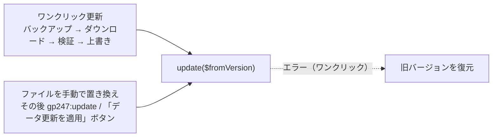

> 🌐 **言語:** [🇻🇳 Tiếng Việt](./create-plugin-update-safety_vi.md) · [🇬🇧 English](./create-plugin-update-safety.md) · 🇯🇵 日本語（現在）

# 安全に更新できるプラグイン — ルール、独自データテーブル、`update()` フック

## はじめに

このドキュメントは、新しいリリースのたびに他の人のサイトで **安全に更新できる** プラグインを作りたい GP247 プラグイン開発者向けです。
設定が消えない、データが壊れない、アンインストールして再インストールしてもテーブルがすべて揃う、という状態を目指します。
更新がどう動くか、守るべき 6 つのルール、独自データテーブルの作り方、`update()` フックの書き方を説明します。[プラグイン作成ガイド](./create-plugin_ja.md) の後に読むことをおすすめします。

> 💡 **AI エージェントと一緒に作業しますか？** [gp247-skills](https://github.com/gp247net/gp247-skills) リポジトリにある拡張機能作成スキル — `gp247-plugin-create`、`gp247-payment-plugin-create`、
> `gp247-shipping-plugin-create`、`gp247-template-create` — は、どれも以下の安全な更新ルールに沿ってプラグイン／テンプレートを作ります。
> コマンドラインでの拡張機能のインストール／更新／アンインストールには、スキル `gp247-extension-lifecycle` を使います。

---

## 更新の仕組み

新しいバージョンをサイトに届ける経路は 2 つあります。



- ワンクリックの経路：上書きの前に、システムが checksum、`configKey`、`version`、`requireUpdateFrom`、`requireCore` を確認します。
  上書きの段階または `update()` でエラーが起きると、プラグインはバックアップから **復元** されます。
- ファイルを手動で置き換える経路（`git pull`、Composer、手作業のコピー。その後 `gp247:update`、`gp247:ext-update --local`、または
  「データ更新を適用」(Apply data update) ボタン）：ファイルのバックアップはありません。`update()` でエラーが起きた場合、プラグインは
  「適用待ち」の状態のまま残り、再実行できます。GP247 がバージョンを記録する前にインストールされたサイトでは、`update()` が **`$fromVersion = null` で 1 回** 呼ばれます。

| 場所 | 更新時 |
|---|---|
| `app/GP247/Plugins/<Name>/…`（コード、`config.php`、ビュー） | 新しいバージョンで **削除して置き換え** |
| `public/GP247/Plugins/<Name>/…`（プラグインの css、js、画像） | **削除して置き換え** |
| `admin_config` の行（有効／無効、設定） | **そのまま保持** |
| プラグイン独自のデータテーブル、メニュー | **そのまま保持** — 新しいバージョンは `update()` で追加 |

---

## 6 つのルール

| # | ルール | 理由 |
|---|---|---|
| 1 | リリースごとに `version` を上げる。`configKey` は変えない | システムはこの 2 つの値で新旧のバージョンを照合する |
| 2 | ストアオーナーが変更する設定はデータベースに置く | 更新はすべてのファイルを上書きする |
| 3 | `update()` は再実行しても安全で、`null` を処理できる | `git pull` の後にも、何度も実行されることがある |
| 4 | ユーザーがアップロードしたファイルをプラグインのフォルダーに保存しない | 更新時にフォルダーが削除され置き換えられる |
| 5 | `requireCore` と `requireUpdateFrom` を正しく設定する | 未検証のコアへのインストールや、古すぎるバージョンからの更新を防ぐ |
| 6 | 独自データテーブルは再インストール時に作り直せる | アンインストール → 再インストールでテーブルがすべて揃う必要がある |

### ルール 1 — `version` を上げ、`configKey` は変えない

- リリースのたびに `gp247.json` の `version` を上げます（`1.0` → `1.1`）。インストール済みのバージョンより大きくないと、ワンクリック更新は
  拒否されます（"not newer"）。
- 公開した後は **`configKey` を絶対に変えないでください**。変えると、システムは別のプラグインとして扱います。

### ルール 2 — 設定はデータベースに置く

**標準の方法：設定 1 つにつき 1 行** の `admin_config`。キーは `<configKey>_<name>` で、`install()` で作り、`update()` で追加し、
`ConfigForm` 画面で編集します — 完全なコードは [プラグイン作成ガイド](./create-plugin_ja.md) の手順 3〜4 を見てください。
**秘密鍵**（`password` 項目、暗号化）を保存できるのはこの方法だけです。

**代わりの方法：JSON の 1 行** — 表形式の設定画面では表せない、構造を持つ設定（リスト、入れ子）向けです。
`config.php` に既定値を置きます。スケルトンは `function.php` にサンプル関数を 2 つ（コメントアウトした状態で）生成しています。

```php
// 有効な設定 = 既定値（config.php）にオーナーの選択（admin_config）を重ねたもの
function MyPlugin_effective_config()
{
    $defaults = (array) config('Plugins/MyPlugin.settings', []);
    $row = \GP247\Core\Models\AdminConfig::where('group', 'Plugins')->where('key', 'MyPlugin_config')->first();
    $overrides = $row ? json_decode((string) $row->value, true) : null;

    return is_array($overrides) ? array_merge($defaults, $overrides) : $defaults;
}

// オーナーの選択をデータベースに保存する（更新後も残る）
function MyPlugin_save_config(array $settings)
{
    \GP247\Core\Models\AdminConfig::updateOrCreate(
        ['group' => 'Plugins', 'key' => 'MyPlugin_config'],
        ['code' => 'MyPlugin_config', 'store_id' => GP247_STORE_ID_GLOBAL, 'value' => json_encode($settings)]
    );
}
```

> JSON の行では **秘密鍵を保持できません**（項目ごとの暗号化がありません）。残りの設定に JSON を使う場合でも、秘密鍵は常に
> `password` 型の独立した行に置いてください。

### ルール 3 — `update()` を正しく書く

```php
public function update(?string $fromVersion = null)
{
    try {
        // 1. 新しいバージョンで追加された設定行。保存済みの値には触れない。
        foreach ($this->seedRows() as $row) {
            $exists = AdminConfig::where('group', $row['group'])->where('key', $row['key'])
                ->where('store_id', (string) $row['store_id'])->exists();
            if (!$exists) {
                AdminConfig::insert($row);
            }
        }

        // 2. 1.1 で追加したカラム — 現在の状態で判定するので、null でも再実行でも安全。
        $table = GP247_DB_PREFIX.'my_plugin_item';
        if (\Illuminate\Support\Facades\Schema::hasTable($table)
            && !\Illuminate\Support\Facades\Schema::hasColumn($table, 'sort')) {
            \Illuminate\Support\Facades\Schema::table($table, function ($t) {
                $t->integer('sort')->default(0);
            });
        }

        return ['error' => 0, 'msg' => ''];
    } catch (\Throwable $e) {
        return ['error' => 1, 'msg' => $e->getMessage()];
    }
}
```

- バージョン番号を比べるだけでなく、**実際の状態**（`hasTable`、`hasColumn`、行がすでにあるか）を確認します。
- **`$fromVersion` が `null` のときに処理を飛ばさないでください** — `null` は「最も古いバージョン」として扱います。
- `version_compare($fromVersion, …)` は、状態から判断できないデータ変更にだけ使います。
- 移行が安全でないときは `['error' => 1, ...]` を返します（または例外を投げます）— ワンクリックの経路では旧バージョンが復元されます。

### ルール 4 — ユーザーのファイルをプラグインのフォルダーに保存しない

お客様がアップロードした画像やファイルは、`storage/` または共通のデータ領域 `public/GP247/…` に保存します。プラグインの `public/` フォルダーには、
リリースに含まれるアセット（css、js、UI 用の画像）だけを置きます。

### ルール 5 — `requireCore` と `requireUpdateFrom`

- `requireCore`：各値 `"X.Y"` は「X.x 系の X.Y 以降」という範囲です。`php artisan gp247:info` に合わせて書きます。複数のメジャー系に対応する場合は
  系ごとに 1 つずつ値を書きます（`["3.1", "4.0"]`）。パッチ番号は書きません。
- `requireUpdateFrom`：直接更新できる、インストール済みの最も低いバージョンです。`"1.0"` は制限なしです。古い系から `update()` で移行できない場合に
  引き上げます（例：`"2.0"`）。

### ルール 6 — 独自データテーブル

**推奨する方法：** `Models/ExtensionModel.php` の中で `Schema` を使ってテーブルを作成／削除します。この方法は **再実行できます**。
`installExtension()` はインストールのたびに実行されるので、アンインストール → 再インストールでも必ずテーブルが作り直されます。

```php
public function installExtension()
{
    $table = GP247_DB_PREFIX.'my_plugin_item';
    if (!\Illuminate\Support\Facades\Schema::hasTable($table)) {
        \Illuminate\Support\Facades\Schema::create($table, function ($t) {
            $t->increments('id');
            $t->string('title');
            $t->tinyInteger('status')->default(1);
            $t->timestamps();
        });
    }
}

public function uninstallExtension()
{
    \Illuminate\Support\Facades\Schema::dropIfExists(GP247_DB_PREFIX.'my_plugin_item');
}
```

`install()` で `(new ExtensionModel)->installExtension()` を、`uninstall()` で `uninstallExtension()` を呼びます。

> ⚠️ **注意:** **Laravel のマイグレーションファイルを使う場合は、`migrations` 台帳を片付ける必要があります。** Laravel は各マイグレーションを共通の `migrations` テーブルに記録し、
> 二度と実行しません。`uninstall()` がテーブルを削除しても台帳の行が残ると、次のインストールで *"Nothing to migrate"* と表示され、テーブルは
> 作り直されません。そのテーブルを読む画面はすべて `SQLSTATE[42S02] … table doesn't exist` エラーになります。マイグレーションを使うなら：
>
> 1. アンインストール時（および `install()` / `update()` の `migrate` の前）に、**そのプラグイン自身の** 台帳の行をファイル名で照合して削除します。
>
>    ```php
>    $names = array_map(fn ($p) => pathinfo($p, PATHINFO_FILENAME),
>        glob(base_path('app/GP247/Plugins/MyPlugin/DB/migrations/*.php')) ?: []);
>    if ($names) {
>        \Illuminate\Support\Facades\DB::table('migrations')->whereIn('migration', $names)->delete();
>    }
>    ```
>
> 2. 再実行しても安全なように、すべての `up()` を `Schema::hasTable()` で囲みます。

> **ストアの帳簿**（注文、お金、会計）であるデータは、プラグインのデータではありません — アンインストール時に削除しないでください。

---

## リリース前に更新を試す

1. テスト用サイトに旧バージョンをインストールし、いくつか設定を変更します。
2. 新しいバージョンのファイルを上書きでコピーし（ストアオーナーが `git pull` するのと同じ）、次を実行します。

   ```bash
   php artisan gp247:ext-update --type=plugin --key=MyPlugin --local --dry-run
   php artisan gp247:ext-update --type=plugin --key=MyPlugin --local
   ```

   期待する結果：1 回目は適用待ちのプラグインを一覧表示し、2 回目は `update()` を実行して成功を報告します。
3. 古い設定がそのまま残り、新しい設定／カラムが追加されていることを確認します。コマンドをもう一度実行します — エラーが出ず、何も変わらないはずです。

---

## 条件と制約（操作の前に確認）

- **新しいバージョンは `version` が大きく**、インストール済みのバージョンが `requireUpdateFrom` 以上である必要があります — そうでないと、ワンクリック更新は拒否されます。
- **開発中のプラグインをアンインストールするときは、必ず `--only-data` を使います** — 通常のアンインストールはソースフォルダー（`app/…` と `public/…`）まで削除します。
- **手動でファイルを置き換える経路で `update()` が失敗しても、ファイルは復元されません** — 再実行のために適用待ちの状態が残るだけです。`update()` は
  何度実行しても安全になるように書いてください。

---

## よくある質問（Q&A）

**Q1: ストアオーナーが `git pull` で更新した場合も、`update()` は実行されますか？**

→ はい。`php artisan gp247:update`、`gp247:ext-update --local` を実行するか、「プラグイン」画面で「データ更新を適用」を押したときに実行されます。

**Q2: なぜ `update()` は `null` を受け取るのですか？**

→ GP247 がバージョンを記録する前にインストールされたサイトでは、旧バージョンが分かりません。`null` を最も古いバージョンとして扱い、実際の状態に基づいて処理してください。

**Q3: ワンクリック更新が途中で失敗したらどうなりますか？**

→ ファイルを上書きする前に作ったバックアップから、プラグインが復元されます。

**Q4: アンインストールして再インストールしたら、プラグインのテーブルがなくなったのはなぜですか？**

→ `migrations` 台帳を片付けずにマイグレーションファイルを使っています。`ExtensionModel` の `Schema` に切り替えるか、ルール 6 のとおりに台帳を片付けてください。

**Q5: 新しいバージョンで設定を 1 つ追加するには、どうすればよいですか？**

→ 設定の一覧にキーを追加します。`update()` が足りない行を作り、ほかの行の古い値はそのまま保持します。

**Q6: `update()` の中で `version_compare` を使うべきですか？**

→ 状態から判断できない処理（例：ある値の形式を変える）にだけ使います。カラムや行の追加は、状態を確認してください。

**Q7: ユーザーがアップロードした画像ファイルが、更新後に消えたのはなぜですか？**

→ プラグインのフォルダーに置かれていたため、更新時に削除され置き換えられました。`storage/` または共通の `public/GP247/…` に保存してください。

**Q8: `requireUpdateFrom` はいつ引き上げるのですか？**

→ 新しいバージョンが古い系から移行できないときです — その系のユーザーは、直接更新する代わりに再インストールする必要があります。

---

<sub>📅 **最終更新:** 2026-10-22 · ✍️ **作成者 (Author):** GP247</sub>
