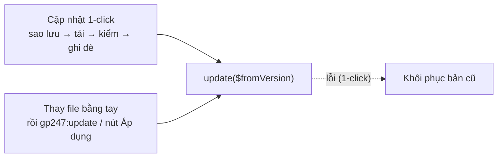

> 🌐 **Ngôn ngữ:** 🇻🇳 Tiếng Việt (hiện tại) · [🇬🇧 English](./create-plugin-update-safety.md)

# Plugin an toàn khi cập nhật — quy tắc, bảng dữ liệu riêng và hook `update()`

## Giới thiệu

Tài liệu này dành cho lập trình viên plugin GP247 muốn mỗi bản phát hành mới **cập nhật được an toàn** trên site của người
khác: không mất thiết lập, không hỏng dữ liệu, gỡ rồi cài lại vẫn đủ bảng. Nó giải thích cập nhật chạy thế nào, 6 quy tắc
cần giữ, cách tạo bảng dữ liệu riêng và cách viết hook `update()`. Nên đọc sau [Hướng dẫn tạo plugin](./create-plugin_vi.md).

> 💡 **Làm cùng AI agent?** Các skill tạo extension trong repo [gp247-skills](https://github.com/gp247net/gp247-skills) — `gp247-plugin-create`, `gp247-payment-plugin-create`,
> `gp247-shipping-plugin-create`, `gp247-template-create` — đều dựng plugin/template theo đúng các quy tắc cập nhật an toàn
> dưới đây. Cài / cập nhật / gỡ extension bằng dòng lệnh: skill `gp247-extension-lifecycle`.

---

## Cập nhật chạy thế nào

Có hai đường đưa bản mới tới một site:



- Đường 1-click: trước khi ghi đè, hệ thống kiểm checksum, `configKey`, `version`, `requireUpdateFrom`, `requireCore`; lỗi ở
  bước ghi đè hoặc `update()` → plugin được **khôi phục** từ bản sao lưu.
- Đường thay file bằng tay (`git pull`, Composer, chép tay; rồi `gp247:update`, `gp247:ext-update --local` hoặc nút **Áp dụng cập nhật
  dữ liệu**): không có bước sao lưu file; lỗi ở `update()` chỉ giữ plugin ở trạng thái "chờ áp dụng" để chạy
  lại. Site cài trước khi GP247 ghi nhớ phiên bản sẽ gọi `update()` **một lần với `$fromVersion = null`**.

| Nơi | Khi cập nhật |
|---|---|
| `app/GP247/Plugins/<Tên>/…` (code, `config.php`, view) | **Xoá và thay** bằng bản mới |
| `public/GP247/Plugins/<Tên>/…` (css, js, ảnh của plugin) | **Xoá và thay** |
| Dòng `admin_config` (bật/tắt, thiết lập) | **Giữ nguyên** |
| Bảng dữ liệu riêng của plugin, menu | **Giữ nguyên** — bản mới bổ sung qua `update()` |

---

## 6 quy tắc

| # | Quy tắc | Vì sao |
|---|---|---|
| 1 | `version` tăng mỗi bản; `configKey` không đổi | Hệ thống đối chiếu bản cũ / mới bằng hai giá trị này |
| 2 | Thiết lập chủ cửa hàng chỉnh nằm trong database | Cập nhật ghi đè mọi file |
| 3 | `update()` chạy lại an toàn và xử lý được `null` | Nó chạy sau cả `git pull`, có thể nhiều lần |
| 4 | Không lưu file người dùng tải lên trong thư mục plugin | Thư mục bị xoá và thay khi cập nhật |
| 5 | Đặt đúng `requireCore` và `requireUpdateFrom` | Chặn cài lên lõi chưa thử, chặn nhảy từ bản quá cũ |
| 6 | Bảng dữ liệu riêng tạo được lại khi cài lại | Gỡ → cài lại phải dựng đủ bảng |

### Quy tắc 1 — `version` tăng, `configKey` giữ nguyên

- Mỗi bản phát hành tăng `version` trong `gp247.json` (`1.0` → `1.1`). Không lớn hơn bản đang cài thì cập nhật 1-click từ
  chối ("not newer").
- **Không bao giờ đổi `configKey`** sau khi phát hành — đổi nghĩa là hệ thống coi như một plugin khác.

### Quy tắc 2 — Thiết lập nằm trong database

**Cách chuẩn: mỗi thiết lập một dòng** `admin_config`, khoá `<configKey>_<tên>`, tạo trong `install()`, bổ sung trong
`update()`, chỉnh bằng màn `ConfigForm` — xem code đầy đủ ở [Hướng dẫn tạo plugin](./create-plugin_vi.md), Bước 3–4. Đây là
cách duy nhất lưu được **khoá bí mật** (ô `password`, mã hoá).

**Cách thay thế: một dòng JSON** — cho thiết lập có cấu trúc (danh sách, lồng nhau) mà màn cấu hình dạng bảng không thể
hiện. `config.php` giữ mặc định; khung sinh sẵn 2 hàm mẫu (đang comment) trong `function.php`:

```php
// Effective config = defaults (config.php) overlaid with the owner's choices (admin_config)
function MyPlugin_effective_config()
{
    $defaults = (array) config('Plugins/MyPlugin.settings', []);
    $row = \GP247\Core\Models\AdminConfig::where('group', 'Plugins')->where('key', 'MyPlugin_config')->first();
    $overrides = $row ? json_decode((string) $row->value, true) : null;

    return is_array($overrides) ? array_merge($defaults, $overrides) : $defaults;
}

// Save the owner's choices in the database (survives updates)
function MyPlugin_save_config(array $settings)
{
    \GP247\Core\Models\AdminConfig::updateOrCreate(
        ['group' => 'Plugins', 'key' => 'MyPlugin_config'],
        ['code' => 'MyPlugin_config', 'store_id' => GP247_STORE_ID_GLOBAL, 'value' => json_encode($settings)]
    );
}
```

> Dòng JSON **không giữ được khoá bí mật** (không mã hoá từng trường). Khoá bí mật luôn để ở dòng riêng kiểu `password`, kể cả khi
> phần còn lại dùng JSON.

### Quy tắc 3 — Viết `update()` đúng cách

```php
public function update(?string $fromVersion = null)
{
    try {
        // 1. Setting rows a newer version introduced; never touch a saved value.
        foreach ($this->seedRows() as $row) {
            $exists = AdminConfig::where('group', $row['group'])->where('key', $row['key'])
                ->where('store_id', (string) $row['store_id'])->exists();
            if (!$exists) {
                AdminConfig::insert($row);
            }
        }

        // 2. A column added in 1.1 — guarded by the CURRENT state, so null and re-runs are safe.
        $table = GP247_DB_PREFIX.'my_plugin_item';
        if (\Illuminate\Support\Facades\Schema::hasTable($table)
            && !\Illuminate\Support\Facades\Schema::hasColumn($table, 'sort')) {
            \Illuminate\Support\Facades\Schema::table($table, function ($t) {
                $t->integer('sort')->default(0);
            });
        }

        return ['error' => 0, 'msg' => ''];
    } catch (\Throwable $e) {
        return ['error' => 1, 'msg' => $e->getMessage()];
    }
}
```

- Kiểm tra **trạng thái thật** (`hasTable`, `hasColumn`, dòng đã có chưa) thay vì chỉ so số phiên bản.
- **Không bỏ qua khi `$fromVersion` là `null`** — coi `null` là "bản cũ nhất".
- Chỉ dùng `version_compare($fromVersion, …)` cho phép đổi dữ liệu không nhận ra được từ trạng thái.
- Trả `['error' => 1, ...]` (hoặc ném lỗi) khi di trú không an toàn — với đường 1-click, bản cũ được khôi phục.

### Quy tắc 4 — Không lưu file người dùng trong thư mục plugin

Ảnh, file khách tải lên lưu ở `storage/` hoặc khu dữ liệu chung `public/GP247/…`. Thư mục `public/` của plugin chỉ chứa asset đi
kèm bản phát hành (css, js, ảnh giao diện).

### Quy tắc 5 — `requireCore` và `requireUpdateFrom`

- `requireCore`: mỗi giá trị `"X.Y"` là khoảng "từ X.Y trong dòng X.x". Ghi theo `php artisan gp247:info`; hỗ trợ nhiều dòng
  lớn thì mỗi dòng một giá trị (`["3.1", "4.0"]`); không ghi số bản vá.
- `requireUpdateFrom`: bản đang cài thấp nhất được cập nhật thẳng. `"1.0"` là không chặn; nâng lên (ví dụ `"2.0"`) khi
  `update()` không di trú được từ dòng cũ hơn.

### Quy tắc 6 — Bảng dữ liệu riêng

**Cách khuyến nghị:** tạo / xoá bảng bằng `Schema` ngay trong `Models/ExtensionModel.php`. Cách này **tự chạy lại được**:
`installExtension()` chạy mỗi lần cài nên gỡ → cài lại luôn dựng lại bảng.

```php
public function installExtension()
{
    $table = GP247_DB_PREFIX.'my_plugin_item';
    if (!\Illuminate\Support\Facades\Schema::hasTable($table)) {
        \Illuminate\Support\Facades\Schema::create($table, function ($t) {
            $t->increments('id');
            $t->string('title');
            $t->tinyInteger('status')->default(1);
            $t->timestamps();
        });
    }
}

public function uninstallExtension()
{
    \Illuminate\Support\Facades\Schema::dropIfExists(GP247_DB_PREFIX.'my_plugin_item');
}
```

Gọi `(new ExtensionModel)->installExtension()` trong `install()` và `uninstallExtension()` trong `uninstall()`.

> ⚠️ **Dùng file migration của Laravel thì phải dọn sổ `migrations`.** Laravel ghi mỗi migration vào bảng `migrations` dùng chung
> và không bao giờ chạy lại. Nếu `uninstall()` xoá bảng mà để lại dòng sổ, lần cài sau báo *"Nothing to migrate"*, bảng không
> được tạo lại và mọi màn đọc nó lỗi `SQLSTATE[42S02] … table doesn't exist`. Muốn dùng migration thì:
>
> 1. Xoá dòng sổ **của chính plugin** khi gỡ (và trước `migrate` trong `install()` / `update()`), khớp theo tên file:
>
>    ```php
>    $names = array_map(fn ($p) => pathinfo($p, PATHINFO_FILENAME),
>        glob(base_path('app/GP247/Plugins/MyPlugin/DB/migrations/*.php')) ?: []);
>    if ($names) {
>        \Illuminate\Support\Facades\DB::table('migrations')->whereIn('migration', $names)->delete();
>    }
>    ```
>
> 2. Bọc mọi `up()` bằng `Schema::hasTable()` để chạy lại an toàn.

> Dữ liệu là **sổ sách của cửa hàng** (đơn hàng, tiền, kế toán) không phải dữ liệu của plugin — đừng xoá khi gỡ.

---

## Thử một bản cập nhật trước khi phát hành

1. Cài bản cũ trên site thử, chỉnh vài thiết lập.
2. Chép file bản mới đè lên (giống chủ cửa hàng `git pull`), chạy:

   ```bash
   php artisan gp247:ext-update --type=plugin --key=MyPlugin --local --dry-run
   php artisan gp247:ext-update --type=plugin --key=MyPlugin --local
   ```

   Kết quả mong đợi: lần đầu liệt kê plugin chờ áp dụng; lần hai chạy `update()` và báo thành công.
3. Kiểm tra thiết lập cũ còn nguyên, thiết lập / cột mới đã có. Chạy lại lệnh lần nữa — không lỗi, không đổi gì.

---

## Điều kiện & ràng buộc (hiểu trước khi thao tác)

- **Bản mới phải có `version` lớn hơn** và bản đang cài không thấp hơn `requireUpdateFrom` — nếu không, cập nhật 1-click từ chối.
- **Gỡ plugin đang phát triển luôn dùng `--only-data`** — gỡ thường xoá cả thư mục mã nguồn (`app/…` và `public/…`).
- **`update()` lỗi trên đường thay file bằng tay không khôi phục file** — chỉ giữ trạng thái chờ để chạy lại; viết `update()`
  sao cho chạy lại luôn an toàn.

---

## Hỏi & Đáp (Q&A)

**Câu 1: Chủ cửa hàng cập nhật bằng `git pull` thì `update()` có chạy không?**

→ Có, khi họ chạy `php artisan gp247:update`, `gp247:ext-update --local` hoặc bấm **Áp dụng cập nhật dữ liệu** trên màn Plugins.

**Câu 2: Vì sao `update()` nhận `null`?**

→ Site cài trước khi GP247 ghi nhớ phiên bản không biết bản cũ là gì. Coi `null` là bản cũ nhất và dựa vào trạng thái thật.

**Câu 3: Cập nhật 1-click lỗi giữa chừng thì sao?**

→ Plugin được khôi phục từ bản sao lưu tạo trước khi ghi đè file.

**Câu 4: Gỡ rồi cài lại, bảng của plugin không còn?**

→ Bạn đang dùng file migration mà không dọn sổ `migrations`. Chuyển sang `Schema` trong `ExtensionModel`, hoặc dọn sổ như Quy tắc 6.

**Câu 5: Thêm một thiết lập ở bản mới thì làm gì?**

→ Thêm khoá vào danh sách thiết lập; `update()` tạo dòng còn thiếu và giữ giá trị cũ của các dòng khác.

**Câu 6: Có nên dùng `version_compare` trong `update()` không?**

→ Chỉ cho việc không nhận ra được từ trạng thái (ví dụ đổi định dạng một giá trị). Thêm cột, thêm dòng thì kiểm trạng thái.

**Câu 7: File ảnh người dùng tải lên biến mất sau khi cập nhật?**

→ Chúng nằm trong thư mục plugin, bị xoá và thay khi cập nhật. Lưu ở `storage/` hoặc `public/GP247/…` chung.

**Câu 8: Khi nào nâng `requireUpdateFrom`?**

→ Khi bản mới không di trú được từ một dòng cũ — người đang ở dòng đó phải cài lại thay vì cập nhật thẳng.

---

<sub>📅 **Cập nhật lần cuối:** 2026-10-18 · ✍️ **Tác giả (Author):** GP247</sub>
