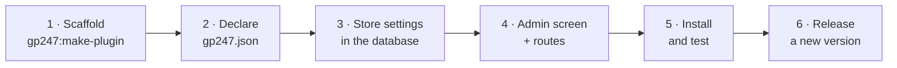

> 🌐 **Language:** [🇻🇳 Tiếng Việt](./create-plugin_vi.md) · 🇬🇧 English (current)

# Creating a plugin for GP247

## Introduction

This document is the **starting point** for PHP/Laravel developers who want to write a GP247 plugin (an add-on feature
package you can enable, disable and remove from the admin). This page walks through 6 steps to build a plugin with a
settings screen that installs and **updates to new versions without losing the store owner's settings**. Deeper topics
live on their own pages, listed right below. After reading, you have a working plugin and know which page to read next for
your kind of plugin.

---

## Pick the right guide

| You are building… | Read |
|---|---|
| An admin feature, a display block, an ordinary plugin | **This page** |
| A **payment** method (bank transfer, online gateway) | [Creating a payment plugin](./create-payment-plugin.md) |
| A **shipping** method (price table, carrier with an API) | [Creating a shipping plugin](./create-shipping-plugin.md) |
| Coupons / loyalty points, an own storefront page, layout blocks, per-store settings, secret keys | [Advanced plugins](./create-plugin-advanced.md) |
| Own data tables, data migration on a new version | [Update-safe plugins](./create-plugin-update-safety.md) |
| Upgrading a plugin written for GP247 1.x | [Converting a plugin from v1 to v2](./convert-plugin-v1-to-v2.md) |
| A storefront look (template), not a plugin | [Creating a template](./create-template.md) |

> 💡 **Working with an AI agent?** Use GP247's skills from the [gp247-skills](https://github.com/gp247net/gp247-skills)
> repository (copy the skill folder into your agent's skills folder, for example `.claude/skills/` for Claude Code):
> `gp247-plugin-create` (ordinary plugins), `gp247-payment-plugin-create` (payment), `gp247-shipping-plugin-create`
> (shipping). Each skill probes the site's version and follows the steps below.

---

## Roadmap



Three things to keep in mind all the way:

1. **An update overwrites every file of the plugin and keeps the database.** Everything a store owner changes must live in the database.
2. **Every release increases `version`; `configKey` never changes.**
3. **Never edit `vendor/gp247/*`.** A plugin only "plugs in" through the existing seams.

---

## Prerequisites

1. A running GP247 3.x website, and permission to run `php artisan` (a terminal on your development machine or server).
2. Check the core version — you need it in Step 2:

   ```bash
   php artisan gp247:info
   ```

   Expected result: a `core` line such as `3.1`.

| Term | Meaning |
|---|---|
| **Plugin (extension)** | An add-on package, located in `app/GP247/Plugins/<Name>` |
| **`configKey`** | The plugin's unique id, **equal to its folder name** |
| **`admin_config`** | The configuration table in the database — where settings survive updates |
| **Livewire** | Laravel's way of building dynamic screens; the GP247 admin uses Livewire + Tailwind (TailAdmin), **no jQuery** |

---

## Step 1 — Scaffold the plugin

1. Open a terminal in the website's root folder (where `artisan` is) and run (replace `MyPlugin` with your name, written
   as one word, each word capitalised):

   ```bash
   php artisan gp247:make-plugin --name=MyPlugin --download=0
   ```

   Expected result: a `Success` line, and the folder `app/GP247/Plugins/MyPlugin` is created. (`--download=1` builds a
   `.zip` in `storage/tmp` for distribution instead.)
2. Look at the generated files:

| File | What it is for | What you do |
|---|---|---|
| `gp247.json` | Declares the plugin (name, version, compatibility) | **Edit** — Step 2 |
| `AppConfig.php` | Install, uninstall, enable, disable, update | **Edit** — Step 3 |
| `Livewire/AdminLivewire.php` | Admin screen | **Edit** — Step 4 |
| `Route.php`, `Provider.php` | Register routes, languages, views | **Edit** — Step 4 |
| `Lang/vi/lang.php`, `Lang/en/lang.php` | Display text | **Edit** — Step 4 |
| `Admin/AdminController.php`, `Views/Admin.blade.php` | Old-style admin screen (backward compatibility) | Delete once you use Livewire |
| `Controllers/FrontController.php`, `Views/Front.blade.php`, `Seo.php` | Public page and sitemap | Delete if the plugin is admin-only — see [Advanced plugins](./create-plugin-advanced.md) |
| `Models/ExtensionModel.php` | Create/drop the plugin's own tables | Keep if you have own tables — see [Update-safe plugins](./create-plugin-update-safety.md) |
| `config.php`, `function.php` | Defaults, helper functions | **Never** let the store owner edit `config.php` |

---

## Step 2 — Declare `gp247.json`

```json
{
    "name": "My plugin",
    "image": "images/logo.jpg",
    "auth": "Your name",
    "email": "you@example.com",
    "link": "https://example.com",
    "configGroup": "Plugins",
    "configCode": "MyPlugin",
    "configKey": "MyPlugin",
    "version": "1.0",
    "requireCore": ["3.1"],
    "requireUpdateFrom": "1.0",
    "requireComposerPackages": [],
    "requireGp247Extensions": [],
    "requireLivewire": false,
    "storeScope": "global"
}
```

| Field | Meaning |
|---|---|
| `configKey` | Equal to the folder name. **Never changes after release.** |
| `configCode` | The plugin's role: `"Payment"`, `"Shipping"`, `"Promotion"` (coupons); any other plugin uses the same value as `configKey` |
| `version` | `1.0`, `1.1`, `2.0`… Every release must be **greater** than the previous one |
| `requireCore` | Core versions it runs on: write the `core` line of `gp247:info`, e.g. `["3.1"]` |
| `requireUpdateFrom` | The lowest installed version allowed to update straight to this one; `"1.0"` blocks nothing |
| `requireComposerPackages` | Required Composer packages, e.g. `["gp247/shop"]` for a selling plugin |
| `requireGp247Extensions` | Other GP247 plugins that must be installed first (by `configKey`) |
| `storeScope` | `"global"` (one shared setting) or `"store"` (one setting per store) |

> ⚠️ **`requireCore` is a range per major version.** `"3.1"` means "from 3.1 upward, within the 3.x line" — it installs on
> 3.1, 3.2…, but is **refused** on 4.x. Writing `"2.1"` makes a 3.x core refuse to install the plugin. To support several
> major lines, write one value per line, e.g. `["3.1", "4.0"]`; never write a patch number such as `"3.1.2"`.

---

## Step 3 — Store settings in the database

An update **overwrites every file** (including `config.php`) but **keeps the database**. So each setting the store owner
may change is **one row** in the `admin_config` table, keyed `<configKey>_<name>`, created on install and topped up on
update. Replace the whole `AppConfig.php`:

```php
<?php

namespace App\GP247\Plugins\MyPlugin;

use GP247\Core\ExtensionConfigDefault;
use GP247\Core\Models\AdminConfig;
use GP247\Core\Models\AdminHome;

class AppConfig extends ExtensionConfigDefault
{
    /** Settings the site owner edits: key => default. */
    public const SETTINGS = [
        'enabled_on_home' => '1',
        'items_per_page'  => '20',
    ];

    public function __construct()
    {
        $config = json_decode(file_get_contents(__DIR__.'/gp247.json'), true);
        $this->configGroup = $config['configGroup'];
        $this->configKey = $config['configKey'];
        $this->configCode = $config['configCode'];
        $this->requireCore = $config['requireCore'] ?? [];
        $this->requireComposerPackages = $config['requireComposerPackages'] ?? [];
        $this->requireGp247Extensions = $config['requireGp247Extensions'] ?? [];
        $this->appPath = $this->configGroup.'/'.$this->configKey;
        $this->title = trans($this->appPath.'::lang.title');
        $this->image = $this->appPath.'/'.$config['image'];
        $this->version = $config['version'];
        $this->auth = $config['auth'];
        $this->link = $config['link'];
    }

    /**
     * Every admin_config row this plugin owns: the on/off row + one row per setting.
     */
    private function seedRows(): array
    {
        $rows = [[
            'group' => $this->configGroup, 'code' => $this->configCode, 'key' => $this->configKey,
            'sort' => 0, 'store_id' => GP247_STORE_ID_GLOBAL, 'value' => self::ON,
            'security' => 0, 'detail' => $this->appPath.'::lang.title',
        ]];
        $sort = 0;
        foreach (self::SETTINGS as $key => $default) {
            $rows[] = [
                'group' => $this->configGroup, 'code' => $this->configKey.'_config',
                'key' => $this->configKey.'_'.$key, 'sort' => ++$sort,
                'store_id' => GP247_STORE_ID_GLOBAL, 'value' => $default,
                'security' => 0, 'detail' => $this->appPath.'::lang.'.$key,
            ];
        }

        return $rows;
    }

    public function install()
    {
        if (AdminConfig::where('group', $this->configGroup)->where('key', $this->configKey)->exists()) {
            return ['error' => 1, 'msg' => gp247_language_render('admin.extension.plugin_exist')];
        }
        try {
            AdminConfig::insert($this->seedRows());

            return ['error' => 0, 'msg' => gp247_language_render('admin.extension.install_success')];
        } catch (\Throwable $e) {
            return ['error' => 1, 'msg' => $e->getMessage()];
        }
    }

    /**
     * Add the rows a newer version introduced; never touch a value the site owner saved.
     */
    public function update(?string $fromVersion = null)
    {
        try {
            foreach ($this->seedRows() as $row) {
                $exists = AdminConfig::where('group', $row['group'])->where('key', $row['key'])
                    ->where('store_id', (string) $row['store_id'])->exists();
                if (!$exists) {
                    AdminConfig::insert($row);
                }
            }

            return ['error' => 0, 'msg' => ''];
        } catch (\Throwable $e) {
            return ['error' => 1, 'msg' => $e->getMessage()];
        }
    }

    public function uninstall()
    {
        try {
            AdminConfig::where('group', $this->configGroup)->where(function ($q) {
                $q->where('key', $this->configKey)
                    ->orWhere('key', 'like', $this->configKey.'\_%')
                    ->orWhere('code', $this->configKey.'_config');
            })->delete();
            AdminHome::where('extension', $this->appPath)->delete();

            return ['error' => 0, 'msg' => gp247_language_render('admin.extension.uninstall_success')];
        } catch (\Throwable $e) {
            return ['error' => 1, 'msg' => $e->getMessage()];
        }
    }

    public function enable()
    {
        AdminConfig::where('group', $this->configGroup)->where('key', $this->configKey)->update(['value' => self::ON]);

        return ['error' => 0, 'msg' => gp247_language_render('admin.extension.enable_success')];
    }

    public function disable()
    {
        AdminConfig::where('group', $this->configGroup)->where('key', $this->configKey)->update(['value' => self::OFF]);

        return ['error' => 0, 'msg' => ''];
    }

    // The ⚙ (Config) button on the Plugins list appears only when this returns a redirect.
    public function clickApp()
    {
        return redirect(gp247_route_admin('admin_myplugin.index'));
    }

    public function setupStore($storeId = null)
    {
    }

    public function removeStore($storeId = null)
    {
    }

    /**
     * A setting for a store (falls back to the shared value).
     */
    public function setting(string $key, $storeId = null): string
    {
        $storeId ??= gp247_plugin_store_id();

        return (string) gp247_config($this->configKey.'_'.$key, $storeId, self::SETTINGS[$key] ?? '');
    }

    public function getInfo()
    {
        return [
            'title' => $this->title,
            'key' => $this->configKey,
            'code' => $this->configCode,
            'image' => $this->image,
            'permission' => self::ALLOW,
            'version' => $this->version,
            'auth' => $this->auth,
            'link' => $this->link,
            'appPath' => $this->appPath,
        ];
    }
}
```

| Method | When it runs | What it does |
|---|---|---|
| `install()` | The store owner clicks **Install** | Writes the on/off row + one row per setting |
| `update(?string $fromVersion)` | After the files were replaced by a newer version (1-click, `git pull`, Composer) | Only **adds** missing rows; safe to run again; may receive `null` |
| `uninstall()` | The store owner clicks **Uninstall** | Deletes every row of the plugin |
| `enable()` / `disable()` | Enable / disable | Switches the flag, deletes nothing |
| `clickApp()` | The Plugins list draws the ⚙ button | Returns a redirect to the settings screen — returning `null` means **no button** |
| `setting()` | Your code needs a value | Reads it for a store, falling back to the shared value |

A setting is a **secret** (API key, password)? Create its row with `'security' => 1` and declare the field as `password` in
Step 4 — the core encrypts it and never sends it back to the browser. Details: [Advanced plugins](./create-plugin-advanced.md#2-secret-keys).

---

## Step 4 — Admin screen and routes

**Settings screen** — extending the core's `ConfigForm` gives you the layout, permissions, Save button and store picker.
Replace `Livewire/AdminLivewire.php`:

```php
<?php

namespace App\GP247\Plugins\MyPlugin\Livewire;

use App\GP247\Plugins\MyPlugin\AppConfig;
use GP247\Core\AdminShell\Infrastructure\ConfigForm;

/**
 * Settings screen: one field per row seeded by AppConfig::install().
 */
class AdminLivewire extends ConfigForm
{
    protected ?string $permission = null;

    protected function group(): string
    {
        return 'Plugins';
    }

    protected function heading(): string
    {
        return trans('Plugins/MyPlugin::lang.title');
    }

    // Required: without keys() the screen would list — and save — nothing of yours.
    protected function keys(): array
    {
        return array_map(fn ($key) => 'MyPlugin_'.$key, array_keys(AppConfig::SETTINGS));
    }

    protected function fieldTypes(): array
    {
        return [
            'MyPlugin_enabled_on_home' => 'bool',
            'MyPlugin_items_per_page'  => 'number',
        ];
    }
}
```

Field types: `bool` (switch), `number`, `select` (with `fieldOptions()`), `password`, `text` (default). You can add
`fieldHints()` (a hint next to a field) and `sections()` (titled blocks). A plugin that needs a screen other than settings
extends `GP247\Core\AdminShell\Infrastructure\GP247AdminComponent` and writes its own view.

**Routes** — replace `Route.php`; point the admin path straight at the Livewire screen:

```php
<?php

use Illuminate\Support\Facades\Route;

$config = json_decode(file_get_contents(__DIR__.'/gp247.json'), true);

if (gp247_extension_check_active($config['configGroup'], $config['configKey'])) {
    Route::group(
        [
            'prefix' => GP247_ADMIN_PREFIX.'/myplugin',
            'middleware' => GP247_ADMIN_MIDDLEWARE,
        ],
        function () {
            Route::get('/', \App\GP247\Plugins\MyPlugin\Livewire\AdminLivewire::class)
                ->name('admin_myplugin.index');
        }
    );
}
```

Then delete `Admin/AdminController.php` and `Views/Admin.blade.php` (the old-style screen).

**Provider** — `Provider.php` loads languages and views and registers the plugin's Livewire name:

```php
<?php

$config = json_decode(file_get_contents(__DIR__.'/gp247.json'), true);
$extensionPath = $config['configGroup'].'/'.$config['configKey'];

$this->loadTranslationsFrom(__DIR__.'/Lang', $extensionPath);

if (gp247_extension_check_active($config['configGroup'], $config['configKey'])) {
    $this->loadViewsFrom(__DIR__.'/Views', $extensionPath);

    if (class_exists(\Livewire\Livewire::class)) {
        \Livewire\Livewire::addNamespace('MyPlugin', classNamespace: 'App\\GP247\\Plugins\\MyPlugin\\Livewire');
    }
}
```

**Languages** — every displayed text goes through `trans('Plugins/MyPlugin::lang.<key>')`, in both `vi` and `en`. The label of
each settings field is the key with the setting's name:

```php
<?php

return [
    'title'           => 'My plugin',
    'enabled_on_home' => 'Show on the home page',
    'items_per_page'  => 'Items per page',
];
```

UI rules: only `<x-gp247::*>` components, Livewire and Alpine; **no** jQuery, AdminLTE or select2.

---

## Step 5 — Install and test

1. Clear the caches to load the new files:

   ```bash
   php artisan optimize:clear
   ```

2. Install the plugin: **Admin → Plugins → MyPlugin → Install**, or with a command:

   ```bash
   php artisan gp247:ext-install --type=plugin --key=MyPlugin
   ```

   Expected result: the plugin shows as enabled.
3. Click ⚙ **Config**, change a value, click **Save**, reload the page — the value is still there.
4. Try enable / disable; open the admin screen in both **light and dark mode**.
5. Try uninstall then install again: the reinstall must create every settings row (and tables, menu if any).

> ⚠️ **Uninstall a plugin you are developing with `--only-data`:**
>
> ```bash
> php artisan gp247:ext-uninstall --type=plugin --key=MyPlugin --only-data
> ```
>
> A plain uninstall (or the **Uninstall** button without "only remove data") **also deletes the plugin's source folder**.

---

## Step 6 — Release a new version

1. Increase `version` in `gp247.json` (e.g. `1.0` → `1.1`).
2. The new version adds a setting? Add the key to `SETTINGS` — `update()` creates the missing row and keeps old values.
3. The new version adds a column / table or changes data? Write it in `update()` following [Update-safe plugins](./create-plugin-update-safety.md).
4. Test it the way a store owner updating with `git pull` would:

   ```bash
   php artisan gp247:ext-update --type=plugin --key=MyPlugin --local --dry-run
   ```

   Expected result: the plugin is listed as pending; drop `--dry-run` to run `update()` for real.

---

## Pre-release checklist

- [ ] `gp247.json`: `configKey` equals the folder name; `requireCore` follows `gp247:info`; `version` increased.
- [ ] Every setting the store owner edits lives in `admin_config`; `config.php` only holds the author's defaults.
- [ ] `install()` / `uninstall()` are symmetric; `update()` is safe to re-run and works with `null`.
- [ ] `clickApp()` opens the settings screen; `keys()` lists every field; secrets are `password` fields.
- [ ] The admin screen uses Livewire + `<x-gp247::*>`, no jQuery; text goes through `trans()` in both `vi` and `en`.
- [ ] Ran `optimize:clear`, then install / enable / disable / uninstall `--only-data` / reinstall successfully.
- [ ] Payment / shipping plugins: followed the dedicated guide for that kind.

---

## Conditions & Rules (know before you act)

**When installing**
- **The core refuses to install when `requireCore` does not match** the running core line (a range per major version) — so a plugin never runs on a core it was not tested on.
- **Installing while the on/off row is still in the database is refused** ("plugin already exists") — uninstall first.
- **A missing package in `requireComposerPackages` / plugin in `requireGp247Extensions` blocks the install.**

**When updating**
- **The new `version` must be greater than the installed one**, and the installed one not lower than `requireUpdateFrom` — otherwise the 1-click update refuses.
- **When `update()` fails, the old version is restored** (1-click update); with `git pull` the files are not restored, the update just stays "pending" so it can run again.

---

## Q&A

**Q1: Do I have to write every plugin file by hand?**

→ No. `php artisan gp247:make-plugin --name=YourPlugin --download=0` generates the skeleton; you only edit the files of Steps 2–4.
With an AI agent, use the `gp247-plugin-create` skill.

**Q2: Must `configKey` equal the folder name?**

→ Yes. It is the id used to match the old and the new version on update, so it must not change after release either.

**Q3: The store owner edited `config.php` and lost everything after an update — why?**

→ An update overwrites every file. Settings must live in the database as in Step 3.

**Q4: The core says "not compatible" when I install the plugin?**

→ `requireCore` does not match. Run `php artisan gp247:info` and write its `core` line (e.g. `["3.1"]`). The old value `"2.1"` cannot be installed on a 3.x core.

**Q5: No ⚙ Config button on the Plugins list?**

→ `clickApp()` returns `null` (the skeleton's default). Make it return a redirect to the settings screen as in Step 3.

**Q6: The settings screen shows no field, or Save saves nothing?**

→ `keys()` is missing in the settings screen, or `install()` did not create rows for those keys (uninstall with `--only-data`, then install again).

**Q7: My new version adds a database column — where do I handle it?**

→ In `update()`, checking the real state (`Schema::hasColumn`) rather than only the version number. See [Update-safe plugins](./create-plugin-update-safety.md).

**Q8: May I use jQuery or select2 on the admin screen?**

→ No. The GP247 admin does not load jQuery; use Livewire / Alpine and `<x-gp247::*>` components.

**Q9: Should `version` be `1.0.0` or `1.0`?**

→ Any numeric form works, as long as each release is **greater** than the previous one (compared with `version_compare`), e.g. `1.0` → `1.1` → `2.0`.

**Q10: After updating, the admin still shows the old version?**

→ Run `php artisan optimize:clear` and reload — Laravel still holds old caches.

---

## Change history
<!-- Only when logic/behavior changed. Newest row on top. One row per day: merge same-day changes into the existing row, never add a new row for the same date. -->

| Date | GP247 version | Change |
| --- | --- | --- |
| 2026-10-18 | gp247/core 3.1 | Restructured into a 6-step main page; split out [Update-safe plugins](./create-plugin-update-safety.md) and [Advanced plugins](./create-plugin-advanced.md); added payment and shipping plugin guides. **Fixed:** `requireCore` follows `gp247:info` (the old `"2.1"` is refused by a 3.x core); settings default to one row per key with a `ConfigForm` screen (holds secrets); added `clickApp()` for the Config button |
| 2026-09-29 |  | The `AppConfig::update($fromVersion)` hook now also runs when the site owner replaces files via `git pull`/Composer/manual copy (through `gp247:update`, `gp247:ext-update --local`, the **Apply data update** button); the first time it may receive `null`. |

---

<sub>📅 **Last updated:** 2026-10-18 · ✍️ **Author:** GP247</sub>
