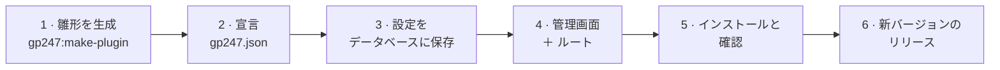

> 🌐 **言語:** [🇻🇳 Tiếng Việt](./create-plugin_vi.md) · [🇬🇧 English](./create-plugin.md) · 🇯🇵 日本語（現在）

# GP247 のプラグイン作成ガイド

## はじめに

このドキュメントは、GP247 のプラグイン（管理画面で有効化／無効化／アンインストールできる追加機能パッケージ）を書きたい
PHP／Laravel 開発者の**出発点**です。このページでは、設定画面を持ち、インストールでき、**ストアオーナーの設定を失わずに
新しいバージョンへ更新できる**プラグインを 6 つのステップで作ります。より詳しいトピックは個別のページにあり、すぐ下に一覧があります。
読み終えると、動作するプラグインができあがり、自分のプラグインの種類に応じて次に読むページがわかります。

---

## 正しいガイドを選ぶ

| 作っているもの… | 読むページ |
|---|---|
| 管理機能、表示ブロック、一般的なプラグイン | **このページ** |
| **決済**方法（銀行振込、オンライン決済ゲートウェイ） | [決済プラグインの作成](./create-payment-plugin_ja.md) |
| **配送**方法（料金表、API を持つ配送業者） | [配送プラグインの作成](./create-shipping-plugin_ja.md) |
| クーポン／ポイント、独自のストアフロントページ、レイアウトブロック、ストアごとの設定、秘密鍵 | [高度なプラグイン](./create-plugin-advanced_ja.md) |
| 独自のデータテーブル、新バージョンでのデータ移行 | [更新に安全なプラグイン](./create-plugin-update-safety_ja.md) |
| GP247 1.x 向けに書かれたプラグインのアップグレード | [プラグインを v1 から v2 へ変換](./convert-plugin-v1-to-v2_ja.md) |
| プラグインではなくストアの見た目（テンプレート） | [テンプレートの作成](./create-template_ja.md) |

> 💡 **ヒント:** **AI エージェントと一緒に作業しますか？** [gp247-skills](https://github.com/gp247net/gp247-skills) リポジトリにある
> GP247 のスキルを使ってください（スキルのフォルダーをエージェントのスキルフォルダーにコピーします。例：Claude Code なら `.claude/skills/`）。
> `gp247-plugin-create`（一般的なプラグイン）、`gp247-payment-plugin-create`（決済）、`gp247-shipping-plugin-create`
> （配送）があります。スキルはサイトのバージョンを自動で調べ、下記の手順どおりに作業します。

---

## 全体の流れ



全体を通して覚えておくべき 3 つのこと：

1. **プラグインの更新はすべてのファイルを上書きし、データベースはそのまま残します。** ストアオーナーが変更するものは、すべてデータベースに置く必要があります。
2. **リリースのたびに `version` を上げます。`configKey` は決して変えません。**
3. **`vendor/gp247/*` は変更しません。** プラグインは既存の接続ポイントを通して「差し込む」だけです。

---

## 準備

1. 稼働中の GP247 3.x の Web サイトと、`php artisan` を実行する権限（開発マシンまたはサーバーのターミナル）。
2. コアのバージョンを確認します — ステップ 2 で必要です。

   ```bash
   php artisan gp247:info
   ```

   期待される結果：`3.1` のような `core` の行。

| 用語 | 意味 |
|---|---|
| **プラグイン（extension）** | 追加機能パッケージ。`app/GP247/Plugins/<Name>` に置かれます |
| **`configKey`** | プラグインの一意な識別子。**フォルダー名と同じ**です |
| **`admin_config`** | データベースの設定テーブル — 更新で失われないように設定を保存する場所 |
| **Livewire** | Laravel で動的な画面を作る方法。GP247 の管理画面は Livewire ＋ Tailwind（TailAdmin）を使い、**jQuery は使いません** |

---

## ステップ 1 — プラグインの雛形を生成する

1. Web サイトのルートフォルダー（`artisan` ファイルがある場所）でターミナルを開き、次を実行します
   （`MyPlugin` を自分の名前に置き換えます。スペースなしで、各単語の先頭を大文字にします）。

   ```bash
   php artisan gp247:make-plugin --name=MyPlugin --download=0
   ```

   期待される結果：`Success` の行が表示され、フォルダー `app/GP247/Plugins/MyPlugin` が作成されます。（`--download=1` にすると、
   配布用の `.zip` ファイルが `storage/tmp` に作成されます。）
2. 生成されたファイルを確認します。

| ファイル | 役割 | あなたの作業 |
|---|---|---|
| `gp247.json` | プラグインの宣言（名前、バージョン、互換性） | **編集** — ステップ 2 |
| `AppConfig.php` | インストール、アンインストール、有効化、無効化、更新 | **編集** — ステップ 3 |
| `Livewire/AdminLivewire.php` | 管理画面 | **編集** — ステップ 4 |
| `Route.php`、`Provider.php` | ルート、言語、ビューの登録 | **編集** — ステップ 4 |
| `Lang/vi/lang.php`、`Lang/en/lang.php` | 表示テキスト | **編集** — ステップ 4 |
| `Admin/AdminController.php`、`Views/Admin.blade.php` | 旧方式の管理画面（後方互換） | Livewire を使い始めたら削除 |
| `Controllers/FrontController.php`、`Views/Front.blade.php`、`Seo.php` | 公開ページとサイトマップ | 管理画面だけで使うプラグインなら削除 — [高度なプラグイン](./create-plugin-advanced_ja.md) を参照 |
| `Models/ExtensionModel.php` | 独自データテーブルの作成／削除 | 独自テーブルがあれば残す — [更新に安全なプラグイン](./create-plugin-update-safety_ja.md) を参照 |
| `config.php`、`function.php` | 既定値、補助関数 | ストアオーナーに `config.php` を編集させては**いけません** |

---

## ステップ 2 — `gp247.json` を宣言する

```json
{
    "name": "My plugin",
    "image": "images/logo.jpg",
    "auth": "Your name",
    "email": "you@example.com",
    "link": "https://example.com",
    "configGroup": "Plugins",
    "configCode": "MyPlugin",
    "configKey": "MyPlugin",
    "version": "1.0",
    "requireCore": ["3.1"],
    "requireUpdateFrom": "1.0",
    "requireComposerPackages": [],
    "requireGp247Extensions": [],
    "requireLivewire": false,
    "storeScope": "global"
}
```

| フィールド | 意味 |
|---|---|
| `configKey` | フォルダー名と同じ。**リリース後は変更しません。** |
| `configCode` | プラグインの役割：`"Payment"`（決済）、`"Shipping"`（配送）、`"Promotion"`（クーポン）。それ以外のプラグインは `configKey` と同じ値を書きます |
| `version` | `1.0`、`1.1`、`2.0`… リリースのたびに前のバージョンより**大きく**なければなりません |
| `requireCore` | 動作するコアのバージョン：`gp247:info` の `core` の行を書きます。例：`["3.1"]` |
| `requireUpdateFrom` | このバージョンへ直接更新できる、インストール済みの最低バージョン。`"1.0"` は制限なし |
| `requireComposerPackages` | 必須の Composer パッケージ。例：販売系プラグインなら `["gp247/shop"]` |
| `requireGp247Extensions` | 先にインストールが必要な他の GP247 プラグイン（`configKey` で指定） |
| `storeScope` | `"global"`（共通の設定が 1 つ）または `"store"`（ストアごとに設定） |

> ⚠️ **注意:** **`requireCore` はメジャーバージョンごとの範囲です。** `"3.1"` は「3.x 系の中で 3.1 以上」という意味です。
> 3.1、3.2… にはインストールできますが、4.x では**拒否されます**。`"2.1"` と書くと、3.x のコアはインストールを拒否します。
> 複数のメジャー系列に対応する場合は、系列ごとに 1 つの値を書きます。例：`["3.1", "4.0"]`。`"3.1.2"` のようなパッチ番号は書きません。

---

## ステップ 3 — 設定をデータベースに保存する

プラグインの更新は**すべてのファイルを上書き**します（`config.php` も含む）が、**データベースはそのまま残します**。
そのため、ストアオーナーが変更する設定は、それぞれ `admin_config` テーブルの **1 行**にします。キーは `<configKey>_<name>` で、
インストール時に作成し、更新時に不足分を追加します。`AppConfig.php` 全体を置き換えます。

```php
<?php

namespace App\GP247\Plugins\MyPlugin;

use GP247\Core\ExtensionConfigDefault;
use GP247\Core\Models\AdminConfig;
use GP247\Core\Models\AdminHome;

class AppConfig extends ExtensionConfigDefault
{
    /** Settings the site owner edits: key => default. */
    public const SETTINGS = [
        'enabled_on_home' => '1',
        'items_per_page'  => '20',
    ];

    public function __construct()
    {
        $config = json_decode(file_get_contents(__DIR__.'/gp247.json'), true);
        $this->configGroup = $config['configGroup'];
        $this->configKey = $config['configKey'];
        $this->configCode = $config['configCode'];
        $this->requireCore = $config['requireCore'] ?? [];
        $this->requireComposerPackages = $config['requireComposerPackages'] ?? [];
        $this->requireGp247Extensions = $config['requireGp247Extensions'] ?? [];
        $this->appPath = $this->configGroup.'/'.$this->configKey;
        $this->title = trans($this->appPath.'::lang.title');
        $this->image = $this->appPath.'/'.$config['image'];
        $this->version = $config['version'];
        $this->auth = $config['auth'];
        $this->link = $config['link'];
    }

    /**
     * Every admin_config row this plugin owns: the on/off row + one row per setting.
     */
    private function seedRows(): array
    {
        $rows = [[
            'group' => $this->configGroup, 'code' => $this->configCode, 'key' => $this->configKey,
            'sort' => 0, 'store_id' => GP247_STORE_ID_GLOBAL, 'value' => self::ON,
            'security' => 0, 'detail' => $this->appPath.'::lang.title',
        ]];
        $sort = 0;
        foreach (self::SETTINGS as $key => $default) {
            $rows[] = [
                'group' => $this->configGroup, 'code' => $this->configKey.'_config',
                'key' => $this->configKey.'_'.$key, 'sort' => ++$sort,
                'store_id' => GP247_STORE_ID_GLOBAL, 'value' => $default,
                'security' => 0, 'detail' => $this->appPath.'::lang.'.$key,
            ];
        }

        return $rows;
    }

    public function install()
    {
        if (AdminConfig::where('group', $this->configGroup)->where('key', $this->configKey)->exists()) {
            return ['error' => 1, 'msg' => gp247_language_render('admin.extension.plugin_exist')];
        }
        try {
            AdminConfig::insert($this->seedRows());

            return ['error' => 0, 'msg' => gp247_language_render('admin.extension.install_success')];
        } catch (\Throwable $e) {
            return ['error' => 1, 'msg' => $e->getMessage()];
        }
    }

    /**
     * Add the rows a newer version introduced; never touch a value the site owner saved.
     */
    public function update(?string $fromVersion = null)
    {
        try {
            foreach ($this->seedRows() as $row) {
                $exists = AdminConfig::where('group', $row['group'])->where('key', $row['key'])
                    ->where('store_id', (string) $row['store_id'])->exists();
                if (!$exists) {
                    AdminConfig::insert($row);
                }
            }

            return ['error' => 0, 'msg' => ''];
        } catch (\Throwable $e) {
            return ['error' => 1, 'msg' => $e->getMessage()];
        }
    }

    public function uninstall()
    {
        try {
            AdminConfig::where('group', $this->configGroup)->where(function ($q) {
                $q->where('key', $this->configKey)
                    ->orWhere('key', 'like', $this->configKey.'\_%')
                    ->orWhere('code', $this->configKey.'_config');
            })->delete();
            AdminHome::where('extension', $this->appPath)->delete();

            return ['error' => 0, 'msg' => gp247_language_render('admin.extension.uninstall_success')];
        } catch (\Throwable $e) {
            return ['error' => 1, 'msg' => $e->getMessage()];
        }
    }

    public function enable()
    {
        AdminConfig::where('group', $this->configGroup)->where('key', $this->configKey)->update(['value' => self::ON]);

        return ['error' => 0, 'msg' => gp247_language_render('admin.extension.enable_success')];
    }

    public function disable()
    {
        AdminConfig::where('group', $this->configGroup)->where('key', $this->configKey)->update(['value' => self::OFF]);

        return ['error' => 0, 'msg' => ''];
    }

    // The ⚙ (Config) button on the Plugins list appears only when this returns a redirect.
    public function clickApp()
    {
        return redirect(gp247_route_admin('admin_myplugin.index'));
    }

    public function setupStore($storeId = null)
    {
    }

    public function removeStore($storeId = null)
    {
    }

    /**
     * A setting for a store (falls back to the shared value).
     */
    public function setting(string $key, $storeId = null): string
    {
        $storeId ??= gp247_plugin_store_id();

        return (string) gp247_config($this->configKey.'_'.$key, $storeId, self::SETTINGS[$key] ?? '');
    }

    public function getInfo()
    {
        return [
            'title' => $this->title,
            'key' => $this->configKey,
            'code' => $this->configCode,
            'image' => $this->image,
            'permission' => self::ALLOW,
            'version' => $this->version,
            'auth' => $this->auth,
            'link' => $this->link,
            'appPath' => $this->appPath,
        ];
    }
}
```

| メソッド | 実行されるタイミング | 処理内容 |
|---|---|---|
| `install()` | ストアオーナーが「インストール」(Install) を押したとき | オン／オフの行と、設定ごとに 1 行を書き込む |
| `update(?string $fromVersion)` | ファイルが新バージョンに置き換えられた後（ワンクリック、`git pull`、Composer） | 不足している行を**追加**するだけ。何度実行しても安全。`null` を受け取ることがある |
| `uninstall()` | ストアオーナーが「削除」(Uninstall) を押したとき | プラグインのすべての行を削除 |
| `enable()`／`disable()` | 有効化／無効化 | フラグを切り替えるだけで、データは削除しない |
| `clickApp()` | プラグイン一覧が ⚙ ボタンを描画するとき | 設定画面へのリダイレクトを返す — `null` を返すと**ボタンが出ない** |
| `setting()` | あなたのコードが値を必要とするとき | ストアごとの値を読み、なければ共通の値を使う |

設定が**秘密鍵**（API キー、パスワード）の場合は？ `'security' => 1` で行を作り、ステップ 4 でフィールドを `password` と宣言します。
コアが暗号化し、ブラウザーには決して送り返しません。詳細：[高度なプラグイン](./create-plugin-advanced_ja.md#2-秘密鍵)。

---

## ステップ 4 — 管理画面とルート

**設定画面** — コアの `ConfigForm` を継承するだけで、レイアウト、権限、保存ボタン、ストア選択が揃います。
`Livewire/AdminLivewire.php` を置き換えます。

```php
<?php

namespace App\GP247\Plugins\MyPlugin\Livewire;

use App\GP247\Plugins\MyPlugin\AppConfig;
use GP247\Core\AdminShell\Infrastructure\ConfigForm;

/**
 * Settings screen: one field per row seeded by AppConfig::install().
 */
class AdminLivewire extends ConfigForm
{
    protected ?string $permission = null;

    protected function group(): string
    {
        return 'Plugins';
    }

    protected function heading(): string
    {
        return trans('Plugins/MyPlugin::lang.title');
    }

    // Required: without keys() the screen would list — and save — nothing of yours.
    protected function keys(): array
    {
        return array_map(fn ($key) => 'MyPlugin_'.$key, array_keys(AppConfig::SETTINGS));
    }

    protected function fieldTypes(): array
    {
        return [
            'MyPlugin_enabled_on_home' => 'bool',
            'MyPlugin_items_per_page'  => 'number',
        ];
    }
}
```

フィールドの種類：`bool`（スイッチ）、`number`、`select`（`fieldOptions()` と併用）、`password`、`text`（既定）。
`fieldHints()`（フィールドの横のヒント）と `sections()`（見出し付きのブロックに分ける）も追加できます。
設定形式ではない独自の画面が必要なプラグインは、`GP247\Core\AdminShell\Infrastructure\GP247AdminComponent` を継承し、ビューを自分で書きます。

**ルート** — `Route.php` を置き換え、管理画面のパスを Livewire 画面に直接向けます。

```php
<?php

use Illuminate\Support\Facades\Route;

$config = json_decode(file_get_contents(__DIR__.'/gp247.json'), true);

if (gp247_extension_check_active($config['configGroup'], $config['configKey'])) {
    Route::group(
        [
            'prefix' => GP247_ADMIN_PREFIX.'/myplugin',
            'middleware' => GP247_ADMIN_MIDDLEWARE,
        ],
        function () {
            Route::get('/', \App\GP247\Plugins\MyPlugin\Livewire\AdminLivewire::class)
                ->name('admin_myplugin.index');
        }
    );
}
```

その後、`Admin/AdminController.php` と `Views/Admin.blade.php`（旧方式の画面）を削除します。

**プロバイダー** — `Provider.php` は言語とビューを読み込み、プラグインの Livewire 名を登録します。

```php
<?php

$config = json_decode(file_get_contents(__DIR__.'/gp247.json'), true);
$extensionPath = $config['configGroup'].'/'.$config['configKey'];

$this->loadTranslationsFrom(__DIR__.'/Lang', $extensionPath);

if (gp247_extension_check_active($config['configGroup'], $config['configKey'])) {
    $this->loadViewsFrom(__DIR__.'/Views', $extensionPath);

    if (class_exists(\Livewire\Livewire::class)) {
        \Livewire\Livewire::addNamespace('MyPlugin', classNamespace: 'App\\GP247\\Plugins\\MyPlugin\\Livewire');
    }
}
```

**言語** — 表示するテキストはすべて `trans('Plugins/MyPlugin::lang.<key>')` を通し、`vi` と `en` の両方を用意します。
各設定フィールドのラベルは、設定名と同じキーです。

```php
<?php

return [
    'title'           => 'マイプラグイン',
    'enabled_on_home' => 'ホームページに表示',
    'items_per_page'  => '1 ページあたりの件数',
];
```

UI のルール：`<x-gp247::*>` コンポーネント、Livewire、Alpine だけを使います。jQuery、AdminLTE、select2 は**使いません**。

---

## ステップ 5 — インストールと確認

1. キャッシュを削除して新しいファイルを読み込みます。

   ```bash
   php artisan optimize:clear
   ```

2. プラグインをインストールします：**管理画面 → プラグイン → MyPlugin → 「インストール」(Install)**、またはコマンドで実行します。

   ```bash
   php artisan gp247:ext-install --type=plugin --key=MyPlugin
   ```

   期待される結果：プラグインが有効の状態で表示されます。
3. ⚙ 「設定」(Config) を押し、値を 1 つ変更して 「保存」(Save) を押し、ページを再読み込みします — 値が残っていることを確認します。
4. 有効化／無効化を試し、管理画面を**ライトモードとダークモード**の両方で開きます。
5. アンインストールしてから再インストールを試します：再インストールで設定の行（テーブル、メニューがあればそれも）がすべて作成される必要があります。

> ⚠️ **注意:** **開発中のプラグインをアンインストールするときは、必ず `--only-data` を使います：**
>
> ```bash
> php artisan gp247:ext-uninstall --type=plugin --key=MyPlugin --only-data
> ```
>
> 通常のアンインストール（または「データのみ削除」を選ばずに 「削除」(Uninstall) ボタンを押す）は、**プラグインのソースフォルダーまで削除します**。

---

## ステップ 6 — 新バージョンのリリース

1. `gp247.json` の `version` を上げます（例：`1.0` → `1.1`）。
2. 新バージョンで設定が増えますか？ `SETTINGS` にキーを追加します — `update()` が不足している行を自動で作成し、既存の値はそのまま残します。
3. 新バージョンで列／テーブルが増える、またはデータが変わりますか？ [更新に安全なプラグイン](./create-plugin-update-safety_ja.md) に従って `update()` に書きます。
4. ストアオーナーが `git pull` で更新する場合と同じように試します。

   ```bash
   php artisan gp247:ext-update --type=plugin --key=MyPlugin --local --dry-run
   ```

   期待される結果：プラグインが適用待ちの一覧に表示されます。`--dry-run` を外すと `update()` が実際に実行されます。

---

## リリース前のチェックリスト

- [ ] `gp247.json`：`configKey` がフォルダー名と同じ。`requireCore` が `gp247:info` に従っている。`version` を上げた。
- [ ] ストアオーナーが変更する設定はすべて `admin_config` にある。`config.php` には作者の既定値だけがある。
- [ ] `install()`／`uninstall()` が対になっている。`update()` は再実行しても安全で、`null` でも動作する。
- [ ] `clickApp()` が設定画面を開く。`keys()` がすべてのフィールドを列挙している。秘密鍵は `password` フィールドになっている。
- [ ] 管理画面は Livewire ＋ `<x-gp247::*>` を使い、jQuery を使っていない。テキストは `trans()` を通し、`vi` と `en` の両方がある。
- [ ] `optimize:clear` を実行し、インストール／有効化／無効化／`--only-data` でのアンインストール／再インストールに成功した。
- [ ] 決済／配送プラグイン：その種類専用のガイドに従った。

---

## 条件と制約（操作の前に確認）

**インストール時**
- **`requireCore` が稼働中のコアの系列（メジャーバージョンごとの範囲）と一致しない場合、コアはインストールを拒否します** — 未検証のコアでプラグインが動くのを防ぎます。
- **オン／オフの行がデータベースに残っている状態での再インストールは拒否されます**（「このプラグインは既に存在します」）— 先にアンインストールしてください。
- **`requireComposerPackages` のパッケージ、または `requireGp247Extensions` のプラグインが不足していると、インストールできません。**

**更新時**
- **新しい `version` はインストール済みのものより大きく**、インストール済みのものが `requireUpdateFrom` 以上である必要があります — そうでないと、ワンクリック更新は拒否されます。
- **`update()` がエラーを返すと、旧バージョンが復元されます**（ワンクリック更新）。`git pull` の場合はファイルは復元されず、再実行できるよう「適用待ち」の状態だけが残ります。

---

## よくある質問（Q&A）

**Q1: プラグインのファイルを 1 つずつ手書きする必要がありますか？**

→ いいえ。`php artisan gp247:make-plugin --name=YourPlugin --download=0` が雛形を生成します。編集するのはステップ 2～4 のファイルだけです。
AI エージェントと作業する場合は、スキル `gp247-plugin-create` を使います。

**Q2: `configKey` はフォルダー名と同じでなければなりませんか？**

→ はい。更新時に旧バージョンと新バージョンを照合するための識別子なので、リリース後に変更してもいけません。

**Q3: ストアオーナーが `config.php` を編集したら、更新後にすべて消えました。なぜですか？**

→ 更新はすべてのファイルを上書きするからです。設定はステップ 3 のようにデータベースに置く必要があります。

**Q4: プラグインをインストールすると、コアが「互換性がない」と表示しますか？**

→ `requireCore` が一致していません。`php artisan gp247:info` を実行し、`core` の行を正しく書きます（例：`["3.1"]`）。古い値 `"2.1"` は 3.x のコアにインストールできません。

**Q5: プラグイン一覧に ⚙ 「設定」ボタンが表示されませんか？**

→ `clickApp()` が `null`（雛形の既定）を返しています。ステップ 3 のように、設定画面へのリダイレクトを返すようにしてください。

**Q6: 設定画面にフィールドが表示されない、または保存しても保存されませんか？**

→ 設定画面に `keys()` がないか、`install()` がそれらのキーの行を作成していません（`--only-data` でアンインストールしてから再インストールします）。

**Q7: 新バージョンでデータベースの列が増えます。どこで処理しますか？**

→ `update()` の中で、バージョン番号だけに頼らず、実際の状態（`Schema::hasColumn`）を確認して処理します。[更新に安全なプラグイン](./create-plugin-update-safety_ja.md) を参照してください。

**Q8: 管理画面で jQuery や select2 を使ってもよいですか？**

→ いいえ。GP247 の管理画面は jQuery を読み込みません。Livewire／Alpine と `<x-gp247::*>` コンポーネントを使ってください。

**Q9: `version` は `1.0.0` と `1.0` のどちらで書きますか？**

→ どちらの数値形式でも構いません。各リリースが前のものより**大きければ**大丈夫です（`version_compare` で比較します）。例：`1.0` → `1.1` → `2.0`。

**Q10: 更新したのに、管理画面に旧バージョンが表示されますか？**

→ `php artisan optimize:clear` を実行してからページを再読み込みしてください — Laravel が古いキャッシュを保持しています。

---

## 変更履歴
<!-- ロジック・動作に変更があった場合のみ記録します。最新の行を一番上に。1 日 1 行：同じ日の変更は既存の行にまとめ、新しい行を追加しません。 -->

| 日付 | GP247 バージョン | 変更内容 |
| --- | --- | --- |
| 2026-10-18 | gp247/core 3.1 | 6 ステップのメインページに再構成。[更新に安全なプラグイン](./create-plugin-update-safety_ja.md) と [高度なプラグイン](./create-plugin-advanced_ja.md) を分離。決済プラグインと配送プラグインのガイドを追加。**修正：** `requireCore` を `gp247:info` に従って書く（古い値 `"2.1"` は 3.x のコアに拒否される）。既定の設定はキーごとに 1 行で保存し、`ConfigForm` 画面を使う（秘密鍵を保持できる）。「設定」ボタンのために `clickApp()` を追加 |
| 2026-09-29 |  | フック `AppConfig::update($fromVersion)` が、サイトオーナーが `git pull`／Composer／手動コピーでファイルを置き換えたときにも呼ばれるようになりました（`gp247:update`、`gp247:ext-update --local`、「データ更新を適用」(Apply data update) ボタン経由）。初回は `null` を受け取ることがあります。 |

---

<sub>📅 **最終更新:** 2026-10-22 · ✍️ **作成者 (Author):** GP247</sub>
