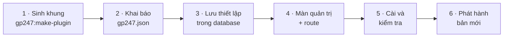

> 🌐 **Ngôn ngữ:** 🇻🇳 Tiếng Việt (hiện tại) · [🇬🇧 English](./create-plugin.md)

# Hướng dẫn tạo plugin cho GP247

## Giới thiệu

Tài liệu này là **điểm bắt đầu** cho lập trình viên PHP/Laravel muốn viết plugin cho GP247 (gói tính năng cắm thêm,
bật/tắt/gỡ được trong trang quản trị). Trang này đi qua 6 bước làm một plugin có màn cấu hình, cài được và **cập nhật
lên bản mới mà không mất thiết lập của chủ cửa hàng**. Các chủ đề sâu hơn nằm ở trang riêng, liệt kê ngay bên dưới. Đọc
xong, bạn có một plugin chạy được và biết cần đọc tiếp trang nào cho loại plugin của mình.

---

## Chọn đúng hướng dẫn

| Bạn đang làm… | Đọc |
|---|---|
| Một tính năng quản trị, một khối hiển thị, plugin thông thường | **Trang này** |
| Phương thức **thanh toán** (chuyển khoản, cổng online) | [Tạo plugin thanh toán](./create-payment-plugin_vi.md) |
| Phương thức **vận chuyển** (bảng giá, hãng giao hàng có API) | [Tạo plugin vận chuyển](./create-shipping-plugin_vi.md) |
| Mã giảm giá / tích điểm, trang storefront riêng, khối layout, cấu hình theo cửa hàng, khoá bí mật | [Plugin nâng cao](./create-plugin-advanced_vi.md) |
| Bảng dữ liệu riêng, di trú dữ liệu khi lên bản mới | [Plugin an toàn khi cập nhật](./create-plugin-update-safety_vi.md) |
| Nâng cấp plugin viết cho GP247 1.x | [Chuyển đổi plugin v1 lên v2](./convert-plugin-v1-to-v2_vi.md) |
| Giao diện cửa hàng (template), không phải plugin | [Tạo template](./create-template_vi.md) |

> 💡 **Làm cùng AI agent?** Dùng skill của GP247 trong repo [gp247-skills](https://github.com/gp247net/gp247-skills) (chép
> thư mục skill vào thư mục skill của agent, ví dụ `.claude/skills/` với Claude Code):
> `gp247-plugin-create` (plugin thông thường), `gp247-payment-plugin-create` (thanh toán), `gp247-shipping-plugin-create`
> (vận chuyển). Skill tự dò phiên bản site và làm đúng các bước dưới đây.

---

## Lộ trình



Ba điều phải nhớ suốt lộ trình:

1. **Cập nhật plugin ghi đè toàn bộ file, giữ nguyên database.** Mọi thứ chủ cửa hàng chỉnh phải nằm trong database.
2. **Mỗi bản phát hành tăng `version`; `configKey` không bao giờ đổi.**
3. **Không sửa `vendor/gp247/*`.** Plugin chỉ "cắm" vào qua điểm nối có sẵn.

---

## Chuẩn bị

1. Một website GP247 3.x đang chạy, và quyền chạy `php artisan` (terminal trên máy phát triển hoặc server).
2. Xem phiên bản lõi — cần cho Bước 2:

   ```bash
   php artisan gp247:info
   ```

   Kết quả mong đợi: một dòng `core` như `3.1`.

| Thuật ngữ | Nghĩa |
|---|---|
| **Plugin (extension)** | Gói tính năng cắm thêm, nằm ở `app/GP247/Plugins/<Tên>` |
| **`configKey`** | Mã định danh duy nhất của plugin, **trùng tên thư mục** |
| **`admin_config`** | Bảng cấu hình trong database — nơi lưu thiết lập để cập nhật không làm mất |
| **Livewire** | Cách làm giao diện động của Laravel; màn quản trị GP247 dùng Livewire + Tailwind (TailAdmin), **không dùng jQuery** |

---

## Bước 1 — Sinh khung plugin

1. Mở terminal tại thư mục gốc website (nơi có file `artisan`), chạy (thay `MyPlugin` bằng tên của bạn, viết liền,
   hoa chữ cái đầu mỗi từ):

   ```bash
   php artisan gp247:make-plugin --name=MyPlugin --download=0
   ```

   Kết quả mong đợi: dòng `Success`, thư mục `app/GP247/Plugins/MyPlugin` được tạo. (`--download=1` thì tạo file `.zip`
   trong `storage/tmp` để phân phối.)
2. Xem các file vừa sinh:

| File | Để làm gì | Bạn làm gì |
|---|---|---|
| `gp247.json` | Khai báo plugin (tên, phiên bản, tương thích) | **Sửa** — Bước 2 |
| `AppConfig.php` | Cài, gỡ, bật, tắt, cập nhật | **Sửa** — Bước 3 |
| `Livewire/AdminLivewire.php` | Màn quản trị | **Sửa** — Bước 4 |
| `Route.php`, `Provider.php` | Đăng ký đường dẫn, ngôn ngữ, view | **Sửa** — Bước 4 |
| `Lang/vi/lang.php`, `Lang/en/lang.php` | Chữ hiển thị | **Sửa** — Bước 4 |
| `Admin/AdminController.php`, `Views/Admin.blade.php` | Màn quản trị kiểu cũ (tương thích ngược) | Xoá khi đã dùng Livewire |
| `Controllers/FrontController.php`, `Views/Front.blade.php`, `Seo.php` | Trang công khai và sitemap | Xoá nếu plugin chỉ dùng trong quản trị — xem [Plugin nâng cao](./create-plugin-advanced_vi.md) |
| `Models/ExtensionModel.php` | Tạo/xoá bảng dữ liệu riêng | Giữ nếu có bảng riêng — xem [Plugin an toàn khi cập nhật](./create-plugin-update-safety_vi.md) |
| `config.php`, `function.php` | Giá trị mặc định, hàm phụ | **Không** để chủ cửa hàng sửa `config.php` |

---

## Bước 2 — Khai báo `gp247.json`

```json
{
    "name": "My plugin",
    "image": "images/logo.jpg",
    "auth": "Your name",
    "email": "you@example.com",
    "link": "https://example.com",
    "configGroup": "Plugins",
    "configCode": "MyPlugin",
    "configKey": "MyPlugin",
    "version": "1.0",
    "requireCore": ["3.1"],
    "requireUpdateFrom": "1.0",
    "requireComposerPackages": [],
    "requireGp247Extensions": [],
    "requireLivewire": false,
    "storeScope": "global"
}
```

| Trường | Ý nghĩa |
|---|---|
| `configKey` | Trùng tên thư mục. **Không đổi sau khi phát hành.** |
| `configCode` | Vai trò của plugin: `"Payment"` (thanh toán), `"Shipping"` (vận chuyển), `"Promotion"` (mã giảm giá); plugin khác ghi giống `configKey` |
| `version` | `1.0`, `1.1`, `2.0`… Mỗi bản phát hành phải **lớn hơn** bản trước |
| `requireCore` | Phiên bản lõi chạy được: ghi dòng `core` của `gp247:info`, ví dụ `["3.1"]` |
| `requireUpdateFrom` | Bản đang cài thấp nhất được cập nhật thẳng lên bản này; `"1.0"` là không chặn |
| `requireComposerPackages` | Gói Composer bắt buộc, ví dụ `["gp247/shop"]` cho plugin bán hàng |
| `requireGp247Extensions` | Plugin GP247 khác phải cài trước (theo `configKey`) |
| `storeScope` | `"global"` (một thiết lập chung) hoặc `"store"` (mỗi cửa hàng một thiết lập) |

> ⚠️ **`requireCore` là một khoảng theo phiên bản lớn.** `"3.1"` nghĩa là "từ 3.1 trở lên, trong dòng 3.x" — cài được trên
> 3.1, 3.2…, nhưng **bị từ chối** trên 4.x. Ghi `"2.1"` thì lõi 3.x từ chối cài. Hỗ trợ nhiều dòng lớn thì ghi mỗi dòng một
> giá trị, ví dụ `["3.1", "4.0"]`; không ghi số bản vá như `"3.1.2"`.

---

## Bước 3 — Lưu thiết lập trong database

Cập nhật plugin **ghi đè toàn bộ file** (kể cả `config.php`) nhưng **giữ nguyên database**. Vì vậy mỗi thiết lập chủ cửa
hàng được chỉnh là **một dòng** trong bảng `admin_config`, khoá `<configKey>_<tên>`, tạo lúc cài và bổ sung lúc cập nhật.
Thay toàn bộ `AppConfig.php`:

```php
<?php

namespace App\GP247\Plugins\MyPlugin;

use GP247\Core\ExtensionConfigDefault;
use GP247\Core\Models\AdminConfig;
use GP247\Core\Models\AdminHome;

class AppConfig extends ExtensionConfigDefault
{
    /** Settings the site owner edits: key => default. */
    public const SETTINGS = [
        'enabled_on_home' => '1',
        'items_per_page'  => '20',
    ];

    public function __construct()
    {
        $config = json_decode(file_get_contents(__DIR__.'/gp247.json'), true);
        $this->configGroup = $config['configGroup'];
        $this->configKey = $config['configKey'];
        $this->configCode = $config['configCode'];
        $this->requireCore = $config['requireCore'] ?? [];
        $this->requireComposerPackages = $config['requireComposerPackages'] ?? [];
        $this->requireGp247Extensions = $config['requireGp247Extensions'] ?? [];
        $this->appPath = $this->configGroup.'/'.$this->configKey;
        $this->title = trans($this->appPath.'::lang.title');
        $this->image = $this->appPath.'/'.$config['image'];
        $this->version = $config['version'];
        $this->auth = $config['auth'];
        $this->link = $config['link'];
    }

    /**
     * Every admin_config row this plugin owns: the on/off row + one row per setting.
     */
    private function seedRows(): array
    {
        $rows = [[
            'group' => $this->configGroup, 'code' => $this->configCode, 'key' => $this->configKey,
            'sort' => 0, 'store_id' => GP247_STORE_ID_GLOBAL, 'value' => self::ON,
            'security' => 0, 'detail' => $this->appPath.'::lang.title',
        ]];
        $sort = 0;
        foreach (self::SETTINGS as $key => $default) {
            $rows[] = [
                'group' => $this->configGroup, 'code' => $this->configKey.'_config',
                'key' => $this->configKey.'_'.$key, 'sort' => ++$sort,
                'store_id' => GP247_STORE_ID_GLOBAL, 'value' => $default,
                'security' => 0, 'detail' => $this->appPath.'::lang.'.$key,
            ];
        }

        return $rows;
    }

    public function install()
    {
        if (AdminConfig::where('group', $this->configGroup)->where('key', $this->configKey)->exists()) {
            return ['error' => 1, 'msg' => gp247_language_render('admin.extension.plugin_exist')];
        }
        try {
            AdminConfig::insert($this->seedRows());

            return ['error' => 0, 'msg' => gp247_language_render('admin.extension.install_success')];
        } catch (\Throwable $e) {
            return ['error' => 1, 'msg' => $e->getMessage()];
        }
    }

    /**
     * Add the rows a newer version introduced; never touch a value the site owner saved.
     */
    public function update(?string $fromVersion = null)
    {
        try {
            foreach ($this->seedRows() as $row) {
                $exists = AdminConfig::where('group', $row['group'])->where('key', $row['key'])
                    ->where('store_id', (string) $row['store_id'])->exists();
                if (!$exists) {
                    AdminConfig::insert($row);
                }
            }

            return ['error' => 0, 'msg' => ''];
        } catch (\Throwable $e) {
            return ['error' => 1, 'msg' => $e->getMessage()];
        }
    }

    public function uninstall()
    {
        try {
            AdminConfig::where('group', $this->configGroup)->where(function ($q) {
                $q->where('key', $this->configKey)
                    ->orWhere('key', 'like', $this->configKey.'\_%')
                    ->orWhere('code', $this->configKey.'_config');
            })->delete();
            AdminHome::where('extension', $this->appPath)->delete();

            return ['error' => 0, 'msg' => gp247_language_render('admin.extension.uninstall_success')];
        } catch (\Throwable $e) {
            return ['error' => 1, 'msg' => $e->getMessage()];
        }
    }

    public function enable()
    {
        AdminConfig::where('group', $this->configGroup)->where('key', $this->configKey)->update(['value' => self::ON]);

        return ['error' => 0, 'msg' => gp247_language_render('admin.extension.enable_success')];
    }

    public function disable()
    {
        AdminConfig::where('group', $this->configGroup)->where('key', $this->configKey)->update(['value' => self::OFF]);

        return ['error' => 0, 'msg' => ''];
    }

    // The ⚙ (Config) button on the Plugins list appears only when this returns a redirect.
    public function clickApp()
    {
        return redirect(gp247_route_admin('admin_myplugin.index'));
    }

    public function setupStore($storeId = null)
    {
    }

    public function removeStore($storeId = null)
    {
    }

    /**
     * A setting for a store (falls back to the shared value).
     */
    public function setting(string $key, $storeId = null): string
    {
        $storeId ??= gp247_plugin_store_id();

        return (string) gp247_config($this->configKey.'_'.$key, $storeId, self::SETTINGS[$key] ?? '');
    }

    public function getInfo()
    {
        return [
            'title' => $this->title,
            'key' => $this->configKey,
            'code' => $this->configCode,
            'image' => $this->image,
            'permission' => self::ALLOW,
            'version' => $this->version,
            'auth' => $this->auth,
            'link' => $this->link,
            'appPath' => $this->appPath,
        ];
    }
}
```

| Hàm | Khi nào chạy | Làm gì |
|---|---|---|
| `install()` | Chủ cửa hàng bấm **Cài đặt** | Ghi dòng bật/tắt + mỗi thiết lập một dòng |
| `update(?string $fromVersion)` | Sau khi file được thay bằng bản mới (1-click, `git pull`, Composer) | Chỉ **thêm** dòng còn thiếu; chạy lại nhiều lần vẫn an toàn; có thể nhận `null` |
| `uninstall()` | Chủ cửa hàng bấm **Gỡ** | Xoá mọi dòng của plugin |
| `enable()` / `disable()` | Bật / tắt | Đổi cờ, không xoá dữ liệu |
| `clickApp()` | Danh sách Plugins vẽ nút ⚙ | Trả chuyển hướng tới màn cấu hình — trả `null` thì **không có nút** |
| `setting()` | Code của bạn cần một giá trị | Đọc theo cửa hàng, không có thì lấy giá trị chung |

Thiết lập là **khoá bí mật** (API key, mật khẩu)? Tạo dòng với `'security' => 1` và khai ô là `password` ở Bước 4 — lõi mã
hoá và không bao giờ gửi lại ra trình duyệt. Chi tiết: [Plugin nâng cao](./create-plugin-advanced_vi.md#2-khoá-bí-mật).

---

## Bước 4 — Màn quản trị và route

**Màn cấu hình** — kế thừa `ConfigForm` của lõi là có sẵn giao diện, phân quyền, nút Lưu, chọn cửa hàng.
Thay `Livewire/AdminLivewire.php`:

```php
<?php

namespace App\GP247\Plugins\MyPlugin\Livewire;

use App\GP247\Plugins\MyPlugin\AppConfig;
use GP247\Core\AdminShell\Infrastructure\ConfigForm;

/**
 * Settings screen: one field per row seeded by AppConfig::install().
 */
class AdminLivewire extends ConfigForm
{
    protected ?string $permission = null;

    protected function group(): string
    {
        return 'Plugins';
    }

    protected function heading(): string
    {
        return trans('Plugins/MyPlugin::lang.title');
    }

    // Required: without keys() the screen would list — and save — nothing of yours.
    protected function keys(): array
    {
        return array_map(fn ($key) => 'MyPlugin_'.$key, array_keys(AppConfig::SETTINGS));
    }

    protected function fieldTypes(): array
    {
        return [
            'MyPlugin_enabled_on_home' => 'bool',
            'MyPlugin_items_per_page'  => 'number',
        ];
    }
}
```

Kiểu ô: `bool` (công tắc), `number`, `select` (kèm `fieldOptions()`), `password`, `text` (mặc định). Có thể thêm
`fieldHints()` (gợi ý cạnh ô) và `sections()` (chia khối có tiêu đề). Plugin cần màn riêng không phải dạng cấu hình thì
kế thừa `GP247\Core\AdminShell\Infrastructure\GP247AdminComponent` và tự viết view.

**Route** — thay `Route.php`; trỏ thẳng đường dẫn quản trị vào màn Livewire:

```php
<?php

use Illuminate\Support\Facades\Route;

$config = json_decode(file_get_contents(__DIR__.'/gp247.json'), true);

if (gp247_extension_check_active($config['configGroup'], $config['configKey'])) {
    Route::group(
        [
            'prefix' => GP247_ADMIN_PREFIX.'/myplugin',
            'middleware' => GP247_ADMIN_MIDDLEWARE,
        ],
        function () {
            Route::get('/', \App\GP247\Plugins\MyPlugin\Livewire\AdminLivewire::class)
                ->name('admin_myplugin.index');
        }
    );
}
```

Sau đó xoá `Admin/AdminController.php` và `Views/Admin.blade.php` (màn kiểu cũ).

**Provider** — `Provider.php` nạp ngôn ngữ, view và đăng ký tên Livewire của plugin:

```php
<?php

$config = json_decode(file_get_contents(__DIR__.'/gp247.json'), true);
$extensionPath = $config['configGroup'].'/'.$config['configKey'];

$this->loadTranslationsFrom(__DIR__.'/Lang', $extensionPath);

if (gp247_extension_check_active($config['configGroup'], $config['configKey'])) {
    $this->loadViewsFrom(__DIR__.'/Views', $extensionPath);

    if (class_exists(\Livewire\Livewire::class)) {
        \Livewire\Livewire::addNamespace('MyPlugin', classNamespace: 'App\\GP247\\Plugins\\MyPlugin\\Livewire');
    }
}
```

**Ngôn ngữ** — mọi chữ hiển thị qua `trans('Plugins/MyPlugin::lang.<khoá>')`, có cả `vi` và `en`. Nhãn của mỗi ô cấu hình
là khoá trùng tên thiết lập:

```php
<?php

return [
    'title'           => 'Plugin của tôi',
    'enabled_on_home' => 'Hiện ở trang chủ',
    'items_per_page'  => 'Số mục mỗi trang',
];
```

Quy tắc giao diện: chỉ dùng component `<x-gp247::*>`, Livewire và Alpine; **không** jQuery, AdminLTE, select2.

---

## Bước 5 — Cài và kiểm tra

1. Xoá cache để nạp file mới:

   ```bash
   php artisan optimize:clear
   ```

2. Cài plugin: **Admin → Plugins → MyPlugin → Cài đặt**, hoặc bằng lệnh:

   ```bash
   php artisan gp247:ext-install --type=plugin --key=MyPlugin
   ```

   Kết quả mong đợi: plugin hiện trạng thái đang bật.
3. Bấm ⚙ **Cấu hình**, đổi một giá trị, bấm **Lưu**, tải lại trang — giá trị vẫn còn.
4. Thử bật / tắt; mở màn quản trị ở cả **nền sáng và nền tối**.
5. Thử gỡ rồi cài lại: lần cài lại phải tạo đủ dòng cấu hình (và bảng, menu nếu có).

> ⚠️ **Gỡ plugin đang phát triển luôn dùng `--only-data`:**
>
> ```bash
> php artisan gp247:ext-uninstall --type=plugin --key=MyPlugin --only-data
> ```
>
> Gỡ thường (hoặc nút **Gỡ** không chọn "chỉ xoá dữ liệu") **xoá luôn thư mục mã nguồn** của plugin.

---

## Bước 6 — Phát hành bản mới

1. Tăng `version` trong `gp247.json` (ví dụ `1.0` → `1.1`).
2. Bản mới thêm thiết lập? Thêm khoá vào `SETTINGS` — `update()` tự tạo dòng còn thiếu, giữ nguyên giá trị cũ.
3. Bản mới thêm cột / bảng hay đổi dữ liệu? Viết trong `update()` theo [Plugin an toàn khi cập nhật](./create-plugin-update-safety_vi.md).
4. Thử như chủ cửa hàng sẽ cập nhật bằng `git pull`:

   ```bash
   php artisan gp247:ext-update --type=plugin --key=MyPlugin --local --dry-run
   ```

   Kết quả mong đợi: plugin hiện trong danh sách chờ áp dụng; bỏ `--dry-run` để chạy `update()` thật.

---

## Danh sách kiểm tra trước khi phát hành

- [ ] `gp247.json`: `configKey` trùng tên thư mục; `requireCore` theo `gp247:info`; `version` đã tăng.
- [ ] Mọi thiết lập chủ cửa hàng chỉnh nằm trong `admin_config`; `config.php` chỉ có mặc định của tác giả.
- [ ] `install()` / `uninstall()` cân xứng; `update()` chạy lại an toàn và chạy được với `null`.
- [ ] `clickApp()` mở màn cấu hình; `keys()` liệt kê đủ ô; khoá bí mật là ô `password`.
- [ ] Màn quản trị dùng Livewire + `<x-gp247::*>`, không jQuery; chữ qua `trans()` có cả `vi` và `en`.
- [ ] Đã `optimize:clear`, cài / bật / tắt / gỡ `--only-data` / cài lại thành công.
- [ ] Plugin thanh toán / vận chuyển: đã theo hướng dẫn riêng của loại đó.

---

## Điều kiện & ràng buộc (hiểu trước khi thao tác)

**Khi cài đặt**
- **Lõi từ chối cài nếu `requireCore` không khớp** dòng lõi đang chạy (khoảng theo phiên bản lớn) — tránh plugin chạy trên lõi chưa thử.
- **Cài lại khi dòng bật/tắt còn trong database bị từ chối** ("plugin đã tồn tại") — gỡ trước rồi mới cài.
- **Thiếu gói trong `requireComposerPackages` / plugin trong `requireGp247Extensions` thì không cài được.**

**Khi cập nhật**
- **`version` mới phải lớn hơn bản đang cài**, và bản đang cài không thấp hơn `requireUpdateFrom` — nếu không, cập nhật 1-click từ chối.
- **`update()` báo lỗi thì bản cũ được khôi phục** (cập nhật 1-click); với `git pull` thì file không khôi phục, chỉ giữ trạng thái "chờ áp dụng" để chạy lại.

---

## Hỏi & Đáp (Q&A)

**Câu 1: Tôi phải viết tay từng file plugin à?**

→ Không. `php artisan gp247:make-plugin --name=TenPlugin --download=0` sinh sẵn khung; bạn chỉ sửa các file ở Bước 2–4.
Làm cùng AI agent thì dùng skill `gp247-plugin-create`.

**Câu 2: `configKey` có bắt buộc trùng tên thư mục không?**

→ Có. Nó là mã định danh dùng để đối chiếu bản cũ và bản mới khi cập nhật, nên cũng không được đổi sau khi phát hành.

**Câu 3: Chủ cửa hàng sửa `config.php`, cập nhật xong là mất hết — vì sao?**

→ Cập nhật ghi đè toàn bộ file. Thiết lập phải nằm trong database như Bước 3.

**Câu 4: Lõi báo "không tương thích" khi cài plugin?**

→ `requireCore` không khớp. Chạy `php artisan gp247:info`, ghi đúng dòng `core` (ví dụ `["3.1"]`). Giá trị `"2.1"` cũ không cài được trên lõi 3.x.

**Câu 5: Không thấy nút ⚙ Cấu hình trên danh sách Plugins?**

→ `clickApp()` đang trả `null` (mặc định của khung). Cho nó trả chuyển hướng tới màn cấu hình như Bước 3.

**Câu 6: Màn cấu hình không hiện ô nào, hoặc Lưu không lưu?**

→ Thiếu `keys()` trong màn cấu hình, hoặc `install()` chưa tạo dòng cho các khoá đó (cài lại bằng gỡ `--only-data` rồi cài).

**Câu 7: Bản mới có thêm cột database — xử lý ở đâu?**

→ Trong `update()`, kiểm tra trạng thái thật (`Schema::hasColumn`) chứ không chỉ dựa vào số phiên bản. Xem [Plugin an toàn khi cập nhật](./create-plugin-update-safety_vi.md).

**Câu 8: Có được dùng jQuery hay select2 trên màn quản trị không?**

→ Không. Màn quản trị GP247 không nạp jQuery; dùng Livewire / Alpine và component `<x-gp247::*>`.

**Câu 9: `version` ghi `1.0.0` hay `1.0`?**

→ Dạng số nào cũng được, miễn bản sau **lớn hơn** bản trước (so bằng `version_compare`), ví dụ `1.0` → `1.1` → `2.0`.

**Câu 10: Cập nhật xong mà quản trị vẫn hiện bản cũ?**

→ Chạy `php artisan optimize:clear` rồi tải lại trang — Laravel còn giữ cache cũ.

---

## Lịch sử thay đổi
<!-- Chỉ ghi khi có thay đổi về logic/hành vi. Dòng mới nhất ở trên cùng. Mỗi ngày một dòng: cùng ngày thì gộp vào dòng có sẵn, không tách dòng mới. -->

| Ngày | Phiên bản GP247 | Thay đổi |
| --- | --- | --- |
| 2026-10-18 | gp247/core 3.1 | Sắp xếp lại thành trang chính 6 bước; tách [Plugin an toàn khi cập nhật](./create-plugin-update-safety_vi.md) và [Plugin nâng cao](./create-plugin-advanced_vi.md); thêm hướng dẫn plugin thanh toán và vận chuyển. **Sửa:** `requireCore` ghi theo `gp247:info` (giá trị `"2.1"` cũ bị lõi 3.x từ chối); thiết lập mặc định lưu mỗi khoá một dòng với màn `ConfigForm` (giữ được khoá bí mật); thêm `clickApp()` cho nút Cấu hình |
| 2026-09-29 |  | Hook `AppConfig::update($fromVersion)` nay cũng được gọi khi chủ site thay file bằng `git pull`/Composer/chép tay (qua `gp247:update`, `gp247:ext-update --local`, nút **Áp dụng cập nhật dữ liệu**); lần đầu có thể nhận `null`. |

---

<sub>📅 **Cập nhật lần cuối:** 2026-10-18 · ✍️ **Tác giả (Author):** GP247</sub>
