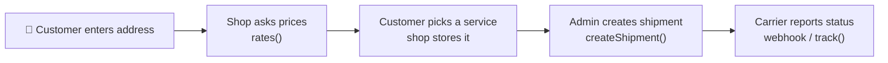
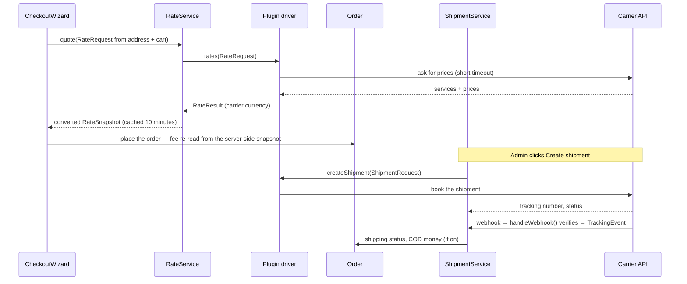

> 🌐 **Language:** [🇻🇳 Tiếng Việt](./create-shipping-plugin_vi.md) · 🇬🇧 English (current)

# Creating a shipping plugin for GP247 — step by step, with complete code

## Introduction

This document guides developers through writing a **shipping plugin** for GP247 / S-Cart on `gp247/shop`'s standard shipping
contract. Part 1 builds a **weight-based price** plugin with two services (Standard, Express) that works right away, with no
outside account. Part 2 connects a **carrier with an API**: quotes, booking and cancelling shipments, tracking, webhooks. After
reading, you have a working plugin and know which parts `gp247/shop` already does and which the plugin must write.

> ℹ️ **Available since:** gp247/shop 3.1.4 (the standard shipping contract). On older versions the plugin still works the old way
> through `getInfo()` — see Step 3.

> 💡 **Working with an AI agent?** Use the **`gp247-shipping-plugin-create`** skill from the
> [gp247-skills](https://github.com/gp247net/gp247-skills) repository: it probes the site's version and capabilities, asks for what
> it needs and builds the plugin following the steps below, and it is updated together with `gp247/shop`.

---

## 1. Before you start

- A GP247 3.x website with `gp247/shop` installed. Check the core version with `php artisan gp247:info` (the `core` line).
- Know how to build a basic plugin: [Creating a plugin](./create-plugin.md).
- Understand how shipping runs on the store side: [Shipping in GP247](../s-cart/shipping/shipping.md).

**Who does what:**

| `gp247/shop` handles | Your plugin handles |
|---|---|
| The Shipping step at checkout, storing the chosen service on the order | Returning services and prices from `rates()` |
| Converting carrier currency → base → display, 10-minute cache, pausing a failing carrier | Returning prices in the **carrier's currency** |
| Weight (grams) and size (cm) of each item | Sending that data to the carrier |
| The order's Shipping block, the shipment table, event de-duplication, the shipping status | Booking / cancelling / tracking with the carrier (when it can) |
| The shared webhook route `/shipping/webhook/<Plugin name>` | Verifying the webhook and turning it into standard events |
| Cash on delivery (COD): the amount, recording it on reconciliation | Sending the COD amount to the carrier |



---

## 2. Part 1 — Weight-based price plugin (works right away)

Result: the Shipping step offers **Standard** (3–5 days) and **Express** (1–2 days), priced by the cart's kilograms; Standard
can be free from a cart value. Each store sets its own prices.

Pricing: first-kilogram fee + a fee per extra kilogram (rounded up: 1.2 kg counts as 2 kg); Express adds a surcharge.

### Step 1 — Scaffold and remove unused files

1. In the website's root folder, run:

   ```bash
   php artisan gp247:make-plugin --name=MyWeightShipping --download=0
   ```

   Expected result: a `Success` line and the folder `app/GP247/Plugins/MyWeightShipping`.
2. In that folder, **delete**: `Admin/`, `Controllers/`, `Models/`, `Views/`, `Seo.php`, `config.php`, `function.php`
   (a shipping plugin has no page of its own on the storefront).

After the steps below, the plugin has:

```
MyWeightShipping/
├── gp247.json                         ← Step 2
├── AppConfig.php                      ← Step 3
├── Services/WeightShippingProvider.php  ← Step 4
├── Livewire/AdminLivewire.php         ← Step 5
├── Route.php · Provider.php           ← Step 6
├── Lang/vi/lang.php · Lang/en/lang.php  ← Step 6
└── public/images/logo.jpg
```

### Step 2 — `gp247.json`

```json
{
    "name": "My weight shipping",
    "image": "images/logo.jpg",
    "auth": "Your name",
    "email": "you@example.com",
    "link": "https://example.com",
    "configGroup": "Plugins",
    "configCode": "Shipping",
    "configKey": "MyWeightShipping",
    "version": "1.0",
    "requireCore": ["3.1"],
    "requireUpdateFrom": "1.0",
    "requireComposerPackages": ["gp247/shop"],
    "requireGp247Extensions": [],
    "requireLivewire": false,
    "storeScope": "store"
}
```

- `configCode: "Shipping"` — how checkout recognises the plugin as a carrier, and how the store owner enables / disables it.
- `requireCore` is the `core` line of `php artisan gp247:info`; `"3.1"` means every 3.x from 3.1.
- `storeScope: "store"` — each store has its own price table.

### Step 3 — `AppConfig.php`: install, uninstall, update

The store owner enters prices in the store's **base** currency; they live in the database (one row per field keyed
`MyWeightShipping_<name>`) so updating the plugin does not lose them.

```php
<?php

namespace App\GP247\Plugins\MyWeightShipping;

use GP247\Core\ExtensionConfigDefault;
use GP247\Core\Models\AdminConfig;
use GP247\Core\Models\AdminHome;

class AppConfig extends ExtensionConfigDefault
{
    /** Settings the site owner edits: key => default (amounts in the store's BASE currency). */
    public const SETTINGS = [
        'base_fee'      => '30000', // fee of the first kilogram
        'fee_per_kg'    => '5000',  // each extra kilogram (started)
        'express_extra' => '20000', // added for the Express service
        'free_from'     => '0',     // free Standard shipping from this cart value; 0 = never
    ];

    public function __construct()
    {
        $config = json_decode(file_get_contents(__DIR__.'/gp247.json'), true);
        $this->configGroup = $config['configGroup'];
        $this->configKey = $config['configKey'];
        $this->configCode = $config['configCode'];
        $this->requireCore = $config['requireCore'] ?? [];
        $this->requireComposerPackages = $config['requireComposerPackages'] ?? [];
        $this->requireGp247Extensions = $config['requireGp247Extensions'] ?? [];
        $this->appPath = $this->configGroup.'/'.$this->configKey;
        $this->title = trans($this->appPath.'::lang.title');
        $this->image = $this->appPath.'/'.$config['image'];
        $this->version = $config['version'];
        $this->auth = $config['auth'];
        $this->link = $config['link'];
    }

    /**
     * Every admin_config row this plugin owns: the on/off row + one row per setting.
     */
    private function seedRows(): array
    {
        $rows = [[
            'group' => $this->configGroup, 'code' => $this->configCode, 'key' => $this->configKey,
            'sort' => 0, 'store_id' => GP247_STORE_ID_GLOBAL, 'value' => self::ON,
            'security' => 0, 'detail' => $this->appPath.'::lang.title',
        ]];
        $sort = 0;
        foreach (self::SETTINGS as $key => $default) {
            $rows[] = [
                'group' => $this->configGroup, 'code' => $this->configKey.'_config',
                'key' => $this->configKey.'_'.$key, 'sort' => ++$sort,
                'store_id' => GP247_STORE_ID_GLOBAL, 'value' => $default,
                'security' => 0, 'detail' => $this->appPath.'::lang.'.$key,
            ];
        }

        return $rows;
    }

    public function install()
    {
        if (AdminConfig::where('group', $this->configGroup)->where('key', $this->configKey)->exists()) {
            return ['error' => 1, 'msg' => gp247_language_render('admin.extension.plugin_exist')];
        }
        try {
            AdminConfig::insert($this->seedRows());

            return ['error' => 0, 'msg' => gp247_language_render('admin.extension.install_success')];
        } catch (\Throwable $e) {
            return ['error' => 1, 'msg' => $e->getMessage()];
        }
    }

    /**
     * Add the rows a newer version introduced; never touch a value the site owner saved.
     */
    public function update(?string $fromVersion = null)
    {
        try {
            foreach ($this->seedRows() as $row) {
                $exists = AdminConfig::where('group', $row['group'])->where('key', $row['key'])
                    ->where('store_id', (string) $row['store_id'])->exists();
                if (!$exists) {
                    AdminConfig::insert($row);
                }
            }

            return ['error' => 0, 'msg' => ''];
        } catch (\Throwable $e) {
            return ['error' => 1, 'msg' => $e->getMessage()];
        }
    }

    public function uninstall()
    {
        try {
            AdminConfig::where('group', $this->configGroup)->where(function ($q) {
                $q->where('key', $this->configKey)
                    ->orWhere('key', 'like', $this->configKey.'\_%')
                    ->orWhere('code', $this->configKey.'_config');
            })->delete();
            AdminHome::where('extension', $this->appPath)->delete();

            return ['error' => 0, 'msg' => gp247_language_render('admin.extension.uninstall_success')];
        } catch (\Throwable $e) {
            return ['error' => 1, 'msg' => $e->getMessage()];
        }
    }

    public function enable()
    {
        AdminConfig::where('group', $this->configGroup)->where('key', $this->configKey)->update(['value' => self::ON]);

        return ['error' => 0, 'msg' => gp247_language_render('admin.extension.enable_success')];
    }

    public function disable()
    {
        AdminConfig::where('group', $this->configGroup)->where('key', $this->configKey)->update(['value' => self::OFF]);

        return ['error' => 0, 'msg' => ''];
    }

    // The ⚙ (Config) button on the Plugins list appears only when this returns a redirect.
    public function clickApp()
    {
        return redirect(gp247_route_admin('admin_myweightshipping.index'));
    }

    public function setupStore($storeId = null)
    {
    }

    public function removeStore($storeId = null)
    {
    }

    /**
     * A setting for a store (falls back to the shared value), as a number.
     */
    public function setting(string $key, $storeId = null): float
    {
        $storeId ??= gp247_plugin_store_id();

        return (float) gp247_config($this->configKey.'_'.$key, $storeId, self::SETTINGS[$key] ?? 0);
    }

    /**
     * Used only by an older gp247/shop without the shipping contract: one fee, in the DISPLAY currency.
     */
    public function getInfo()
    {
        return [
            'title' => $this->title,
            'key' => $this->configKey,
            'code' => $this->configCode,
            'image' => $this->image,
            'permission' => self::ALLOW,
            'version' => $this->version,
            'auth' => $this->auth,
            'link' => $this->link,
            'value' => gp247_currency_value($this->setting('base_fee')),
            'appPath' => $this->appPath,
        ];
    }
}
```

- `update()` only adds missing rows and keeps saved prices; it works when `$fromVersion` is `null`.
- `clickApp()` makes the ⚙ **Config** button appear on the Plugins list.
- `getInfo()` is only used by an **older** `gp247/shop` without the shipping contract: one fee, in the **display** currency
  (`gp247_currency_value()` converts from base). On newer versions the shop uses the driver of Step 4.

### Step 4 — The pricing driver (`Services/WeightShippingProvider.php`)

This is what makes a shipping plugin: a class implementing `ShippingProvider` with exactly one required function, `rates()`.

```php
<?php

namespace App\GP247\Plugins\MyWeightShipping\Services;

use App\GP247\Plugins\MyWeightShipping\AppConfig;
use GP247\Shop\Shipping\Contracts\ShippingProvider;
use GP247\Shop\Shipping\Data\Money;
use GP247\Shop\Shipping\Data\RateRequest;
use GP247\Shop\Shipping\Data\RateResult;
use GP247\Shop\Shipping\Data\ShippingRate;
use GP247\Shop\Shipping\RateRequestFactory;

/**
 * Two services priced by weight: Standard and Express.
 */
class WeightShippingProvider implements ShippingProvider
{
    public function rates(RateRequest $request): RateResult
    {
        $config = new AppConfig();
        $store = $request->storeId;
        $currency = RateRequestFactory::baseCurrency(); // the settings are in the base currency

        // Started kilograms: 1 200 g counts as 2 kg; an empty parcel still counts as 1 kg.
        $kg = max(1, (int) ceil($request->totalWeightGrams() / 1000));
        $standard = $config->setting('base_fee', $store) + ($kg - 1) * $config->setting('fee_per_kg', $store);
        $express = $standard + $config->setting('express_extra', $store);

        // declaredValue is the cart value in the base currency — the unit the owner typed the threshold in.
        $freeFrom = $config->setting('free_from', $store);
        if ($freeFrom > 0 && $request->declaredValue->value() >= $freeFrom) {
            $standard = 0;
        }

        return new RateResult([
            new ShippingRate(
                pluginKey: 'MyWeightShipping',
                serviceCode: 'standard',
                title: trans('Plugins/MyWeightShipping::lang.service_standard'),
                amount: new Money((string) $standard, $currency),
                etaMinDays: 3,
                etaMaxDays: 5,
            ),
            new ShippingRate(
                pluginKey: 'MyWeightShipping',
                serviceCode: 'express',
                title: trans('Plugins/MyWeightShipping::lang.service_express'),
                amount: new Money((string) $express, $currency),
                etaMinDays: 1,
                etaMaxDays: 2,
            ),
        ]);
    }
}
```

- `RateRequest` gives you: the store (`storeId`), pick-up / delivery addresses (`origin`, `destination`), the items (`items`, weight
  in **grams**), the goods value (`declaredValue`, in the **base** currency). `totalWeightGrams()` sums the weight for you.
- Each service is a `ShippingRate`: service code, name, price (`Money` with a currency code), estimated delivery days.
- Return the price in the currency you priced it in — the shop converts **once**. Never convert to the display currency yourself.

### Step 5 — Settings screen (`Livewire/AdminLivewire.php`)

```php
<?php

namespace App\GP247\Plugins\MyWeightShipping\Livewire;

use App\GP247\Plugins\MyWeightShipping\AppConfig;
use GP247\Core\AdminShell\Infrastructure\ConfigForm;

/**
 * Settings screen: one field per row seeded by AppConfig::install().
 */
class AdminLivewire extends ConfigForm
{
    protected ?string $permission = null;

    protected function group(): string
    {
        return 'Plugins';
    }

    protected function heading(): string
    {
        return trans('Plugins/MyWeightShipping::lang.title');
    }

    // Each store may have its own prices (storeScope "store" in gp247.json).
    protected function storeScoped(): bool
    {
        return true;
    }

    // Required: without keys() the screen would list — and save — nothing of yours.
    protected function keys(): array
    {
        return array_map(fn ($key) => 'MyWeightShipping_'.$key, array_keys(AppConfig::SETTINGS));
    }

    protected function fieldTypes(): array
    {
        return array_fill_keys($this->keys(), 'number');
    }
}
```

### Step 6 — `Route.php`, `Provider.php`, languages

`Route.php` (only the settings screen — the plugin has no storefront page):

```php
<?php

use Illuminate\Support\Facades\Route;

$config = json_decode(file_get_contents(__DIR__.'/gp247.json'), true);

if (gp247_extension_check_active($config['configGroup'], $config['configKey'])) {
    Route::group(
        [
            'prefix' => GP247_ADMIN_PREFIX.'/myweightshipping',
            'middleware' => GP247_ADMIN_MIDDLEWARE,
        ],
        function () {
            Route::get('/', \App\GP247\Plugins\MyWeightShipping\Livewire\AdminLivewire::class)
                ->name('admin_myweightshipping.index');
        }
    );
}
```

`Provider.php` — registers the driver with `gp247/shop`'s shipping layer:

```php
<?php

$config = json_decode(file_get_contents(__DIR__.'/gp247.json'), true);
$extensionPath = $config['configGroup'].'/'.$config['configKey'];

$this->loadTranslationsFrom(__DIR__.'/Lang', $extensionPath);

if (gp247_extension_check_active($config['configGroup'], $config['configKey'])) {
    if (class_exists(\Livewire\Livewire::class)) {
        \Livewire\Livewire::addNamespace('MyWeightShipping', classNamespace: 'App\\GP247\\Plugins\\MyWeightShipping\\Livewire');
    }

    // Register the driver with gp247/shop's shipping layer. On an older shop without it,
    // the plugin still works through AppConfig::getInfo() (one fee).
    if (interface_exists(\GP247\Shop\Shipping\Contracts\ShippingProvider::class)) {
        config(['gp247-config.shop.shipping_providers.MyWeightShipping' => [
            'driver' => \App\GP247\Plugins\MyWeightShipping\Services\WeightShippingProvider::class,
            'capabilities' => ['rates'],
            'settings_route' => 'admin_myweightshipping.index',
        ]]);
    }
}
```

- `capabilities` only lists what the driver really does — here only `'rates'` (pricing).
- `settings_route` gives the **Shipping** tab of the shop settings a link to the plugin's settings screen.
- Wrapped in `interface_exists(...)` so the plugin still runs on an older `gp247/shop`.

`Lang/en/lang.php` (create `Lang/vi/lang.php` the same way, in Vietnamese):

```php
<?php

return [
    'title'            => 'Shipping by weight',
    'base_fee'         => 'First kilogram fee',
    'fee_per_kg'       => 'Each extra kilogram',
    'express_extra'    => 'Express surcharge',
    'free_from'        => 'Free Standard shipping from (0 = never)',
    'service_standard' => 'Standard',
    'service_express'  => 'Express',
];
```

### Step 7 — Install and try it

1. Clear the caches: `php artisan optimize:clear`.
2. Install: **Admin → Plugins → MyWeightShipping → Install** (or `php artisan gp247:ext-install --type=plugin --key=MyWeightShipping`).
3. Click ⚙ **Config**, enter the prices (in the base currency), click **Save**.
4. Check that **Admin → Shop settings → Shipping tab** has "Enable shipping at checkout" on and a pick-up warehouse.
5. On the storefront, add products to the cart and go to the Shipping step.
   Expected result: two choices **Standard** and **Express** with price and days; changing quantities changes the price by kilogram.

> ⚠️ When testing uninstall on a plugin **you are developing**, always use `--only-data`:
> `php artisan gp247:ext-uninstall --type=plugin --key=MyWeightShipping --only-data`. A plain uninstall **also deletes the source folder**.

---

## 3. Part 2 — Connecting a carrier with an API (skeleton code)

This part builds the driver for a **fictitious** carrier `MyCarrier` with an API for quotes, booking / cancelling / tracking
shipments and signed webhooks. Replace the addresses, field names and status codes with your real carrier's documentation. The
plugin skeleton, `gp247.json`, `AppConfig.php` and settings screen are done as in Part 1; the settings `api_token` and
`webhook_secret` are **secret fields** (`security = 1` when creating the row, `password` type on the settings screen).

### 3.1. Declaring capabilities

Only declare what the carrier really offers — each capability matches an interface the driver must implement:

| Capability | Interface | What the shop then offers |
|---|---|---|
| `'rates'` (required) | `ShippingProvider` | Services and prices at checkout |
| `'shipments'` | `CreatesShipments` | **Create shipment** button on the order detail |
| `'cancel'` | `CancelsShipments` | **Cancel shipment** button |
| `'documents'` | `ProvidesShippingDocuments` | **Download label** button |
| `'tracking'` | `TracksShipments` | **Sync** button + refresh when the order is opened |
| `'webhook'` | `HandlesShippingWebhooks` | The shared webhook route accepts the plugin's events |
| `'cod'` | `CreatesShipments` | The shipment carries the cash-on-delivery amount |

```php
if (interface_exists(\GP247\Shop\Shipping\Contracts\ShippingProvider::class)) {
    config(['gp247-config.shop.shipping_providers.MyCarrier' => [
        'driver' => \App\GP247\Plugins\MyCarrier\Services\MyCarrierProvider::class,
        'capabilities' => ['rates', 'shipments', 'cancel', 'tracking', 'webhook', 'cod'],
        'settings_route' => 'admin_mycarrier.index',
    ]]);
}
```

### 3.2. The driver — `Services/MyCarrierProvider.php`

```php
<?php

namespace App\GP247\Plugins\MyCarrier\Services;

use Closure;
use GP247\Shop\Shipping\Contracts\CancelsShipments;
use GP247\Shop\Shipping\Contracts\CreatesShipments;
use GP247\Shop\Shipping\Contracts\HandlesShippingWebhooks;
use GP247\Shop\Shipping\Contracts\ShippingProvider;
use GP247\Shop\Shipping\Contracts\TracksShipments;
use GP247\Shop\Shipping\Data\Money;
use GP247\Shop\Shipping\Data\RateRequest;
use GP247\Shop\Shipping\Data\RateResult;
use GP247\Shop\Shipping\Data\ShipmentRequest;
use GP247\Shop\Shipping\Data\ShipmentResult;
use GP247\Shop\Shipping\Data\ShippingRate;
use GP247\Shop\Shipping\Data\TrackingEvent;
use GP247\Shop\Shipping\Data\WebhookResult;
use GP247\Shop\Shipping\ShippingCurrency;
use GP247\Shop\Shipping\ShippingException;
use Illuminate\Http\Client\ConnectionException;
use Illuminate\Http\Request;
use Illuminate\Support\Facades\Http;

/**
 * A carrier with an API (fictitious "MyCarrier"): quotes, booking, cancel, tracking, webhook.
 * Replace URLs, fields and status codes with your carrier's documentation.
 */
class MyCarrierProvider implements ShippingProvider, CreatesShipments, CancelsShipments, TracksShipments, HandlesShippingWebhooks
{
    private const CURRENCY = 'VND'; // the carrier prices in VND — must exist in the shop's Currencies

    public function rates(RateRequest $request): RateResult
    {
        if ($this->token($request->storeId) === '') {
            return RateResult::error('not_configured');
        }
        if ($request->destination->province === '' || $request->destination->ward === '') {
            return RateResult::error('address_incomplete', trans('Plugins/MyCarrier::lang.address_incomplete'));
        }

        // A timeout / 5xx throws: the shop then pauses this carrier for a minute and the others still answer.
        $response = $this->http($request->storeId)->post('/v1/fees', [
            'from' => $request->origin->toArray(),
            'to' => $request->destination->toArray(),
            'weight_grams' => $request->totalWeightGrams(),
            'value' => (int) round(ShippingCurrency::convert($request->declaredValue, self::CURRENCY, 0)?->value() ?? 0),
        ]);
        if ($response->clientError()) {
            return RateResult::error('carrier_refused', (string) $response->json('message', ''));
        }
        $response->throw();

        $rates = [];
        foreach ((array) $response->json('services', []) as $service) {
            $rates[] = new ShippingRate(
                pluginKey: 'MyCarrier',
                serviceCode: (string) $service['code'],
                title: (string) $service['name'],
                amount: new Money((string) $service['fee'], self::CURRENCY), // carrier currency, never pre-converted
                etaMinDays: $service['eta_min'] ?? null,
                etaMaxDays: $service['eta_max'] ?? null,
            );
        }

        return new RateResult($rates);
    }

    public function createShipment(ShipmentRequest $request): ShipmentResult
    {
        // At booking the amounts are in the ORDER's currency: convert them to the carrier's.
        $cod = ShippingCurrency::convert($request->codAmount, self::CURRENCY, 0);
        $value = ShippingCurrency::convert($request->declaredValue, self::CURRENCY, 0);
        if ($cod === null || $value === null) {
            throw new ShippingException(trans('Plugins/MyCarrier::lang.currency_missing'));
        }
        $weight = $request->parcel?->weightGrams ?: $request->totalWeightGrams();

        $response = $this->http($request->storeId)->post('/v1/orders', [
            'reference' => $request->bookingReference(), // order id, suffixed after a cancellation
            'service' => $request->serviceCode,
            'from' => $request->origin->toArray(),
            'to' => $request->destination->toArray(),
            'weight_grams' => $weight,
            'cod' => (int) $cod->value(),
            'value' => (int) $value->value(),
            'note' => $request->note,
        ]);
        if ($response->status() === 409) { // already booked: return the existing shipment
            $response = $this->http($request->storeId)->get('/v1/orders/by-reference/'.urlencode($request->bookingReference()));
        }
        if (!$response->successful()) {
            throw new ShippingException((string) $response->json('message', 'Carrier refused the booking'));
        }

        return new ShipmentResult(
            trackingNumber: (string) $response->json('tracking'),
            status: StatusMapper::map((string) $response->json('status')) ?? \GP247\Shop\Shipping\ShipmentStatus::PENDING,
            fee: new Money((string) $response->json('fee', 0), self::CURRENCY),
            trackingUrl: (string) $response->json('tracking_url', ''),
        );
    }

    public function shipmentFormFields(): array
    {
        return []; // extra inputs of the booking form, e.g. ['name' => 'pick_option', 'type' => 'select', ...]
    }

    public function cancelShipment(string $trackingNumber, string $storeId): void
    {
        $response = $this->http($storeId)->post('/v1/orders/'.urlencode($trackingNumber).'/cancel');
        if (!$response->successful()) {
            throw new ShippingException((string) $response->json('message', 'Carrier refused to cancel'));
        }
    }

    public function track(string $trackingNumber, string $storeId): array
    {
        $data = $this->http($storeId)->get('/v1/orders/'.urlencode($trackingNumber))->throw()->json();

        return [$this->event($trackingNumber, $data)];
    }

    public function handleWebhook(Request $request, Closure $storeOf): WebhookResult
    {
        $data = (array) $request->json()->all();
        $tracking = (string) ($data['tracking'] ?? '');
        $storeId = $tracking !== '' ? $storeOf($tracking) : null;
        $secret = $storeId !== null ? (string) gp247_config('MyCarrier_webhook_secret', $storeId) : '';
        $signature = hash_hmac('sha256', (string) $request->getContent(), $secret);
        if ($secret === '' || !hash_equals($signature, (string) $request->header('X-Signature'))) {
            return WebhookResult::rejected(403); // the shop writes nothing
        }

        return new WebhookResult(true, [$this->event($tracking, $data)]);
    }

    private function event(string $tracking, array $data): TrackingEvent
    {
        $code = (string) ($data['status'] ?? '');

        return new TrackingEvent(
            trackingNumber: $tracking,
            status: StatusMapper::map($code), // null = informational only
            providerStatus: $code,
            occurredAt: (int) ($data['updated_at'] ?? 0), // the carrier's time: a replay gives the same event
            message: (string) ($data['reason'] ?? ''),
        );
    }

    private function token($storeId): string
    {
        return (string) gp247_config('MyCarrier_api_token', $storeId);
    }

    private function http($storeId)
    {
        return Http::baseUrl('https://api.mycarrier.example')
            ->timeout(5) // a slow carrier must not stall the checkout
            ->withToken($this->token($storeId))
            ->acceptJson();
    }
}
```

Easy mistakes:

- **Ordinary refusals** (not configured, no ward, no delivery to that place) → `RateResult::error()`. **Carrier outage** (timeout,
  5xx) → let the exception escape: the shop pauses the carrier for 1 minute while the other carriers keep quoting.
- **At quote time** the goods value is in the base currency; **at booking time** the goods value and the COD amount are in the
  **order's currency** — convert both to the carrier's currency with `ShippingCurrency::convert()`, and stop if the result is
  `null` (missing currency).
- Send `bookingReference()` as the carrier order reference: the order number the first time, with a suffix after a cancellation
  (carriers refuse to reuse a reference).
- Webhook: find the shipment's store through `$storeOf`, verify the signature with **that store's secret** before trusting any data.
  Bad signature → `WebhookResult::rejected()` and the shop writes nothing.
- `occurredAt` uses **the carrier's time**, not `time()`: the same event sent again must produce the same key so it is not recorded twice.

The webhook address the store owner pastes into the carrier's dashboard: `route('shop.shipping.webhook', ['pluginKey' => 'MyCarrier'])`
— this route is provided by `gp247/shop`; the plugin does **not** create a webhook route of its own.

### 3.3. Status map — `Services/StatusMapper.php`

All of the carrier's status codes map to the shop's standard statuses in **one** place:

```php
<?php

namespace App\GP247\Plugins\MyCarrier\Services;

use GP247\Shop\Shipping\ShipmentStatus;

/**
 * The carrier's status codes → the shop's statuses, in ONE place.
 */
class StatusMapper
{
    private const MAP = [
        'created'    => ShipmentStatus::PENDING,
        'picked'     => ShipmentStatus::PICKED_UP,
        'in_transit' => ShipmentStatus::IN_TRANSIT,
        'delivering' => ShipmentStatus::OUT_FOR_DELIVERY,
        'failed'     => ShipmentStatus::DELIVERY_FAILED,
        'delivered'  => ShipmentStatus::DELIVERED,
        'returning'  => ShipmentStatus::RETURNING,
        'returned'   => ShipmentStatus::RETURNED,
        'cancelled'  => ShipmentStatus::CANCELLED,
        'lost'       => ShipmentStatus::EXCEPTION,
    ];

    public static function map(string $code): ?ShipmentStatus
    {
        return self::MAP[$code] ?? null; // unknown code = informational event
    }
}
```

The standard status decides the order's shipping status (table in [Shipping in GP247](../s-cart/shipping/shipping.md), section A5).

### 3.4. Cash on delivery (COD) and labels

- **COD**: declare `'cod'`. The shop computes the amount itself (the outstanding balance of an order paid "on delivery") and puts it
  in `ShipmentRequest::$codAmount`. When the carrier reports it has paid the collected cash out, return a **separate**
  `TrackingEvent` with `codSettled: true` and `codAmount` — the shop records the money on the order (when the store owner turned
  that on), exactly once.
- **Labels**: declare `'documents'`, implement `ProvidesShippingDocuments::document()` returning a `ShippingDocument` (PDF content,
  type, file name). The shop hands the file to the admin; the carrier's key never reaches the browser.

### 3.5. Testing without calling the real carrier

```php
<?php

namespace Tests\Feature\MyCarrier;

use App\GP247\Plugins\MyCarrier\Services\MyCarrierProvider;
use GP247\Core\Models\AdminConfig;
use GP247\Shop\Shipping\Data\Money;
use GP247\Shop\Shipping\Data\RateRequest;
use GP247\Shop\Shipping\Data\ShippingAddress;
use GP247\Shop\Shipping\Data\ShippingItem;
use GP247\Shop\Shipping\RateRequestFactory;
use Illuminate\Foundation\Testing\DatabaseTransactions;
use Illuminate\Http\Client\ConnectionException;
use Illuminate\Support\Facades\Http;
use Tests\TestCase;

class MyCarrierProviderTest extends TestCase
{
    use DatabaseTransactions; // run against a TEST database only

    private function request(): RateRequest
    {
        $base = RateRequestFactory::baseCurrency();

        return new RateRequest(
            storeId: (string) GP247_STORE_ID_ROOT,
            origin: new ShippingAddress(country: 'VN', province: 'Ho Chi Minh'),
            destination: new ShippingAddress(country: 'VN', province: 'Ha Noi', ward: 'Ward 1'),
            items: [new ShippingItem(name: 'Shirt', qty: 2, weightGrams: 400, unitValue: new Money('10', $base))],
            declaredValue: new Money('20', $base),
        );
    }

    protected function setUp(): void
    {
        parent::setUp();
        AdminConfig::updateOrInsert(
            ['group' => 'Plugins', 'key' => 'MyCarrier_api_token', 'store_id' => GP247_STORE_ID_GLOBAL],
            ['value' => 'test-token', 'code' => 'MyCarrier_config']
        );
    }

    public function test_each_service_comes_back_in_the_carrier_currency(): void
    {
        Http::fake(['api.mycarrier.example/v1/fees' => Http::response(['services' => [
            ['code' => 'road', 'name' => 'Road', 'fee' => 32000, 'eta_min' => 2, 'eta_max' => 4],
        ]])]);

        $rates = (new MyCarrierProvider())->rates($this->request())->rates;

        $this->assertSame('road', $rates[0]->serviceCode);
        $this->assertSame('VND', $rates[0]->amount->currency);
    }

    public function test_a_carrier_outage_throws_so_the_shop_pauses_the_carrier(): void
    {
        Http::fake(fn () => throw new ConnectionException('timeout'));

        $this->expectException(ConnectionException::class);
        (new MyCarrierProvider())->rates($this->request());
    }
}
```

---

## 4. Pre-release checklist

- [ ] `gp247.json`: `configCode: "Shipping"`, `configKey` equals the folder name, `requireCore` from `gp247:info`, has `gp247/shop`.
- [ ] The driver is registered in `Provider.php`, wrapped in `interface_exists`; `capabilities` only lists real capabilities.
- [ ] `rates()` returns prices in the carrier's currency; ordinary refusals return `RateResult::error()`; every API call has a short timeout.
- [ ] The carrier's currency exists in the store's **Admin → Currencies**.
- [ ] (If booking) convert `codAmount` / `declaredValue` to the carrier's currency; send `bookingReference()`; carrier errors → `ShippingException` without secrets.
- [ ] (If webhook) verify the signature before trusting data; `occurredAt` uses the carrier's time.
- [ ] Settings in `admin_config`, secrets as `password` fields; `update()` safe to re-run; `clickApp()` opens the settings screen.
- [ ] Tests use `Http::fake()`, including carrier error / timeout and a webhook with a bad signature.

---

## 5. Quick reference — what `gp247/shop` provides, and where

The whole shipping layer lives in `vendor/gp247/shop/src/Shipping/` (namespace `GP247\Shop\Shipping`). **Do not edit
inside `vendor/`** — every customisation goes through a plugin.

| Component | Location | What it does (you do not rewrite it) |
|---|---|---|
| Carrier contract | `Contracts/ShippingProvider.php` + 5 capability interfaces | Defines what a plugin must provide (table in section 3.1) |
| Carrier registry | `ShippingProviderRegistry.php`, config key `gp247-config.shop.shipping_providers` | Finds each plugin's driver, checks declared capabilities are real |
| Quoting | `RateService.php`, `RateRequestFactory.php` | Asks every carrier, caches 10 minutes per address + cart, pauses a failing carrier for 1 minute, converts carrier → base → display currency |
| Keeping the chosen rate | `ShippingCheckout.php`, `Data/RateSnapshot.php` | The fee is decided on the server, stored in `shop_order.shipping_service` / `shipping_rate`; a rate no longer valid refuses the order instead of shipping free |
| Parcel data | `ShippingItemFactory.php`, `Data/ShippingItem.php`, `WeightConverter.php`, `LengthConverter.php` | Weight (grams), size (cm), barcode, brand… from the product; digital goods excluded; bundles weighed from their parts |
| Shipments | `ShipmentService.php`, `Models/ShopShipment.php`, `Models/ShopShipmentEvent.php` | Book/cancel/label/sync, de-duplicated events, order shipping status, asks the carrier again when an order is opened |
| Shared webhook | `Routes/Webhook/shipping.php`, `Http/ShippingWebhookController.php` | Route `POST /shipping/webhook/<PluginKey>` outside the storefront middleware, throttled |
| Cash on delivery | `CodResolver.php`, config key `gp247-config.shop.cod_payment_methods` | COD amount = outstanding balance for COD methods; recorded once when the carrier reconciles |
| Admin screens | `Admin/Livewire/OrderShipmentPanel.php`, Shipping tab of `ShopConfigForm` | Shipping block of the order detail, settings tab |
| Old contract | `LegacyGetInfoAdapter.php` | Plugins written for the old `getInfo()` still show at checkout (one service) |

Data flows through those components like this:



**Other cases**

- **Adding parcel data for a carrier** (HS code, fragile goods…): register an array callable into
  `gp247-config.shop.shipping_item_resolvers` — not a closure (it breaks `config:cache`).
- **Writing your own theme that overrides the checkout step** (`livewire/shop_checkout-wizard.blade.php`): keep the
  behaviour of the original in `vendor/gp247/shop/src/Views/templates/GP247Front/` — one choice per service (keyed by the
  service code), the formatted price, estimated days, a message when no service is available, and the Ward field. See
  also [Creating a template](./create-template.md).
- **Old shipping plugins written for `getInfo()`**: they still work (one service, fee in the display currency). For several
  services, shipments, tracking or COD, add a driver as in Parts 1–2 — the reference plugin `ShippingStandard` supports both ways.

---

## Conditions & Rules (know before you act)

**Declaring the plugin**
- **`configKey` equals the folder name and never changes after release**; **every release increases `version`**.
- **`requireCore` is a range per major version** — `"3.1"` cannot be installed on a 4.x core.

**Quoting**
- **The carrier's currency must exist in Currencies** — otherwise the shop drops that carrier's services, since it cannot convert them.
- **Quotes are cached for 10 minutes per address + cart** — after changing your price table, an open cart may still show the old
  price until the address / cart changes or 10 minutes pass.
- **Quoting must not break checkout** — return an error on refusal; throw only when the carrier is really down.

**Shipments and webhooks**
- **One active shipment per order**; the admin can click cancel at any non-final status — throw `ShippingException` when the carrier refuses.
- **Never trust an unverified webhook**; states that move money (delivered, COD reconciled) should be confirmed through the carrier
  API when the carrier does not sign its webhooks.

---

## Q&A

**Q1: The plugin is installed but the Shipping step does not show my services?**

→ Check: the plugin is **Enabled** for the right store; the **Shipping** tab has shipping turned on; the carrier's currency is in
Currencies; `rates()` does not return an error (see the system log); you ran `php artisan optimize:clear`.

**Q2: The price shows several times what I computed?**

→ You converted the currency inside the plugin. Return the price in the currency the number is in (e.g. VND); the shop converts once.

**Q3: I changed my price table but customers still see the old price?**

→ Quotes are cached for 10 minutes per address + cart. Change the address or cart, or wait 10 minutes.

**Q4: No Create shipment button?**

→ `capabilities` lacks `'shipments'`, or the driver does not implement `CreatesShipments` (the shop drops a declared capability without
its interface, and logs it), or the order is closed / already has an active shipment.

**Q5: Do I need to create a webhook route myself?**

→ No. `gp247/shop` already serves `/shipping/webhook/<Plugin name>`; you only implement `HandlesShippingWebhooks` and declare `'webhook'`.

**Q6: Is a repeated webhook recorded twice?**

→ No, as long as `providerStatus` and `occurredAt` are the same each time — that is the de-duplication key.

**Q7: Does my plugin still run on an older `gp247/shop`?**

→ Yes, if you keep `getInfo()` returning the fee in `value` (display currency) and wrap the driver registration in `interface_exists`.

**Q8: I want to add carrier-specific data (HS code, fragile goods)?**

→ Register an array callable `[Class::class, 'method']` in `gp247-config.shop.shipping_item_resolvers`; it receives the item and the
product and returns the item with extra `meta`. Never a closure — it makes `php artisan config:cache` fail.

**Q9: How do I test without calling the real carrier?**

→ Use `Http::fake()` as in 3.5; for manual tests use the carrier's test environment (if any).

**Q10: Is there a faster way with an AI agent?**

→ Use the `gp247-shipping-plugin-create` skill — it builds the plugin on the contract described here and is updated together with `gp247/shop`.

---

## Change history
<!-- Only when logic/behavior changed. Newest row on top. One row per day: merge same-day changes into the existing row, never add a new row for the same date. -->

| Date | GP247 version | Change |
| --- | --- | --- |
| 2026-10-18 | gp247/shop 3.1.4 | New document: a weight-based price plugin that works right away + a skeleton for connecting a carrier with an API |

---

<sub>📅 **Last updated:** 2026-10-18 · ✍️ **Author:** GP247</sub>
