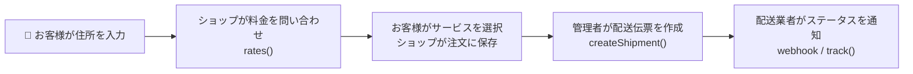
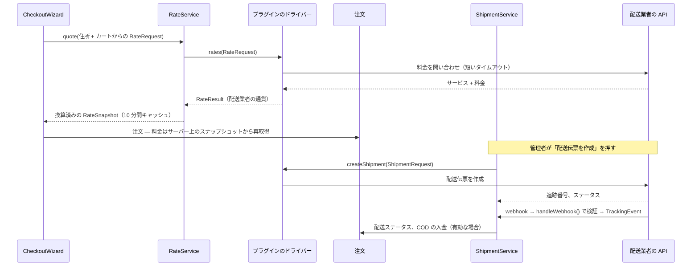

> 🌐 **言語:** [🇻🇳 Tiếng Việt](./create-shipping-plugin_vi.md) · [🇬🇧 English](./create-shipping-plugin.md) · 🇯🇵 日本語（現在）

# GP247 の配送プラグインを作る — 手順ごとに、完全なコード付き

## はじめに

このドキュメントでは、開発者が `gp247/shop` の標準配送コントラクトに沿って、GP247 / S-Cart 用の**配送プラグイン**を自分で書く方法を説明します。
パート 1 では、2 つのサービス（標準、速達）を持つ**重量ベースの料金**プラグインを作ります。外部のアカウントなしで、すぐに動きます。
パート 2 では、**API を持つ配送業者**と連携します。見積もり、配送伝票の作成とキャンセル、追跡、Webhook を扱います。
読み終えると、動作するプラグインが手に入り、`gp247/shop` が用意している部分とプラグインが書くべき部分がわかります。

> ℹ️ **対応バージョン:** gp247/shop 3.1.4（標準配送コントラクト）。それより古いバージョンでも、プラグインは `getInfo()` を使う従来の方法で動作します。手順 3 を参照してください。

> 💡 **ヒント:** **AI エージェントと一緒に作業しますか？** リポジトリ
> [gp247-skills](https://github.com/gp247net/gp247-skills) のスキル **`gp247-shipping-plugin-create`** を使ってください。このスキルはサイトのバージョンと機能を自動で調べ、必要な情報を確認したうえで、
> 以下の手順どおりにプラグインを作成します。スキルは `gp247/shop` と一緒に更新されます。

---

## 1. 始める前に

- `gp247/shop` がインストールされた GP247 3.x の Web サイト。コアのバージョンは `php artisan gp247:info`（`core` 行）で確認します。
- 基本的なプラグインの作り方を知っていること：[プラグイン作成ガイド](./create-plugin_ja.md)。
- ストア側で配送がどう動くかを理解していること：[GP247 の配送](../s-cart/shipping/shipping_ja.md)。

**役割分担：**

| `gp247/shop` が担当 | あなたのプラグインが担当 |
|---|---|
| 決済ページの配送ステップ、お客様が選んだサービスを注文に保存 | `rates()` でサービスと料金を返す |
| 配送業者の通貨 → 基本通貨 → 表示通貨への換算、10 分間のキャッシュ、エラーの配送業者の一時停止 | **配送業者の通貨**で料金を返す |
| 各商品の重量（グラム）とサイズ（cm） | そのデータを配送業者に送る |
| 注文詳細の配送ブロック、配送伝票の表、イベントの重複防止、配送ステータス | 配送業者との配送伝票の作成／キャンセル／追跡（配送業者が対応している場合） |
| 共通の Webhook ルート `/shipping/webhook/<プラグイン名>` | Webhook を検証し、標準のイベントに変換する |
| 代金引換（COD）：金額、精算時の記帳 | 代引き金額を配送業者に送る |



---

## 2. パート 1 — 重量ベースの料金プラグイン（すぐに動く）

完成形：配送ステップに**標準**（3〜5 日）と**速達**（1〜2 日）の 2 つの選択肢が表示され、料金はカートの重量（kg）で計算されます。
一定の金額以上で標準配送を無料にすることもできます。ストアごとに料金を設定できます。

計算方法：最初の 1 kg の料金 + 追加 1 kg ごとの料金（切り上げ：1.2 kg は 2 kg として計算）。速達には追加料金を加算します。

### 手順 1 — スケルトンを生成し、不要なファイルを削除する

1. Web サイトのルートフォルダーで次を実行します。

   ```bash
   php artisan gp247:make-plugin --name=MyWeightShipping --download=0
   ```

   期待される結果：`Success` という行と、フォルダー `app/GP247/Plugins/MyWeightShipping`。
2. そのフォルダーから `Admin/`、`Controllers/`、`Models/`、`Views/`、`Seo.php`、`config.php`、`function.php` を**削除**します
   （配送プラグインにはストアフロントの独自ページがありません）。

以下の手順を終えると、プラグインには次のファイルが残ります。

```
MyWeightShipping/
├── gp247.json                         ← 手順 2
├── AppConfig.php                      ← 手順 3
├── Services/WeightShippingProvider.php  ← 手順 4
├── Livewire/AdminLivewire.php         ← 手順 5
├── Route.php · Provider.php           ← 手順 6
├── Lang/vi/lang.php · Lang/en/lang.php  ← 手順 6
└── public/images/logo.jpg
```

### 手順 2 — `gp247.json`

```json
{
    "name": "My weight shipping",
    "image": "images/logo.jpg",
    "auth": "Your name",
    "email": "you@example.com",
    "link": "https://example.com",
    "configGroup": "Plugins",
    "configCode": "Shipping",
    "configKey": "MyWeightShipping",
    "version": "1.0",
    "requireCore": ["3.1"],
    "requireUpdateFrom": "1.0",
    "requireComposerPackages": ["gp247/shop"],
    "requireGp247Extensions": [],
    "requireLivewire": false,
    "storeScope": "store"
}
```

- `configCode: "Shipping"` — 決済ページがプラグインを配送業者として認識するための値です。ストアオーナーがオン／オフを切り替える際にも使われます。
- `requireCore` には `php artisan gp247:info` の `core` 行の値をそのまま書きます。`"3.1"` は 3.1 以降のすべての 3.x を意味します。
- `storeScope: "store"` — ストアごとに独自の料金表を持てます。

### 手順 3 — `AppConfig.php`：インストール、アンインストール、アップデート

料金はストアオーナーがストアの**基本通貨**で入力し、データベースに保存します（各項目は `MyWeightShipping_<名前>` というキーの 1 行）。
こうすることで、プラグインをアップデートしても料金が消えません。

```php
<?php

namespace App\GP247\Plugins\MyWeightShipping;

use GP247\Core\ExtensionConfigDefault;
use GP247\Core\Models\AdminConfig;
use GP247\Core\Models\AdminHome;

class AppConfig extends ExtensionConfigDefault
{
    /** Settings the site owner edits: key => default (amounts in the store's BASE currency). */
    public const SETTINGS = [
        'base_fee'      => '30000', // fee of the first kilogram
        'fee_per_kg'    => '5000',  // each extra kilogram (started)
        'express_extra' => '20000', // added for the Express service
        'free_from'     => '0',     // free Standard shipping from this cart value; 0 = never
    ];

    public function __construct()
    {
        $config = json_decode(file_get_contents(__DIR__.'/gp247.json'), true);
        $this->configGroup = $config['configGroup'];
        $this->configKey = $config['configKey'];
        $this->configCode = $config['configCode'];
        $this->requireCore = $config['requireCore'] ?? [];
        $this->requireComposerPackages = $config['requireComposerPackages'] ?? [];
        $this->requireGp247Extensions = $config['requireGp247Extensions'] ?? [];
        $this->appPath = $this->configGroup.'/'.$this->configKey;
        $this->title = trans($this->appPath.'::lang.title');
        $this->image = $this->appPath.'/'.$config['image'];
        $this->version = $config['version'];
        $this->auth = $config['auth'];
        $this->link = $config['link'];
    }

    /**
     * Every admin_config row this plugin owns: the on/off row + one row per setting.
     */
    private function seedRows(): array
    {
        $rows = [[
            'group' => $this->configGroup, 'code' => $this->configCode, 'key' => $this->configKey,
            'sort' => 0, 'store_id' => GP247_STORE_ID_GLOBAL, 'value' => self::ON,
            'security' => 0, 'detail' => $this->appPath.'::lang.title',
        ]];
        $sort = 0;
        foreach (self::SETTINGS as $key => $default) {
            $rows[] = [
                'group' => $this->configGroup, 'code' => $this->configKey.'_config',
                'key' => $this->configKey.'_'.$key, 'sort' => ++$sort,
                'store_id' => GP247_STORE_ID_GLOBAL, 'value' => $default,
                'security' => 0, 'detail' => $this->appPath.'::lang.'.$key,
            ];
        }

        return $rows;
    }

    public function install()
    {
        if (AdminConfig::where('group', $this->configGroup)->where('key', $this->configKey)->exists()) {
            return ['error' => 1, 'msg' => gp247_language_render('admin.extension.plugin_exist')];
        }
        try {
            AdminConfig::insert($this->seedRows());

            return ['error' => 0, 'msg' => gp247_language_render('admin.extension.install_success')];
        } catch (\Throwable $e) {
            return ['error' => 1, 'msg' => $e->getMessage()];
        }
    }

    /**
     * Add the rows a newer version introduced; never touch a value the site owner saved.
     */
    public function update(?string $fromVersion = null)
    {
        try {
            foreach ($this->seedRows() as $row) {
                $exists = AdminConfig::where('group', $row['group'])->where('key', $row['key'])
                    ->where('store_id', (string) $row['store_id'])->exists();
                if (!$exists) {
                    AdminConfig::insert($row);
                }
            }

            return ['error' => 0, 'msg' => ''];
        } catch (\Throwable $e) {
            return ['error' => 1, 'msg' => $e->getMessage()];
        }
    }

    public function uninstall()
    {
        try {
            AdminConfig::where('group', $this->configGroup)->where(function ($q) {
                $q->where('key', $this->configKey)
                    ->orWhere('key', 'like', $this->configKey.'\_%')
                    ->orWhere('code', $this->configKey.'_config');
            })->delete();
            AdminHome::where('extension', $this->appPath)->delete();

            return ['error' => 0, 'msg' => gp247_language_render('admin.extension.uninstall_success')];
        } catch (\Throwable $e) {
            return ['error' => 1, 'msg' => $e->getMessage()];
        }
    }

    public function enable()
    {
        AdminConfig::where('group', $this->configGroup)->where('key', $this->configKey)->update(['value' => self::ON]);

        return ['error' => 0, 'msg' => gp247_language_render('admin.extension.enable_success')];
    }

    public function disable()
    {
        AdminConfig::where('group', $this->configGroup)->where('key', $this->configKey)->update(['value' => self::OFF]);

        return ['error' => 0, 'msg' => ''];
    }

    // The ⚙ (Config) button on the Plugins list appears only when this returns a redirect.
    public function clickApp()
    {
        return redirect(gp247_route_admin('admin_myweightshipping.index'));
    }

    public function setupStore($storeId = null)
    {
    }

    public function removeStore($storeId = null)
    {
    }

    /**
     * A setting for a store (falls back to the shared value), as a number.
     */
    public function setting(string $key, $storeId = null): float
    {
        $storeId ??= gp247_plugin_store_id();

        return (float) gp247_config($this->configKey.'_'.$key, $storeId, self::SETTINGS[$key] ?? 0);
    }

    /**
     * Used only by an older gp247/shop without the shipping contract: one fee, in the DISPLAY currency.
     */
    public function getInfo()
    {
        return [
            'title' => $this->title,
            'key' => $this->configKey,
            'code' => $this->configCode,
            'image' => $this->image,
            'permission' => self::ALLOW,
            'version' => $this->version,
            'auth' => $this->auth,
            'link' => $this->link,
            'value' => gp247_currency_value($this->setting('base_fee')),
            'appPath' => $this->appPath,
        ];
    }
}
```

- `update()` は不足している行を追加するだけで、保存済みの料金はそのまま残します。`$fromVersion` が `null` でも実行できます。
- `clickApp()` によって、プラグイン一覧に ⚙ **「設定」**(Config) ボタンが表示されます。
- `getInfo()` は、配送コントラクトがない**古い** `gp247/shop` でのみ使われます。料金は 1 つだけで、**表示通貨**です
  （`gp247_currency_value()` が基本通貨から換算します）。新しいバージョンでは、ストアは手順 4 のドライバーを使います。

### 手順 4 — 料金計算ドライバー（`Services/WeightShippingProvider.php`）

ここが配送プラグイン特有の部分です。`ShippingProvider` を実装するクラスで、必須のメソッドは `rates()` の 1 つだけです。

```php
<?php

namespace App\GP247\Plugins\MyWeightShipping\Services;

use App\GP247\Plugins\MyWeightShipping\AppConfig;
use GP247\Shop\Shipping\Contracts\ShippingProvider;
use GP247\Shop\Shipping\Data\Money;
use GP247\Shop\Shipping\Data\RateRequest;
use GP247\Shop\Shipping\Data\RateResult;
use GP247\Shop\Shipping\Data\ShippingRate;
use GP247\Shop\Shipping\RateRequestFactory;

/**
 * Two services priced by weight: Standard and Express.
 */
class WeightShippingProvider implements ShippingProvider
{
    public function rates(RateRequest $request): RateResult
    {
        $config = new AppConfig();
        $store = $request->storeId;
        $currency = RateRequestFactory::baseCurrency(); // the settings are in the base currency

        // Started kilograms: 1 200 g counts as 2 kg; an empty parcel still counts as 1 kg.
        $kg = max(1, (int) ceil($request->totalWeightGrams() / 1000));
        $standard = $config->setting('base_fee', $store) + ($kg - 1) * $config->setting('fee_per_kg', $store);
        $express = $standard + $config->setting('express_extra', $store);

        // declaredValue is the cart value in the base currency — the unit the owner typed the threshold in.
        $freeFrom = $config->setting('free_from', $store);
        if ($freeFrom > 0 && $request->declaredValue->value() >= $freeFrom) {
            $standard = 0;
        }

        return new RateResult([
            new ShippingRate(
                pluginKey: 'MyWeightShipping',
                serviceCode: 'standard',
                title: trans('Plugins/MyWeightShipping::lang.service_standard'),
                amount: new Money((string) $standard, $currency),
                etaMinDays: 3,
                etaMaxDays: 5,
            ),
            new ShippingRate(
                pluginKey: 'MyWeightShipping',
                serviceCode: 'express',
                title: trans('Plugins/MyWeightShipping::lang.service_express'),
                amount: new Money((string) $express, $currency),
                etaMinDays: 1,
                etaMaxDays: 2,
            ),
        ]);
    }
}
```

- `RateRequest` からは次の情報が得られます：ストア（`storeId`）、集荷先／配送先の住所（`origin`、`destination`）、商品（`items`、重量は
  **グラム**）、商品の価額（`declaredValue`、**基本通貨**）。`totalWeightGrams()` は重量の合計を計算済みで返します。
- 各サービスは 1 つの `ShippingRate` です：サービスコード、名前、料金（通貨コード付きの `Money`）、配送予定日数。
- 料金は計算に使った通貨のまま返してください。ストアが**1 回だけ**換算します。表示通貨に自分で換算しないでください。

### 手順 5 — 設定画面（`Livewire/AdminLivewire.php`）

```php
<?php

namespace App\GP247\Plugins\MyWeightShipping\Livewire;

use App\GP247\Plugins\MyWeightShipping\AppConfig;
use GP247\Core\AdminShell\Infrastructure\ConfigForm;

/**
 * Settings screen: one field per row seeded by AppConfig::install().
 */
class AdminLivewire extends ConfigForm
{
    protected ?string $permission = null;

    protected function group(): string
    {
        return 'Plugins';
    }

    protected function heading(): string
    {
        return trans('Plugins/MyWeightShipping::lang.title');
    }

    // Each store may have its own prices (storeScope "store" in gp247.json).
    protected function storeScoped(): bool
    {
        return true;
    }

    // Required: without keys() the screen would list — and save — nothing of yours.
    protected function keys(): array
    {
        return array_map(fn ($key) => 'MyWeightShipping_'.$key, array_keys(AppConfig::SETTINGS));
    }

    protected function fieldTypes(): array
    {
        return array_fill_keys($this->keys(), 'number');
    }
}
```

### 手順 6 — `Route.php`、`Provider.php`、言語

`Route.php`（設定画面だけです。プラグインにはストアフロントのページがありません）：

```php
<?php

use Illuminate\Support\Facades\Route;

$config = json_decode(file_get_contents(__DIR__.'/gp247.json'), true);

if (gp247_extension_check_active($config['configGroup'], $config['configKey'])) {
    Route::group(
        [
            'prefix' => GP247_ADMIN_PREFIX.'/myweightshipping',
            'middleware' => GP247_ADMIN_MIDDLEWARE,
        ],
        function () {
            Route::get('/', \App\GP247\Plugins\MyWeightShipping\Livewire\AdminLivewire::class)
                ->name('admin_myweightshipping.index');
        }
    );
}
```

`Provider.php` — ドライバーを `gp247/shop` の配送レイヤーに登録します。

```php
<?php

$config = json_decode(file_get_contents(__DIR__.'/gp247.json'), true);
$extensionPath = $config['configGroup'].'/'.$config['configKey'];

$this->loadTranslationsFrom(__DIR__.'/Lang', $extensionPath);

if (gp247_extension_check_active($config['configGroup'], $config['configKey'])) {
    if (class_exists(\Livewire\Livewire::class)) {
        \Livewire\Livewire::addNamespace('MyWeightShipping', classNamespace: 'App\GP247\Plugins\MyWeightShipping\Livewire');
    }

    // Register the driver with gp247/shop's shipping layer. On an older shop without it,
    // the plugin still works through AppConfig::getInfo() (one fee).
    if (interface_exists(\GP247\Shop\Shipping\Contracts\ShippingProvider::class)) {
        config(['gp247-config.shop.shipping_providers.MyWeightShipping' => [
            'driver' => \App\GP247\Plugins\MyWeightShipping\Services\WeightShippingProvider::class,
            'capabilities' => ['rates'],
            'settings_route' => 'admin_myweightshipping.index',
        ]]);
    }
}
```

- `capabilities` には、ドライバーが実際に行うことだけを宣言します。ここでは `'rates'`（料金計算）だけです。
- `settings_route` により、ショップ設定の**配送**タブからプラグインの設定画面へのリンクが表示されます。
- `interface_exists(...)` で囲むことで、古い `gp247/shop` でもプラグインが動作します。

`Lang/en/lang.php`（`Lang/vi/lang.php` もベトナム語で同様に作成します）：

```php
<?php

return [
    'title'            => 'Shipping by weight',
    'base_fee'         => 'First kilogram fee',
    'fee_per_kg'       => 'Each extra kilogram',
    'express_extra'    => 'Express surcharge',
    'free_from'        => 'Free Standard shipping from (0 = never)',
    'service_standard' => 'Standard',
    'service_express'  => 'Express',
];
```

### 手順 7 — インストールして試す

1. キャッシュを削除します：`php artisan optimize:clear`。
2. インストールします：**管理画面 → プラグイン → MyWeightShipping → 「インストール」**（または `php artisan gp247:ext-install --type=plugin --key=MyWeightShipping`）。
3. ⚙ **「設定」**を押し、料金を（基本通貨で）入力して**「保存」**を押します。
4. **管理画面 → 「ショップ設定」→ 配送タブ**で、「注文時に配送を有効にする」(Enable shipping at checkout) がオンになっていて、集荷倉庫が設定されていることを確認します。
5. ストアフロントで商品をカートに入れ、配送ステップに進みます。
   期待される結果：**標準**と**速達**の 2 つの選択肢が料金と日数付きで表示されます。商品の数量を変えると、重量（kg）に応じて料金が変わります。

> ⚠️ **注意:** **開発中の**プラグインのアンインストールを試すときは、必ず `--only-data` を使ってください：
> `php artisan gp247:ext-uninstall --type=plugin --key=MyWeightShipping --only-data`。通常のアンインストールでは**ソースコードのフォルダーも削除されます**。

---

## 3. パート 2 — API を持つ配送業者と連携する（スケルトンコード）

このパートでは、**架空の**配送業者 `MyCarrier` 用のドライバーを作ります。この業者には、見積もり、配送伝票の作成／キャンセル／追跡の API と、署名付きの Webhook があります。
URL、フィールド名、ステータスコードは、実際の配送業者のドキュメントに合わせて置き換えてください。プラグインのスケルトン、`gp247.json`、`AppConfig.php`、設定画面は
パート 1 と同じように作ります。設定項目の `api_token` と `webhook_secret` は**秘密の項目**です（行を作成するときに `security = 1`、設定画面では `password` 型）。

### 3.1. 機能（capabilities）を宣言する

配送業者が実際に対応しているものだけを宣言します。各機能は、ドライバーが実装すべきインターフェースに対応します。

| 機能 | インターフェース | ストアで追加されるもの |
|---|---|---|
| `'rates'`（必須） | `ShippingProvider` | 決済ページのサービスと料金 |
| `'shipments'` | `CreatesShipments` | 注文詳細の**「配送伝票を作成」**(Create shipment) ボタン |
| `'cancel'` | `CancelsShipments` | **「配送伝票をキャンセル」**(Cancel shipment) ボタン |
| `'documents'` | `ProvidesShippingDocuments` | **「ラベルをダウンロード」**(Download label) ボタン |
| `'tracking'` | `TracksShipments` | **「同期」**(Sync) ボタン + 注文を開いたときの自動更新 |
| `'webhook'` | `HandlesShippingWebhooks` | プラグインのイベントを受け取る共通の Webhook ルート |
| `'cod'` | `CreatesShipments` | 代引き金額を含む配送伝票 |

```php
if (interface_exists(\GP247\Shop\Shipping\Contracts\ShippingProvider::class)) {
    config(['gp247-config.shop.shipping_providers.MyCarrier' => [
        'driver' => \App\GP247\Plugins\MyCarrier\Services\MyCarrierProvider::class,
        'capabilities' => ['rates', 'shipments', 'cancel', 'tracking', 'webhook', 'cod'],
        'settings_route' => 'admin_mycarrier.index',
    ]]);
}
```

### 3.2. ドライバー — `Services/MyCarrierProvider.php`

```php
<?php

namespace App\GP247\Plugins\MyCarrier\Services;

use Closure;
use GP247\Shop\Shipping\Contracts\CancelsShipments;
use GP247\Shop\Shipping\Contracts\CreatesShipments;
use GP247\Shop\Shipping\Contracts\HandlesShippingWebhooks;
use GP247\Shop\Shipping\Contracts\ShippingProvider;
use GP247\Shop\Shipping\Contracts\TracksShipments;
use GP247\Shop\Shipping\Data\Money;
use GP247\Shop\Shipping\Data\RateRequest;
use GP247\Shop\Shipping\Data\RateResult;
use GP247\Shop\Shipping\Data\ShipmentRequest;
use GP247\Shop\Shipping\Data\ShipmentResult;
use GP247\Shop\Shipping\Data\ShippingRate;
use GP247\Shop\Shipping\Data\TrackingEvent;
use GP247\Shop\Shipping\Data\WebhookResult;
use GP247\Shop\Shipping\ShippingCurrency;
use GP247\Shop\Shipping\ShippingException;
use Illuminate\Http\Client\ConnectionException;
use Illuminate\Http\Request;
use Illuminate\Support\Facades\Http;

/**
 * A carrier with an API (fictitious "MyCarrier"): quotes, booking, cancel, tracking, webhook.
 * Replace URLs, fields and status codes with your carrier's documentation.
 */
class MyCarrierProvider implements ShippingProvider, CreatesShipments, CancelsShipments, TracksShipments, HandlesShippingWebhooks
{
    private const CURRENCY = 'VND'; // the carrier prices in VND — must exist in the shop's Currencies

    public function rates(RateRequest $request): RateResult
    {
        if ($this->token($request->storeId) === '') {
            return RateResult::error('not_configured');
        }
        if ($request->destination->province === '' || $request->destination->ward === '') {
            return RateResult::error('address_incomplete', trans('Plugins/MyCarrier::lang.address_incomplete'));
        }

        // A timeout / 5xx throws: the shop then pauses this carrier for a minute and the others still answer.
        $response = $this->http($request->storeId)->post('/v1/fees', [
            'from' => $request->origin->toArray(),
            'to' => $request->destination->toArray(),
            'weight_grams' => $request->totalWeightGrams(),
            'value' => (int) round(ShippingCurrency::convert($request->declaredValue, self::CURRENCY, 0)?->value() ?? 0),
        ]);
        if ($response->clientError()) {
            return RateResult::error('carrier_refused', (string) $response->json('message', ''));
        }
        $response->throw();

        $rates = [];
        foreach ((array) $response->json('services', []) as $service) {
            $rates[] = new ShippingRate(
                pluginKey: 'MyCarrier',
                serviceCode: (string) $service['code'],
                title: (string) $service['name'],
                amount: new Money((string) $service['fee'], self::CURRENCY), // carrier currency, never pre-converted
                etaMinDays: $service['eta_min'] ?? null,
                etaMaxDays: $service['eta_max'] ?? null,
            );
        }

        return new RateResult($rates);
    }

    public function createShipment(ShipmentRequest $request): ShipmentResult
    {
        // At booking the amounts are in the ORDER's currency: convert them to the carrier's.
        $cod = ShippingCurrency::convert($request->codAmount, self::CURRENCY, 0);
        $value = ShippingCurrency::convert($request->declaredValue, self::CURRENCY, 0);
        if ($cod === null || $value === null) {
            throw new ShippingException(trans('Plugins/MyCarrier::lang.currency_missing'));
        }
        $weight = $request->parcel?->weightGrams ?: $request->totalWeightGrams();

        $response = $this->http($request->storeId)->post('/v1/orders', [
            'reference' => $request->bookingReference(), // order id, suffixed after a cancellation
            'service' => $request->serviceCode,
            'from' => $request->origin->toArray(),
            'to' => $request->destination->toArray(),
            'weight_grams' => $weight,
            'cod' => (int) $cod->value(),
            'value' => (int) $value->value(),
            'note' => $request->note,
        ]);
        if ($response->status() === 409) { // already booked: return the existing shipment
            $response = $this->http($request->storeId)->get('/v1/orders/by-reference/'.urlencode($request->bookingReference()));
        }
        if (!$response->successful()) {
            throw new ShippingException((string) $response->json('message', 'Carrier refused the booking'));
        }

        return new ShipmentResult(
            trackingNumber: (string) $response->json('tracking'),
            status: StatusMapper::map((string) $response->json('status')) ?? \GP247\Shop\Shipping\ShipmentStatus::PENDING,
            fee: new Money((string) $response->json('fee', 0), self::CURRENCY),
            trackingUrl: (string) $response->json('tracking_url', ''),
        );
    }

    public function shipmentFormFields(): array
    {
        return []; // extra inputs of the booking form, e.g. ['name' => 'pick_option', 'type' => 'select', ...]
    }

    public function cancelShipment(string $trackingNumber, string $storeId): void
    {
        $response = $this->http($storeId)->post('/v1/orders/'.urlencode($trackingNumber).'/cancel');
        if (!$response->successful()) {
            throw new ShippingException((string) $response->json('message', 'Carrier refused to cancel'));
        }
    }

    public function track(string $trackingNumber, string $storeId): array
    {
        $data = $this->http($storeId)->get('/v1/orders/'.urlencode($trackingNumber))->throw()->json();

        return [$this->event($trackingNumber, $data)];
    }

    public function handleWebhook(Request $request, Closure $storeOf): WebhookResult
    {
        $data = (array) $request->json()->all();
        $tracking = (string) ($data['tracking'] ?? '');
        $storeId = $tracking !== '' ? $storeOf($tracking) : null;
        $secret = $storeId !== null ? (string) gp247_config('MyCarrier_webhook_secret', $storeId) : '';
        $signature = hash_hmac('sha256', (string) $request->getContent(), $secret);
        if ($secret === '' || !hash_equals($signature, (string) $request->header('X-Signature'))) {
            return WebhookResult::rejected(403); // the shop writes nothing
        }

        return new WebhookResult(true, [$this->event($tracking, $data)]);
    }

    private function event(string $tracking, array $data): TrackingEvent
    {
        $code = (string) ($data['status'] ?? '');

        return new TrackingEvent(
            trackingNumber: $tracking,
            status: StatusMapper::map($code), // null = informational only
            providerStatus: $code,
            occurredAt: (int) ($data['updated_at'] ?? 0), // the carrier's time: a replay gives the same event
            message: (string) ($data['reason'] ?? ''),
        );
    }

    private function token($storeId): string
    {
        return (string) gp247_config('MyCarrier_api_token', $storeId);
    }

    private function http($storeId)
    {
        return Http::baseUrl('https://api.mycarrier.example')
            ->timeout(5) // a slow carrier must not stall the checkout
            ->withToken($this->token($storeId))
            ->acceptJson();
    }
}
```

間違えやすい点：

- **通常の拒否**（未設定、区／町の情報がない、配送業者が配達できない地域）→ `RateResult::error()`。**配送業者のダウン**
  （タイムアウト、5xx エラー）→ 例外をそのまま投げます。ストアはその配送業者を 1 分間一時停止し、他の配送業者は通常どおり見積もりを返します。
- **見積もり時**の商品価額は基本通貨です。**配送伝票の作成時**の商品価額と代引き金額は**注文の通貨**です。どちらも
  `ShippingCurrency::convert()` で配送業者の通貨に換算し、結果が `null`（通貨がない）の場合は処理を止めてください。
- 配送業者への注文番号として `bookingReference()` を送ります。最初は注文番号そのもので、キャンセル後はサフィックスが付きます（配送業者は古い番号の再利用を認めないため）。
- Webhook：`$storeOf` で配送伝票のストアを探し、データを信用する前に**そのストアの秘密鍵**で署名を検証します。
  署名が違う場合 → `WebhookResult::rejected()` を返し、ストアは何も記録しません。
- `occurredAt` には `time()` ではなく**配送業者の時刻**を使います。同じイベントが再送されたときに同じキーになり、二重に記録されないようにするためです。

ストアオーナーが配送業者の管理画面に貼り付ける Webhook の URL：`route('shop.shipping.webhook', ['pluginKey' => 'MyCarrier'])`
— このルートは `gp247/shop` が提供します。プラグインが Webhook のルートを自分で作る**必要はありません**。

### 3.3. ステータスの対応表 — `Services/StatusMapper.php`

配送業者のステータスコードは、すべて**1 か所**でストアの標準ステータスに変換します。

```php
<?php

namespace App\GP247\Plugins\MyCarrier\Services;

use GP247\Shop\Shipping\ShipmentStatus;

/**
 * The carrier's status codes → the shop's statuses, in ONE place.
 */
class StatusMapper
{
    private const MAP = [
        'created'    => ShipmentStatus::PENDING,
        'picked'     => ShipmentStatus::PICKED_UP,
        'in_transit' => ShipmentStatus::IN_TRANSIT,
        'delivering' => ShipmentStatus::OUT_FOR_DELIVERY,
        'failed'     => ShipmentStatus::DELIVERY_FAILED,
        'delivered'  => ShipmentStatus::DELIVERED,
        'returning'  => ShipmentStatus::RETURNING,
        'returned'   => ShipmentStatus::RETURNED,
        'cancelled'  => ShipmentStatus::CANCELLED,
        'lost'       => ShipmentStatus::EXCEPTION,
    ];

    public static function map(string $code): ?ShipmentStatus
    {
        return self::MAP[$code] ?? null; // unknown code = informational event
    }
}
```

標準ステータスによって注文の配送ステータスが決まります（表は [GP247 の配送](../s-cart/shipping/shipping_ja.md) の A5 節にあります）。

### 3.4. 代金引換（COD）とラベル印刷

- **代金引換**：`'cod'` を宣言します。ストアが金額（「代金引換」の支払方法で支払う注文の未払い残高）を自動で計算し、
  `ShipmentRequest::$codAmount` に入れます。配送業者が代引き金額の送金を通知したら、`codSettled: true` と `codAmount` を持つ**別の** `TrackingEvent` を返します。
  ストアは注文に入金を記録します（ストアオーナーが有効にしている場合）。記録は 1 回だけです。
- **ラベル印刷**：`'documents'` を宣言し、`ProvidesShippingDocuments::document()` を実装して `ShippingDocument`（PDF の内容、
  種類、ファイル名）を返します。ストアが管理者にファイルのダウンロードを提供します。配送業者の鍵がブラウザーに渡ることはありません。

### 3.5. 実際の配送業者を呼ばずにテストする

```php
<?php

namespace Tests\Feature\MyCarrier;

use App\GP247\Plugins\MyCarrier\Services\MyCarrierProvider;
use GP247\Core\Models\AdminConfig;
use GP247\Shop\Shipping\Data\Money;
use GP247\Shop\Shipping\Data\RateRequest;
use GP247\Shop\Shipping\Data\ShippingAddress;
use GP247\Shop\Shipping\Data\ShippingItem;
use GP247\Shop\Shipping\RateRequestFactory;
use Illuminate\Foundation\Testing\DatabaseTransactions;
use Illuminate\Http\Client\ConnectionException;
use Illuminate\Support\Facades\Http;
use Tests\TestCase;

class MyCarrierProviderTest extends TestCase
{
    use DatabaseTransactions; // run against a TEST database only

    private function request(): RateRequest
    {
        $base = RateRequestFactory::baseCurrency();

        return new RateRequest(
            storeId: (string) GP247_STORE_ID_ROOT,
            origin: new ShippingAddress(country: 'VN', province: 'Ho Chi Minh'),
            destination: new ShippingAddress(country: 'VN', province: 'Ha Noi', ward: 'Ward 1'),
            items: [new ShippingItem(name: 'Shirt', qty: 2, weightGrams: 400, unitValue: new Money('10', $base))],
            declaredValue: new Money('20', $base),
        );
    }

    protected function setUp(): void
    {
        parent::setUp();
        AdminConfig::updateOrInsert(
            ['group' => 'Plugins', 'key' => 'MyCarrier_api_token', 'store_id' => GP247_STORE_ID_GLOBAL],
            ['value' => 'test-token', 'code' => 'MyCarrier_config']
        );
    }

    public function test_each_service_comes_back_in_the_carrier_currency(): void
    {
        Http::fake(['api.mycarrier.example/v1/fees' => Http::response(['services' => [
            ['code' => 'road', 'name' => 'Road', 'fee' => 32000, 'eta_min' => 2, 'eta_max' => 4],
        ]])]);

        $rates = (new MyCarrierProvider())->rates($this->request())->rates;

        $this->assertSame('road', $rates[0]->serviceCode);
        $this->assertSame('VND', $rates[0]->amount->currency);
    }

    public function test_a_carrier_outage_throws_so_the_shop_pauses_the_carrier(): void
    {
        Http::fake(fn () => throw new ConnectionException('timeout'));

        $this->expectException(ConnectionException::class);
        (new MyCarrierProvider())->rates($this->request());
    }
}
```

---

## 4. リリース前のチェックリスト

- [ ] `gp247.json`：`configCode: "Shipping"`、`configKey` がフォルダー名と一致、`requireCore` は `gp247:info` に合わせる、`gp247/shop` がある。
- [ ] ドライバーを `Provider.php` で登録し、`interface_exists` で囲んでいる。`capabilities` には実際にある機能だけを含めている。
- [ ] `rates()` は配送業者の通貨で料金を返す。通常の拒否は `RateResult::error()` を返す。すべての API 呼び出しに短いタイムアウトがある。
- [ ] 配送業者の通貨が、ストアの **管理画面 → 「通貨」** に登録されている。
- [ ] （配送伝票を作成する場合）`codAmount` / `declaredValue` を配送業者の通貨に換算している。`bookingReference()` を送っている。配送業者のエラー → 鍵を漏らさない `ShippingException`。
- [ ] （Webhook の場合）データを信用する前に署名を検証している。`occurredAt` には配送業者の時刻を使っている。
- [ ] 設定は `admin_config` にあり、秘密鍵は `password` 型の項目。`update()` は再実行しても安全。`clickApp()` で設定画面が開く。
- [ ] テストで `Http::fake()` を使い、配送業者のエラー／タイムアウト、Webhook の署名の誤りのケースを含めている。

---

## 5. クイックリファレンス — `gp247/shop` に何が用意されていて、どこにあるか

配送レイヤー全体は `vendor/gp247/shop/src/Shipping/`（名前空間 `GP247\Shop\Shipping`）にあります。**`vendor/` の中は
編集しないでください**。カスタマイズはすべてプラグインを通して行います。

| 構成要素 | 場所 | 役割（自分で書き直す必要はありません） |
|---|---|---|
| 配送業者のコントラクト | `Contracts/ShippingProvider.php` + 5 つの機能インターフェース | プラグインが提供すべきものを定義（3.1 節の表） |
| 配送業者の登録簿 | `ShippingProviderRegistry.php`、設定キー `gp247-config.shop.shipping_providers` | 各プラグインのドライバーを探し、宣言された機能が実際にあるかを確認 |
| 見積もり | `RateService.php`、`RateRequestFactory.php` | すべての配送業者に料金を問い合わせ、住所 + カートごとに 10 分間キャッシュ、エラーの配送業者を 1 分間一時停止、配送業者の通貨 → 基本通貨 → 表示通貨に換算 |
| 選択した料金の保持 | `ShippingCheckout.php`、`Data/RateSnapshot.php` | 料金はサーバーが決定し、`shop_order.shipping_service` / `shipping_rate` に保存。料金が無効になった場合は、送料無料で配送するのではなく注文を拒否 |
| 商品データ | `ShippingItemFactory.php`、`Data/ShippingItem.php`、`WeightConverter.php`、`LengthConverter.php` | 商品から重量（グラム）、サイズ（cm）、バーコード、ブランドなどを取得。デジタル商品は除外。セット商品は構成品ごとに計算 |
| 配送伝票 | `ShipmentService.php`、`Models/ShopShipment.php`、`Models/ShopShipmentEvent.php` | 作成／キャンセル／ラベル／同期、重複防止付きのイベント保存、配送ステータスへの変換、注文を開いたときに配送業者へ自動で再問い合わせ |
| 共通の Webhook | `Routes/Webhook/shipping.php`、`Http/ShippingWebhookController.php` | ストアフロントのミドルウェアの外にあるルート `POST /shipping/webhook/<PluginKey>`、スロットリング付き。URL：`route('shop.shipping.webhook', ['pluginKey' => 'MyCarrier'])` |
| 代金引換 | `CodResolver.php`、設定キー `gp247-config.shop.cod_payment_methods` | 代引き金額 = COD の支払方法での未払い残高。配送業者の精算時に入金を 1 回だけ記録 |
| 管理画面 | `Admin/Livewire/OrderShipmentPanel.php`、`ShopConfigForm` の配送タブ | 注文詳細の配送ブロック、設定タブ（プラグインの `settings_route` へのリンク） |
| 旧コントラクト | `LegacyGetInfoAdapter.php` | 従来の `getInfo()` で書かれたプラグインも決済ページに表示される（サービスは 1 つ） |

データは次のようにこれらの構成要素を流れます。



**その他のケース**

- **配送業者向けに商品データを追加する**（HS コード、割れ物など）：配列形式の callable を
  `gp247-config.shop.shipping_item_resolvers` に登録します。クロージャーは使わないでください（`config:cache` が壊れます）。
- **決済ステップを上書きする独自のテンプレートを書く**（`livewire/shop_checkout-wizard.blade.php`）：`vendor/gp247/shop/src/Views/templates/GP247Front/` にある元の版の
  表示方法を守ってください。サービスごとに 1 つの選択肢（キーはサービスコード）、フォーマット済みの料金、配送予定日数、サービスがないときのメッセージ、区／町の入力欄です。
  [テンプレートの作成](./create-template_ja.md)も参照してください。
- **`getInfo()` で書かれた古い配送プラグイン**：引き続き動作します（サービスは 1 つ、料金は表示通貨）。複数のサービス、配送伝票、
  追跡、代金引換が必要な場合は、パート 1〜2 のようにドライバーを追加します。サンプルプラグイン `ShippingStandard` は両方の方法に対応しています。

---

## 条件と制約（操作の前に確認）

**プラグインの宣言**
- **`configKey` はフォルダー名と一致させ、リリース後は変更しません**。**リリースごとに `version` を上げます**。
- **`requireCore` はメジャーバージョン単位の範囲です** — `"3.1"` は 4.x のコアにはインストールできません。

**見積もり**
- **配送業者の通貨は「通貨」の一覧に登録されている必要があります** — ない場合、換算できないため、ストアはその配送業者のサービスを除外します。
- **見積もりの結果は住所 + カートごとに 10 分間キャッシュされます** — 料金表を変更しても、開いているカートでは住所やカートを変更するか、
  10 分が経過するまで古い料金が表示されることがあります。
- **見積もりで決済ページを壊してはいけません** — 拒否する場合はエラーを返します。例外を投げるのは、配送業者が本当にダウンしているときだけです。

**配送伝票と Webhook**
- **1 つの注文で有効な配送伝票は 1 つだけです**。管理者は終了していないどのステータスでもキャンセルを押せます。配送業者が拒否した場合は `ShippingException` を投げます。
- **検証していない Webhook は信用しません**。お金に関わるステータス（配達済み、代引きの精算済み）は、配送業者が Webhook に署名しない場合、
  配送業者の API で再確認することをおすすめします。

---

## よくある質問（Q&A）

**Q1: プラグインをインストールしたのに、配送ステップに自分のサービスが表示されません。**

→ 次を確認してください。プラグインが正しいストアで**有効**になっているか。**配送**タブで配送が有効になっているか。配送業者の通貨が「通貨」に登録されているか。
`rates()` がエラーを返していないか（システムログを確認）。`php artisan optimize:clear` を実行したか。

**Q2: 表示される料金が、計算した料金の何倍にもなっています。**

→ プラグインの中で自分で通貨を換算しています。数値の元の通貨（例：VND）のまま料金を返してください。ストアが 1 回だけ換算します。

**Q3: 料金表を変更したのに、お客様には古い料金が表示されます。**

→ 見積もりは住所 + カートごとに 10 分間キャッシュされます。住所かカートを変更するか、10 分経つのを待ってください。

**Q4: 「配送伝票を作成」ボタンが表示されません。**

→ `capabilities` に `'shipments'` がないか、ドライバーが `CreatesShipments` を実装していません（インターフェースのない宣言済みの機能はストアが除外し、ログに記録します）。
あるいは、注文が確定済みか、すでに有効な配送伝票があります。

**Q5: Webhook のルートを自分で作る必要がありますか？**

→ いいえ。`gp247/shop` にはすでに `/shipping/webhook/<プラグイン名>` があります。`HandlesShippingWebhooks` を実装し、`'webhook'` を宣言するだけです。

**Q6: Webhook が繰り返し送られてきた場合、二重に記録されますか？**

→ 送信ごとに `providerStatus` と `occurredAt` が同じであれば、記録されません。これが重複防止のキーです。

**Q7: 私のプラグインは古い `gp247/shop` でも動きますか？**

→ はい。`getInfo()` で `value` に料金（表示通貨）を返し、ドライバーの登録部分を `interface_exists` で囲んでいれば動作します。

**Q8: 配送業者向けに独自のデータ（HS コード、割れ物）を追加したいです。**

→ 配列形式の関数 `[クラス::class, 'メソッド名']` を `gp247-config.shop.shipping_item_resolvers` に登録します。関数は商品の明細と
商品を受け取り、`meta` を追加した明細を返します。クロージャーは使わないでください。`php artisan config:cache` がエラーになります。

**Q9: 実際の配送業者を呼ばずにテストするには？**

→ 3.5 節のように `Http::fake()` を使います。手動で試す場合は、配送業者のテスト環境（ある場合）を使ってください。

**Q10: AI エージェントを使ってもっと速く作る方法はありますか？**

→ スキル `gp247-shipping-plugin-create` を使ってください。このスキルはここで説明したコントラクトどおりにプラグインを作成し、`gp247/shop` と一緒に更新されます。

---

## 変更履歴
<!-- ロジック・動作に変更があった場合のみ記録します。最新の行を一番上に。1 日 1 行：同じ日の変更は既存の行にまとめ、新しい行を追加しません。 -->

| 日付 | GP247 バージョン | 変更内容 |
| --- | --- | --- |
| 2026-10-18 | gp247/shop 3.1.4 | 新しいドキュメント：すぐに動く重量ベースの料金プラグイン + API を持つ配送業者と連携するスケルトン |

---

<sub>📅 **最終更新:** 2026-10-22 · ✍️ **作成者 (Author):** GP247</sub>
