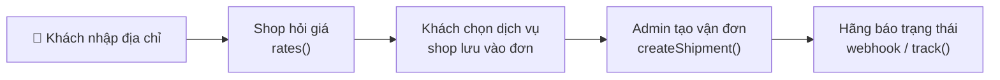

> 🌐 **Ngôn ngữ:** 🇻🇳 Tiếng Việt (hiện tại) · [🇬🇧 English](./create-shipping-plugin.md)

# Tạo plugin vận chuyển cho GP247 — từng bước, có code đầy đủ

## Giới thiệu

Tài liệu này hướng dẫn lập trình viên tự viết một **plugin vận chuyển** cho GP247 / S-Cart theo hợp đồng vận chuyển chuẩn
của `gp247/shop`. Phần 1 dựng plugin **tính phí theo khối lượng** có hai dịch vụ (Tiêu chuẩn, Giao nhanh), chạy được ngay
không cần tài khoản bên ngoài. Phần 2 nối một **hãng vận chuyển có API**: báo giá, tạo và huỷ vận đơn, tra cứu, webhook.
Đọc xong, bạn có một plugin chạy được và biết phần nào `gp247/shop` đã làm sẵn, phần nào plugin phải viết.

> ℹ️ **Có từ:** gp247/shop 3.1.4 (hợp đồng vận chuyển chuẩn). Trên bản cũ hơn, plugin vẫn chạy theo cách cũ qua `getInfo()` — xem Bước 3.

> 💡 **Làm cùng AI agent?** Dùng skill **`gp247-shipping-plugin-create`** trong repo
> [gp247-skills](https://github.com/gp247net/gp247-skills): skill tự dò phiên bản và năng lực của site, hỏi đủ thông tin rồi dựng
> plugin theo đúng các bước dưới đây, và được cập nhật cùng `gp247/shop`.

---

## 1. Trước khi bắt đầu

- Website GP247 3.x có cài `gp247/shop`. Xem phiên bản lõi bằng `php artisan gp247:info` (dòng `core`).
- Biết cách tạo plugin cơ bản: [Hướng dẫn tạo plugin](./create-plugin_vi.md).
- Hiểu vận chuyển chạy thế nào ở phía cửa hàng: [Vận chuyển trong GP247](../s-cart/shipping/shipping_vi.md).

**Ai làm gì:**

| `gp247/shop` lo | Plugin của bạn lo |
|---|---|
| Bước Vận chuyển ở trang thanh toán, lưu dịch vụ khách chọn vào đơn | Trả về các dịch vụ và giá trong `rates()` |
| Quy đổi tiền tệ của hãng → tiền gốc → tiền hiển thị, cache 10 phút, tạm dừng hãng lỗi | Trả giá theo **tiền tệ của hãng** |
| Khối lượng (gram), kích thước (cm) của từng món hàng | Gửi dữ liệu đó cho hãng |
| Khối Vận chuyển ở chi tiết đơn, bảng vận đơn, chống trùng sự kiện, trạng thái giao hàng | Tạo / huỷ / tra cứu vận đơn với hãng (nếu hãng có) |
| Route webhook chung `/shipping/webhook/<Tên plugin>` | Xác minh webhook và chuyển thành sự kiện chuẩn |
| Tiền thu hộ (COD): số tiền, ghi sổ khi đối soát | Gửi số tiền thu hộ cho hãng |



---

## 2. Phần 1 — Plugin phí theo khối lượng (chạy được ngay)

Kết quả: ở bước Vận chuyển có hai lựa chọn **Tiêu chuẩn** (3–5 ngày) và **Giao nhanh** (1–2 ngày), giá tính theo số kg của
giỏ hàng; có thể miễn phí giao Tiêu chuẩn từ một mức tiền. Mỗi cửa hàng đặt giá riêng.

Cách tính: phí kg đầu tiên + phí mỗi kg tiếp theo (làm tròn lên: 1,2 kg tính 2 kg); Giao nhanh cộng thêm phụ phí.

### Bước 1 — Sinh khung và dọn file thừa

1. Tại thư mục gốc website, chạy:

   ```bash
   php artisan gp247:make-plugin --name=MyWeightShipping --download=0
   ```

   Kết quả mong đợi: dòng `Success` và thư mục `app/GP247/Plugins/MyWeightShipping`.
2. Trong thư mục đó, **xoá**: `Admin/`, `Controllers/`, `Models/`, `Views/`, `Seo.php`, `config.php`, `function.php`
   (plugin vận chuyển không có trang riêng ngoài storefront).

Sau các bước dưới, plugin còn:

```
MyWeightShipping/
├── gp247.json                         ← Bước 2
├── AppConfig.php                      ← Bước 3
├── Services/WeightShippingProvider.php  ← Bước 4
├── Livewire/AdminLivewire.php         ← Bước 5
├── Route.php · Provider.php           ← Bước 6
├── Lang/vi/lang.php · Lang/en/lang.php  ← Bước 6
└── public/images/logo.jpg
```

### Bước 2 — `gp247.json`

```json
{
    "name": "My weight shipping",
    "image": "images/logo.jpg",
    "auth": "Your name",
    "email": "you@example.com",
    "link": "https://example.com",
    "configGroup": "Plugins",
    "configCode": "Shipping",
    "configKey": "MyWeightShipping",
    "version": "1.0",
    "requireCore": ["3.1"],
    "requireUpdateFrom": "1.0",
    "requireComposerPackages": ["gp247/shop"],
    "requireGp247Extensions": [],
    "requireLivewire": false,
    "storeScope": "store"
}
```

- `configCode: "Shipping"` — cách trang thanh toán nhận ra plugin là một hãng vận chuyển, và cách chủ cửa hàng bật/tắt nó.
- `requireCore` ghi đúng dòng `core` của `php artisan gp247:info`; `"3.1"` nghĩa là mọi bản 3.x từ 3.1.
- `storeScope: "store"` — mỗi cửa hàng có bảng giá riêng.

### Bước 3 — `AppConfig.php`: cài, gỡ, cập nhật

Giá do chủ cửa hàng nhập theo **tiền gốc** của cửa hàng, lưu trong database (mỗi ô một dòng khoá `MyWeightShipping_<tên>`)
để cập nhật plugin không làm mất.

```php
<?php

namespace App\GP247\Plugins\MyWeightShipping;

use GP247\Core\ExtensionConfigDefault;
use GP247\Core\Models\AdminConfig;
use GP247\Core\Models\AdminHome;

class AppConfig extends ExtensionConfigDefault
{
    /** Settings the site owner edits: key => default (amounts in the store's BASE currency). */
    public const SETTINGS = [
        'base_fee'      => '30000', // fee of the first kilogram
        'fee_per_kg'    => '5000',  // each extra kilogram (started)
        'express_extra' => '20000', // added for the Express service
        'free_from'     => '0',     // free Standard shipping from this cart value; 0 = never
    ];

    public function __construct()
    {
        $config = json_decode(file_get_contents(__DIR__.'/gp247.json'), true);
        $this->configGroup = $config['configGroup'];
        $this->configKey = $config['configKey'];
        $this->configCode = $config['configCode'];
        $this->requireCore = $config['requireCore'] ?? [];
        $this->requireComposerPackages = $config['requireComposerPackages'] ?? [];
        $this->requireGp247Extensions = $config['requireGp247Extensions'] ?? [];
        $this->appPath = $this->configGroup.'/'.$this->configKey;
        $this->title = trans($this->appPath.'::lang.title');
        $this->image = $this->appPath.'/'.$config['image'];
        $this->version = $config['version'];
        $this->auth = $config['auth'];
        $this->link = $config['link'];
    }

    /**
     * Every admin_config row this plugin owns: the on/off row + one row per setting.
     */
    private function seedRows(): array
    {
        $rows = [[
            'group' => $this->configGroup, 'code' => $this->configCode, 'key' => $this->configKey,
            'sort' => 0, 'store_id' => GP247_STORE_ID_GLOBAL, 'value' => self::ON,
            'security' => 0, 'detail' => $this->appPath.'::lang.title',
        ]];
        $sort = 0;
        foreach (self::SETTINGS as $key => $default) {
            $rows[] = [
                'group' => $this->configGroup, 'code' => $this->configKey.'_config',
                'key' => $this->configKey.'_'.$key, 'sort' => ++$sort,
                'store_id' => GP247_STORE_ID_GLOBAL, 'value' => $default,
                'security' => 0, 'detail' => $this->appPath.'::lang.'.$key,
            ];
        }

        return $rows;
    }

    public function install()
    {
        if (AdminConfig::where('group', $this->configGroup)->where('key', $this->configKey)->exists()) {
            return ['error' => 1, 'msg' => gp247_language_render('admin.extension.plugin_exist')];
        }
        try {
            AdminConfig::insert($this->seedRows());

            return ['error' => 0, 'msg' => gp247_language_render('admin.extension.install_success')];
        } catch (\Throwable $e) {
            return ['error' => 1, 'msg' => $e->getMessage()];
        }
    }

    /**
     * Add the rows a newer version introduced; never touch a value the site owner saved.
     */
    public function update(?string $fromVersion = null)
    {
        try {
            foreach ($this->seedRows() as $row) {
                $exists = AdminConfig::where('group', $row['group'])->where('key', $row['key'])
                    ->where('store_id', (string) $row['store_id'])->exists();
                if (!$exists) {
                    AdminConfig::insert($row);
                }
            }

            return ['error' => 0, 'msg' => ''];
        } catch (\Throwable $e) {
            return ['error' => 1, 'msg' => $e->getMessage()];
        }
    }

    public function uninstall()
    {
        try {
            AdminConfig::where('group', $this->configGroup)->where(function ($q) {
                $q->where('key', $this->configKey)
                    ->orWhere('key', 'like', $this->configKey.'\_%')
                    ->orWhere('code', $this->configKey.'_config');
            })->delete();
            AdminHome::where('extension', $this->appPath)->delete();

            return ['error' => 0, 'msg' => gp247_language_render('admin.extension.uninstall_success')];
        } catch (\Throwable $e) {
            return ['error' => 1, 'msg' => $e->getMessage()];
        }
    }

    public function enable()
    {
        AdminConfig::where('group', $this->configGroup)->where('key', $this->configKey)->update(['value' => self::ON]);

        return ['error' => 0, 'msg' => gp247_language_render('admin.extension.enable_success')];
    }

    public function disable()
    {
        AdminConfig::where('group', $this->configGroup)->where('key', $this->configKey)->update(['value' => self::OFF]);

        return ['error' => 0, 'msg' => ''];
    }

    // The ⚙ (Config) button on the Plugins list appears only when this returns a redirect.
    public function clickApp()
    {
        return redirect(gp247_route_admin('admin_myweightshipping.index'));
    }

    public function setupStore($storeId = null)
    {
    }

    public function removeStore($storeId = null)
    {
    }

    /**
     * A setting for a store (falls back to the shared value), as a number.
     */
    public function setting(string $key, $storeId = null): float
    {
        $storeId ??= gp247_plugin_store_id();

        return (float) gp247_config($this->configKey.'_'.$key, $storeId, self::SETTINGS[$key] ?? 0);
    }

    /**
     * Used only by an older gp247/shop without the shipping contract: one fee, in the DISPLAY currency.
     */
    public function getInfo()
    {
        return [
            'title' => $this->title,
            'key' => $this->configKey,
            'code' => $this->configCode,
            'image' => $this->image,
            'permission' => self::ALLOW,
            'version' => $this->version,
            'auth' => $this->auth,
            'link' => $this->link,
            'value' => gp247_currency_value($this->setting('base_fee')),
            'appPath' => $this->appPath,
        ];
    }
}
```

- `update()` chỉ thêm dòng còn thiếu, giữ nguyên giá đã lưu; chạy được khi `$fromVersion` là `null`.
- `clickApp()` làm hiện nút ⚙ **Cấu hình** trên danh sách Plugins.
- `getInfo()` chỉ dùng trên `gp247/shop` **cũ** chưa có hợp đồng vận chuyển: một mức phí, theo **tiền hiển thị**
  (`gp247_currency_value()` đổi từ tiền gốc). Trên bản mới, cửa hàng dùng driver ở Bước 4.

### Bước 4 — Driver tính giá (`Services/WeightShippingProvider.php`)

Đây là phần riêng của plugin vận chuyển: một lớp implement `ShippingProvider` với đúng một hàm bắt buộc `rates()`.

```php
<?php

namespace App\GP247\Plugins\MyWeightShipping\Services;

use App\GP247\Plugins\MyWeightShipping\AppConfig;
use GP247\Shop\Shipping\Contracts\ShippingProvider;
use GP247\Shop\Shipping\Data\Money;
use GP247\Shop\Shipping\Data\RateRequest;
use GP247\Shop\Shipping\Data\RateResult;
use GP247\Shop\Shipping\Data\ShippingRate;
use GP247\Shop\Shipping\RateRequestFactory;

/**
 * Two services priced by weight: Standard and Express.
 */
class WeightShippingProvider implements ShippingProvider
{
    public function rates(RateRequest $request): RateResult
    {
        $config = new AppConfig();
        $store = $request->storeId;
        $currency = RateRequestFactory::baseCurrency(); // the settings are in the base currency

        // Started kilograms: 1 200 g counts as 2 kg; an empty parcel still counts as 1 kg.
        $kg = max(1, (int) ceil($request->totalWeightGrams() / 1000));
        $standard = $config->setting('base_fee', $store) + ($kg - 1) * $config->setting('fee_per_kg', $store);
        $express = $standard + $config->setting('express_extra', $store);

        // declaredValue is the cart value in the base currency — the unit the owner typed the threshold in.
        $freeFrom = $config->setting('free_from', $store);
        if ($freeFrom > 0 && $request->declaredValue->value() >= $freeFrom) {
            $standard = 0;
        }

        return new RateResult([
            new ShippingRate(
                pluginKey: 'MyWeightShipping',
                serviceCode: 'standard',
                title: trans('Plugins/MyWeightShipping::lang.service_standard'),
                amount: new Money((string) $standard, $currency),
                etaMinDays: 3,
                etaMaxDays: 5,
            ),
            new ShippingRate(
                pluginKey: 'MyWeightShipping',
                serviceCode: 'express',
                title: trans('Plugins/MyWeightShipping::lang.service_express'),
                amount: new Money((string) $express, $currency),
                etaMinDays: 1,
                etaMaxDays: 2,
            ),
        ]);
    }
}
```

- `RateRequest` cho bạn: cửa hàng (`storeId`), địa chỉ lấy hàng / giao (`origin`, `destination`), các món hàng (`items`, khối
  lượng **gram**), giá trị hàng (`declaredValue`, theo **tiền gốc**). `totalWeightGrams()` cộng sẵn khối lượng.
- Mỗi dịch vụ là một `ShippingRate`: mã dịch vụ, tên, giá (`Money` kèm mã tiền tệ), số ngày giao dự kiến.
- Trả giá theo đúng tiền tệ bạn tính — cửa hàng tự quy đổi **một lần**. Không tự đổi sang tiền hiển thị.

### Bước 5 — Màn cấu hình (`Livewire/AdminLivewire.php`)

```php
<?php

namespace App\GP247\Plugins\MyWeightShipping\Livewire;

use App\GP247\Plugins\MyWeightShipping\AppConfig;
use GP247\Core\AdminShell\Infrastructure\ConfigForm;

/**
 * Settings screen: one field per row seeded by AppConfig::install().
 */
class AdminLivewire extends ConfigForm
{
    protected ?string $permission = null;

    protected function group(): string
    {
        return 'Plugins';
    }

    protected function heading(): string
    {
        return trans('Plugins/MyWeightShipping::lang.title');
    }

    // Each store may have its own prices (storeScope "store" in gp247.json).
    protected function storeScoped(): bool
    {
        return true;
    }

    // Required: without keys() the screen would list — and save — nothing of yours.
    protected function keys(): array
    {
        return array_map(fn ($key) => 'MyWeightShipping_'.$key, array_keys(AppConfig::SETTINGS));
    }

    protected function fieldTypes(): array
    {
        return array_fill_keys($this->keys(), 'number');
    }
}
```

### Bước 6 — `Route.php`, `Provider.php`, ngôn ngữ

`Route.php` (chỉ có màn cấu hình — plugin không có trang storefront):

```php
<?php

use Illuminate\Support\Facades\Route;

$config = json_decode(file_get_contents(__DIR__.'/gp247.json'), true);

if (gp247_extension_check_active($config['configGroup'], $config['configKey'])) {
    Route::group(
        [
            'prefix' => GP247_ADMIN_PREFIX.'/myweightshipping',
            'middleware' => GP247_ADMIN_MIDDLEWARE,
        ],
        function () {
            Route::get('/', \App\GP247\Plugins\MyWeightShipping\Livewire\AdminLivewire::class)
                ->name('admin_myweightshipping.index');
        }
    );
}
```

`Provider.php` — đăng ký driver với lớp vận chuyển của `gp247/shop`:

```php
<?php

$config = json_decode(file_get_contents(__DIR__.'/gp247.json'), true);
$extensionPath = $config['configGroup'].'/'.$config['configKey'];

$this->loadTranslationsFrom(__DIR__.'/Lang', $extensionPath);

if (gp247_extension_check_active($config['configGroup'], $config['configKey'])) {
    if (class_exists(\Livewire\Livewire::class)) {
        \Livewire\Livewire::addNamespace('MyWeightShipping', classNamespace: 'App\\GP247\\Plugins\\MyWeightShipping\\Livewire');
    }

    // Register the driver with gp247/shop's shipping layer. On an older shop without it,
    // the plugin still works through AppConfig::getInfo() (one fee).
    if (interface_exists(\GP247\Shop\Shipping\Contracts\ShippingProvider::class)) {
        config(['gp247-config.shop.shipping_providers.MyWeightShipping' => [
            'driver' => \App\GP247\Plugins\MyWeightShipping\Services\WeightShippingProvider::class,
            'capabilities' => ['rates'],
            'settings_route' => 'admin_myweightshipping.index',
        ]]);
    }
}
```

- `capabilities` chỉ khai những gì driver thật sự làm — ở đây chỉ `'rates'` (tính giá).
- `settings_route` để tab **Vận chuyển** trong cấu hình cửa hàng có liên kết sang màn cấu hình của plugin.
- Bọc trong `interface_exists(...)` để plugin vẫn chạy trên `gp247/shop` cũ.

`Lang/vi/lang.php` (tạo tương tự `Lang/en/lang.php`):

```php
<?php

return [
    'title'            => 'Giao hàng theo khối lượng',
    'base_fee'         => 'Phí kg đầu tiên',
    'fee_per_kg'       => 'Phí mỗi kg tiếp theo',
    'express_extra'    => 'Phụ phí giao nhanh',
    'free_from'        => 'Miễn phí giao Tiêu chuẩn từ (0 = không miễn phí)',
    'service_standard' => 'Tiêu chuẩn',
    'service_express'  => 'Giao nhanh',
];
```

### Bước 7 — Cài và thử

1. Xoá cache: `php artisan optimize:clear`.
2. Cài: **Admin → Plugins → MyWeightShipping → Cài đặt** (hoặc `php artisan gp247:ext-install --type=plugin --key=MyWeightShipping`).
3. Bấm ⚙ **Cấu hình**, nhập giá (theo tiền gốc), bấm **Lưu**.
4. Kiểm tra **Admin → Cấu hình cửa hàng → tab Vận chuyển** đã bật "Bật vận chuyển khi đặt hàng" và có kho lấy hàng.
5. Ra trang cửa hàng, cho hàng vào giỏ, tới bước Vận chuyển.
   Kết quả mong đợi: hai lựa chọn **Tiêu chuẩn** và **Giao nhanh** kèm giá và số ngày; đổi số lượng hàng thì giá đổi theo kg.

> ⚠️ Khi thử gỡ plugin **đang phát triển**, luôn dùng `--only-data`:
> `php artisan gp247:ext-uninstall --type=plugin --key=MyWeightShipping --only-data`. Gỡ thường sẽ **xoá luôn thư mục mã nguồn**.

---

## 3. Phần 2 — Nối hãng vận chuyển có API (code khung)

Phần này dựng driver cho một hãng **giả định** `MyCarrier` có API báo giá, tạo / huỷ / tra cứu vận đơn và webhook có chữ ký.
Thay địa chỉ, tên trường và mã trạng thái bằng tài liệu của hãng thật. Khung plugin, `gp247.json`, `AppConfig.php`, màn cấu
hình làm như Phần 1; thiết lập gồm `api_token` và `webhook_secret` là **ô bí mật** (`security = 1` khi tạo dòng, kiểu `password`
trên màn cấu hình).

### 3.1. Khai năng lực

Chỉ khai những gì hãng thật sự có — mỗi năng lực ứng với một interface driver phải implement:

| Năng lực | Interface | Cửa hàng mở thêm |
|---|---|---|
| `'rates'` (bắt buộc) | `ShippingProvider` | Dịch vụ và giá ở trang thanh toán |
| `'shipments'` | `CreatesShipments` | Nút **Tạo vận đơn** ở chi tiết đơn |
| `'cancel'` | `CancelsShipments` | Nút **Huỷ vận đơn** |
| `'documents'` | `ProvidesShippingDocuments` | Nút **Tải nhãn** |
| `'tracking'` | `TracksShipments` | Nút **Đồng bộ** + tự cập nhật khi mở đơn |
| `'webhook'` | `HandlesShippingWebhooks` | Route webhook chung nhận sự kiện của plugin |
| `'cod'` | `CreatesShipments` | Vận đơn mang số tiền thu hộ |

```php
if (interface_exists(\GP247\Shop\Shipping\Contracts\ShippingProvider::class)) {
    config(['gp247-config.shop.shipping_providers.MyCarrier' => [
        'driver' => \App\GP247\Plugins\MyCarrier\Services\MyCarrierProvider::class,
        'capabilities' => ['rates', 'shipments', 'cancel', 'tracking', 'webhook', 'cod'],
        'settings_route' => 'admin_mycarrier.index',
    ]]);
}
```

### 3.2. Driver — `Services/MyCarrierProvider.php`

```php
<?php

namespace App\GP247\Plugins\MyCarrier\Services;

use Closure;
use GP247\Shop\Shipping\Contracts\CancelsShipments;
use GP247\Shop\Shipping\Contracts\CreatesShipments;
use GP247\Shop\Shipping\Contracts\HandlesShippingWebhooks;
use GP247\Shop\Shipping\Contracts\ShippingProvider;
use GP247\Shop\Shipping\Contracts\TracksShipments;
use GP247\Shop\Shipping\Data\Money;
use GP247\Shop\Shipping\Data\RateRequest;
use GP247\Shop\Shipping\Data\RateResult;
use GP247\Shop\Shipping\Data\ShipmentRequest;
use GP247\Shop\Shipping\Data\ShipmentResult;
use GP247\Shop\Shipping\Data\ShippingRate;
use GP247\Shop\Shipping\Data\TrackingEvent;
use GP247\Shop\Shipping\Data\WebhookResult;
use GP247\Shop\Shipping\ShippingCurrency;
use GP247\Shop\Shipping\ShippingException;
use Illuminate\Http\Client\ConnectionException;
use Illuminate\Http\Request;
use Illuminate\Support\Facades\Http;

/**
 * A carrier with an API (fictitious "MyCarrier"): quotes, booking, cancel, tracking, webhook.
 * Replace URLs, fields and status codes with your carrier's documentation.
 */
class MyCarrierProvider implements ShippingProvider, CreatesShipments, CancelsShipments, TracksShipments, HandlesShippingWebhooks
{
    private const CURRENCY = 'VND'; // the carrier prices in VND — must exist in the shop's Currencies

    public function rates(RateRequest $request): RateResult
    {
        if ($this->token($request->storeId) === '') {
            return RateResult::error('not_configured');
        }
        if ($request->destination->province === '' || $request->destination->ward === '') {
            return RateResult::error('address_incomplete', trans('Plugins/MyCarrier::lang.address_incomplete'));
        }

        // A timeout / 5xx throws: the shop then pauses this carrier for a minute and the others still answer.
        $response = $this->http($request->storeId)->post('/v1/fees', [
            'from' => $request->origin->toArray(),
            'to' => $request->destination->toArray(),
            'weight_grams' => $request->totalWeightGrams(),
            'value' => (int) round(ShippingCurrency::convert($request->declaredValue, self::CURRENCY, 0)?->value() ?? 0),
        ]);
        if ($response->clientError()) {
            return RateResult::error('carrier_refused', (string) $response->json('message', ''));
        }
        $response->throw();

        $rates = [];
        foreach ((array) $response->json('services', []) as $service) {
            $rates[] = new ShippingRate(
                pluginKey: 'MyCarrier',
                serviceCode: (string) $service['code'],
                title: (string) $service['name'],
                amount: new Money((string) $service['fee'], self::CURRENCY), // carrier currency, never pre-converted
                etaMinDays: $service['eta_min'] ?? null,
                etaMaxDays: $service['eta_max'] ?? null,
            );
        }

        return new RateResult($rates);
    }

    public function createShipment(ShipmentRequest $request): ShipmentResult
    {
        // At booking the amounts are in the ORDER's currency: convert them to the carrier's.
        $cod = ShippingCurrency::convert($request->codAmount, self::CURRENCY, 0);
        $value = ShippingCurrency::convert($request->declaredValue, self::CURRENCY, 0);
        if ($cod === null || $value === null) {
            throw new ShippingException(trans('Plugins/MyCarrier::lang.currency_missing'));
        }
        $weight = $request->parcel?->weightGrams ?: $request->totalWeightGrams();

        $response = $this->http($request->storeId)->post('/v1/orders', [
            'reference' => $request->bookingReference(), // order id, suffixed after a cancellation
            'service' => $request->serviceCode,
            'from' => $request->origin->toArray(),
            'to' => $request->destination->toArray(),
            'weight_grams' => $weight,
            'cod' => (int) $cod->value(),
            'value' => (int) $value->value(),
            'note' => $request->note,
        ]);
        if ($response->status() === 409) { // already booked: return the existing shipment
            $response = $this->http($request->storeId)->get('/v1/orders/by-reference/'.urlencode($request->bookingReference()));
        }
        if (!$response->successful()) {
            throw new ShippingException((string) $response->json('message', 'Carrier refused the booking'));
        }

        return new ShipmentResult(
            trackingNumber: (string) $response->json('tracking'),
            status: StatusMapper::map((string) $response->json('status')) ?? \GP247\Shop\Shipping\ShipmentStatus::PENDING,
            fee: new Money((string) $response->json('fee', 0), self::CURRENCY),
            trackingUrl: (string) $response->json('tracking_url', ''),
        );
    }

    public function shipmentFormFields(): array
    {
        return []; // extra inputs of the booking form, e.g. ['name' => 'pick_option', 'type' => 'select', ...]
    }

    public function cancelShipment(string $trackingNumber, string $storeId): void
    {
        $response = $this->http($storeId)->post('/v1/orders/'.urlencode($trackingNumber).'/cancel');
        if (!$response->successful()) {
            throw new ShippingException((string) $response->json('message', 'Carrier refused to cancel'));
        }
    }

    public function track(string $trackingNumber, string $storeId): array
    {
        $data = $this->http($storeId)->get('/v1/orders/'.urlencode($trackingNumber))->throw()->json();

        return [$this->event($trackingNumber, $data)];
    }

    public function handleWebhook(Request $request, Closure $storeOf): WebhookResult
    {
        $data = (array) $request->json()->all();
        $tracking = (string) ($data['tracking'] ?? '');
        $storeId = $tracking !== '' ? $storeOf($tracking) : null;
        $secret = $storeId !== null ? (string) gp247_config('MyCarrier_webhook_secret', $storeId) : '';
        $signature = hash_hmac('sha256', (string) $request->getContent(), $secret);
        if ($secret === '' || !hash_equals($signature, (string) $request->header('X-Signature'))) {
            return WebhookResult::rejected(403); // the shop writes nothing
        }

        return new WebhookResult(true, [$this->event($tracking, $data)]);
    }

    private function event(string $tracking, array $data): TrackingEvent
    {
        $code = (string) ($data['status'] ?? '');

        return new TrackingEvent(
            trackingNumber: $tracking,
            status: StatusMapper::map($code), // null = informational only
            providerStatus: $code,
            occurredAt: (int) ($data['updated_at'] ?? 0), // the carrier's time: a replay gives the same event
            message: (string) ($data['reason'] ?? ''),
        );
    }

    private function token($storeId): string
    {
        return (string) gp247_config('MyCarrier_api_token', $storeId);
    }

    private function http($storeId)
    {
        return Http::baseUrl('https://api.mycarrier.example')
            ->timeout(5) // a slow carrier must not stall the checkout
            ->withToken($this->token($storeId))
            ->acceptJson();
    }
}
```

Những điểm dễ sai:

- **Từ chối thông thường** (chưa cấu hình, thiếu phường/xã, hãng không giao tới) → `RateResult::error()`. **Hãng sập**
  (timeout, lỗi 5xx) → để exception bay ra: cửa hàng tạm dừng hãng 1 phút, các hãng khác vẫn báo giá bình thường.
- **Lúc báo giá** giá trị hàng theo tiền gốc; **lúc tạo vận đơn** giá trị hàng và tiền thu hộ theo **tiền của đơn** — đều
  phải đổi sang tiền của hãng bằng `ShippingCurrency::convert()`, và dừng lại nếu kết quả là `null` (thiếu tiền tệ).
- Gửi `bookingReference()` làm mã đơn với hãng: lần đầu là mã đơn, sau khi huỷ có thêm hậu tố (hãng không cho dùng lại mã cũ).
- Webhook: tìm cửa hàng của vận đơn qua `$storeOf`, xác minh chữ ký bằng **mã bí mật của cửa hàng đó** trước khi tin dữ liệu.
  Sai chữ ký → `WebhookResult::rejected()` và cửa hàng không ghi gì.
- `occurredAt` dùng **thời gian của hãng**, không dùng `time()`: cùng một sự kiện gửi lại phải trùng khoá để không bị ghi hai lần.

Địa chỉ webhook để chủ cửa hàng dán sang trang quản trị của hãng: `route('shop.shipping.webhook', ['pluginKey' => 'MyCarrier'])`
— route này do `gp247/shop` cung cấp, plugin **không** tự tạo route webhook.

### 3.3. Bảng ánh xạ trạng thái — `Services/StatusMapper.php`

Mọi mã trạng thái của hãng quy về trạng thái chuẩn của cửa hàng ở **một** chỗ:

```php
<?php

namespace App\GP247\Plugins\MyCarrier\Services;

use GP247\Shop\Shipping\ShipmentStatus;

/**
 * The carrier's status codes → the shop's statuses, in ONE place.
 */
class StatusMapper
{
    private const MAP = [
        'created'    => ShipmentStatus::PENDING,
        'picked'     => ShipmentStatus::PICKED_UP,
        'in_transit' => ShipmentStatus::IN_TRANSIT,
        'delivering' => ShipmentStatus::OUT_FOR_DELIVERY,
        'failed'     => ShipmentStatus::DELIVERY_FAILED,
        'delivered'  => ShipmentStatus::DELIVERED,
        'returning'  => ShipmentStatus::RETURNING,
        'returned'   => ShipmentStatus::RETURNED,
        'cancelled'  => ShipmentStatus::CANCELLED,
        'lost'       => ShipmentStatus::EXCEPTION,
    ];

    public static function map(string $code): ?ShipmentStatus
    {
        return self::MAP[$code] ?? null; // unknown code = informational event
    }
}
```

Trạng thái chuẩn quyết định trạng thái giao hàng của đơn (bảng ở [Vận chuyển trong GP247](../s-cart/shipping/shipping_vi.md), mục A5).

### 3.4. Thu hộ (COD) và in nhãn

- **Thu hộ**: khai `'cod'`. Cửa hàng tự tính số tiền (số còn phải trả của đơn trả bằng phương thức "thanh toán khi nhận hàng")
  và đưa vào `ShipmentRequest::$codAmount`. Khi hãng báo đã chuyển tiền thu hộ về, trả một `TrackingEvent` **riêng** với
  `codSettled: true` và `codAmount` — cửa hàng ghi tiền vào đơn (nếu chủ cửa hàng bật), đúng một lần.
- **In nhãn**: khai `'documents'`, implement `ProvidesShippingDocuments::document()` trả về `ShippingDocument` (nội dung PDF,
  kiểu, tên file). Cửa hàng tự đưa file cho người quản trị tải; khoá của hãng không ra trình duyệt.

### 3.5. Kiểm thử không gọi hãng thật

```php
<?php

namespace Tests\Feature\MyCarrier;

use App\GP247\Plugins\MyCarrier\Services\MyCarrierProvider;
use GP247\Core\Models\AdminConfig;
use GP247\Shop\Shipping\Data\Money;
use GP247\Shop\Shipping\Data\RateRequest;
use GP247\Shop\Shipping\Data\ShippingAddress;
use GP247\Shop\Shipping\Data\ShippingItem;
use GP247\Shop\Shipping\RateRequestFactory;
use Illuminate\Foundation\Testing\DatabaseTransactions;
use Illuminate\Http\Client\ConnectionException;
use Illuminate\Support\Facades\Http;
use Tests\TestCase;

class MyCarrierProviderTest extends TestCase
{
    use DatabaseTransactions; // run against a TEST database only

    private function request(): RateRequest
    {
        $base = RateRequestFactory::baseCurrency();

        return new RateRequest(
            storeId: (string) GP247_STORE_ID_ROOT,
            origin: new ShippingAddress(country: 'VN', province: 'Ho Chi Minh'),
            destination: new ShippingAddress(country: 'VN', province: 'Ha Noi', ward: 'Ward 1'),
            items: [new ShippingItem(name: 'Shirt', qty: 2, weightGrams: 400, unitValue: new Money('10', $base))],
            declaredValue: new Money('20', $base),
        );
    }

    protected function setUp(): void
    {
        parent::setUp();
        AdminConfig::updateOrInsert(
            ['group' => 'Plugins', 'key' => 'MyCarrier_api_token', 'store_id' => GP247_STORE_ID_GLOBAL],
            ['value' => 'test-token', 'code' => 'MyCarrier_config']
        );
    }

    public function test_each_service_comes_back_in_the_carrier_currency(): void
    {
        Http::fake(['api.mycarrier.example/v1/fees' => Http::response(['services' => [
            ['code' => 'road', 'name' => 'Road', 'fee' => 32000, 'eta_min' => 2, 'eta_max' => 4],
        ]])]);

        $rates = (new MyCarrierProvider())->rates($this->request())->rates;

        $this->assertSame('road', $rates[0]->serviceCode);
        $this->assertSame('VND', $rates[0]->amount->currency);
    }

    public function test_a_carrier_outage_throws_so_the_shop_pauses_the_carrier(): void
    {
        Http::fake(fn () => throw new ConnectionException('timeout'));

        $this->expectException(ConnectionException::class);
        (new MyCarrierProvider())->rates($this->request());
    }
}
```

---

## 4. Danh sách kiểm tra trước khi phát hành

- [ ] `gp247.json`: `configCode: "Shipping"`, `configKey` trùng tên thư mục, `requireCore` theo `gp247:info`, có `gp247/shop`.
- [ ] Driver đăng ký trong `Provider.php`, bọc `interface_exists`; `capabilities` chỉ gồm năng lực có thật.
- [ ] `rates()` trả giá theo tiền tệ của hãng; từ chối thông thường trả `RateResult::error()`; mọi lệnh gọi API có timeout ngắn.
- [ ] Tiền tệ của hãng có trong **Admin → Tiền tệ** của cửa hàng.
- [ ] (Nếu tạo vận đơn) đổi `codAmount` / `declaredValue` sang tiền của hãng; gửi `bookingReference()`; lỗi hãng → `ShippingException` không lộ khoá.
- [ ] (Nếu webhook) xác minh chữ ký trước khi tin dữ liệu; `occurredAt` lấy thời gian của hãng.
- [ ] Thiết lập trong `admin_config`, khoá bí mật là ô `password`; `update()` chạy lại an toàn; `clickApp()` mở màn cấu hình.
- [ ] Test dùng `Http::fake()`, có trường hợp hãng lỗi / timeout, webhook sai chữ ký.

---

## Điều kiện & ràng buộc (hiểu trước khi thao tác)

**Khai báo plugin**
- **`configKey` trùng tên thư mục, không đổi sau khi phát hành**; **mỗi bản phát hành tăng `version`**.
- **`requireCore` là khoảng theo phiên bản lớn** — `"3.1"` không cài được trên lõi 4.x.

**Báo giá**
- **Tiền tệ của hãng phải có trong danh sách Tiền tệ** — thiếu thì cửa hàng bỏ các dịch vụ của hãng, vì không quy đổi được.
- **Kết quả báo giá được cache 10 phút theo địa chỉ + giỏ hàng** — đổi bảng giá xong, giỏ đang mở có thể còn thấy giá cũ tới
  khi đổi địa chỉ / giỏ hoặc hết 10 phút.
- **Báo giá không được làm hỏng trang thanh toán** — từ chối thì trả lỗi; chỉ ném exception khi hãng thật sự sập.

**Vận đơn và webhook**
- **Mỗi đơn chỉ một vận đơn đang hiệu lực**; người quản trị có thể bấm huỷ ở mọi trạng thái chưa kết thúc — hãng từ chối thì ném `ShippingException`.
- **Không tin webhook khi chưa xác minh**; trạng thái làm thay đổi tiền (đã giao, đã đối soát thu hộ) nên xác nhận lại bằng
  API của hãng nếu hãng không ký webhook.

---

## Hỏi & Đáp (Q&A)

**Câu 1: Plugin đã cài nhưng bước Vận chuyển không có dịch vụ của tôi?**

→ Kiểm tra: plugin đang **Bật** cho đúng cửa hàng; tab **Vận chuyển** đã bật vận chuyển; tiền tệ của hãng có trong Tiền tệ;
`rates()` không trả lỗi (xem nhật ký hệ thống); đã `php artisan optimize:clear`.

**Câu 2: Giá hiện ra gấp nhiều lần giá tôi tính?**

→ Bạn đã tự đổi tiền trong plugin. Trả giá theo tiền tệ gốc của con số (ví dụ VND), cửa hàng tự quy đổi một lần.

**Câu 3: Tôi đổi bảng giá mà khách vẫn thấy giá cũ?**

→ Báo giá được cache 10 phút theo địa chỉ + giỏ hàng. Đổi địa chỉ hoặc giỏ, hoặc chờ hết 10 phút.

**Câu 4: Không thấy nút Tạo vận đơn?**

→ `capabilities` chưa có `'shipments'`, hoặc driver chưa implement `CreatesShipments` (cửa hàng bỏ năng lực khai mà không có
interface, có ghi nhật ký), hoặc đơn đã chốt / đã có vận đơn đang hiệu lực.

**Câu 5: Có cần tự tạo route webhook không?**

→ Không. `gp247/shop` đã có `/shipping/webhook/<Tên plugin>`; bạn chỉ implement `HandlesShippingWebhooks` và khai `'webhook'`.

**Câu 6: Webhook gửi lặp có bị ghi hai lần không?**

→ Không, nếu `providerStatus` và `occurredAt` giống nhau giữa các lần gửi — đó là khoá chống trùng.

**Câu 7: Plugin của tôi còn chạy trên `gp247/shop` cũ không?**

→ Có, nếu bạn giữ `getInfo()` trả phí trong `value` (theo tiền hiển thị) và bọc phần đăng ký driver trong `interface_exists`.

**Câu 8: Tôi muốn thêm dữ liệu riêng cho hãng (mã HS, hàng dễ vỡ)?**

→ Đăng ký một hàm dạng mảng `[Lớp::class, 'tênHàm']` vào `gp247-config.shop.shipping_item_resolvers`; hàm nhận món hàng và sản
phẩm, trả về món hàng đã thêm `meta`. Không dùng closure — sẽ làm `php artisan config:cache` lỗi.

**Câu 9: Làm sao test mà không gọi hãng thật?**

→ Dùng `Http::fake()` như mục 3.5; thử bằng tay dùng môi trường thử của hãng (nếu có).

**Câu 10: Có cách nào nhanh hơn với AI agent?**

→ Dùng skill `gp247-shipping-plugin-create` — skill dựng plugin theo đúng hợp đồng ở đây và được cập nhật cùng `gp247/shop`.

---

## Lịch sử thay đổi
<!-- Chỉ ghi khi có thay đổi về logic/hành vi. Dòng mới nhất ở trên cùng. Mỗi ngày một dòng: cùng ngày thì gộp vào dòng có sẵn, không tách dòng mới. -->

| Ngày | Phiên bản GP247 | Thay đổi |
| --- | --- | --- |
| 2026-10-18 | gp247/shop 3.1.4 | Tài liệu mới: plugin phí theo khối lượng chạy được ngay + khung nối hãng vận chuyển có API |

---

<sub>📅 **Cập nhật lần cuối:** 2026-10-18 · ✍️ **Tác giả (Author):** GP247</sub>
