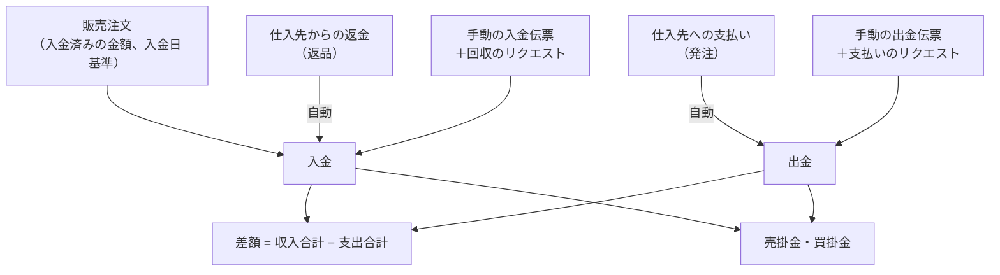
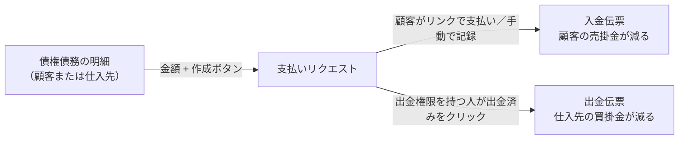

> 🌐 **言語:** [🇻🇳 Tiếng Việt](./in-out-cashflow-and-debt_vi.md) · [🇬🇧 English](./in-out-cashflow-and-debt.md) · 🇯🇵 日本語（現在）

# InOut — パート3: 入出金・債権債務・締め処理

## はじめに
このドキュメントでは、InOut の財務機能を説明します。**出納帳**（自動と手動の入金/出金）、期間ごとの **集計表**、顧客と仕入先の **債権債務**、**期首残高**、**支払いリクエストによる回収・支払い**、そして **締め処理** です。経理担当者と経営者の方を対象としています。読み終えると、ストアのお金の全体像をつかみ、回収と支払いを正しい場所で行い、期間ごとに安全に帳簿を締められるようになります。

## お金の流れの概要

## 1. 出納帳
「注文」→「[IO] 出納帳」を開きます。ここにすべてのお金の取引が集まります。

- **自動の入金:** 顧客が販売注文に支払った金額。仕入先からの返金（返品）。
- **自動の出金:** 仕入先への支払い（発注）。
- **手動の入金/出金:** その他の項目の入金/出金伝票（電気代、給与、手付金、過去の売掛金の回収など）。
- **支払いリクエストで作成された伝票:** 支払いリクエスト（セクション4）で顧客から回収したり仕入先に支払ったりすると、実際にお金が動くたびに、正しい取引先の入金/出金伝票が作成されます。

この画面には4つのタブがあります。「入出金伝票」（手動）、「販売注文」、「発注」、「返品」です。どのタブも、ページ上部の **期間** で絞り込めます。

### 手動の入金/出金伝票を作成する
1. 「入出金伝票」タブで「伝票作成」をクリックします。
2. **種別**（入金伝票／出金伝票）と **取引先** を選びます: *顧客*、*仕入先*（一覧から選択）、または *その他*（名前を入力）。債権債務を正しい相手にひも付けるため、必須です。
3. 取引先が顧客の場合、「対象注文（任意）」欄に、その顧客の未払いの注文が表示されます。**ある注文の代金であれば、その注文を選んでください** — 金額がその注文に記録され、注文の未収額が減ります。どの注文にも属さないお金（注文前の手付金、過去の売掛金）の場合だけ空欄にします。システムは警告を表示しますが、ブロックはしません。
4. **金額**（0より大きく、基準通貨）、**日付**、方法、**勘定科目**（例: *給与*、*水道光熱費*）、備考を入力し、「保存」をクリックします。伝票番号（`CE-YYYYMMDD-XXXX`）は自動で発行されます。

成功すると、伝票がタブに表示され、集計表の数字も更新されます。手動の伝票は **編集／削除** できます（行の末尾のボタン）。すべての操作は履歴に記録されます。

> 編集・削除できるのは **手動の伝票** だけです。発注/返品から作成された伝票は、その発注/返品の画面で修正します。**支払いリクエスト** で作成された伝票は、そのリクエストの画面で処理（キャンセル、返金）します。

## 2. 集計表
出納帳のページ上部で期間を選ぶと、次の項目が表示されます。

| 指標 | 意味 |
|--------|---------|
| 売上入金 | 顧客が販売注文に **支払った** 金額。**入金日** 基準（返金済みの分を除く） |
| 手動入金 | 手入力した入金伝票の合計（回収のリクエストで作成された伝票を含む） |
| 仕入先からの返金 | 返品に記録された返金の合計 |
| **収入合計** | 上の3行の合計 |
| 仕入代金の支払 | 発注に記録された支払いの合計 |
| 手動出金 | 手入力した出金伝票の合計（支払いのリクエストで作成された伝票を含む） |
| **支出合計** | 上の2行の合計 |
| **利益** | 収入合計 − 支出合計。**期間内の現金の差額** であり、会計上の利益ではありません |
| 売上入金と仕入出金の差額 | 売上入金 − 仕入代金の支払 |

売上は **入金日** で計算されるため、8月末に注文され9月初めに支払われた注文は9月に計上されます。実際に口座に入ったお金と一致します。

## 3. 債権債務
出納帳の画面から「売掛金・買掛金」をクリックします。取引先名で検索する欄と、期間の絞り込みがあります。

### 顧客の売掛金（顧客からあなたへの未払い）
- **支払いが完了していない** 注文がある顧客を一覧表示します: 注文数、注文合計、支払済み、注文残高、入出金伝票、**正味残高**。
- 「詳細を見る」をクリックすると、注文ごとの明細（合計、入金済み、残高、支払状況）、注文の商品と費用、その顧客の手動の入金/出金伝票が表示されます。
- **正味残高** = 注文の残高 − 手動の入金伝票 + 手動の出金伝票（その顧客分）。

### 仕入先の買掛金（あなたから仕入先への未払い）
- **支払いが完了していない** 発注がある仕入先を一覧表示します。
- **正味残高** = 発注の未払額 + 期首残高 − 返品の返金 − 手動の出金伝票 + 手動の入金伝票。

### 期首残高（仕入先のみ）
InOut を使い始める **前から仕入先への買掛金がある** 場合に使います。
1. 債権債務画面で「仕入先の期首残高」を開き、「期首残高を追加」をクリックします。
2. 仕入先を選び、金額と記録日を入力して「保存」をクリックします。この金額は仕入先の買掛金に加算されます。
3. 入力を間違えた場合は、その記録を「削除」します。作成も削除も履歴に記録され、締め処理のチェックの対象になります。

> **顧客** の売掛金は販売注文から直接取得するため、顧客の期首残高は **ありません**。システム導入前からの顧客の売掛金は、S-Cart で対応する注文を手動で作成するか、顧客が支払ったときに入金伝票で管理してください。

## 4. 支払いリクエストによる顧客からの回収・仕入先への支払い
お金が届いてから伝票を入力する代わりに、債権債務の画面から直接 **支払いリクエスト** を作成できます。顧客には **オンライン決済リンク** が届きます（顧客が振込で支払った場合は手動で記録します）。仕入先への支払いは、**出金権限を持つ人** が「出金済み」をクリックして処理します。実際にお金が動くと、入金/出金伝票が出納帳に自動で表示され、債権債務も自動で減ります。

手順:
1. 「売掛金・買掛金」→ 顧客または仕入先の「詳細を見る」を開きます。
2. ページ上部の金額欄には、**正味残高があらかじめ入力** されています。一部だけ回収・支払いする場合は修正します。
3. 「支払を請求」（顧客）または「リクエスト経由で支払う」（仕入先）をクリックします。作成されたリクエストのページが開きます。
4. 顧客の場合: 決済リンクを顧客に送るか（有効期間 **7日間**）、顧客が手動で振込したときに「受領済み」をクリックします。仕入先の場合: 経理担当者が送金し、出金権限を持つ人が「出金済み」をクリックします。

リクエストのライフサイクル全体、出金権限、返金については [支払いリクエスト](../s-cart/order-processing/payment-request_ja.md) を参照してください。

InOut の債権債務で使う場合の注意点:
- ボタンが表示されるのは、（InOut の権限に加えて）**支払いリクエスト** 権限がある場合だけです。
- リクエストはストアの **基準通貨** を使います。出納帳の通貨は1つだけです。
- リクエストで作成された伝票は **出納帳で編集・削除できません**。キャンセルや返金はリクエストの画面で行い、対応する伝票が自動で作成されます。
- リンクで回収した金額を返金すると、顧客に返金する **出金伝票** が作成されます。

## 5. 締め処理
締め処理は、過去の期間の **数字を確定** します。その期間の伝票は、うっかりであっても誰も変更できなくなります。

### 締め方と解除
1. 出納帳の画面で「締め処理」を開き、**締め日** を入力して「締める」をクリックします。日付がこの日以前の伝票はすべてロックされます。この欄には締めている期間の数が表示されます。
2. 過去の数字を修正する必要がある場合は、該当する締めの基準日で「締めを解除」をクリックし、修正後にもう一度締めます。
3. 出納帳の画面を使う権限があるアカウントは、誰でも締め・解除ができます。操作した人が記録されます。

### 原則: 伝票の日付で区切る
締めは **伝票の日付** で判定され、操作した日ではありません。5月31日まで締めている場合、今日であっても5月20日付の出金伝票は **編集できません** が、6月1日付の伝票は通常どおり操作できます。

締めた期間に属する場合にブロックされる操作: 費用の追加・削除、発注の商品の追加・削除、キャンセル、支払いの追加・削除（支払日で判定）、返金の追加・削除（返金日で判定）、入出金伝票の作成・編集・削除、期首残高の入力・削除、そしてその期間の日付での **販売注文への入金の記録・返金**。

ただし、支払いリクエストを通じて **決済ゲートウェイで実際に回収した** お金は拒否されません（お金は実際に届いているため）。伝票は **今日の日付** で記録され、照合しやすいように元の日付が備考に記載されます。

## 条件と制約（操作の前に確認）
**手動の入金/出金伝票:**
- **種別**、**取引先区分**、**具体的な取引先** の選択が **必須** です — 債権債務を正しくひも付けるためです。
- 金額は基準通貨で **0より大きく**、**日付** は必須です。
- 注文にひも付けた顧客の入金伝票: システムが注文に記録します。注文がこのストアのものでない場合や、注文がこれ以上入金を受け付けない場合（例: 残高を超える）は拒否されます。
- **編集／削除** できるのは **手動の** 伝票だけです。発注/返品や支払いリクエストから作成された伝票はできません。
- 伝票を **編集** するときは、**元の日付と新しい日付の両方** について締め処理がチェックされます。日付を締めた期間に変更することもブロックされます。

**期首残高:**
- **仕入先** にのみ適用されます。
- 金額は **0より大きく**、**記録日** は必須です。その日付で締め処理のチェックを受けます。

**回収・支払いの支払いリクエスト:**
- **支払いリクエスト** 権限が必要です。金額は **0より大きく**、**基準通貨** のみです。
- 顧客への回収リンクは **7日後** に期限切れになります。期限が切れたら新しいリクエストを作成します。

**締め処理:**
- **未来の日付は締められません** — その期間はまだ終わっていません。
- すでに締めている期間に含まれる日付で **再度締めることはできません**。
- 区切りは常に **伝票の日付** です。Multi-Store を使用している場合、ストアごとに締めの基準日があります。

## よくある質問（Q&A）
**Q1: 集計表の「利益」は会社の実際の利益ですか？**

→ これは期間内の **実際の入金 − 実際の出金の差額** で、会計上の売上総利益/純利益ではありません（売上原価や減価償却などは含まれていません）。すばやく把握するためのものです。

**Q2: 顧客がある注文の代金を支払いました。どこに記録すればよいですか？**

→ その注文自体に記録します。注文の画面で記録するか、入金伝票を作成して「対象注文」欄で注文を選びます。同じ金額を両方に記録しないでください。二重計上になります。

**Q3: 発注/返品から自動作成された伝票を編集できますか？**

→ いいえ。元の発注/返品で直接修正します（支払い/返金を削除してから記録し直します）。伝票は自動で更新されます。

**Q4: 「支払いリクエストで作成された」伝票を削除できないのはなぜですか？**

→ そのお金は、独自のライフサイクル（リンク、有効期限、返金）を持つリクエストを通っているためです。キャンセルや返金はリクエストの画面で行ってください。対応する伝票が自動で作成されます。

**Q5: 締めたのに、まだ編集できる伝票があるのはなぜですか？**

→ その伝票の日付が締めの基準日より **後** だからです。締め処理がブロックするのは、日付が締め日以前の伝票だけです。

**Q6: 5月31日まで締めています。5月20日付の伝票を修正するには、どう解除すればよいですか？**

→ 「締め処理」で5月31日の基準日の「締めを解除」をクリックし、修正してからもう一度締めます。

**Q7: 明日の日付で締められないのはなぜですか？**

→ まだ終わっていない期間を確定することはできません。締められるのは今日以前の日付だけです。

**Q8: 顧客の売掛金に期首残高を入力できますか？**

→ いいえ。期首残高があるのは仕入先だけです。顧客の過去の売掛金は、S-Cart で対応する注文を手動で作成し、通常の注文と同じように管理してください。

**Q9: 顧客の入金伝票を記録すると、その顧客の売掛金は自動で減りますか？**

→ はい。正しい顧客にひも付けた入金伝票は、その顧客の正味残高から差し引かれます。注文を選んだ場合は、その注文の残高が直接減ります。

**Q10: 手動の伝票を削除すると、記録は残りませんか？**

→ 残ります。誰が、いつ削除したか、伝票の内容が履歴に保存されます。

---

◀ [パート2 — 返品](./in-out-return-order_ja.md) · [目次](./in-out_ja.md) · [パート4 — 販売注文](./in-out-sales-order-integration_ja.md) ▶

---

📅 **最終更新:** 2026-10-22 · ✍️ **作成者 (Author):** GP247
