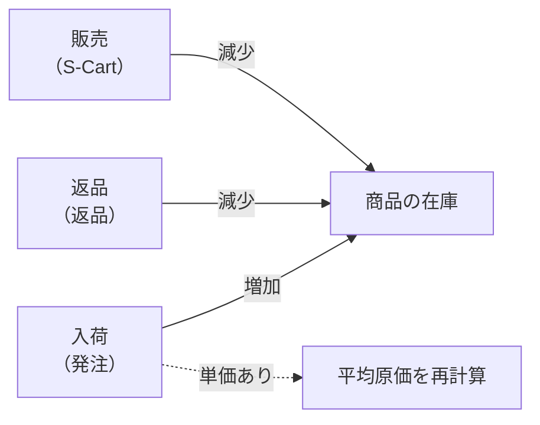

> 🌐 **言語:** [🇻🇳 Tiếng Việt](./in-out-export-print_vi.md) · [🇬🇧 English](./in-out-export-print.md) · 🇯🇵 日本語（現在）

# InOut — パート5: ファイル出力・印刷・在庫の自動更新・履歴

## はじめに
このドキュメントでは、InOut プラグインの共通機能をまとめて説明します。帳票の **Excel/PDF 出力**、**在庫の自動更新** の仕組み、**費用の区分**、**操作履歴** です。帳票を印刷し、在庫を照合し、誰が何をしたかを管理する必要がある経理担当者と管理者の方を対象としています。読み終えると、ファイルをどこから取得するか、在庫を何が動かしているか、履歴をどう確認するかがわかります。

## 1. データの出力と印刷
プラグインでは、次の帳票を出力できます。

| 帳票の種類 | 形式 | 内容 |
|----------------|-----------|----------|
| 発注 | Excel (.xlsx)、PDF | 商品の明細、費用、支払履歴 |
| 返品 | Excel (.xlsx)、PDF | 返品した商品の明細、費用、返金 |
| 入金伝票／出金伝票 | PDF | 署名欄付きの標準伝票テンプレート |
| 出納帳 | Excel (.xlsx) | 絞り込み中の期間の伝票一覧 |
| 債権債務レポート | Excel (.xlsx) | 顧客と仕入先の債権債務の集計 |
| 取引先ごとの債権債務の明細 | Excel (.xlsx)、PDF | 注文ごと、入金/出金伝票、期首残高、正味残高 |

取得方法: 帳票の詳細ページ（または一覧ページ／債権債務ページ）を開き、「Excel出力」／「PDF出力」をクリックします。ダウンロードされるファイルは、帳票番号と出力日で名前が付けられるため（例: `PO_PO-20261003-0001_20261003.pdf`）、何度保存しても上書きされません。

すべてのファイルは **企業向けの帳票テンプレート** を使います。ストアのロゴと名前、書式付きのデータ表、署名欄が入ります。金額はストアの基準通貨です。

### 帳票の署名欄

| 帳票の種類 | 署名欄1 | 署名欄2 | 署名欄3 |
|---------------|--------|--------|--------|
| 発注 | 発注作成者 | 販売者 | — |
| 返品 | 発注作成者 | 検収者 | — |
| 入金伝票 | 作成者 | 支払者 | 出納担当 |
| 出金伝票 | 作成者 | 受領者 | 出納担当 |
| 債権債務の明細 | 作成者 | 取引先／顧客 | — |

## 2. 在庫の自動更新

| 操作 | 在庫への影響 | 管理元 |
|----------|-------------------|-------------|
| 発注からの入荷 | 入荷数に応じて在庫が **増える** | InOut |
| 記録済みの入荷数を減らす | 差分を在庫から **差し引く** | InOut |
| 仕入先への返品 | 返品済み数に応じて在庫が **減る** | InOut |
| 顧客への販売 | 販売注文に応じて在庫が **減る** | S-Cart |
| 発注のキャンセル（未入荷） | 影響なし | — |

単価のある入荷では、商品の **平均原価** が加重平均で再計算されます。計算は入荷時のみで、過去の入荷分は再計算されません。

> **まとめ:** InOut は **入荷** と **返品** の在庫を管理し、**販売** は S-Cart が処理します（[商品の在庫管理](../s-cart/product/product-stock-management_ja.md)）。

## 3. 費用の区分
発注/返品に付帯費用を追加するときは、あとで絞り込み・集計できるように区分を1つ選びます。

| 区分 | 例 |
|------|-------|
| 送料 | 国内・国際の配送料 |
| 保険料 | 貨物保険 |
| 輸入税 | 関税 |
| 荷役費 | 積み下ろし費、梱包費 |
| その他 | その他の発生費用 |

## 4. 履歴と管理
業務上の操作はすべて記録されます。誰が発注を作成したか、誰がいくつ入荷したか（旧数量 → 新数量）、誰が支払い/返金を記録したか、誰が注文をキャンセルしたか、誰が入出金伝票を作成・編集・削除したか、誰が期首残高を入力・削除したか — 日時とともに記録されます。履歴は、各発注/伝票の詳細ページの「操作履歴」に表示されます。削除された入出金伝票も記録が残ります（誰が、いつ削除したか、伝票の内容）。

## 条件と制約（操作の前に確認）
- 帳票を出力するには、該当する画面への **アクセス権限** が必要です（権限グループ **Inout Cash** があれば十分です）— ファイルには財務データが含まれるためです。
- 出力ファイルは、**出力ボタンを押した時点のデータ** と **適用中の絞り込み**（期間、取引先の検索キーワードなど）をそのまま反映します。1年分のレポートが必要な場合は、出力する前に1年分の期間を選んでください。
- PDF で発音記号を正しく表示するには、サーバーに **ベトナム語に対応した Unicode フォント** が必要です。同梱のテンプレートは適切なフォントを使用しています。
- 在庫が変わるのは、**入荷/返品**（InOut）または **販売**（S-Cart）の業務を通じた場合だけです。すべての変更に帳票が残るよう、プラグインには在庫を手動で編集する欄がありません。
- 平均原価が再計算されるのは **単価のある入荷時** だけです。過去の発注を編集しても再計算 **されません**。

## よくある質問（Q&A）
**Q1: CSV で出力するボタンを探していますが、見つかりません。**

→ プラグインは **Excel (.xlsx)** で出力し、CSV はありません。「Excel出力」ボタンを使ってください。Excel で直接開け、数値の書式とベトナム語の文字がそのまま保たれます。

**Q2: PDF ファイルでベトナム語のフォントが崩れる場合はどうすればよいですか？**

→ テンプレートはベトナム語に対応したフォントを使用しています。それでも崩れる場合は、サーバーに Unicode フォントが揃っているか確認してください。必要に応じて GP247 のサポートにお問い合わせください。

**Q3: 販売しても在庫が変わらないのはなぜですか？**

→ それは販売側で、在庫を差し引くのは InOut ではなく **S-Cart** です。S-Cart の在庫設定を確認してください。

**Q4: 過去の発注を編集すると、平均原価は再計算されますか？**

→ いいえ。原価が更新されるのは **入荷** した時点だけで、過去の発注を編集しても再計算されません。

**Q5: 操作履歴は誰が見られますか？**

→ 該当する画面へのアクセス権限がある人です。履歴は各発注/伝票の詳細ページにあります。

**Q6: Excel と PDF の署名欄は同じですか？**

→ はい。同じ種類の帳票では、Excel でも PDF でも **同じ署名欄** を使います。

---

◀ [パート4 — 販売注文](./in-out-sales-order-integration_ja.md) · [目次](./in-out_ja.md)

---

📅 **最終更新:** 2026-10-22 · ✍️ **作成者 (Author):** GP247
