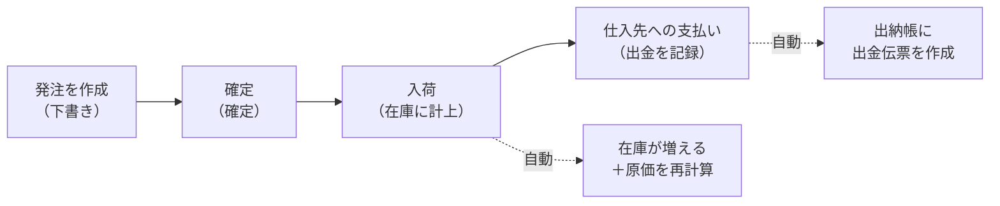

> 🌐 **言語:** [🇻🇳 Tiếng Việt](./in-out-purchase-order_vi.md) · [🇬🇧 English](./in-out-purchase-order.md) · 🇯🇵 日本語（現在）

# InOut — パート1: 発注（仕入先からの入荷）

## はじめに
このドキュメントでは、InOut プラグインの **入荷** 業務を説明します。仕入先への発注の作成、確定、入荷から、買掛金の支払いまでを扱います。ストアオーナー、在庫管理者、社内の経理担当者の方を対象としています。読み終えると、発注を最初から最後まで自分で作成・処理でき、システムが操作をブロックしたときにその理由がわかるようになります。

## 入荷の流れ

## 操作手順

### ステップ1 — 発注を作成する
1. メニュー「注文」→「[IO] 発注」を開き、「発注を作成」をクリックします。
2. 一覧から **仕入先を選択** します（必須。商品を追加する前に選択してください）。仕入先がまだない場合は、先に S-Cart の「仕入先」で作成します。
3. 商品行を1行ずつ追加します。商品名または SKU を入力して検索し、既存の商品を選び、**数量** と **仕入単価** を入力します。数量は小数に対応しています（小数点以下2桁まで。例: `1.5`）。
4. 課税対象の商品は、行ごとに **税率 (%)** を入力します。税額はシステムが自動で計算します。
5. （任意）**付帯費用**（送料、保険料、荷役費など）を追加し、費用ごとに **区分** を選びます。仕入先からの値引きを記録するために、費用には **マイナスの値** も入力できます。
6. （任意）**入荷予定日**、**支払期日**、備考を入力します。
7. 「発注を保存」をクリックします。発注番号（`PO-YYYYMMDD-XXXX` 形式）が自動で発行され、商品合計 + 税額合計 + 付帯費用 = **総合計** が自動で計算されます。

成功すると発注の詳細ページが開き、ステータスは **下書き** になります。ここでの金額はすべてストアの **基準通貨** です。

> 商品行の追加・削除ができるのは、ステータスが下書きのときだけです。

### ステップ2 — 発注を確定する
1. **下書き** の発注の詳細を開き、「確定」をクリックします。
2. 発注は **確定** になり、入荷の準備が整います。この時点から商品リストはロックされます。

### ステップ3 — 入荷する（在庫に計上）
1. 発注の詳細で、各商品行に **入荷数** を入力し、「数量を更新」をクリックします。
2. **複数回に分けて** 入荷できます。行のステータスは自動で変わります: *未入荷 → 一部入荷 → 入荷済み*。すべての行の入荷が完了すると、発注は **入荷済み** になります。
3. 記録した時点で、**商品の在庫が** 入荷した分だけ **増え**、商品の **平均原価** が仕入単価に基づいて再計算されます。

> 入荷数を多く入力してしまい、**減らす** 方向に修正した場合は、多く加算した在庫分をシステムが自動で **差し引き** ます。

### ステップ4 — 仕入先に支払う
1. 発注の詳細の「支払履歴」で「+ 記録」をクリックし、**金額**、**支払日**、方法、備考を入力して保存します。
2. **合計金額／支払済み額／残額** の3つの数字を確認します。**分割払い** として何回でも記録できます。締めていない期間であれば、記録済みの支払いを削除できます。
3. 支払いはそれぞれ **自動で出金伝票** として出納帳に記録されます。手入力し直す必要はありません。

> 支出の承認者を通したい場合や、複数の発注をまとめて仕入先に支払いたい場合は、債権債務画面の **支払いリクエスト** を使います。[パート3](./in-out-cashflow-and-debt_ja.md) を参照してください。

## 発注のステータス

| ステータス | 意味 |
|------------|---------|
| 下書き | 作成直後で未確定（商品の追加・削除が可能） |
| 確定 | 承認済みで、入荷の準備ができている |
| 一部入荷 | 一部の商品が入荷済みで、まだすべてではない |
| 入荷済み | すべての商品が入荷済み |
| キャンセル | 発注がキャンセルされた（キャンセルできるのは、まだ **1つも入荷していない** 場合のみ） |

## 一覧の検索と絞り込み
発注の一覧ページでは、**発注番号**、**仕入先**、**ステータス**、**作成日の期間** で絞り込めます。発注の詳細では、その発注から返品したことがある場合に「関連する返品」も表示されます。

## 条件と制約（操作の前に確認）
どの制約にも業務上の理由があります。

**発注の作成・編集時:**
- **商品を追加する前に仕入先を選択する必要があります** — 買掛金を正しい取引先にひも付けるためです。
- **商品は1つ以上** 必要です。各行で、在庫に **実在する商品** を選び、**名前** が必要です。
- **発注数 > 0**、小数点以下 **2桁まで**（`1.25` は有効、`1.255` は拒否されます） — システムは小数点以下2桁までしか保存しません。
- **仕入単価 ≥ 0** — 仕入単価はマイナスにできません。
- **税率**（入力する場合）は **0〜100%** の範囲です。
- **付帯費用** は **マイナス** にできます（値引きの記録）。名前は255文字以内、備考は500文字以内です。
- 発注の備考は2000文字以内です。

**入荷時:**
- 入荷数は、その行の **発注数を超えられません** — 発注した数より多く入荷することはできません。
- 入荷数は0以上、小数点以下2桁までです。
- 入荷数を **減らす** ことで在庫を差し引く必要があり、**在庫が足りない**（すでに販売済み）場合はブロックされます。在庫がマイナスにならないようにするためです。

**支払い時:**
- 金額は **0より大きく** する必要があります。
- **支払済み額 + 今回の支払い ≤ 発注合計** — 発注の金額を超えて支払うことはできません。発注以外の追加の支払い（前払い、過去の買掛金の支払い）は、出納帳の **手動の出金伝票** で記録します。

**商品の追加・削除、確定、キャンセル:**
- **商品の追加・削除** ができるのは、発注が **下書き** の間だけです。確定済み/入荷済みの発注では、数字を守るためにリストがロックされます。
- 入荷済みの行（入荷数 > 0）や、関連する返品がある行は **削除できません**。
- 発注を **キャンセル** できるのは、まだ **1つも入荷していない** 場合だけです。入荷済みの場合は [返品](./in-out-return-order_ja.md) の手順を使います。
- **確定** できるのは **下書き** の発注だけです。

**締め処理:** **締めた期間** に属する発注に対する変更操作はすべてブロックされます（**発注日** で判定。支払いのみ **支払日** で判定）。[パート3](./in-out-cashflow-and-debt_ja.md) を参照してください。

## よくある質問（Q&A）
**Q1: 入荷する前に必ず「確定」しなければなりませんか？**

→ データをわかりやすくするため、下書き → 確定 → 入荷 の順に進めることをおすすめします。商品行の追加・削除は発注が **下書き** の間しかできないため、確定する前にリストをよく確認してください。

**Q2: 入荷数を間違えて入力した場合、どう修正しますか？**

→ 正しい数を入力し直し、「数量を更新」をクリックします。新しい数が以前より少なければ在庫から差分が差し引かれ、多ければ加算されます。

**Q3: 付帯費用にマイナスの値を入力するのはなぜですか？**

→ 仕入先からの **値引き・割引** を記録するためです。たとえば費用 `-200.000` を入力すると、発注の総合計が減ります。

**Q4: 発注に商品を追加できないのはなぜですか？**

→ 商品の追加・削除ができるのは **下書き** の発注だけです。確定済み/入荷済みの発注では商品リストがロックされます。

**Q5: 支払いがブロックされたのはなぜですか？**

→ 支払済み額と今回の支払いの合計が **発注合計を超えている** か、支払日が **締めた期間** に入っているためです。入力する前に、残額と締めの基準日を確認してください。

**Q6: 「平均原価」はどのように計算されますか？**

→ 入荷時の加重平均です: `(既存在庫 × 既存原価 + 入荷数 × 仕入単価) ÷ (既存在庫 + 入荷数)`。原価は入荷時にのみ更新され、過去の入荷分は再計算されません。

**Q7: 入荷済みの発注をキャンセルできますか？**

→ いいえ。キャンセルできるのは、まだ **1つも入荷していない** 発注だけです。入荷済みの場合は [パート2 — 返品](./in-out-return-order_ja.md) を使ってください。

**Q8: 発注を Excel/PDF に出力するにはどこから操作しますか？**

→ 発注の詳細ページで「Excel出力」または「PDF出力」ボタンを使います。[パート5](./in-out-export-print_ja.md) を参照してください。

---

◀ [目次](./in-out_ja.md) · [パート2 — 返品](./in-out-return-order_ja.md) ▶

---

📅 **最終更新:** 2026-10-22 · ✍️ **作成者 (Author):** GP247
