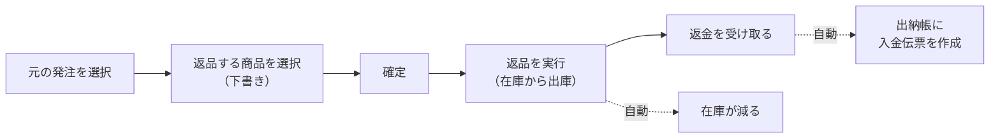

> 🌐 **言語:** [🇻🇳 Tiếng Việt](./in-out-return-order_vi.md) · [🇬🇧 English](./in-out-return-order.md) · 🇯🇵 日本語（現在）

# InOut — パート2: 返品（仕入先への返品）

## はじめに
このドキュメントでは、InOut プラグインで仕入先に **返品** する業務を説明します。元の発注を選び、返品する商品を選び、在庫から出庫して、返金を記録します。在庫管理者と経理担当者の方を対象としています。読み終えると、返品を最初から最後まで処理し、返金を正確に照合できるようになります。

## 返品の流れ

## 操作手順

### ステップ1 — 返品を作成する
1. メニュー「注文」→「[IO] 返品」を開き、「返品を作成」をクリックします。
2. **元の発注を選択** します（実際に入荷済みの発注）。入荷済みの商品が **入荷数** とともに読み込まれます。
3. 商品ごとに **返品予定数** を入力します（小数に対応、小数点以下2桁まで）。
4. （任意）返品時に発生する **費用**（返送料など）を区分付きで追加します。費用はマイナスの値も入力できます。
5. 「返品を保存」をクリックします。返品番号（`RO-YYYYMMDD-XXXX` 形式）が自動で発行されます。

成功すると、返品の詳細ページがステータス **下書き** で表示され、**参照発注** も表示されます。

> **入荷数を超えて返品できません**: 返品予定数（同じ商品について、キャンセルされていないすべての返品の合計）は、実際の入荷数を超えられません。保存した時点でシステムがブロックします。

### ステップ2 — 確定して返品を実行する
1. 「確定」をクリックして、**下書き** から **確定** に変更します。
2. 商品ごとに **返品済み数** を入力して保存します。**複数回に分けて** 返品できます。行のステータス: *未返品 → 一部返品 → 返品済み*。すべての行が完了すると、返品は **返品済み** になります。
3. 商品の在庫は返品した数だけ **自動で減ります**。返品済み数を減らす方向に修正すると、在庫はその分 **戻されます**。

### ステップ3 — 返金を受け取る
1. **返金総額** = Σ（仕入単価 × 返品数）+ 費用 がシステムで自動計算されます。
2. 返品の詳細の「返金」で「+ 記録」をクリックし、金額、返金日、方法を入力して保存します。複数回に分けて記録でき、**返金総額／返金済み／残額** を確認できます。
3. 返金はそれぞれ **自動で入金伝票** として出納帳に記録され、その仕入先に対する **買掛金を減らします**。

> **返金総額を超えて返金を記録できません**: 返金済み + 今回の返金は、返金総額を超えられません。仕入先が返品した商品の金額を超えて補填した場合は、出納帳で別途 **手動の入金伝票** として記録してください（[パート3](./in-out-cashflow-and-debt_ja.md) を参照）。返品に詰め込まないでください。

## 返品のステータス

| ステータス | 意味 |
|------------|---------|
| 下書き | 作成直後で未確定 |
| 確定 | 承認済みで、返品を実行できる状態 |
| 一部返品 | 一部の商品が返品済みで、まだすべてではない |
| 返品済み | すべての商品が返品済み |
| キャンセル | 返品がキャンセルされた（キャンセルできるのは、まだ **1つも返品していない** 場合のみ） |

## 一覧の検索と絞り込み
返品の一覧ページでは、**返品番号**、**ステータス**、**参照発注**、**作成日の期間** で絞り込めます。

## 条件と制約（操作の前に確認）
以下の制約はすべて、在庫と買掛金を正確に保つためのものです。

**返品の作成時:**
- 実際に入荷済みの **元の発注を選択する必要があります** — 下書きやキャンセル済みの発注は表示されません。
- **商品は1つ以上** 必要です。各行は、元の発注で入荷済みの商品から選びます。
- **返品予定数 > 0**、小数点以下2桁まで。
- **返品予定数（同じ商品について、キャンセルされていないすべての返品の合計）≤ 実際の入荷数** — 実際にある数より多く返品することはできません。
- 費用はマイナスにできます。文字数の制限は発注と同じです（名前は255文字以内、返品の備考は2000文字以内）。

**返品の実行時:**
- 返品済み数は、その行の **返品予定数を超えられません**。
- 差し引くための **在庫が十分にある必要があります** — 在庫が足りない（すでに販売済み）場合は操作がブロックされ、在庫がマイナスになるのを防ぎます。

**返金時:**
- 金額は **0より大きく** する必要があります。
- **返金済み + 今回の返金 ≤ 返金総額** — 追加の補填分は手動の入金伝票で記録します。

**確定／キャンセル:**
- **確定** できるのは **下書き** の返品だけです。
- **キャンセル** できるのは、まだ **1つも返品していない** 場合だけです。

**締め処理:** 締めた期間に属する返品への操作はすべてブロックされます（**返品の日付** で判定。返金の記録・削除は **返金日** で判定）。

## よくある質問（Q&A）
**Q1: 返品のために発注を選べないのはなぜですか？**

→ 表示されるのは、**実際に入荷済み**（まだ返品できる数量が残っている）の発注だけです。下書き、キャンセル済み、またはすべて返品済みの発注は一覧に表示されません。

**Q2: システムに「入荷数を超えています」と表示されるのはどういう意味ですか？**

→ 返品しようとしている数量（同じ商品の、ほかの未完了の返品も含む）が実際の入荷数より多いということです。返品数を正しく減らしてください。

**Q3: 仕入先が返品した商品の金額より多く返金してくれた場合、どこに記録しますか？**

→ 超過分は *その他の収入* です。出納帳で **手動の入金伝票**（取引先 = その仕入先）を作成し、返品には記録しないでください。

**Q4: 返品すると在庫は自動で減りますか？**

→ はい。返品済み数を記録すると、在庫はすぐに減ります。差し引く在庫が足りない場合はエラーが表示されます。

**Q5: 実行済みの返品をキャンセルできますか？**

→ いいえ。キャンセルできるのは、まだ **1つも返品していない** 場合だけです。返品済みの場合は、返品済み数を実際の数に合わせて調整してください。

**Q6: 返金は仕入先への買掛金に影響しますか？**

→ はい。返金により、仕入先への **買掛金が減ります**。計算方法は [パート3](./in-out-cashflow-and-debt_ja.md) を参照してください。

---

◀ [パート1 — 発注](./in-out-purchase-order_ja.md) · [目次](./in-out_ja.md) · [パート3 — 入出金・債権債務・締め処理](./in-out-cashflow-and-debt_ja.md) ▶

---

📅 **最終更新:** 2026-10-22 · ✍️ **作成者 (Author):** GP247
