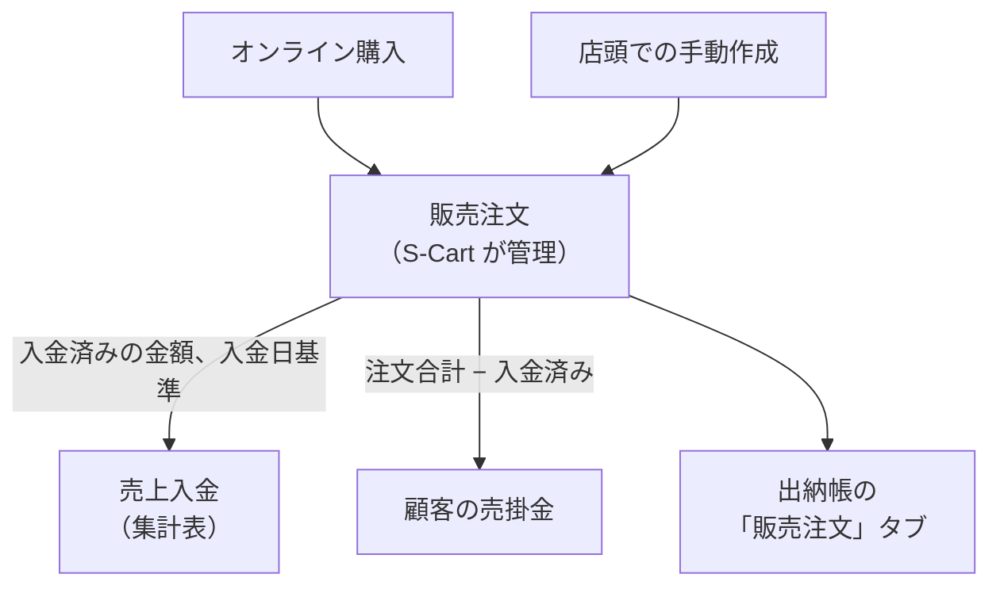

> 🌐 **言語:** [🇻🇳 Tiếng Việt](./in-out-sales-order-integration_vi.md) · [🇬🇧 English](./in-out-sales-order-integration.md) · 🇯🇵 日本語（現在）

# InOut — パート4: 販売注文（売上と顧客の売掛金）

## はじめに
このドキュメントでは、InOut プラグインが S-Cart の **販売注文を読み取って** 出納帳に反映する仕組みを説明します。販売の流れには **一切** 手を加えません。売上と顧客の売掛金がなぜ InOut に表示されるのか、その数字がどの日付で計算されるのかを知りたいストアオーナーと経理担当者の方を対象としています。読み終えると、販売データがどこから InOut に流れてくるのか、顧客からの入金をどこに記録すれば正しいのかがわかります。

## 販売注文はどこから来るか
販売注文は InOut ではなく、**S-Cart が作成・管理** します。発生元は2つです。

| 発生元 | 説明 |
|-------|-------|
| **オンライン購入** | 顧客が Web サイトで直接注文する |
| **手動作成** | 管理者が管理画面で注文を作成する（店頭販売、電話注文など） |

注文のライフサイクル、顧客の支払いや返金の記録方法については、[注文のライフサイクル](../s-cart/order-processing/order-lifecycle_ja.md) を参照してください。

## InOut は販売注文を何に使うか

InOut は販売注文を **読み取るだけ** で、次の3つの目的に使います。

1. **売上入金の計算** — **顧客が実際に支払った金額** を、**入金日**（注文日ではありません）で計算します。例: 8月28日の注文に対して、顧客が9月2日に振り込んだ場合 → その金額は9月の売上に入ります。顧客への返金は、返金した日付で差し引かれます。
2. **顧客の売掛金の追跡** — **支払いが完了していない** 注文がある顧客は、顧客の売掛金に表示されます。例: 注文 5.000.000 に対し、顧客がまだ 3.000.000 しか支払っていない → 残り 2.000.000 が未払いです。
3. **「販売注文」タブの表示** — 選択した期間の注文を一覧表示します: 注文番号、注文合計、入金済み、残高、支払状況。

## 顧客が注文の代金を支払ったら、どこに記録するか
**特定の注文** のお金は、**その注文自体に** 記録してください。S-Cart の注文の画面で記録するか、InOut で直接記録します。InOut で顧客の入金伝票を作成するとき、「対象注文（任意）」欄に、その顧客の未払いの注文が表示されます。注文を選ぶと、金額が注文の支払記録に記録され、注文の残高が減り、売上も自動で更新されます。

**注文にひも付けない手動の入金伝票** は、**どの注文にも属さない** お金（注文前の手付金、システム導入前からの売掛金の回収）にだけ使います。顧客に未払いの注文があるのにこの欄を空欄にすると、システムは **警告** を表示しますが、ブロックはしません — 意図的な場合もあるためです。

> なぜ分ける必要があるのでしょうか？ 集計表は *売上入金* と *手動入金* の両方を合計します。同じ金額を両方に記録すると、お金が **二重計上** されます。

## 販売時の在庫は誰が管理するか
**販売** 時の在庫は **S-Cart が自動で処理** します（[商品の在庫管理](../s-cart/product/product-stock-management_ja.md) を参照）。InOut が管理するのは、仕入先からの **入荷** と仕入先への **返品** の在庫だけです。[パート5](./in-out-export-print_ja.md) を参照してください。

## 条件と制約（操作の前に確認）
- InOut は販売注文を **読み取るだけ** で、**作成・編集・削除はしません**。販売注文の入力に関する制約はすべて **S-Cart** が管理します。
- 顧客が **顧客の売掛金** に表示されるのは、**支払いが完了していない**（残高 > 0）注文がある場合だけです。
- **売上は入金済みの金額と入金日で計算されます**。注文の合計金額や注文日ではないため、同じ期間の注文合計と数字が異なることがあります。
- **締め処理は販売注文のお金にも適用されます**: 締めた期間の日付で、注文への入金を記録したり返金したりすることはできません（[パート3](./in-out-cashflow-and-debt_ja.md) を参照）。
- 「販売注文」タブと債権債務は、出納帳の画面で選択中の **期間** に基づいて表示されます。

## よくある質問（Q&A）
**Q1: InOut は販売注文を作成しますか？**

→ いいえ。販売注文は S-Cart が作成します（オンラインまたは手動）。InOut は売上と売掛金を計算するために読み取るだけです。

**Q2: 出納帳の売上が、期間内の販売注文の合計と異なるのはなぜですか？**

→ 売上は **入金済みの金額** を **入金日** で計算したものです。顧客がまだ支払っていない分は **売掛金** に入ります。先月の注文でも今月に入金されたお金は、今月に計上されます。

**Q3: 顧客が未払い分を追加で支払った場合、どこに記録しますか？**

→ **その注文自体に** 記録します。注文の画面で記録するか、InOut で入金伝票を作成して「対象注文」欄で注文を選びます。顧客にオンライン決済リンクを送りたい場合は、顧客の債権債務の明細で「支払を請求」を使います（[パート3](./in-out-cashflow-and-debt_ja.md)）。

**Q4: 販売すると InOut の在庫は減りますか？**

→ 販売時の在庫は S-Cart が自動で差し引きます。InOut は販売側には関与せず、仕入先からの入荷/仕入先への返品のときにだけ在庫を増減します。

**Q5: 1か月分のすべての販売注文はどこで確認できますか？**

→「[IO] 出納帳」を開き、期間を選んで「販売注文」タブを開きます。

---

◀ [パート3 — 入出金・債権債務・締め処理](./in-out-cashflow-and-debt_ja.md) · [目次](./in-out_ja.md) · [パート5 — ファイル出力・印刷・在庫・履歴](./in-out-export-print_ja.md) ▶

---

📅 **最終更新:** 2026-10-22 · ✍️ **作成者 (Author):** GP247
