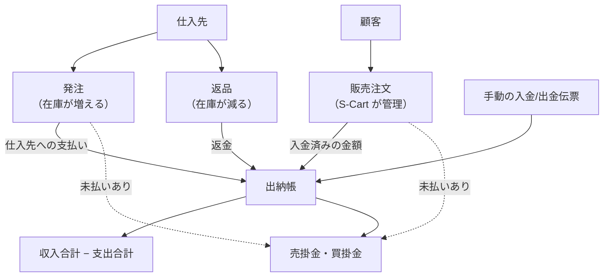

> 🌐 **言語:** [🇻🇳 Tiếng Việt](./in-out_vi.md) · [🇬🇧 English](./in-out.md) · 🇯🇵 日本語（現在）

# InOut — 入荷・返品・入出金・債権債務を1つの管理画面で

> 🚀 **InOut プラグインのリンク（有料）:** [https://gp247.net/en/product/plugin-inout-purchase-return.html](https://gp247.net/en/product/plugin-inout-purchase-return.html)

## はじめに
このドキュメントでは **InOut** を紹介します。InOut は、ストアの「裏方」の業務である **仕入先からの入荷、返品、出納帳、債権債務** を、S-Cart の管理画面の販売注文のすぐ隣に追加するプラグインです。**ストアオーナー、在庫管理者、社内の経理担当者** の方を対象としています。このページを読むと、プラグインでできること、お金と在庫の流れ、インストールに必要なもの、次に読むべきページがわかります。

これは InOut ドキュメントセットの **目次ページ** です。残りの5つのパートで、各業務を詳しく説明します。

## このドキュメントセットの目次

| パート | 内容 | 対象 |
| --- | --- | --- |
| **このページ** | InOut が解決すること、お金と在庫の全体像、システム要件、インストール、権限設定 | 導入を検討中、またはインストールしたばかりの方 |
| [パート1 — 発注](./in-out-purchase-order_ja.md) | 作成 → 確定 → 入荷 → 仕入先への支払い。ステータス、付帯費用、原価 | 在庫管理者、発注担当者 |
| [パート2 — 返品](./in-out-return-order_ja.md) | 元の発注を選択 → 返品 → 返金の受け取り。返品数の上限 | 在庫管理者、経理担当者 |
| [パート3 — 入出金・債権債務・締め処理](./in-out-cashflow-and-debt_ja.md) | 出納帳、集計表、顧客と仕入先の債権債務、期首残高、支払いリクエストによる回収・支払い、締め処理 | 経理担当者、経営者 |
| [パート4 — 販売注文](./in-out-sales-order-integration_ja.md) | 売上と顧客の売掛金を S-Cart の販売注文からどのように取得するか | ストアオーナー、経理担当者 |
| [パート5 — ファイル出力・印刷・在庫・履歴](./in-out-export-print_ja.md) | Excel/PDF 出力、署名欄付きの帳票テンプレート、在庫の自動更新、操作履歴 | 経理担当者、帳票を印刷する方 |

## InOut が解決すること
S-Cart は **販売側** をしっかり管理します。注文、顧客、注文の入金などです。しかし、ストアには **仕入側** もあります。仕入先への発注、入荷、不良品の返品、買掛金の支払い、さらに細かな入出金（電気代、給与、過去の売掛金の回収）です。ツールがないと、これらは Excel、手帳、記憶の中に散らばりがちです。その結果、在庫がずれ、支払いを忘れ、月末に本当に利益が出ているのかわからなくなります。

InOut は、これらすべてを **1か所、いつもの管理画面** にまとめます。

- **手順のある入荷。** 発注は 下書き → 確定 → 入荷 → 支払い と進みます。一部入荷や分割払いにも対応します。入荷時に在庫と平均原価が自動で更新されます。
- **元の発注にひも付く返品。** 入荷数を超えて返品することはできません。仕入先からの返金は自動で入金伝票になります。
- **すべてのお金の流れを1つの出納帳で。** 販売代金、仕入先への支払い、返金、手動の入金/出金伝票が、期間ごとの1つの集計表にまとまります。
- **双方向の債権債務を明確に。** どの顧客がいくら未払いか、どの仕入先にいくら支払いが残っているかがわかります。さらに **支払いリクエスト**（オンライン決済リンク、または手動記録）でその場で回収・支払いができます。
- **期間ごとの締め処理。** 報告済みの数字を確定し、締めた期間の伝票は誰も変更できなくなります。
- **印刷できる帳票。** 発注書、返品書、入金/出金伝票、債権債務レポートを、署名欄付きのテンプレートで Excel/PDF に出力できます。

## お金と在庫の全体像



役割分担の原則は次のとおりです。**InOut は仕入と返品の側を管理します**（在庫の増減、仕入先への支払い、仕入先からの返金）。**S-Cart は販売側を管理します**（注文、販売時の在庫引き当て、顧客からの入金）。InOut は売上と顧客の売掛金を計算するために販売注文を **読み取る** だけで、販売注文を変更しません。

## プラグインでできること

| グループ | 機能 |
|---|---|
| 発注 | 仕入先ごとに発注を作成。複数の商品行、小数の数量、行ごとの税率、付帯費用（マイナスの値引きも可）。確定、分割入荷、分割支払い、未入荷の発注のキャンセル。発注番号、仕入先、ステータス、期間で絞り込み |
| 返品 | 入荷済みの発注から作成。入荷数を超える返品を防止。分割返品、分割返金（超過返金を防止）。未返品の返品のキャンセル |
| 出納帳 | 取引先（顧客／仕入先／その他）ごとの手動の入金/出金伝票。顧客の入金伝票は販売注文にひも付けでき、二重計上を防げます。期間ごとの集計表と収入/支出の内訳。4つのタブ：手動伝票、販売注文、発注、返品 |
| 債権債務 | 未払いのある顧客と、支払いが残っている仕入先の一覧。注文ごとの明細。仕入先の期首残高。債権債務の明細画面から **回収・支払いのリクエストを直接作成** |
| 締め処理 | 特定の日付まで締め、必要に応じて解除。締めた期間に日付が入る伝票はすべて変更不可（販売注文に記録する金額も含む） |
| 出力・印刷 | 発注、返品、入金/出金伝票、出納帳、債権債務レポートの Excel/PDF。ロゴと署名欄付きのテンプレート |
| 履歴 | 誰が作成、入荷、支払い、キャンセル、編集、削除したかを日時付きで記録。各伝票の詳細画面ですぐに確認可能 |
| 通貨 | すべての金額はストアの **基準通貨** で入力・表示 |

## システム要件
- S-Cart **3.x**（`gp247/core` **3.1** 以上）、および `gp247/shop` がインストール済みであること。
- パッケージ `barryvdh/laravel-dompdf`（PDF 出力に使用）。不足している場合はインストーラーが通知します。
- 一般的な共有ホスティングで動作します。cron、キューワーカー、WebSocket は **不要** です。
- 顧客からの回収にオンライン決済リンクを使う場合は、決済ゲートウェイを1つ以上設定する必要があります（[支払いリクエスト](../s-cart/order-processing/payment-request_ja.md) を参照）。ゲートウェイがなくても手動で記録できます。

## インストール
InOut は **有料プラグイン** です。[商品ページ](https://gp247.net/en/product/plugin-inout-purchase-return.html) で購入後、GP247 のライブラリから取得します。他のプラグインと同じ方法でインストールします。[プラグイン・テンプレートのインストール](../extension/install-extension_ja.md) の方法から **1つ** を選んでください。

1. **GP247 ライブラリから（推奨）:** 管理画面 →「拡張機能」→「プラグイン」→「ライブラリから」タブ → **InOut** を検索 →「インストール」。
2. **zip ファイルのインポート:**「インポート」タブ → ダウンロードした zip ファイルを選択します。
3. **手動コピー:** ソースコードを `app/GP247/Plugins/InOut/` に、プラグインの `public` フォルダを `public/GP247/Plugins/InOut/` にコピーし、「ローカル」タブでインストールします。
4. **コマンドライン**（`php artisan` を実行できるサーバー）:

   ```bash
   composer require barryvdh/laravel-dompdf
   ```

   ```bash
   php artisan gp247:ext-register-license
   ```

   ```bash
   php artisan gp247:ext-install --type=plugin --key=InOut
   ```

   1つ目のコマンドは、Web サイトに PDF 出力パッケージがまだない場合にのみ必要です。2つ目のコマンドはライブラリに接続するためのもので、**Web サイトごとに1回** だけ実行します。実行前に `.env` の `APP_URL` が実際のドメインになっていることを確認してください。今後のバージョンアップ: `php artisan gp247:ext-update --type=plugin --key=InOut`。

成功すると、管理画面サイドバーの「注文」メニューに、**[IO]** の接頭辞が付いた3つの項目が表示されます。**[IO] 発注**、**[IO] 返品**、**[IO] 出納帳** です。

## スタッフへの権限設定
インストール時に、プラグインのすべての画面の権限を含む権限グループ **「Inout Cash」** が自動で作成されます。管理画面 →「権限」で、このグループを経理/在庫担当スタッフのロールに割り当ててください。管理者権限がなくても InOut を利用できます。権限設定の一般的な方法: [権限（権限・ロール・ユーザー）](../system/permission-and-role_ja.md)。

なお、債権債務画面の **支払を請求／リクエスト経由で支払う** ボタンには、S-Cart の **支払いリクエスト** 権限も必要です。この権限がないとボタンは表示されません。

## 条件と制約（操作の前に確認）
- **アンインストール（Uninstall）すると InOut のデータがすべて削除されます**。発注、返品、入出金伝票、締めの基準日も含みます。一時的に使わない場合は、アンインストールではなくプラグインを **無効化**（Disable）してください。本当にアンインストールする場合は、残したいデータを先に Excel に出力してください。
- **金額はストアの基準通貨で記録されます**。出納帳の数字を合算できるよう、通貨は1つだけです。
- **Multi-Store を使用している場合**、InOut のデータ（注文、帳簿、締めの基準日）は **現在管理中のストア** ごとに記録されます。ストアごとに別の帳簿になります。
- **締め処理は伝票の日付で判定されます**。操作した日ではありません。詳しくは [パート3](./in-out-cashflow-and-debt_ja.md) を参照してください。

## よくある質問（Q&A）
**Q1: InOut は S-Cart の販売注文の機能を置き換えますか？**

→ いいえ。販売注文は引き続き S-Cart が作成・処理します。InOut は入金済みの売上と顧客の売掛金を計算するために販売注文を読み取り、S-Cart にない入荷、返品、入出金の機能を追加します。

**Q2: どのパートから読めばよいですか？**

→ [パート1 — 発注](./in-out-purchase-order_ja.md)、次に [パート3 — 入出金・債権債務・締め処理](./in-out-cashflow-and-debt_ja.md) です。この2つが毎日使う業務です。

**Q3: 販売時にプラグインが自動で在庫を引き当てますか？**

→ 販売側は、これまでどおり S-Cart が在庫を引き当てます。InOut は、仕入先から入荷したときに在庫を **増やし**、仕入先に返品したときに在庫を **減らす** だけです。

**Q4: 管理者ではないスタッフも使えますか？**

→ はい。そのスタッフのロールに権限グループ **Inout Cash** を割り当てれば十分です。回収・支払いの支払いリクエストも作成させたい場合は、**支払いリクエスト** 権限も割り当ててください。

**Q5: インストール前から仕入先への買掛金があります。どこに記録しますか？**

→ 債権債務画面の **期首残高** を使います。[パート3](./in-out-cashflow-and-debt_ja.md) を参照してください。

**Q6: 集計表の「利益」は会計上の利益ですか？**

→ いいえ。期間内の **実際の入金 − 実際の出金の差額** で、すばやく把握するためのものです。正式な損益計算書は、引き続き経理担当者が作成する必要があります。

**Q7: プラグインを無効にするとデータは消えますか？**

→ 無効化（Disable）では消えません。再度有効にすればデータはそのまま残っています。**アンインストール（Uninstall）するとすべて消えます**。残す必要がある場合は、先に Excel に出力してください。

**Q8: 購入前に試してみたいのですが？**

→ 公開デモサイト: https://demo.s-cart.org

---

<sub>📅 **最終更新:** 2026-10-22 · ✍️ **作成者 (Author):** GP247</sub>
