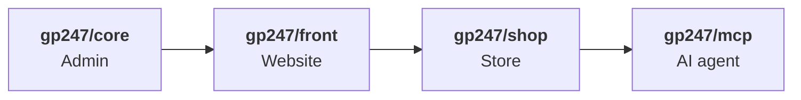
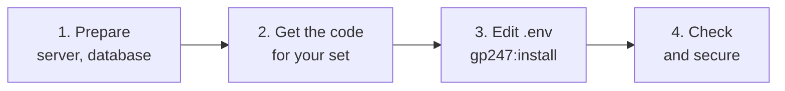
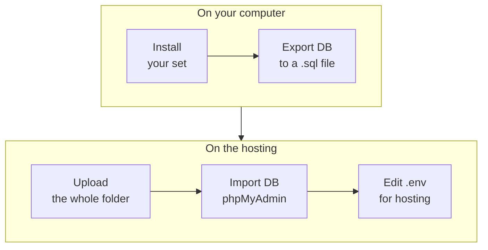

> 🌐 **Language:** [🇻🇳 Tiếng Việt](./install_vi.md) · 🇬🇧 English (current) · [🇯🇵 日本語](./install_ja.md)

# Installing GP247 and S-Cart

## Introduction
This page explains how to install a **brand-new** site on the GP247 3.x line: a full S-Cart store, a GP247 CMS content
website, or just the GP247 admin added to your own Laravel app. It is written for site owners, operators and developers; every
command can be copied and run as is. After reading it you will have picked the right package set, have a working site, and have
done the first security tasks.

## Pick the right page
Three pages cover three different situations, and **the commands on this page do not work for the other two**:

| Your situation | Read |
| --- | --- |
| No site yet, you want to create one | **Installing GP247 and S-Cart** (this page) |
| Site running the **3.x** line, you want a newer release | [Updating GP247 and S-Cart](./update.md) |
| Site running the **2.x** line or older | [Upgrading to the 3.x line](./upgrade.md) |

> ⚠️ **Warning:** the install command **recreates tables and deletes data**. Never run it on a site that is in use.

## Choose a package set
GP247 is made of four packages stacked on each other; each one needs the one before it:



- **`gp247/core`** — the admin panel, users, permissions, configuration, plugins.
- **`gp247/front`** — the website: pages, news, menus, banners, templates.
- **`gp247/shop`** — products, cart, orders, payment, shipping.
- **`gp247/mcp`** — lets AI agents (Claude, Cursor…) work with the store.

Choose the set for what you need to do:

| You need | Set | Packages | Install with |
| --- | --- | --- | --- |
| A full **online store** | **S-Cart** | core + front + shop + mcp | `composer create-project gp247/s-cart` |
| A **content website** (pages, news, templates, plugins) | **GP247 CMS** | core + front | `composer create-project gp247/cms` |
| An **admin panel** for your Laravel app | **Core only** | core | `composer require gp247/core` in a Laravel project |
| A website / store inside an **existing Laravel project** | Build your own | core + front (+ shop) | `composer require` each package |

- **One install command for every set** — each set ends with `php artisan gp247:install`. The command detects which packages
  are present and installs them in the right order: core → front → shop → mcp.
- **You can add packages later** — for example a CMS site that starts selling adds `gp247/shop`, see
  [Add front or shop to an existing site](#add-front-or-shop-to-an-existing-site).

## At a glance
Every set goes through four stages:



**Command summary** — for experienced users; pick **one** line in stage 2:

```bash
# Stage 2 — get the code (pick one)
composer create-project gp247/s-cart my-site "^3.0"     # S-Cart
composer create-project gp247/cms my-site "^3.0"        # GP247 CMS
# (Core only: inside an existing Laravel project) composer require gp247/core

# Stage 3 — set DB_*, APP_URL in .env, then:
cd my-site
php artisan gp247:install

# Stage 4
php artisan gp247:doctor
```

- **The first admin account is `admin` / `admin`** — everyone knows it, so replace it in stage 4.
- **Stage 4 still matters** — check and secure the site before opening it to users.

## On this page
- [Before you start](#before-you-start) — system requirements and what to have ready
- [Steps: S-Cart](#steps-s-cart) — online store, every step
- [Steps: GP247 CMS](#steps-gp247-cms) — content website
- [Steps: add GP247 to a Laravel project](#steps-add-gp247-to-a-laravel-project) — core only, or your own combination
- [Other setups: Git, Docker, hosting without a command line](#other-setups-git-docker-hosting-without-a-command-line) — what differs from the standard steps
- [Check the result and secure the site](#check-the-result-and-secure-the-site) — right after installing
- [Troubleshooting](#troubleshooting) — symptoms and fixes

## Before you start
With everything below ready, the install command runs through in one go.

**System requirements** (the same for every set; with Docker skip this — the containers already have it):

| Component | Requirement |
| --- | --- |
| PHP | **8.3 or newer** |
| PHP extensions | `pdo`, `pdo_mysql`, `mbstring`, `gd`, `fileinfo`, `xml`, `zip` (plus Laravel's usual ones such as `openssl`, `ctype`, `curl`) |
| Laravel | 13 — already included in S-Cart and GP247 CMS; when building your own set, the Laravel project must be version 13 |
| Composer | 2.x — only on the machine that runs the install commands |
| Database | MySQL or MariaDB |
| Writable folders | `storage`, `bootstrap/cache`, `app/GP247`, `public/GP247`, `public/vendor`, `resources/views/vendor`, `vendor` |
| Web server | The domain's document root points to the site's `public/` folder |

No cron, queue or Node.js is needed to install and run the site; only a few optional features need them — see
[Scheduler & Queue](../system/schedule-and-queue.md).

**Have ready:**

- [ ] **An empty database** — create it in phpMyAdmin or your hosting panel; note the database name, user and password.
- [ ] **Table prefix** `GP247_DB_PREFIX` (default `gp247_`) — **cannot be changed after installing**.
- [ ] **Admin path** `GP247_ADMIN_PREFIX` (default `gp247_admin`) — can be changed at any time.

## Steps: S-Cart
The full online store: core + front + shop + MCP server.

1. Open a **Terminal** (on Windows: "Command Prompt" or the Laragon terminal) and check which PHP Composer runs on:

   ```bash
   composer diagnose
   ```

   The `PHP version` line must be **8.3 or newer**. On an older PHP, Composer silently installs S-Cart 1.x — that is why step 2
   always keeps `"^3.0"`.

2. Create the project (replace `my-site` with the folder name you want):

   ```bash
   composer create-project gp247/s-cart my-site "^3.0"
   cd my-site
   ```

   Composer creates the `.env` file and the `APP_KEY` application key for you.

3. Open the `.env` file and set it to your database and domain:

   ```env
   DB_HOST=127.0.0.1
   DB_PORT=3306
   DB_DATABASE=your_database
   DB_USERNAME=your_username
   DB_PASSWORD=your_password
   APP_URL=https://your-domain
   ```

   The `DB_HOST=mysql-local` already in the file is for Docker — for a direct install change it as above.

4. Run the install command:

   ```bash
   php artisan gp247:install
   ```

   The command shows the steps it will run and asks for confirmation — type `yes`. When it finishes, the screen prints the
   **admin path** and the login **`admin` / `admin`**.

   > ⚠️ **Warning:** everyone knows `admin` / `admin`. Replace this account right after your first login — see
   > [Check the result and secure the site](#check-the-result-and-secure-the-site).

5. *(Optional — test sites only)* load sample products, categories and articles:

   ```bash
   php artisan gp247:shop-sample
   ```

6. Point the domain's document root to the **`public/`** folder, then open your browser:

   | Page | Address |
   | --- | --- |
   | Website / store | `https://your-domain` |
   | Admin | `https://your-domain/gp247_admin` |

   Seeing the home page and being able to log in to the admin means the install worked. Continue with
   [Check the result and secure the site](#check-the-result-and-secure-the-site).

## Steps: GP247 CMS
A content website: core + front — pages, news, menus, banners, templates, plugins; **no** products, cart or orders.

1. Create the project:

   ```bash
   composer create-project gp247/cms my-site "^3.0"
   cd my-site
   ```

2. Continue with **steps 3, 4 and 6** of [S-Cart](#steps-s-cart): edit `.env`, run `php artisan gp247:install`, point the
   domain to `public/`. The install command sees that the site has only core + front and installs just those two.

To start selling later: [add the shop](#add-front-or-shop-to-an-existing-site) — no reinstall needed.

## Steps: add GP247 to a Laravel project
Use this when you already have (or create) a **Laravel 13** project and want to add GP247 to it.

### Core only
Core adds an admin panel (users, permissions, configuration, plugins) at `/gp247_admin`; it does not touch the app's existing
pages.

1. *(No project yet)* create a new Laravel project:

   ```bash
   composer create-project laravel/laravel my-site
   cd my-site
   ```

2. Add the core package — it registers itself with Laravel, nothing else to declare:

   ```bash
   composer require gp247/core
   ```

3. Set the database part of `.env` as in [step 3 of S-Cart](#steps-s-cart). If there is no `APP_KEY` yet, run
   `php artisan key:generate`.

4. Install:

   ```bash
   php artisan gp247:install
   ```

5. *(Recommended)* to send the app's errors through GP247's error reporting, open `bootstrap/app.php` and add inside
   `->withExceptions(function (Exceptions $exceptions) { … })`:

   ```php
   // GP247 add new
   $exceptions->report(function (\Throwable $e) {
       try {
           if (function_exists('gp247_handle_exception')) {
               gp247_handle_exception($e);
           }
       } catch (\Throwable $inner) {
           \Log::error($e->getMessage(), ['exception' => $e]);
       }
   });
   ```

6. Open `https://your-domain/gp247_admin` and log in with the account printed in step 4.

### Add front or shop to an existing site
For a core-only site (add front), or a GP247 CMS site (add shop). Unlike core, front and shop do **not** register themselves
with Laravel, so there are two extra declaration steps.

1. Add the package (shop needs front — add front first if the site does not have it):

   ```bash
   composer require gp247/front     # website
   composer require gp247/shop      # store (needs front)
   ```

2. Declare the package in `bootstrap/providers.php`, **after** the existing providers:

   ```php
   return [
       App\Providers\AppServiceProvider::class,
       GP247\Front\FrontServiceProvider::class,   // with front
       GP247\Shop\ShopServiceProvider::class,     // with shop
   ];
   ```

3. *(When adding front)* front serves the home page and the website's pages, so turn off Laravel's default web routes. In
   `bootstrap/app.php`, comment out the `web:` line:

   ```php
   ->withRouting(
       //web: __DIR__.'/../routes/web.php',
       commands: __DIR__.'/../routes/console.php',
       health: '/up',
   )
   ```

   If your app has its own routes in `routes/web.php`, move them to another file and load that file after turning this line off.

4. Install **only the part you just added** — do not rerun `gp247:install` on a site that already has data:

   ```bash
   php artisan gp247:front-install     # after adding front
   php artisan gp247:shop-install      # after adding shop
   ```

5. Run `php artisan gp247:info`: the new package's line is there. Open the home page and the admin to check.

> ⚠️ **Warning:** `gp247:front-install` and `gp247:shop-install` **recreate** that part's tables. Run them **once**, right after
> adding the package; from then on use only `gp247:update`.

## Other setups: Git, Docker, hosting without a command line
These give the same site as the standard steps; each part below only lists what differs.

### Git (S-Cart)
Replace steps 1–2 of [S-Cart](#steps-s-cart) with:

```bash
git clone https://github.com/gp247net/s-cart.git my-site
cd my-site
cp .env.example .env
composer install
php artisan key:generate
```

Then continue with **steps 3 → 6**.

### Docker (S-Cart)
The Docker setup ships with the S-Cart source: PHP, the web server and MySQL run in containers. On your own computer (dev
environment):

```bash
git clone https://github.com/gp247net/s-cart.git my-site
cd my-site
cp .env.example .env
docker compose up -d --build
docker compose exec app php artisan key:generate
docker compose exec app php artisan gp247:install
```

Open the site at <http://localhost:8000>.

- **Real server (prod)** — add `-f docker-compose.prod.yml` to **every** `docker compose` command, and edit `.env` first
  (`APP_ENV=production`, `APP_DEBUG=false`, database details, the user that runs the containers). Forgetting `-f` runs the dev
  configuration by mistake (debug on, running as root).
- **Full guide** (environment variables, where data is stored, image patching, several projects on one server):
  [S-Cart with Docker](https://github.com/gp247net/s-cart/blob/master/DOCKER.md).

### Hosting without a command line (any set)
If your hosting only has FTP and phpMyAdmin, **install everything on your own computer**, then move the code and database up:



1. On a computer with PHP 8.3+ (Laragon, XAMPP…), install your chosen set with a local database. Use **the same table prefix**
   you want on the hosting.
2. Log in to the admin on your computer to make sure the site works.
3. Export the local database to a `.sql` file (phpMyAdmin → **Export**).
4. On the hosting: create an empty database, then phpMyAdmin → **Import** the `.sql` file.
5. Upload the **whole** project folder to the hosting — including `vendor/`, `.env` and
   `storage/app/private/gp247-installed.txt` (the "installed" marker file).
6. Edit `.env` on the hosting: `DB_*` for the hosting, `APP_URL` for the domain, `APP_ENV=production`, `APP_DEBUG=false`.
   **Keep** `APP_KEY` and `GP247_ENCRYPTION_KEY` unchanged.
7. Point the domain's document root to `public/` and open the domain: seeing the home page (or the admin, for core only) means
   you are done.

## Check the result and secure the site
The freshly installed site already works, but go through this whole list **before** opening it to users:

- [ ] **Run the automatic check** — `php artisan gp247:doctor` shows no **fail** items. The admin home page has a
      **System alerts** block listing unsafe settings (visible to Administrators only).
- [ ] **Production configuration** — `APP_ENV=production`, `APP_DEBUG=false`, HTTPS:
      [Safe production configuration](../security/security-production-config.md).
- [ ] **Replace the `admin` / `admin` account** — create your own Administrator account (real email, strong password kept in a
      password manager), log in again with it, then disable or delete `admin`; turn on two-factor authentication if available:
      [Replace the `admin` / `admin` account](../security/security-accounts-and-access.md).
- [ ] **Back up the encryption keys** — copy `APP_KEY` and `GP247_ENCRYPTION_KEY` somewhere safe; losing them means losing the
      stored passwords (SMTP, payment gateways): [Encryption keys & backup](../security/security-keys-and-backup.md).
- [ ] **Email sending** — [Mail system](../system/mail-system.md).
- [ ] *(With shop)* **Store settings** — [Currency](../s-cart/tax-and-currency/currency.md) ·
      [Tax](../s-cart/tax-and-currency/tax.md) · [Payments](../s-cart/payment/payment.md) ·
      [Shipping](../s-cart/shipping/shipping.md).
- [ ] *(Optional)* Plugins / templates: [Installing Plugins & Templates](../extension/install-extension.md).

## Troubleshooting

| Symptom | Common cause | Fix |
| --- | --- | --- |
| Composer finishes, then reports `Access denied for user 'root'` | Composer ran on an old PHP and installed 1.x by mistake | Delete the new folder, switch to PHP 8.3+, install again with `"^3.0"` |
| The domain shows a file list, a 403 or a 404 | The document root does not point to `public/` | Fix it in the hosting panel / web server configuration |
| The home page is still Laravel's welcome page | Front was added but the default web routes are still on | Comment out the `web:` line in `bootstrap/app.php` ([step 3](#add-front-or-shop-to-an-existing-site)) |
| `gp247:install` installs only core although front / shop were added | The front / shop providers are not declared | Add them to `bootstrap/providers.php` ([step 2](#add-front-or-shop-to-an-existing-site)) |
| The admin returns 403 | `GP247_ADMIN_PREFIX` matches a folder name in `public/` (`vendor`, `GP247`) | Choose another name in `.env` |
| Error 500 right after installing | Missing write permission, missing extension, wrong database details | Run `php artisan gp247:doctor`, read `storage/logs/laravel.log` |
| `gp247:install` refuses to run | Run from a script / CI, so it cannot ask for confirmation | Run it in a normal Terminal; for an unattended install add `--force=1` |
| The **System alerts** block reports the default admin password | The `admin` / `admin` account is still there | Replace it following [the guide](../security/security-accounts-and-access.md) |

## Conditions & Rules (know before you act)

**When running `gp247:install`, `gp247:front-install`, `gp247:shop-install`**

- **Tables are recreated** — existing GP247 data of the installed part is deleted. That is why `gp247:install` always asks for
  confirmation (default "no") and warns when the site is **already installed**; the per-part commands are run **once**, right
  after adding the package.
- **No silent run when it cannot ask** (scripts, CI, `--json`) — `gp247:install` refuses instead of installing over a site.
  `--force=1` means you deliberately accept losing data.
- **An `admin` / `admin` account is always created** — every command-line install has it; the **System alerts** block keeps
  reminding you until you replace it.

**When combining packages**

- **The dependency order is fixed** — front needs core; shop needs core and front; the MCP server needs shop.
- **Front and shop must be declared in `bootstrap/providers.php`** — core and the MCP server register themselves.

**When choosing settings**

- **`GP247_DB_PREFIX` cannot be changed after installing** — every table already carries it.
- **Sample data (`gp247:shop-sample`) wipes the shop data** and loads demo content — test sites only.

## Q&A
**Q1: I only need a company website — do I have to install S-Cart?**

→ No. Use [GP247 CMS](#steps-gp247-cms) (core + front) — leaner, without the selling part. Add the shop later if you start selling.

**Q2: I already have a Laravel app and only want an admin panel?**

→ Install [core only](#core-only): `composer require gp247/core`, then `php artisan gp247:install`. The app's existing pages stay
as they are.

**Q3: Do I need cron or a queue?**

→ Not to install and run the site. Only a few optional features need them — see [Scheduler & Queue](../system/schedule-and-queue.md).

**Q4: Do I need the sample data?**

→ Only to try out the store. Skip it on a real site, because sample data has to be deleted by hand later.

**Q5: Are the GP247 commands different on Docker?**

→ No. Just put `docker compose exec app` (on prod also `-f docker-compose.prod.yml`) before each `php artisan` command.

**Q6: I ran `gp247:install` on a site in use by mistake — what now?**

→ Stop everything else and restore the database from the latest backup. The install command recreated the tables, so the data
only exists in the backup.

**Q7: The site is installed — how do I get newer releases later?**

→ Follow [Updating GP247 and S-Cart](./update.md): `composer update`, then `php artisan gp247:update`. Never reinstall.

---

<sub>📅 **Last updated:** 2026-11-07 · ✍️ **Author:** GP247</sub>
