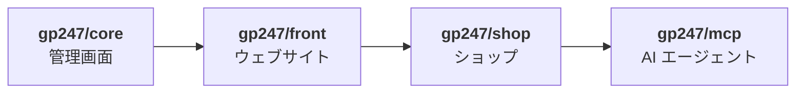
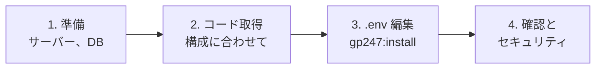
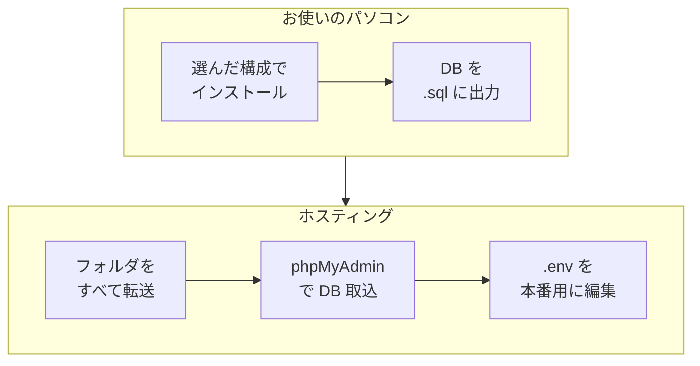

> 🌐 **言語:** [🇻🇳 Tiếng Việt](./install_vi.md) · [🇬🇧 English](./install.md) · 🇯🇵 日本語（現在）

# GP247 と S-Cart のインストール

## はじめに
このページでは、GP247 3.x 系を使うサイトを**ゼロから新しく**インストールする方法を説明します。対象のサイトは、フル機能の
S-Cart ショップ、コンテンツサイトの GP247 CMS、またはお使いの Laravel アプリケーションに GP247 の管理画面だけを組み込んだもの
のいずれかです。サイトのオーナー、運用担当者、開発者向けのドキュメントで、どのコマンドもそのままコピーすれば動きます。読み終える
と、正しいインストール構成を選び、動くサイトを用意し、最初のセキュリティ作業まで終えられます。

## ページの選び方
3 つのページはそれぞれ別の状況向けです。**このページのコマンドを、ほかの 2 つのページの作業に使うことはできません。**

| あなたの状況 | 読むページ |
| --- | --- |
| まだサイトがなく、新しく作りたい | **GP247 と S-Cart のインストール**（このページ） |
| **3.x** 系のサイトを、より新しいバージョンにしたい | [GP247 と S-Cart の更新](./update_ja.md) |
| **2.x** 系またはそれより古いサイトを運用している | [3.x 系へのアップグレード](./upgrade_ja.md) |

> ⚠️ **注意:** インストールコマンドは**テーブルを作り直し、データを削除します**。稼働中のサイトでは絶対に実行しないでください。

## インストール構成の選び方
GP247 は 4 つのパッケージが積み重なってできています。後ろのパッケージは前のパッケージを必要とします。



- **`gp247/core`** — 管理画面、ユーザー、権限、設定、プラグイン。
- **`gp247/front`** — ウェブサイトの画面: ページ、ニュース、メニュー、バナー、テンプレート。
- **`gp247/shop`** — 商品、カート、注文、決済、配送。
- **`gp247/mcp`** — AI エージェント（Claude、Cursor など）がショップを操作するための接続。

やりたいことに合わせて構成を選びます。

| やりたいこと | 構成 | 含まれるパッケージ | インストール方法 |
| --- | --- | --- | --- |
| フル機能の**オンラインショップ** | **S-Cart** | core + front + shop + mcp | `composer create-project gp247/s-cart` |
| **コンテンツサイト**（ページ、ニュース、テンプレート、プラグイン） | **GP247 CMS** | core + front | `composer create-project gp247/cms` |
| お使いの Laravel アプリケーション用の**管理画面** | **core のみ** | core | Laravel プロジェクトで `composer require gp247/core` |
| **既存の Laravel プロジェクト**にウェブサイト／ショップを組み込む | 自分で組み合わせ | core + front（+ shop） | パッケージごとに `composer require` |

- **インストールコマンドは共通** — どの構成も最後は `php artisan gp247:install` です。どのパッケージがあるかを自動で判別し、
  core → front → shop → mcp の正しい順番でインストールします。
- **パッケージは後から追加できます** — たとえば CMS サイトで販売を始めたくなったら `gp247/shop` を追加します。
  [既存サイトに front または shop を追加](#既存サイトに-front-または-shop-を追加)を参照してください。

## ひと目でわかる
どの構成も 4 つの段階を通ります。



**コマンドの要約** — 慣れている方向けです。段階 2 では**どれか 1 行**を選びます。

```bash
# 段階 2 — コードを取得（どれか 1 つ）
composer create-project gp247/s-cart my-site "^3.0"     # S-Cart
composer create-project gp247/cms my-site "^3.0"        # GP247 CMS
# （core のみ: 既存の Laravel プロジェクト内で）composer require gp247/core

# 段階 3 — .env の DB_*、APP_URL を編集してから:
cd my-site
php artisan gp247:install

# 段階 4
php artisan gp247:doctor
```

- **最初の管理者アカウントは `admin` / `admin` です** — 誰でも知っている情報なので、段階 4 ですぐに置き換えます。
- **インストール後も段階 4 が残っています** — 利用者に公開する前に、確認とセキュリティ作業を行います。

## このページの内容
- [始める前に](#始める前に) — システム要件と、用意しておくもの
- [手順: S-Cart](#手順-s-cart) — オンラインショップ、すべての手順
- [手順: GP247 CMS](#手順-gp247-cms) — コンテンツサイト
- [手順: Laravel プロジェクトに GP247 を追加](#手順-laravel-プロジェクトに-gp247-を追加) — core のみ、またはパッケージを組み合わせる
- [その他の方法: Git、Docker、コマンドラインのないホスティング](#その他の方法-gitdockerコマンドラインのないホスティング) — 標準の方法との違い
- [結果の確認とセキュリティ](#結果の確認とセキュリティ) — インストール直後に行うこと
- [問題が起きたとき](#問題が起きたとき) — 症状と対処方法

## 始める前に
以下がそろっていれば、インストールコマンドは一度で完了します。

**システム要件**（どの構成でも共通です。Docker を使う場合はコンテナに含まれているため不要です）:

| 項目 | 要件 |
| --- | --- |
| PHP | **8.3 以上** |
| PHP 拡張モジュール | `pdo`、`pdo_mysql`、`mbstring`、`gd`、`fileinfo`、`xml`、`zip`（ほかに Laravel が標準で必要とする `openssl`、`ctype`、`curl` など） |
| Laravel | 13 — S-Cart と GP247 CMS には同梱されています。自分で組み合わせる場合は Laravel 13 のプロジェクトが必要です |
| Composer | 2.x — インストールコマンドを実行するマシンにだけ必要です |
| データベース | MySQL または MariaDB |
| 書き込み可能なフォルダ | `storage`、`bootstrap/cache`、`app/GP247`、`public/GP247`、`public/vendor`、`resources/views/vendor`、`vendor` |
| Web サーバー | ドメインのドキュメントルートを、サイトの `public/` フォルダに向けます |

インストールと運用に cron、キュー、Node.js は必要ありません。一部のオプション機能だけが必要とします —
[スケジュールとキュー](../system/schedule-and-queue_ja.md)を参照してください。

**準備するもの:**

- [ ] **空のデータベース** — phpMyAdmin またはホスティングの管理画面で作成し、DB 名、ユーザー名、パスワードを控えます。
- [ ] **テーブル接頭辞** `GP247_DB_PREFIX`（既定は `gp247_`）— **インストール後は変更できません**。
- [ ] **管理画面のパス** `GP247_ADMIN_PREFIX`（既定は `gp247_admin`）— いつでも変更できます。

## 手順: S-Cart
フル機能のオンラインショップです: core + front + shop + MCP サーバー。

1. **ターミナル**（Windows では「コマンドプロンプト」または Laragon のターミナル）を開き、Composer がどの PHP で動いているかを
   確認します。

   ```bash
   composer diagnose
   ```

   `PHP version` の行が **8.3 以上**である必要があります。古い PHP だと、Composer は何も言わずに S-Cart 1.x をインストールします。
   そのため、手順 2 では必ず `"^3.0"` を付けてください。

2. プロジェクトを作成します（`my-site` は好きなフォルダ名に変えてください）。

   ```bash
   composer create-project gp247/s-cart my-site "^3.0"
   cd my-site
   ```

   Composer が `.env` ファイルとアプリケーションキー `APP_KEY` を自動で作成します。

3. `.env` ファイルを開き、お使いの DB とドメインに合わせて編集します。

   ```env
   DB_HOST=127.0.0.1
   DB_PORT=3306
   DB_DATABASE=your_database
   DB_USERNAME=your_username
   DB_PASSWORD=your_password
   APP_URL=https://your-domain
   ```

   ファイルに最初から入っている `DB_HOST=mysql-local` は Docker 用です。直接インストールする場合は上のように変更します。

4. インストールコマンドを実行します。

   ```bash
   php artisan gp247:install
   ```

   実行される手順が表示され、確認を求められます — `yes` と入力します。完了すると、**管理画面のパス**とログイン情報
   **`admin` / `admin`** が表示されます。

   > ⚠️ **注意:** `admin` / `admin` は誰でも知っている情報です。最初にログインしたら、すぐにこのアカウントを置き換えてください —
   > [結果の確認とセキュリティ](#結果の確認とセキュリティ)をご覧ください。

5. *（任意 — テスト用サイトのみ）* 商品、カテゴリ、記事のサンプルを読み込みます。

   ```bash
   php artisan gp247:shop-sample
   ```

6. ドメインのドキュメントルートを **`public/`** フォルダに向け、ブラウザで開きます。

   | ページ | アドレス |
   | --- | --- |
   | ウェブサイト／ショップ | `https://your-domain` |
   | 管理画面 | `https://your-domain/gp247_admin` |

   トップページが表示され、管理画面にログインできればインストール成功です。続けて
   [結果の確認とセキュリティ](#結果の確認とセキュリティ)を行ってください。

## 手順: GP247 CMS
コンテンツサイトです: core + front — ページ、ニュース、メニュー、バナー、テンプレート、プラグイン。商品、カート、注文は
**ありません**。

1. プロジェクトを作成します。

   ```bash
   composer create-project gp247/cms my-site "^3.0"
   cd my-site
   ```

2. 続けて [S-Cart](#手順-s-cart) の**手順 3、4、6** を行います: `.env` の編集、`php artisan gp247:install` の実行、
   ドメインを `public/` に向ける。インストールコマンドはサイトに core + front しかないことを判別し、その 2 つだけをインストールします。

後から販売を始める場合は [shop を追加](#既存サイトに-front-または-shop-を追加)します — インストールし直す必要はありません。

## 手順: Laravel プロジェクトに GP247 を追加
**Laravel 13** のプロジェクトがすでにある（または自分で作る）場合に、そこへ GP247 を組み込む方法です。

### core のみ
core は `/gp247_admin` に管理画面（ユーザー、権限、設定、プラグイン）を追加します。アプリケーションの既存のページには影響しません。

1. *（プロジェクトがない場合）* 新しい Laravel プロジェクトを作成します。

   ```bash
   composer create-project laravel/laravel my-site
   cd my-site
   ```

2. core パッケージを追加します — パッケージは Laravel に自動で登録されるため、追加の宣言は必要ありません。

   ```bash
   composer require gp247/core
   ```

3. `.env` の DB 部分を [S-Cart の手順 3](#手順-s-cart) と同じように編集します。`APP_KEY` がない場合は
   `php artisan key:generate` を実行します。

4. インストールします。

   ```bash
   php artisan gp247:install
   ```

5. *（推奨）* アプリケーションのエラーを GP247 のエラー報告の仕組みに通すため、`bootstrap/app.php` を開き、
   `->withExceptions(function (Exceptions $exceptions) { … })` の中に次を追加します。

   ```php
   // GP247 add new
   $exceptions->report(function (\Throwable $e) {
       try {
           if (function_exists('gp247_handle_exception')) {
               gp247_handle_exception($e);
           }
       } catch (\Throwable $inner) {
           \Log::error($e->getMessage(), ['exception' => $e]);
       }
   });
   ```

6. `https://your-domain/gp247_admin` を開き、手順 4 で表示されたアカウントでログインします。

### 既存サイトに front または shop を追加
core だけのサイト（front を追加）や、GP247 CMS のサイト（shop を追加）に使います。front と shop は core と違って Laravel に
自動登録**されない**ため、宣言の手順が 2 つ増えます。

1. パッケージを追加します（shop には front が必要です — サイトに front がなければ先に追加します）。

   ```bash
   composer require gp247/front     # ウェブサイト
   composer require gp247/shop      # ショップ（front が必要）
   ```

2. `bootstrap/providers.php` で、既存のプロバイダーの**後ろ**にパッケージを宣言します。

   ```php
   return [
       App\Providers\AppServiceProvider::class,
       GP247\Front\FrontServiceProvider::class,   // front がある場合
       GP247\Shop\ShopServiceProvider::class,     // shop がある場合
   ];
   ```

3. *（front を追加する場合）* front がトップページとウェブサイトの各ページを表示するため、Laravel 既定の web ルートを無効にします。
   `bootstrap/app.php` で `web:` の行をコメントアウトします。

   ```php
   ->withRouting(
       //web: __DIR__.'/../routes/web.php',
       commands: __DIR__.'/../routes/console.php',
       health: '/up',
   )
   ```

   アプリケーション独自のルートが `routes/web.php` にある場合は、この行を無効にした後、別のファイルに移して読み込み直してください。

4. **追加した部分だけ**をインストールします — データのあるサイトで `gp247:install` を再実行してはいけません。

   ```bash
   php artisan gp247:front-install     # front を追加した直後
   php artisan gp247:shop-install      # shop を追加した直後
   ```

5. `php artisan gp247:info` を実行し、追加したパッケージの行が表示されることを確認します。トップページと管理画面を開いて確認します。

> ⚠️ **注意:** `gp247:front-install` と `gp247:shop-install` は、その部分の**テーブルを作り直します**。パッケージを追加した直後に
> **1 回だけ**実行し、以降は `gp247:update` だけを使ってください。

## その他の方法: Git、Docker、コマンドラインのないホスティング
これらの方法でも、標準の方法と同じサイトができます。以下の各項目には、違う部分だけを書いています。

### Git（S-Cart）
[S-Cart](#手順-s-cart) の手順 1〜2 を次に置き換えます。

```bash
git clone https://github.com/gp247net/s-cart.git my-site
cd my-site
cp .env.example .env
composer install
php artisan key:generate
```

その後、**手順 3 → 6** を続けます。

### Docker（S-Cart）
Docker 一式は S-Cart のソースコードに含まれており、PHP、Web サーバー、MySQL をコンテナで動かします。お使いのマシン
（開発環境）では:

```bash
git clone https://github.com/gp247net/s-cart.git my-site
cd my-site
cp .env.example .env
docker compose up -d --build
docker compose exec app php artisan key:generate
docker compose exec app php artisan gp247:install
```

<http://localhost:8000> でサイトを開きます。

- **本番サーバー（prod）** — **すべての** `docker compose` コマンドに `-f docker-compose.prod.yml` を付け、事前に `.env` を編集します
  （`APP_ENV=production`、`APP_DEBUG=false`、DB 情報、コンテナを実行するユーザー）。`-f` を忘れると、開発用の設定（デバッグ有効、
  root 権限での実行）で動いてしまいます。
- **詳しいガイド**（環境変数、データの保存場所、イメージの更新、1 台のサーバーで複数プロジェクト）:
  [S-Cart with Docker](https://github.com/gp247net/s-cart/blob/master/DOCKER.md)（英語）。

### コマンドラインのないホスティング（すべての構成）
FTP と phpMyAdmin しかないホスティングでは、**お使いのパソコンで完全にインストール**してから、コードと DB を移します。



1. PHP 8.3 以上のパソコン（Laragon、XAMPP など）で、選んだ構成をローカルの DB にインストールします。ホスティングで使いたい
   **テーブル接頭辞と同じもの**を使ってください。
2. パソコン上の管理画面にログインし、サイトが動くことを確認します。
3. ローカルの DB を `.sql` ファイルに出力します（phpMyAdmin → **エクスポート**）。
4. ホスティングで空の DB を作り、phpMyAdmin → **インポート**で `.sql` ファイルを取り込みます。
5. プロジェクトのフォルダを**丸ごと**ホスティングに転送します — `vendor/`、`.env`、`storage/app/private/gp247-installed.txt`
   （「インストール済み」を示すファイル）も含めます。
6. ホスティング上の `.env` を編集します: `DB_*` をホスティングの値に、`APP_URL` をドメインに、`APP_ENV=production`、
   `APP_DEBUG=false`。`APP_KEY` と `GP247_ENCRYPTION_KEY` は**そのまま**にします。
7. ドメインのドキュメントルートを `public/` に向けてドメインを開きます。トップページ（core のみの構成では管理画面）が
   表示されれば完了です。

## 結果の確認とセキュリティ
インストール直後のサイトはすでに動きますが、利用者に公開する**前に**このリストをすべて済ませてください。

- [ ] **自動チェックを実行** — `php artisan gp247:doctor` に **fail** の項目がないこと。管理画面のトップには、安全でない設定を
      一覧表示する「**システムアラート**」ブロックがあります（Administrator だけに表示されます）。
- [ ] **本番環境の設定** — `APP_ENV=production`、`APP_DEBUG=false`、HTTPS で運用:
      [安全な本番環境の設定](../security/security-production-config_ja.md)。
- [ ] **アカウント `admin` / `admin` を置き換える** — 自分用の Administrator アカウント（実際のメールアドレス、パスワード
      マネージャーに保存した強いパスワード）を作成し、新しいアカウントでログインし直してから、`admin` を無効化または削除します。
      可能なら二要素認証も有効にします: [アカウント `admin` / `admin` の置き換え](../security/security-accounts-and-access_ja.md#旧バージョンからインストールしたサイトアカウント-admin--admin-を置き換える)。
- [ ] **暗号化キーのバックアップ** — `APP_KEY` と `GP247_ENCRYPTION_KEY` を安全な場所に控えます。鍵を失うと、保存済みのパスワード
      （SMTP、決済ゲートウェイ）も失われます: [暗号化キーとバックアップ](../security/security-keys-and-backup_ja.md)。
- [ ] **メール送信** — [メール送信システム](../system/mail-system_ja.md)。
- [ ] *（shop あり）* **ショップの設定** — [通貨](../s-cart/tax-and-currency/currency_ja.md) ·
      [税](../s-cart/tax-and-currency/tax_ja.md) · [決済](../s-cart/payment/payment_ja.md) ·
      [配送](../s-cart/shipping/shipping_ja.md)。
- [ ] *（任意）* プラグイン／テンプレート: [プラグインとテンプレートのインストール](../extension/install-extension_ja.md)。

## 問題が起きたとき

| 症状 | よくある原因 | 対処方法 |
| --- | --- | --- |
| Composer の完了後に `Access denied for user 'root'` と表示される | Composer が古い PHP で動き、1.x を誤ってインストールした | 作成したフォルダを削除し、PHP 8.3 以上に切り替えて `"^3.0"` 付きで再インストール |
| ドメインを開くとファイル一覧、403 や 404 エラーが表示される | ドメインのドキュメントルートが `public/` を向いていない | ホスティングの管理画面／Web サーバーの設定で修正 |
| トップページが Laravel のウェルカムページのまま | front を追加したが、既定の web ルートが有効なまま | `bootstrap/app.php` の `web:` の行をコメントアウト（[手順 3](#既存サイトに-front-または-shop-を追加)） |
| front／shop を追加したのに `gp247:install` が core しかインストールしない | front／shop のプロバイダーを宣言していない | `bootstrap/providers.php` に追加（[手順 2](#既存サイトに-front-または-shop-を追加)） |
| 管理画面が 403 になる | `GP247_ADMIN_PREFIX` が `public/` 内のフォルダ名（`vendor`、`GP247`）と同じ | `.env` で別の名前を設定 |
| インストール直後に 500 エラー | フォルダの書き込み権限不足、拡張モジュール不足、DB 情報の誤り | `php artisan gp247:doctor` を実行し、`storage/logs/laravel.log` を確認 |
| `gp247:install` が実行を拒否する | スクリプト／CI で実行していて確認に答えられない | 通常のターミナルで実行。自動インストールなら `--force=1` を付ける |
| 「**システムアラート**」ブロックが既定の管理者パスワードを警告する | アカウント `admin` / `admin` が残っている | [手順](../security/security-accounts-and-access_ja.md#旧バージョンからインストールしたサイトアカウント-admin--admin-を置き換える)に沿って置き換える |

## 条件と制約（操作の前に確認）

**`gp247:install`、`gp247:front-install`、`gp247:shop-install` を実行するとき**

- **テーブルを作り直します** — インストール対象部分の既存の GP247 データは削除されます。そのため `gp247:install` は必ず確認を求め
  （既定は「いいえ」）、サイトが**インストール済み**の場合は警告します。部分ごとのインストールコマンドは、パッケージを追加した
  直後に **1 回だけ**使います。
- **確認に答えられない環境では自動実行しません**（スクリプト、CI、`--json`）— `gp247:install` は上書きインストールせずに拒否します。
  `--force=1` は、データが失われることを自分で受け入れるという意味です。
- **アカウント `admin` / `admin` が必ず作成されます** — コマンドラインでインストールしたサイトにはすべてこのアカウントがあり、
  置き換えるまで「**システムアラート**」ブロックが知らせ続けます。

**パッケージを組み合わせるとき**

- **依存関係の順番は固定です** — front には core が、shop には core と front が、MCP サーバーには shop が必要です。
- **front と shop は `bootstrap/providers.php` での宣言が必要です** — core と MCP サーバーは自動で登録されます。

**設定を選ぶとき**

- **`GP247_DB_PREFIX` はインストール後に変更できません** — すべてのテーブルにこの接頭辞が付いています。
- **サンプルデータ（`gp247:shop-sample`）は shop のデータを削除**してからデモデータを読み込みます — テスト用サイトだけで使ってください。

## よくある質問（Q&A）
**Q1: 会社紹介のウェブサイトだけが必要です。S-Cart をインストールする必要がありますか？**

→ いいえ。[GP247 CMS](#手順-gp247-cms)（core + front）を使ってください — 販売機能がない分、すっきりしています。後から販売が必要に
なったら shop を追加します。

**Q2: Laravel アプリケーションがすでにあり、管理画面だけを追加したいのですが？**

→ [core のみ](#core-のみ)をインストールします: `composer require gp247/core` の後に `php artisan gp247:install`。アプリケーションの
既存のページはそのまま残ります。

**Q3: cron やキューの設定は必要ですか？**

→ インストールと運用には不要です。一部のオプション機能だけが必要とします — [スケジュールとキュー](../system/schedule-and-queue_ja.md)を
参照してください。

**Q4: サンプルデータは必要ですか？**

→ ショップを試しに見るためだけのものです。本番サイトでは使わないでください。サンプルデータは後から手作業で削除する必要があります。

**Q5: Docker でのインストールでは、GP247 のコマンドに違いはありますか？**

→ ありません。各 `php artisan` コマンドの前に `docker compose exec app`（本番では `-f docker-compose.prod.yml` も）を付けるだけです。

**Q6: 稼働中のサイトで `gp247:install` を実行してしまいました。どうすればよいですか？**

→ ほかの操作をすべて止め、最新のバックアップから DB を復元してください。インストールコマンドがテーブルを作り直したため、
データはバックアップにしか残っていません。

**Q7: インストールした後、新しいバージョンにするにはどうしますか？**

→ [GP247 と S-Cart の更新](./update_ja.md)のとおり、`composer update` の後に `php artisan gp247:update` を実行します。
インストールし直すことは決してありません。

---

<sub>📅 **最終更新:** 2026-11-07 · ✍️ **作成者 (Author):** GP247</sub>
