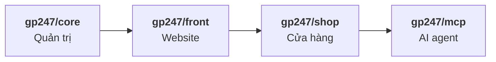
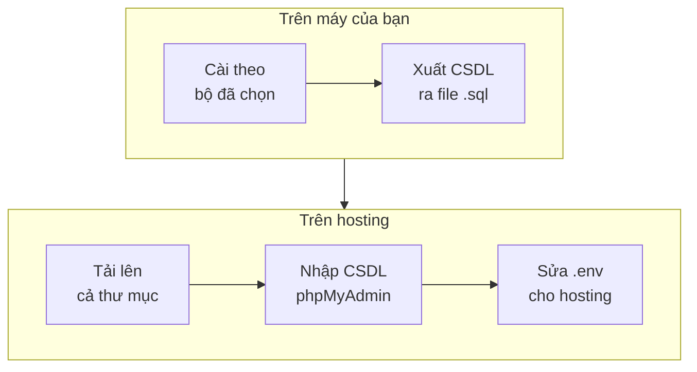

> 🌐 **Ngôn ngữ:** 🇻🇳 Tiếng Việt (hiện tại) · [🇬🇧 English](./install.md) · [🇯🇵 日本語](./install_ja.md)

# Cài đặt GP247 và S-Cart

## Giới thiệu
Trang này hướng dẫn cài **mới từ đầu** một site dùng GP247 dòng 3.x. Site đó có thể là cửa hàng S-Cart đầy đủ, website nội
dung GP247 CMS, hoặc chỉ phần quản trị GP247 gắn vào ứng dụng Laravel của bạn. Tài liệu dành cho chủ site, người vận hành và
lập trình viên; lệnh nào cũng copy nguyên là chạy được. Đọc xong, bạn chọn được đúng bộ cài, có một site chạy được, và đã làm
xong các việc bảo mật đầu tiên.

## Chọn đúng trang
Ba trang dùng cho ba tình huống khác nhau, và **lệnh của trang này không dùng được cho hai trang kia**:

| Tình huống của bạn | Đọc trang |
| --- | --- |
| Chưa có site, muốn tạo site mới | **Cài đặt GP247 và S-Cart** (trang này) |
| Site đang chạy dòng **3.x**, muốn lên bản mới hơn | [Cập nhật GP247 và S-Cart](./update_vi.md) |
| Site đang chạy dòng **2.x** hoặc cũ hơn | [Nâng cấp lên dòng 3.x](./upgrade_vi.md) |

> ⚠️ **Lưu ý:** lệnh cài đặt **tạo lại bảng và xoá dữ liệu**. Không bao giờ chạy nó trên site đang hoạt động.

## Chọn bộ cài đặt
GP247 gồm bốn gói xếp chồng lên nhau; gói sau cần gói trước:



- **`gp247/core`** — trang quản trị, người dùng, phân quyền, cấu hình, plugin.
- **`gp247/front`** — giao diện website: trang, tin tức, menu, banner, template.
- **`gp247/shop`** — sản phẩm, giỏ hàng, đơn hàng, thanh toán, vận chuyển.
- **`gp247/mcp`** — cho AI agent (Claude, Cursor…) làm việc với cửa hàng.

Chọn bộ theo việc bạn cần làm:

| Bạn cần | Bộ cài | Gồm gói | Cài bằng |
| --- | --- | --- | --- |
| **Cửa hàng online** đầy đủ | **S-Cart** | core + front + shop + mcp | `composer create-project gp247/s-cart` |
| **Website nội dung** (trang, tin tức, giao diện, plugin) | **GP247 CMS** | core + front | `composer create-project gp247/cms` |
| **Trang quản trị** cho ứng dụng Laravel của bạn | **Chỉ core** | core | `composer require gp247/core` vào dự án Laravel |
| Gắn website / cửa hàng vào **dự án Laravel đang có** | Tự ghép | core + front (+ shop) | `composer require` từng gói |

- **Dùng chung một lệnh cài** — mọi bộ đều kết thúc bằng `php artisan gp247:install`. Lệnh tự nhận ra gói nào đang có và cài
  theo đúng thứ tự core → front → shop → mcp.
- **Thêm gói về sau được** — ví dụ site CMS muốn bán hàng thì thêm `gp247/shop`, xem
  [Thêm front hoặc shop vào site đang có](#thêm-front-hoặc-shop-vào-site-đang-có).

## Nhìn nhanh
Bộ cài nào cũng đi qua bốn chặng:


**Lệnh tóm tắt** — dành cho người đã quen; chọn **một** dòng ở chặng 2:

```bash
# Chặng 2 — lấy code (chọn một)
composer create-project gp247/s-cart my-site "^3.0"     # S-Cart
composer create-project gp247/cms my-site "^3.0"        # GP247 CMS
# (Chỉ core: trong dự án Laravel có sẵn) composer require gp247/core

# Chặng 3 — sửa DB_*, APP_URL trong .env, rồi:
cd my-site
php artisan gp247:install

# Chặng 4
php artisan gp247:doctor
```

- **Tài khoản quản trị đầu tiên là `admin` với mật khẩu ngẫu nhiên** — mật khẩu **chỉ hiện một lần**, ở cuối lệnh
  `gp247:install`. Chép lại ngay, vì đóng Terminal là không xem lại được.
- **Cài xong còn chặng 4** — kiểm tra và bảo mật, trước khi mở site cho người dùng.

## Trong trang này
- [Trước khi bắt đầu](#trước-khi-bắt-đầu) — yêu cầu hệ thống và những thứ cần có sẵn
- [Các bước: S-Cart](#các-bước-s-cart) — cửa hàng online, đầy đủ từng bước
- [Các bước: GP247 CMS](#các-bước-gp247-cms) — website nội dung
- [Các bước: thêm GP247 vào dự án Laravel](#các-bước-thêm-gp247-vào-dự-án-laravel) — chỉ core, hoặc tự ghép gói
- [Cách khác: Git, Docker, hosting không có dòng lệnh](#cách-khác-git-docker-hosting-không-có-dòng-lệnh) — chỗ khác với cách chuẩn
- [Kiểm tra kết quả và bảo mật](#kiểm-tra-kết-quả-và-bảo-mật) — làm ngay sau khi cài
- [Khi gặp sự cố](#khi-gặp-sự-cố) — triệu chứng và cách xử lý

## Trước khi bắt đầu
Có đủ các thứ dưới đây thì lệnh cài chạy một lượt là xong.

**Yêu cầu hệ thống** (giống nhau cho mọi bộ cài; dùng Docker thì bỏ qua — container đã có sẵn):

| Thành phần | Yêu cầu |
| --- | --- |
| PHP | **8.3 trở lên** |
| PHP extension | `pdo`, `pdo_mysql`, `mbstring`, `gd`, `fileinfo`, `xml`, `zip` (cùng các extension mặc định Laravel cần như `openssl`, `ctype`, `curl`) |
| Laravel | 13 — bộ S-Cart và GP247 CMS đã kèm sẵn; tự ghép thì dự án Laravel phải là bản 13 |
| Composer | 2.x — chỉ cần ở máy chạy lệnh cài |
| Cơ sở dữ liệu | MySQL hoặc MariaDB |
| Thư mục ghi được | `storage`, `bootstrap/cache`, `app/GP247`, `public/GP247`, `public/vendor`, `resources/views/vendor`, `vendor` |
| Web server | Thư mục gốc của tên miền (document root) trỏ vào thư mục `public/` của site |

Không cần cron, queue hay Node.js để cài và vận hành; chỉ vài tính năng tuỳ chọn mới cần — xem
[Lịch chạy & Hàng đợi](../system/schedule-and-queue_vi.md).

**Chuẩn bị:**

- [ ] **Một cơ sở dữ liệu rỗng** — tạo trong phpMyAdmin hoặc trang quản lý hosting; ghi lại tên CSDL, người dùng, mật khẩu.
- [ ] **Tiền tố bảng** `GP247_DB_PREFIX` (mặc định `gp247_`) — **không đổi được sau khi cài**.
- [ ] **Đường dẫn quản trị** `GP247_ADMIN_PREFIX` (mặc định `gp247_admin`) — đổi lúc nào cũng được.

## Các bước: S-Cart
Cửa hàng online đầy đủ: core + front + shop + MCP server.

1. Mở **Terminal** (trên Windows: "Command Prompt" hoặc terminal của Laragon), kiểm tra Composer đang chạy PHP bản nào:

   ```bash
   composer diagnose
   ```

   Dòng `PHP version` phải là **8.3 trở lên**. PHP cũ hơn thì Composer lặng lẽ cài S-Cart 1.x — vì vậy luôn giữ `"^3.0"` ở bước 2.

2. Tạo dự án (đổi `my-site` thành tên thư mục bạn muốn):

   ```bash
   composer create-project gp247/s-cart my-site "^3.0"
   cd my-site
   ```

   Composer tự tạo file `.env` và khoá ứng dụng `APP_KEY`.

3. Mở file `.env`, sửa cho khớp CSDL và tên miền của bạn:

   ```env
   DB_HOST=127.0.0.1
   DB_PORT=3306
   DB_DATABASE=ten_csdl
   DB_USERNAME=ten_nguoi_dung
   DB_PASSWORD=mat_khau
   APP_URL=https://ten-mien-cua-ban
   ```

   `DB_HOST=mysql-local` có sẵn trong file là dành cho Docker — cài trực tiếp thì đổi như trên.

4. Chạy lệnh cài đặt:

   ```bash
   php artisan gp247:install
   ```

   Lệnh hiện các bước sẽ chạy và hỏi xác nhận — gõ `yes`. Khi cài xong, **khối cuối cùng** trên màn hình in **đường dẫn quản
   trị**, tên đăng nhập **`admin`** và một **mật khẩu ngẫu nhiên**.

   > ⚠️ **Lưu ý:** mật khẩu này **chỉ hiện một lần**, ngay khi cài thành công. GP247 không lưu bản đọc được ở đâu và không in
   > lại. Chép vào trình quản lý mật khẩu **trước khi** đóng Terminal, rồi làm tiếp
   > [Kiểm tra kết quả và bảo mật](#kiểm-tra-kết-quả-và-bảo-mật). Muốn tự chọn mật khẩu (12–64 ký tự) thì chạy
   > `php artisan gp247:install --admin-password="..."` — nhớ rằng Terminal lưu lại lệnh này trong lịch sử.

   > ℹ️ **Có từ:** gp247/core 3.11.0 — bản cũ hơn tạo tài khoản `admin` / `admin`.

5. *(Tuỳ chọn — chỉ cho site thử)* nạp sản phẩm, danh mục, bài viết mẫu:

   ```bash
   php artisan gp247:shop-sample
   ```

6. Trỏ thư mục gốc của tên miền vào thư mục **`public/`**, rồi mở trình duyệt:

   | Trang | Địa chỉ |
   | --- | --- |
   | Website / cửa hàng | `https://ten-mien-cua-ban` |
   | Quản trị | `https://ten-mien-cua-ban/gp247_admin` |

   Thấy trang chủ và đăng nhập được trang quản trị là cài thành công. Làm tiếp
   [Kiểm tra kết quả và bảo mật](#kiểm-tra-kết-quả-và-bảo-mật).

## Các bước: GP247 CMS
Website nội dung: core + front — trang, tin tức, menu, banner, giao diện, plugin; **không** có sản phẩm, giỏ hàng, đơn hàng.

1. Tạo dự án:

   ```bash
   composer create-project gp247/cms my-site "^3.0"
   cd my-site
   ```

2. Làm tiếp **bước 3, 4 và 6** của [S-Cart](#các-bước-s-cart): sửa `.env`, chạy `php artisan gp247:install`, trỏ tên miền vào
   `public/`. Lệnh cài tự nhận ra site chỉ có core + front và chỉ cài hai phần này.

Muốn bán hàng về sau: [thêm shop](#thêm-front-hoặc-shop-vào-site-đang-có) — không phải cài lại.

## Các bước: thêm GP247 vào dự án Laravel
Dùng khi bạn đã có (hoặc tự tạo) một dự án **Laravel 13**, và muốn gắn GP247 vào đó.

### Chỉ core
Core thêm trang quản trị (người dùng, phân quyền, cấu hình, plugin) ở `/gp247_admin`; không đụng tới các trang hiện có của ứng
dụng.

1. *(Chưa có dự án)* tạo một dự án Laravel mới:

   ```bash
   composer create-project laravel/laravel my-site
   cd my-site
   ```

2. Thêm gói core — gói tự đăng ký vào Laravel, không phải khai báo gì thêm:

   ```bash
   composer require gp247/core
   ```

3. Sửa phần CSDL trong `.env` như [bước 3 của S-Cart](#các-bước-s-cart). Chưa có `APP_KEY` thì chạy `php artisan key:generate`.

4. Cài đặt:

   ```bash
   php artisan gp247:install
   ```

5. *(Khuyến nghị)* để lỗi của ứng dụng đi qua cơ chế báo lỗi của GP247, mở `bootstrap/app.php`, thêm vào trong
   `->withExceptions(function (Exceptions $exceptions) { … })`:

   ```php
   // GP247 add new
   $exceptions->report(function (\Throwable $e) {
       try {
           if (function_exists('gp247_handle_exception')) {
               gp247_handle_exception($e);
           }
       } catch (\Throwable $inner) {
           \Log::error($e->getMessage(), ['exception' => $e]);
       }
   });
   ```

6. Mở `https://ten-mien-cua-ban/gp247_admin` và đăng nhập bằng tài khoản in ra ở bước 4.

### Thêm front hoặc shop vào site đang có
Áp dụng cho site chỉ có core (thêm front), hoặc site GP247 CMS (thêm shop). Front và shop **không** tự đăng ký vào Laravel như
core, nên có thêm hai bước khai báo.

1. Thêm gói (shop cần front — thêm front trước nếu site chưa có):

   ```bash
   composer require gp247/front     # website
   composer require gp247/shop      # cửa hàng (cần front)
   ```

2. Khai báo gói trong `bootstrap/providers.php`, **sau** các provider đang có:

   ```php
   return [
       App\Providers\AppServiceProvider::class,
       GP247\Front\FrontServiceProvider::class,   // khi có front
       GP247\Shop\ShopServiceProvider::class,     // khi có shop
   ];
   ```

3. *(Khi thêm front)* front phục vụ trang chủ và các trang của website, nên tắt route web mặc định của Laravel. Trong
   `bootstrap/app.php`, comment dòng `web:`:

   ```php
   ->withRouting(
       //web: __DIR__.'/../routes/web.php',
       commands: __DIR__.'/../routes/console.php',
       health: '/up',
   )
   ```

   Route riêng của ứng dụng đang nằm trong `routes/web.php` thì chuyển sang file khác và nạp lại sau khi tắt dòng này.

4. Cài **chỉ phần vừa thêm** — không chạy lại `gp247:install` trên site đã có dữ liệu:

   ```bash
   php artisan gp247:front-install     # khi vừa thêm front
   php artisan gp247:shop-install      # khi vừa thêm shop
   ```

5. Chạy `php artisan gp247:info`: dòng của gói vừa thêm đã xuất hiện. Mở trang chủ và trang quản trị để kiểm tra.

> ⚠️ **Lưu ý:** `gp247:front-install` và `gp247:shop-install` **tạo lại bảng** của phần đó. Chỉ chạy **một lần** khi vừa thêm
> gói; về sau chỉ dùng `gp247:update`.

## Cách khác: Git, Docker, hosting không có dòng lệnh
Ba cách này cho ra cùng một site như cách chuẩn; mỗi mục dưới đây chỉ ghi chỗ khác.

### Git (S-Cart)
Thay bước 1–2 của [S-Cart](#các-bước-s-cart) bằng:

```bash
git clone https://github.com/gp247net/s-cart.git my-site
cd my-site
cp .env.example .env
composer install
php artisan key:generate
```

Rồi làm tiếp **bước 3 → 6**.

### Docker (S-Cart)
Bộ Docker có sẵn trong mã nguồn S-Cart: chạy sẵn PHP, web server và MySQL trong container. Trên máy của bạn (môi trường dev):

```bash
git clone https://github.com/gp247net/s-cart.git my-site
cd my-site
cp .env.example .env
docker compose up -d --build
docker compose exec app php artisan key:generate
docker compose exec app php artisan gp247:install
```

Mở site tại <http://localhost:8000>.

- **Máy chủ thật (prod)** — thêm `-f docker-compose.prod.yml` vào **mọi** lệnh `docker compose`, và sửa `.env` trước
  (`APP_ENV=production`, `APP_DEBUG=false`, thông tin CSDL, người dùng chạy container). Quên `-f` là chạy nhầm cấu hình dev
  (bật debug, chạy quyền root).
- **Hướng dẫn đầy đủ** (biến môi trường, dữ liệu lưu ở đâu, vá image, nhiều dự án một máy chủ):
  [S-Cart với Docker](https://github.com/gp247net/s-cart/blob/master/DOCKER_vi.md).

### Hosting không có dòng lệnh (mọi bộ cài)
Hosting chỉ có FTP và phpMyAdmin thì **cài trọn vẹn trên máy tính của bạn**, rồi chuyển code và CSDL lên:



1. Trên máy tính có PHP 8.3+ (Laragon, XAMPP…), cài theo bộ bạn đã chọn với một CSDL cục bộ. Dùng **đúng tiền tố bảng** bạn
   muốn có trên hosting.
2. Đăng nhập trang quản trị ở máy bạn để chắc chắn site chạy.
3. Xuất CSDL cục bộ ra file `.sql` (phpMyAdmin → **Export**).
4. Trên hosting: tạo CSDL rỗng, phpMyAdmin → **Import** file `.sql`.
5. Tải **toàn bộ** thư mục dự án lên hosting — gồm cả `vendor/`, `.env` và `storage/app/private/gp247-installed.txt`
   (file đánh dấu "đã cài").
6. Sửa `.env` trên hosting: `DB_*` theo hosting, `APP_URL` theo tên miền, `APP_ENV=production`, `APP_DEBUG=false`.
   **Giữ nguyên** `APP_KEY` và `GP247_ENCRYPTION_KEY`.
7. Trỏ thư mục gốc của tên miền vào `public/`, mở tên miền: thấy trang chủ (hoặc trang quản trị, với bộ chỉ core) là xong.

## Kiểm tra kết quả và bảo mật
Site vừa cài đã chạy được, nhưng làm hết danh sách này **trước khi** mở cho người dùng:

- [ ] **Chạy kiểm tra tự động** — `php artisan gp247:doctor` không còn mục **fail**. Trang chủ quản trị có khối
      **Cảnh báo hệ thống** liệt kê cấu hình chưa an toàn (chỉ Administrator thấy).
- [ ] **Cấu hình production** — `APP_ENV=production`, `APP_DEBUG=false`, chạy HTTPS:
      [Cấu hình production](../security/security-production-config_vi.md).
- [ ] **Giữ an toàn tài khoản quản trị** — đăng nhập bằng `admin` và mật khẩu lệnh cài vừa in ra, đổi email sang email thật
      (**Thiết lập tài khoản** ở góc trên), cất mật khẩu vào trình quản lý mật khẩu; bật xác thực hai lớp nếu có:
      [Tài khoản quản trị đầu tiên](../security/security-accounts-and-access_vi.md#tài-khoản-quản-trị-đầu-tiên).
- [ ] **Sao lưu khoá mã hoá** — chép `APP_KEY` và `GP247_ENCRYPTION_KEY` ra nơi an toàn; mất khoá là mất các mật khẩu đã lưu
      (SMTP, cổng thanh toán): [Khoá mã hoá & sao lưu](../security/security-keys-and-backup_vi.md).
- [ ] **Gửi mail** — [Hệ thống gửi mail](../system/mail-system_vi.md).
- [ ] *(Có shop)* **Cấu hình cửa hàng** — [Tiền tệ](../s-cart/tax-and-currency/currency_vi.md) ·
      [Thuế](../s-cart/tax-and-currency/tax_vi.md) · [Thanh toán](../s-cart/payment/payment_vi.md) ·
      [Vận chuyển](../s-cart/shipping/shipping_vi.md).
- [ ] *(Tuỳ chọn)* Plugin / giao diện: [Cài đặt Plugin & Template](../extension/install-extension_vi.md).

## Khi gặp sự cố

| Triệu chứng | Nguyên nhân thường gặp | Cách xử lý |
| --- | --- | --- |
| Composer xong rồi báo `Access denied for user 'root'` | Composer chạy PHP cũ, đã cài nhầm bản 1.x | Xoá thư mục vừa tạo, chuyển sang PHP 8.3+, cài lại với `"^3.0"` |
| Mở tên miền thấy danh sách file, lỗi 403 hoặc 404 | Thư mục gốc của tên miền chưa trỏ vào `public/` | Sửa trong trang quản lý hosting / cấu hình web server |
| Trang chủ vẫn là trang chào mừng của Laravel | Đã thêm front nhưng route web mặc định còn bật | Comment dòng `web:` trong `bootstrap/app.php` ([bước 3](#thêm-front-hoặc-shop-vào-site-đang-có)) |
| `gp247:install` chỉ cài core dù đã thêm front / shop | Chưa khai báo provider của front / shop | Thêm vào `bootstrap/providers.php` ([bước 2](#thêm-front-hoặc-shop-vào-site-đang-có)) |
| Trang quản trị báo 403 | `GP247_ADMIN_PREFIX` trùng tên thư mục trong `public/` (`vendor`, `GP247`) | Đặt tên khác trong `.env` |
| Lỗi 500 ngay sau khi cài | Thiếu quyền ghi thư mục, thiếu extension, sai thông tin CSDL | Chạy `php artisan gp247:doctor`, xem `storage/logs/laravel.log` |
| Mở tên miền thấy trang "This site is not installed yet" | Chưa chạy `gp247:install`, hoặc khi chuyển site lên hosting đã thiếu file đánh dấu `storage/app/private/gp247-installed.txt` | Chạy `php artisan gp247:install`; hosting không có dòng lệnh thì tải lên cả file đánh dấu ([cách làm](#hosting-không-có-dòng-lệnh-mọi-bộ-cài)) |
| `gp247:install` từ chối chạy | Chạy trong script / CI nên không hỏi xác nhận được | Chạy trong Terminal thường; cài tự động thì thêm `--force=1` |
| Không kịp chép mật khẩu quản trị sau khi cài | Mật khẩu chỉ in một lần ở cuối lệnh `gp247:install`, không xem lại được | Site vừa cài, chưa có dữ liệu: chạy lại `php artisan gp247:install` để nhận mật khẩu mới (lệnh tạo lại bảng). Tài khoản đã đổi sang email thật và site gửi được mail: dùng **Quên mật khẩu** ở trang đăng nhập. Còn lại: `php artisan gp247:admin-password admin` ([cách dùng](../cli/cli-maintenance_vi.md#đặt-lại-mật-khẩu-quản-trị)) |
| Khối **Cảnh báo hệ thống** báo mật khẩu quản trị mặc định | Site cài bằng bản cũ hơn vẫn còn tài khoản `admin` / `admin` | Thay tài khoản theo [hướng dẫn](../security/security-accounts-and-access_vi.md#site-cài-từ-bản-cũ-thay-tài-khoản-admin--admin) |

## Điều kiện & ràng buộc (hiểu trước khi thao tác)

**Khi chạy `gp247:install`, `gp247:front-install`, `gp247:shop-install`**

- **Tạo lại bảng** — dữ liệu GP247 đang có của phần được cài bị xoá. Vì vậy `gp247:install` luôn hỏi xác nhận (mặc định
  "không") và cảnh báo khi site **đã được cài**; lệnh cài từng phần chỉ dùng **một lần** khi vừa thêm gói.
- **Không tự chạy khi không hỏi được** (script, CI, `--json`) — `gp247:install` từ chối thay vì cài đè. `--force=1` nghĩa là bạn
  chủ động chấp nhận mất dữ liệu.
- **Mật khẩu quản trị chỉ hiện một lần** — tài khoản `admin` nhận mật khẩu ngẫu nhiên, in ở khối cuối cùng của lệnh (kể cả khi
  một bước sau đó lỗi). Không có lệnh nào in lại. Site cài bằng bản cũ hơn có thể vẫn còn `admin` / `admin`; khối
  **Cảnh báo hệ thống** nhắc cho tới khi bạn thay.

**Khi ghép gói**

- **Thứ tự phụ thuộc cố định** — front cần core; shop cần core và front; MCP server cần shop.
- **Front và shop phải khai báo trong `bootstrap/providers.php`** — core và MCP server tự đăng ký.

**Khi chọn cấu hình**

- **`GP247_DB_PREFIX` không đổi được sau khi cài** — mọi bảng đã mang tiền tố này.
- **Dữ liệu mẫu (`gp247:shop-sample`) xoá dữ liệu shop** rồi nạp dữ liệu demo — chỉ dùng cho site thử.

## Hỏi & Đáp (Q&A)
**Câu 1: Tôi chỉ cần website giới thiệu công ty, có phải cài S-Cart không?**

→ Không. Dùng [GP247 CMS](#các-bước-gp247-cms) (core + front) — gọn hơn, không có phần bán hàng. Cần bán hàng về sau thì thêm shop.

**Câu 2: Tôi đã có ứng dụng Laravel, chỉ muốn thêm trang quản trị?**

→ Cài [chỉ core](#chỉ-core): `composer require gp247/core` rồi `php artisan gp247:install`. Các trang hiện có của ứng dụng giữ nguyên.

**Câu 3: Có cần cài cron hay queue không?**

→ Không, để cài và vận hành. Chỉ vài tính năng tuỳ chọn mới cần — xem [Lịch chạy & Hàng đợi](../system/schedule-and-queue_vi.md).

**Câu 4: Tôi có cần dữ liệu mẫu không?**

→ Chỉ để xem thử cửa hàng. Site thật thì bỏ qua, vì dữ liệu mẫu phải xoá tay sau này.

**Câu 5: Cài trên Docker có khác gì về lệnh GP247 không?**

→ Không. Chỉ thêm `docker compose exec app` (prod thêm `-f docker-compose.prod.yml`) trước mỗi lệnh `php artisan`.

**Câu 6: Lỡ chạy `gp247:install` trên site đang hoạt động thì làm gì?**

→ Dừng mọi thao tác khác, khôi phục CSDL từ bản sao lưu gần nhất. Lệnh cài đã tạo lại bảng nên dữ liệu chỉ còn trong bản sao lưu.

**Câu 7: Cài xong rồi, về sau lên bản mới thế nào?**

→ Theo [Cập nhật GP247 và S-Cart](./update_vi.md): `composer update` rồi `php artisan gp247:update`. Không bao giờ cài lại.

## Lịch sử thay đổi
<!-- Chỉ ghi khi có thay đổi về logic/hành vi. Dòng mới nhất ở trên cùng. Mỗi ngày một dòng: cùng ngày thì gộp vào dòng có sẵn, không tách dòng mới. -->

| Ngày | Phiên bản GP247 | Thay đổi |
| --- | --- | --- |
| 2026-11-08 | gp247/core 3.11.0 | Tài khoản quản trị đầu tiên nhận mật khẩu ngẫu nhiên, in một lần ở khối cuối cùng của `gp247:install` (thay cho `admin` / `admin`); mất mật khẩu thì dùng `gp247:admin-password`. |

---

<sub>📅 **Cập nhật lần cuối:** 2026-11-08 · ✍️ **Tác giả (Author):** GP247</sub>
