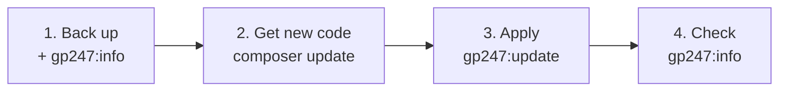

> 🌐 **Language:** [🇻🇳 Tiếng Việt](./update_vi.md) · 🇬🇧 English (current) · [🇯🇵 日本語](./update_ja.md)

# Updating GP247 and S-Cart

## Introduction
This page explains how to bring a running GP247 site — an S-Cart store, a GP247 CMS website, or a Laravel app that uses only
core — to a newer release **within the 3.x line** (for example core 3.9 to 3.10), **without losing data or customizations**.
It is written for site administrators, including non-technical ones: follow the steps and copy the exact commands. After reading
it you can update your site, check the result, and use the advanced options when you need them.

## Pick the right page
Three pages cover three different situations, and **the commands on this page do not work for the other two**:

| Your situation | Read |
| --- | --- |
| No site yet, you want to create one | [Installing GP247 and S-Cart](./install.md) |
| Site running the **3.x** line, you want a newer release | **Updating GP247 and S-Cart** (this page) |
| Site running the **2.x** line or older | [Upgrading to the 3.x line](./upgrade.md) |

Not sure which line your site is on? Run `php artisan gp247:info`: a `gp247/core` line starting with `3.` means 3.x.

## At a glance
An update has four stages; stages 2 and 3 are **both** required:



**Command summary** — for experienced users, run after backing up; pick **one** `composer update` line for the packages your
site uses:

```bash
php artisan gp247:info

composer update gp247/core gp247/front gp247/shop gp247/mcp    # S-Cart
composer update gp247/core gp247/front                         # GP247 CMS (core + front)
composer update gp247/core                                     # core only

php artisan gp247:update
php artisan gp247:info
```

- **`composer update` only replaces code in `vendor/`** — it does not touch the database yet.
- **`gp247:update` applies the changes to the site** — converts data, updates configuration, refreshes the cache. You never have
  to run `php artisan migrate` yourself.
- **Safe by default** — data, edited translations and edited templates are kept; only the [advanced options](#advanced-options)
  overwrite anything.

## On this page
- [Before you start](#before-you-start) — back up, note the version
- [Steps](#steps) — four steps for most sites
- [Other setups: Docker, hosting without a command line](#other-setups-docker-hosting-without-a-command-line) — what differs from the standard steps
- [Check the result](#check-the-result) — make sure the update is complete
- [Troubleshooting](#troubleshooting) — symptoms and fixes
- [Advanced options](#advanced-options) — translations, templates, plugins updated with `git pull`

## Before you start

- [ ] **Back up** — the database, the `.env` file and the `app/GP247`, `public/GP247`, `storage` folders. If something goes
      wrong, the backup is your way back: [Encryption keys & backups](../security/security-keys-and-backup.md).
- [ ] **Note the current version** — run `php artisan gp247:info` and write down the core / front / shop / mcp numbers.
- [ ] **Read what the new release needs** — the **📋 To do when updating** part of each release in
      [S-Cart releases and security](../release/release.md#releases).
- [ ] *(Recommended)* **Check the environment** — `php artisan gp247:doctor`; fix any item reported as **fail** first.

## Steps

1. Open a **Terminal** ("Command Prompt" on Windows) and go to the site's root folder.

2. **Get the new code** with Composer — list only the packages your site has (check with `php artisan gp247:info`):

   | Your site | Command |
   | --- | --- |
   | S-Cart (core + front + shop + mcp) | `composer update gp247/core gp247/front gp247/shop gp247/mcp` |
   | GP247 CMS (core + front) | `composer update gp247/core gp247/front` |
   | Core + front + shop (no mcp) | `composer update gp247/core gp247/front gp247/shop` |
   | Core only | `composer update gp247/core` |

   Composer lists the packages whose version changed.

   > ℹ️ **Info:** S-Cart sites installed **before 3.5** do not have the MCP server package yet. The first time, run this
   > **instead of** the command above: `composer require gp247/mcp -W`. Sites using the old McpServer plugin: step 3 moves its
   > tokens, configuration and permissions to the built-in MCP; afterwards remove the plugin folder with
   > `php artisan gp247:ext-uninstall --type=plugin --key=McpServer --purge`.

3. **Apply the changes to the site**:

   ```bash
   php artisan gp247:update
   ```

   The command runs, in order, and prints the name of each step it ran:
   - **core**;
   - **front** and **shop** — only when the site has them;
   - **MCP server** — only when the `gp247/mcp` package is present;
   - **plugins / templates** whose files are newer than the data in use — see
     [section C](#c-pluginstemplates-updated-with-git-pull-composer-or-by-copying-files);
   - a **cache** refresh.

4. **Check** following [Check the result](#check-the-result).

## Other setups: Docker, hosting without a command line
The result is the same as the standard [steps](#steps); each part below only lists what differs.

### Docker
The Docker setup ships with the S-Cart source. Run the same commands inside the `app` container (on a real server add
`-f docker-compose.prod.yml` after `docker compose`):

```bash
docker compose exec app composer update gp247/core gp247/front gp247/shop gp247/mcp
docker compose exec app php artisan gp247:update
docker compose exec app php artisan gp247:info
docker compose restart queue scheduler
```

The last line restarts the two background containers so they load the new code. Patching PHP / Nginx in the image itself is a
separate task — see [S-Cart with Docker](https://github.com/gp247net/s-cart/blob/master/DOCKER.md).

### Hosting without a command line
Update a **copy on your own computer**, then upload the result:

1. On your computer: copy the site folder down, import the hosting database backup into a local database, and point the copy's
   `.env` at that local database.
2. Run the [steps](#steps) on the copy and check the site on your computer.
3. Pause taking orders on the live site, then back up the hosting database **again**.
4. Upload the `vendor/` folder (replacing the old one entirely) plus the copy's `app/GP247` and `public/GP247` to the hosting.
   Do **not** overwrite the hosting's `.env`.
5. Export the copy's database and import it on the hosting **only if** the live site had no new orders / data since step 1.
   If it did, ask your technical contact or hosting provider to run `php artisan gp247:update` on the hosting instead of
   overwriting the database.

> ⚠️ **Warning:** importing the database from your computer **overwrites** the hosting database — orders and customers created
> after the backup in step 1 are lost.

## Check the result

- [ ] `php artisan gp247:info` — the version numbers are higher than the ones you noted in [Before you start](#before-you-start).
- [ ] `gp247:update` printed no line reporting an error.
- [ ] The home page and the admin open normally; place a test order (then cancel it) if the release touches the cart / payment.
- [ ] The **Plugin** / **Template** screens no longer show a yellow "Data update pending" label.
- [ ] You did the items in the **📋 To do when updating** part of the new release.

## Troubleshooting

| Symptom | Common cause | Fix |
| --- | --- | --- |
| Site breaks after running only `composer update` | The changes were not applied to the site | Run `php artisan gp247:update` |
| Still on 2.x after `composer update` | Composer never jumps to a new line by itself | Follow [Upgrading to the 3.x line](./upgrade.md) |
| Composer refuses, reporting a version conflict | A new package needs a newer core / library than the locked one | Rerun the command with `-W` at the end, or update the whole package set at once |
| Admin screens have broken CSS / JS | The published admin assets are still the old ones | `php artisan gp247:update --publish=core-public` (safe) |
| `gp247:update` stops halfway | One step reported an error; later steps did not run | Read the message, fix the cause, run it again — rerunning is safe |
| A plugin keeps its "Data update pending" label | The plugin's data update reported an error | Fix the cause, click **Apply data update**; `gp247:doctor` reports `extension_data_pending` until it is done |

Still not right: restore the database and folders from the backup, then try again.

## Advanced options
Use these only for special needs; options A and B can **overwrite your customizations**.

### A. Refresh language files (`--overwrite-lang`)
By default `gp247:update` **keeps** the translations you edited in the admin. To pull the package's latest default translations
(**overwriting** the strings you edited):

```bash
php artisan gp247:update --overwrite-lang
```

If you edited many translations, back up the language table first. Details: [Language system](../system/language-system.md).

### B. Refresh published templates / assets (`--publish=<tokens>`)
`composer update` only replaces code in `vendor/`. Files **published** outside it (admin CSS/JS in `public/GP247`, views in
`resources/views/vendor/…`, templates in `app/GP247/…`) stay as they are. To refresh them, add `--publish` with a
comma-separated list of "tokens":

```bash
php artisan gp247:update --publish=core-public                 # safe: only the built admin CSS/JS
php artisan gp247:update --publish=core-public,front-view      # also overwrites the storefront template (DESTROYS CUSTOMIZATIONS)
php artisan gp247:update --publish=all                         # refresh EVERYTHING (DESTROYS CUSTOMIZATIONS — back up first)
```

| Token | Refreshes | Safe? |
| --- | --- | --- |
| `core-public`, `front-public` | The package's pre-built CSS/JS | ✅ Yes — no customizations lost |
| `core-view`, `front-template`, `front-view`, `shop-view-admin`, `shop-view-front` | Published views / templates | ⚠️ No — overwrites what you edited |
| `all` | All of the tokens above | ⚠️ No |

The default `GP247Front` template is loaded straight from the package, so files you have **not** published get the new version
without any token. Which folders each token touches:
[Refresh published files (`--publish`)](../cli/cli-install-update.md#refresh-published-files---publish).

### C. Plugins/templates updated with `git pull`, Composer or by copying files

> ℹ️ **Since:** the update of 2026-09-29

Clicking **Update** in the extension library both replaces the files and runs the **data update** the new version needs.
Replacing the files any other way (`git pull`, Composer, FTP, copying a folder) changes **only the files** — the data part has
**not** run. GP247 remembers the installed version of each extension, so it notices this; pick **one** of three ways to apply
the missing part:

| Way | What to do |
| --- | --- |
| The general command | `php artisan gp247:update` — it already includes this step for every plugin and template |
| Extensions only | The `gp247:ext-update --local` commands below |
| No command line | **Plugin** (or **Template**) screen: an extension with the yellow label **"Data update pending: x → y"** → click **Apply data update** (database icon) |

```bash
php artisan gp247:ext-update --local --all --type=plugin --dry-run   # preview, changes nothing
php artisan gp247:ext-update --local --all --type=plugin             # apply to every plugin
php artisan gp247:ext-update --local --type=plugin --key=InOut       # or just one plugin
```

- **Safe to run any number of times** — extensions already up to date are skipped.
- **Sites installed before 2026-09-29** have no recorded versions yet, so the **first time** every extension shows as pending.
  Apply once and it clears.
- **If the data update fails**, the new files stay in place (no automatic restore as when updating from the library). Fix the
  cause and run it again.

## Conditions & Rules (know before you act)

**When running `gp247:update`**

- **Upgrades only, never reinstalls** — no step deletes data, so it is safe on a live site.
- **No cron, queue or websocket needed** — being able to run `php artisan` is enough, even on restricted hosting.
- **The front / shop / MCP parts run only when present** — parts the site does not have are skipped without an error.
- **Never jumps lines** — a site pinned to `^3.x` only receives 3.x releases; to change lines follow
  [Upgrading to the 3.x line](./upgrade.md).

**When using `--overwrite-lang`**

- **Overwrites the translations you edited** with the package defaults — that is why it is off by default.

**When using `--publish=<tokens>`**

- **Only `core-public` and `front-public` are safe** — the other tokens overwrite views / templates you edited; back up the target
  folders first.
- **There is no `--force` flag** — typing a token is your consent; in a Terminal the command still **warns and asks for
  confirmation** (default "no").
- **A mistyped token stops everything** — the command reports an error and exits *before* updating anything.

## Q&A
**Q1: Is running `composer update` alone enough?**

→ No. `composer update` only downloads code into `vendor/`; `gp247:update` is what applies the changes to the database and
cache. Without it the site may break.

**Q2: My site uses only core (or core + front) — do I use the same `gp247:update`?**

→ Yes. `gp247:update` detects which packages are present, calls each package's command in order, and skips what the site does
not have. Only the `composer update` line differs — list exactly the packages your site uses.

**Q3: Will updating lose data or customizations?**

→ Not with the default command. Overwriting only happens when you deliberately add `--overwrite-lang` or `--publish` (with
tokens other than `core-public`, `front-public`).

**Q4: My site is on shared hosting without cron / queue — can I update?**

→ Yes — you only need to be able to run `php artisan`. With no command line at all, see
[Hosting without a command line](#hosting-without-a-command-line).

**Q5: How often should I update?**

→ Immediately when there is a security fix; otherwise whenever a new S-Cart release comes out. Follow
[S-Cart releases and security](../release/release.md).

**Q6: Do I need to run `gp247:doctor` every time?**

→ Not required, but recommended before updating, especially right after changing server or PHP version.

**Q7: Where can I see every GP247 command and its options?**

→ [GP247 command line (CLI)](../cli/cli-introduction.md) — the table of every command, by job.

## Change history
<!-- Only record changes in logic/behavior. Newest row on top. -->

| Date | GP247 version | Change |
| --- | --- | --- |
| 2026-11-07 |  | Page moved from `system/update-gp247` to the `install-upgrade` folder next to the Install and Upgrade pages; commands per package set (S-Cart, GP247 CMS, core only); added updating on Docker, hosting without a command line and a troubleshooting table; changing lines (2.x → 3.x) moved to the Upgrade page. |
| 2026-09-29 |  | `gp247:update` gained a step that **applies the data update of plugins/templates** updated with `git pull`/Composer/copying (GP247 remembers each installed version); new `gp247:ext-update --local` command and **Apply data update** button in the admin (section C). |
| 2026-08-29 | gp247/core 2.2 | `gp247:update` now also runs **core's upgrade migrations** (via `gp247:core-update`); before, it only re-seeded. Documents the rule in place since the public v2.1: every breaking change ships with an automatic data conversion, so `composer update` + `gp247:update` is the whole process. |

---

<sub>📅 **Last updated:** 2026-11-08 · ✍️ **Author:** GP247</sub>
