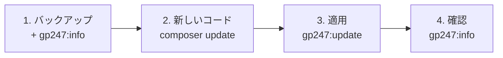

> 🌐 **言語:** [🇻🇳 Tiếng Việt](./update_vi.md) · [🇬🇧 English](./update.md) · 🇯🇵 日本語（現在）

# GP247 と S-Cart の更新

## はじめに
このページでは、稼働中の GP247 サイト — S-Cart のショップ、GP247 CMS のウェブサイト、または core だけを使う Laravel アプリケーション —
を、**同じ 3.x 系の中で**より新しいバージョン（たとえば core 3.9 から 3.10）にする方法を説明します。**データもカスタマイズも失いません。**
対象はサイト管理者です。技術に詳しくない方でも、手順どおりに進めてコマンドを正しくコピーするだけで完了します。読み終えると、
サイトを更新し、結果を確認し、必要なときに上級者向けオプションを使えるようになります。

## ページの選び方
3 つのページはそれぞれ別の状況向けです。**このページのコマンドを、ほかの 2 つのページの作業に使うことはできません。**

| あなたの状況 | 読むページ |
| --- | --- |
| まだサイトがなく、新しく作りたい | [GP247 と S-Cart のインストール](./install_ja.md) |
| **3.x** 系のサイトを、より新しいバージョンにしたい | **GP247 と S-Cart の更新**（このページ） |
| **2.x** 系またはそれより古いサイトを運用している | [3.x 系へのアップグレード](./upgrade_ja.md) |

サイトがどの系列かわからない場合は、`php artisan gp247:info` を実行します。`gp247/core` の行が `3.` で始まっていれば 3.x 系です。

## ひと目でわかる
1 回の更新は 4 つの段階でできています。段階 2 と 3 は**両方とも**必ず行います。



**コマンドの要約** — 慣れている方向けです。バックアップを取った後に実行します。サイトのパッケージ構成に合わせて
`composer update` を**どれか 1 行**選びます。

```bash
php artisan gp247:info

composer update gp247/core gp247/front gp247/shop gp247/mcp    # S-Cart
composer update gp247/core gp247/front                         # GP247 CMS（core + front）
composer update gp247/core                                     # core のみ

php artisan gp247:update
php artisan gp247:info
```

- **`composer update` が変えるのは `vendor/` 内のコードだけ** — データベースにはまだ触れません。
- **変更をサイトに適用するのは `gp247:update`** — データの変換、設定の更新、キャッシュの再作成を行います。
  `php artisan migrate` を自分で実行する必要は一切ありません。
- **既定の動作は安全** — データ、修正した翻訳、修正した画面デザインはそのまま残ります。上書きするのは
  [上級者向けオプション](#上級者向けオプション)だけです。

## このページの内容
- [始める前に](#始める前に) — バックアップ、バージョンの控え
- [手順](#手順) — ほとんどのサイトに必要な 4 つの手順
- [その他の方法: Docker、コマンドラインのないホスティング](#その他の方法-dockerコマンドラインのないホスティング) — 標準の方法との違い
- [結果の確認](#結果の確認) — 更新が終わったことを確かめる
- [問題が起きたとき](#問題が起きたとき) — 症状と対処方法
- [上級者向けオプション](#上級者向けオプション) — 翻訳、画面デザイン、`git pull` で更新したプラグイン

## 始める前に

- [ ] **バックアップ** — データベース、`.env` ファイル、`app/GP247`、`public/GP247`、`storage` フォルダ。問題が起きたときは
      バックアップが元に戻る手段です: [暗号化キーとバックアップ](../security/security-keys-and-backup_ja.md)。
- [ ] **現在のバージョンを控える** — `php artisan gp247:info` を実行し、core / front / shop / mcp の番号を控えます。
- [ ] **新しいバージョン固有の作業を読む** — [S-Cart のリリースとセキュリティ](../release/release_ja.md#リリース一覧)の各リリースにある
      「**📋 更新時の対応**」の項目。
- [ ] *（推奨）* **環境を確認** — `php artisan gp247:doctor`。**fail** の項目があれば先に対処します。

## 手順

1. **ターミナル**（Windows では「コマンドプロンプト」）を開き、サイトのルートフォルダに移動します。

2. Composer で**新しいコードを取得**します — サイトにあるパッケージだけを指定します（`php artisan gp247:info` で確認できます）。

   | お使いのサイト | コマンド |
   | --- | --- |
   | S-Cart（core + front + shop + mcp） | `composer update gp247/core gp247/front gp247/shop gp247/mcp` |
   | GP247 CMS（core + front） | `composer update gp247/core gp247/front` |
   | core + front + shop（mcp なし） | `composer update gp247/core gp247/front gp247/shop` |
   | core のみ | `composer update gp247/core` |

   Composer が、バージョンが変わったパッケージの一覧を表示します。

   > ℹ️ **情報:** S-Cart **3.5 より前**からインストールしたサイトには、MCP サーバーのパッケージがまだありません。初回は、上の
   > コマンドの**代わりに**次を実行します: `composer require gp247/mcp -W`。旧 McpServer プラグインを使っているサイトでは、手順 3 で
   > トークン、設定、権限が組み込みの MCP に自動で移行されます。その後、
   > `php artisan gp247:ext-uninstall --type=plugin --key=McpServer --purge` でプラグインのフォルダを削除してください。

3. **変更をサイトに適用**します。

   ```bash
   php artisan gp247:update
   ```

   コマンドは次の順に実行し、実行した手順の名前を表示します。
   - **core**
   - **front** と **shop** — サイトにインストールされている場合のみ
   - **MCP サーバー** — `gp247/mcp` パッケージがある場合のみ
   - 使用中のデータより新しいファイルを持つ**プラグイン／テンプレート** —
     [C 項](#c-git-pullcomposer手動コピーでプラグインテンプレートを更新した場合)を参照
   - **キャッシュ**の再作成

4. [結果の確認](#結果の確認)に沿って**確認**します。

## その他の方法: Docker、コマンドラインのないホスティング
結果は標準の[手順](#手順)と同じです。以下の各項目には、違う部分だけを書いています。

### Docker
Docker 一式は S-Cart のソースコードに含まれています。同じコマンドを `app` コンテナの中で実行します（本番サーバーでは
`docker compose` の後に `-f docker-compose.prod.yml` を付けます）。

```bash
docker compose exec app composer update gp247/core gp247/front gp247/shop gp247/mcp
docker compose exec app php artisan gp247:update
docker compose exec app php artisan gp247:info
docker compose restart queue scheduler
```

最後の行は、バックグラウンドで動く 2 つのコンテナを再起動して新しいコードを読み込ませます。イメージ自体の PHP／Nginx の更新は
別の作業です — [S-Cart with Docker](https://github.com/gp247net/s-cart/blob/master/DOCKER.md)（英語）を参照してください。

### コマンドラインのないホスティング
**お使いのパソコン上のコピー**で更新し、その結果をホスティングに反映します。

1. パソコン上で: サイトのフォルダをコピーし、ホスティングの DB バックアップをローカルの DB に取り込み、コピーの `.env` を
   そのローカル DB に向けます。
2. コピーで[手順](#手順)を実行し、パソコン上でサイトを開いて確認します。
3. 本番サイトで注文の受付を一時停止し、ホスティングの DB を**もう一度**バックアップします。
4. コピーの `vendor/` フォルダ（古いフォルダを丸ごと置き換え）と `app/GP247`、`public/GP247` をホスティングに転送します。
   ホスティングの `.env` は**上書きしません**。
5. 手順 1 以降に本番サイトで新しい注文やデータが**ない場合に限り**、コピーの DB を出力してホスティングに取り込みます。ある場合は、
   DB を上書きせず、技術担当者またはホスティング事業者にホスティング上で `php artisan gp247:update` を実行してもらいます。

> ⚠️ **注意:** パソコンから DB を取り込むと、ホスティングの DB が**上書き**されます — 手順 1 のバックアップ以降に発生した注文や
> 顧客は失われます。

## 結果の確認

- [ ] `php artisan gp247:info` — バージョン番号が、[始める前に](#始める前に)で控えた番号より新しくなっている。
- [ ] `gp247:update` がエラーの行を 1 つも表示していない。
- [ ] ショップのトップページと管理画面が正常に開く。新しいバージョンがカートや決済に関わる場合は、テスト注文を 1 件入れる（その後キャンセル）。
- [ ] 「**プラグイン**」／「**テンプレート管理**」画面に、黄色の「データ更新待ち」ラベルが残っていない。
- [ ] 新しいバージョンの「**📋 更新時の対応**」を済ませた。

## 問題が起きたとき

| 症状 | よくある原因 | 対処方法 |
| --- | --- | --- |
| `composer update` だけ実行した後にサイトがエラーになる | 変更をまだサイトに適用していない | `php artisan gp247:update` を実行 |
| `composer update` の後も 2.x 系のまま | Composer は系列を自動で上げない | [3.x 系へのアップグレード](./upgrade_ja.md)に沿って作業 |
| Composer がバージョンの衝突を報告して拒否する | 新しいパッケージが、ロック中のものより新しい core／ライブラリを必要とする | コマンドの末尾に `-W` を付けて再実行するか、パッケージ一式をまとめて更新 |
| 管理画面の CSS／JS がおかしい | 公開（publish）済みの管理画面アセットが古いまま | `php artisan gp247:update --publish=core-public`（安全） |
| `gp247:update` が途中で止まる | ある手順がエラーになり、以降の手順が未実行 | メッセージを読んで原因を直し、再実行 — 再実行しても安全 |
| プラグインに「データ更新待ち」ラベルが残る | プラグインのデータ部分がエラーになった | 原因を直して「**データ更新を適用**」を押す。完了するまで `gp247:doctor` が `extension_data_pending` を報告 |

それでも解決しない場合は、バックアップから DB とフォルダを復元して、やり直してください。

## 上級者向けオプション
特別な必要があるときだけ使います。A と B のオプションは、あなたの**カスタマイズを上書き**することがあります。

### A. 言語ファイルの再取得（`--overwrite-lang`）
既定では、`gp247:update` は管理画面で修正した翻訳を**そのまま残します**。パッケージの最新の既定翻訳を取り込みたい場合
（これまで修正した文字列は**上書きされます**）:

```bash
php artisan gp247:update --overwrite-lang
```

多くの翻訳を修正している場合は、先に言語テーブルをバックアップしてください。詳しくは [言語システム](../system/language-system_ja.md)。

### B. 公開済みの画面デザイン／アセットの再作成（`--publish=<tokens>`）
`composer update` が変えるのは `vendor/` 内のコードだけです。外部に**公開（publish）**済みのファイル（`public/GP247` 内の
管理画面 CSS/JS、`resources/views/vendor/…` 内の view、`app/GP247/…` 内のテンプレート）はそのまま残ります。更新したい場合は、
`--publish` に「トークン」の一覧をカンマ区切りで指定します。

```bash
php artisan gp247:update --publish=core-public                 # 安全: ビルド済みの管理画面 CSS/JS だけ
php artisan gp247:update --publish=core-public,front-view      # ストアフロントのテンプレートも上書き（カスタマイズが消える）
php artisan gp247:update --publish=all                         # すべてを更新（カスタマイズが消える — 先にバックアップ）
```

| トークン | 更新するもの | 安全？ |
| --- | --- | --- |
| `core-public`、`front-public` | パッケージのビルド済み CSS/JS | ✅ はい — カスタマイズは失われない |
| `core-view`、`front-template`、`front-view`、`shop-view-admin`、`shop-view-front` | 公開済みの view／テンプレート | ⚠️ いいえ — 修正した箇所を上書き |
| `all` | 上のすべてのトークン | ⚠️ いいえ |

既定のテンプレート `GP247Front` はパッケージから直接読み込まれるため、**公開していない**ファイルはトークンなしで自動的に新しい
バージョンになります。各トークンがどのフォルダに影響するかは、
[コマンドラインリファレンス](../system/command-line-reference_ja.md)の「`gp247:update`」の項を参照してください。

### C. `git pull`、Composer、手動コピーでプラグイン／テンプレートを更新した場合

> ℹ️ **対応バージョン:** 2026-09-29 の更新から

拡張機能ライブラリで「更新」(Update) を押すと、GP247 はファイルを置き換えるとともに、新しいバージョンに必要な**データ更新**も
実行します。別の方法（`git pull`、Composer、FTP、フォルダのコピー）でファイルを置き換えた場合は、**ファイル**だけが変わり、
データの部分は**まだ**実行されていません。GP247 は拡張機能ごとにインストール済みのバージョンを記録しているため、このケースを
検出できます。足りない部分を適用する方法を、次の 3 つから**1 つ**選びます。

| 方法 | やること |
| --- | --- |
| 共通コマンド | `php artisan gp247:update` — すべてのプラグインとテンプレートに適用する手順がすでに含まれています |
| 拡張機能の部分だけ | 下の `gp247:ext-update --local` コマンド |
| コマンドラインがない | 「**プラグイン**」（または「**テンプレート管理**」）画面: 黄色のラベル **「データ更新待ち: x → y」** がある拡張機能で **「データ更新を適用」** ボタン（データベースのアイコン）を押す |

```bash
php artisan gp247:ext-update --local --all --type=plugin --dry-run   # プレビューのみ（まだ何もしない）
php artisan gp247:ext-update --local --all --type=plugin             # すべてのプラグインに適用
php artisan gp247:ext-update --local --type=plugin --key=InOut       # または 1 つのプラグインだけ
```

- **何度実行しても安全** — 適用済みの拡張機能はスキップされます。
- **2026-09-29 より前にインストールしたサイト**にはバージョンの記録がないため、**初回**はすべての拡張機能が「待ち」と表示されます。
  一度適用すれば解消します。
- **データ部分がエラーになった場合**も、新しいファイルはそのまま残ります（ライブラリからの更新のように自動では元に戻りません）。
  原因を直してから再実行してください。

## 条件と制約（操作の前に確認）

**`gp247:update` を実行するとき**

- **アップグレードだけを行い、再インストールはしません** — データを削除する手順はないため、本番サイトでもそのまま使えます。
- **cron、キュー、websocket は不要** — `php artisan` を実行できれば十分で、制限のあるホスティングでも動きます。
- **front／shop／MCP の部分は、インストールされている場合だけ実行** — インストールしていない部分はスキップされ、エラーも出ません。
- **系列は自動で上がりません** — `^3.x` の制約を持つサイトは 3.x のバージョンだけを受け取ります。系列を変えるときは
  [3.x 系へのアップグレード](./upgrade_ja.md)に従ってください。

**`--overwrite-lang` を使うとき**

- **修正した翻訳がパッケージの既定値で上書きされます** — このため既定では無効です。

**`--publish=<tokens>` を使うとき**

- **安全なのは `core-public` と `front-public` だけ** — それ以外のトークンは修正した view／テンプレートを上書きします。先に対象
  フォルダをバックアップしてください。
- **`--force` フラグはありません** — トークンを自分で入力したこと自体が同意とみなされます。ターミナルでは、それでもコマンドが
  **警告して確認を求めます**（既定は「いいえ」）。
- **トークンを打ち間違えると、何もせずにすぐ停止します** — コマンドは更新を始める*前に*エラーを表示して終了します。

## よくある質問（Q&A）
**Q1: `composer update` だけ実行すればよいですか？**

→ いいえ。`composer update` はコードを `vendor/` にダウンロードするだけです。変更を DB とキャッシュに適用するのは
`gp247:update` です。この手順を省くと、サイトがエラーになることがあります。

**Q2: core だけ（または core + front だけ）のサイトでも、`gp247:update` は共通ですか？**

→ はい。`gp247:update` はどのパッケージがあるかを自動で判別し、各パッケージのコマンドを順番に呼び出し、サイトにない部分は
スキップします。違うのは `composer update` だけで、サイトが使っているパッケージを正しく指定します。

**Q3: 更新するとデータやカスタマイズは失われますか？**

→ 既定のコマンドでは失われません。`--overwrite-lang`、または `--publish`（`core-public`、`front-public` 以外のトークン）を
自分で追加したときだけ上書きが起きます。

**Q4: cron やキューのない共有ホスティングでも更新できますか？**

→ できます — `php artisan` を実行できれば十分です。コマンドラインもない場合は
[コマンドラインのないホスティング](#コマンドラインのないホスティング)を参照してください。

**Q5: どのくらいの頻度で更新すべきですか？**

→ セキュリティ修正があれば、すぐに更新してください。それ以外は、S-Cart の新しいリリースが出るたびに更新します。
[S-Cart のリリースとセキュリティ](../release/release_ja.md)で確認できます。

**Q6: 更新のたびに `gp247:doctor` を実行する必要がありますか？**

→ 必須ではありませんが、更新前の実行をおすすめします。特にサーバーや PHP のバージョンを変えた直後は実行してください。

**Q7: GP247 のすべてのコマンドとオプションは、どこで確認できますか？**

→ [コマンドラインリファレンス](../system/command-line-reference_ja.md)を参照してください。

## 変更履歴
<!-- ロジック／動作に変更があった場合のみ記録します。最新の行を一番上にします。 -->

| 日付 | GP247 バージョン | 変更内容 |
| --- | --- | --- |
| 2026-11-07 |  | ページを `system/update-gp247` から、インストールとアップグレードのページと同じ `install-upgrade` フォルダに移動しました。パッケージ構成別のコマンド（S-Cart、GP247 CMS、core のみ）、Docker での更新、コマンドラインのないホスティング、トラブル対処表を追加しました。系列の変更（2.x → 3.x）はアップグレードのページに移しました。 |
| 2026-09-29 |  | `gp247:update` に、`git pull`／Composer／手動コピーで更新された**プラグイン／テンプレートのデータ更新を適用する**手順を追加しました（GP247 がインストール済みのバージョンを記録）。`gp247:ext-update --local` コマンドと、管理画面の **「データ更新を適用」** ボタンを追加しました（C 項）。 |
| 2026-08-29 | gp247/core 2.2 | `gp247:update` が **core のアップグレード用マイグレーション**も実行するようになりました（`gp247:core-update` 経由）。以前は再シードだけでした。公開版 v2.1 からのルールを明記しました。互換性を壊す変更にはすべて自動のデータ変換が付くため、`composer update` + `gp247:update` だけで手順全体が完了します。 |

---

<sub>📅 **最終更新:** 2026-11-07 · ✍️ **作成者 (Author):** GP247</sub>
