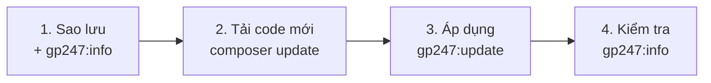

> 🌐 **Ngôn ngữ:** 🇻🇳 Tiếng Việt (hiện tại) · [🇬🇧 English](./update.md) · [🇯🇵 日本語](./update_ja.md)

# Cập nhật GP247 và S-Cart

## Giới thiệu
Trang này hướng dẫn đưa một site GP247 đang chạy — cửa hàng S-Cart, website GP247 CMS, hay ứng dụng Laravel chỉ dùng core —
lên bản mới hơn **trong cùng dòng 3.x** (ví dụ core 3.9 lên 3.10), **không mất dữ liệu, không mất tùy biến**. Tài liệu dành cho người quản trị site, kể cả người không rành kỹ thuật: làm theo từng bước, copy
đúng lệnh là được. Đọc xong, bạn cập nhật được site, kiểm tra được kết quả, và biết dùng các tùy chọn nâng cao khi cần.

## Chọn đúng trang
Ba trang dùng cho ba tình huống khác nhau, và **lệnh của trang này không dùng được cho hai trang kia**:

| Tình huống của bạn | Đọc trang |
| --- | --- |
| Chưa có site, muốn tạo site mới | [Cài đặt GP247 và S-Cart](./install_vi.md) |
| Site đang chạy dòng **3.x**, muốn lên bản mới hơn | **Cập nhật GP247 và S-Cart** (trang này) |
| Site đang chạy dòng **2.x** hoặc cũ hơn | [Nâng cấp lên dòng 3.x](./upgrade_vi.md) |

Không biết site đang ở dòng nào? Chạy `php artisan gp247:info`: dòng `gp247/core` bắt đầu bằng `3.` là dòng 3.x.

## Nhìn nhanh
Một lần cập nhật gồm bốn chặng; chặng 2 và 3 phải làm **cả hai**:



**Lệnh tóm tắt** — dành cho người đã quen, chạy sau khi đã sao lưu; chọn **một** dòng `composer update` theo bộ gói của site:

```bash
php artisan gp247:info

composer update gp247/core gp247/front gp247/shop gp247/mcp    # S-Cart
composer update gp247/core gp247/front                         # GP247 CMS (core + front)
composer update gp247/core                                     # chỉ core

php artisan gp247:update
php artisan gp247:info
```

- **`composer update` chỉ thay code trong `vendor/`** — chưa đụng tới cơ sở dữ liệu.
- **`gp247:update` mới áp thay đổi vào site** — chuyển đổi dữ liệu, cập nhật cấu hình, làm mới cache. Bạn không bao giờ phải tự
  chạy `php artisan migrate`.
- **Mặc định an toàn** — giữ nguyên dữ liệu, bản dịch đã sửa, giao diện đã sửa; chỉ [tùy chọn nâng cao](#tùy-chọn-nâng-cao)
  mới ghi đè.

## Trong trang này
- [Trước khi bắt đầu](#trước-khi-bắt-đầu) — sao lưu, ghi lại phiên bản
- [Các bước](#các-bước) — bốn bước cho đa số site
- [Cách khác: Docker, hosting không có dòng lệnh](#cách-khác-docker-hosting-không-có-dòng-lệnh) — chỗ khác với cách chuẩn
- [Kiểm tra kết quả](#kiểm-tra-kết-quả) — biết chắc đã cập nhật xong
- [Khi gặp sự cố](#khi-gặp-sự-cố) — triệu chứng và cách xử lý
- [Tùy chọn nâng cao](#tùy-chọn-nâng-cao) — bản dịch, giao diện, plugin cập nhật bằng `git pull`

## Trước khi bắt đầu

- [ ] **Sao lưu** — cơ sở dữ liệu, file `.env` và các thư mục `app/GP247`, `public/GP247`, `storage`. Có sự cố thì bản sao lưu
      là đường quay lại: [Khoá mã hoá & sao lưu](../security/security-keys-and-backup_vi.md).
- [ ] **Ghi lại phiên bản hiện tại** — chạy `php artisan gp247:info`, chép lại số của core / front / shop / mcp.
- [ ] **Đọc việc riêng của bản mới** — mục **📋 Cần làm khi cập nhật** của các bản trong
      [Phát hành và bảo mật S-Cart](../release/release_vi.md#các-bản-phát-hành).
- [ ] *(Khuyến nghị)* **Kiểm tra môi trường** — `php artisan gp247:doctor`; mục nào báo **fail** thì xử lý trước.

## Các bước

1. Mở **Terminal** (trên Windows là "Command Prompt"), vào thư mục gốc của site.

2. **Tải code mới** bằng Composer — chỉ liệt kê các gói site đang có (xem bằng `php artisan gp247:info`):

   | Site của bạn | Lệnh |
   | --- | --- |
   | S-Cart (core + front + shop + mcp) | `composer update gp247/core gp247/front gp247/shop gp247/mcp` |
   | GP247 CMS (core + front) | `composer update gp247/core gp247/front` |
   | Core + front + shop (không có mcp) | `composer update gp247/core gp247/front gp247/shop` |
   | Chỉ core | `composer update gp247/core` |

   Composer in danh sách gói vừa đổi phiên bản.

   > ℹ️ **Thông tin:** site S-Cart cài từ **trước 3.5** chưa có gói MCP server. Lần đầu, chạy lệnh này **thay cho** lệnh trên:
   > `composer require gp247/mcp -W`. Site đang dùng plugin McpServer cũ: bước 3 tự chuyển token, cấu hình, quyền sang MCP
   > có sẵn; sau đó xoá thư mục plugin bằng `php artisan gp247:ext-uninstall --type=plugin --key=McpServer --purge`.

3. **Áp dụng thay đổi vào site**:

   ```bash
   php artisan gp247:update
   ```

   Lệnh chạy lần lượt, và in tên từng bước đã chạy:
   - **core**;
   - **front** và **shop** — chỉ khi site có cài các phần này;
   - **MCP server** — chỉ khi có gói `gp247/mcp`;
   - **plugin / giao diện** có file mới hơn dữ liệu đang dùng — xem
     [mục C](#c-plugintemplate-cập-nhật-bằng-git-pull-composer-hoặc-chép-tay);
   - làm mới **cache**.

4. **Kiểm tra** theo [Kiểm tra kết quả](#kiểm-tra-kết-quả).

## Cách khác: Docker, hosting không có dòng lệnh
Kết quả giống [các bước](#các-bước) chuẩn; mỗi mục dưới đây chỉ ghi chỗ khác.

### Docker
Bộ Docker có sẵn trong mã nguồn S-Cart. Chạy cùng lệnh, bên trong container `app` (máy chủ thật thêm `-f docker-compose.prod.yml` sau `docker compose`):

```bash
docker compose exec app composer update gp247/core gp247/front gp247/shop gp247/mcp
docker compose exec app php artisan gp247:update
docker compose exec app php artisan gp247:info
docker compose restart queue scheduler
```

Dòng cuối khởi động lại hai container chạy nền để chúng nạp code mới. Vá PHP / Nginx của chính image là việc riêng — xem
[S-Cart với Docker](https://github.com/gp247net/s-cart/blob/master/DOCKER_vi.md).

### Hosting không có dòng lệnh
Cập nhật trên **bản sao ở máy bạn**, rồi đưa kết quả lên hosting:

1. Trên máy bạn: chép thư mục site về, nhập bản sao lưu CSDL của hosting vào một CSDL cục bộ, sửa `.env` của bản sao cho trỏ
   vào CSDL cục bộ đó.
2. Chạy [các bước](#các-bước) trên bản sao, mở site ở máy bạn kiểm tra.
3. Tạm ngừng nhận đơn trên site thật, rồi sao lưu CSDL của hosting **lần nữa**.
4. Tải lên hosting thư mục `vendor/` (thay toàn bộ thư mục cũ) cùng `app/GP247`, `public/GP247` của bản sao.
   **Không** ghi đè `.env` của hosting.
5. Xuất CSDL bản sao và nhập vào hosting **chỉ khi** site thật không có đơn / dữ liệu mới kể từ bước 1. Nếu có, nhờ người
   phụ trách kỹ thuật hoặc nhà cung cấp hosting chạy `php artisan gp247:update` trên hosting thay vì ghi đè CSDL.

> ⚠️ **Lưu ý:** nhập CSDL từ máy bạn là **ghi đè** CSDL của hosting — đơn và khách phát sinh sau lúc sao lưu ở bước 1 sẽ mất.

## Kiểm tra kết quả

- [ ] `php artisan gp247:info` — số phiên bản đã cao hơn số bạn ghi lại ở [Trước khi bắt đầu](#trước-khi-bắt-đầu).
- [ ] `gp247:update` không in dòng nào báo lỗi.
- [ ] Trang chủ cửa hàng và trang quản trị mở bình thường; đặt thử một đơn (rồi huỷ) nếu bản mới chạm tới giỏ hàng / thanh toán.
- [ ] Màn **Plugin** / **Template** không còn nhãn vàng "Chờ cập nhật dữ liệu".
- [ ] Đã làm các việc ở mục **📋 Cần làm khi cập nhật** của bản mới.

## Khi gặp sự cố

| Triệu chứng | Nguyên nhân thường gặp | Cách xử lý |
| --- | --- | --- |
| Site lỗi sau khi chỉ chạy `composer update` | Chưa áp thay đổi vào site | Chạy `php artisan gp247:update` |
| `composer update` xong mà vẫn ở dòng 2.x | Composer không tự nhảy dòng | Làm theo [Nâng cấp lên dòng 3.x](./upgrade_vi.md) |
| Composer từ chối, báo xung đột phiên bản | Gói mới cần bản core / thư viện mới hơn bản đang khoá | Chạy lại lệnh với `-W` ở cuối, hoặc cập nhật cả bộ gói cùng lúc |
| Giao diện quản trị lỗi CSS / JS | Asset quản trị đã publish còn bản cũ | `php artisan gp247:update --publish=core-public` (an toàn) |
| `gp247:update` dừng giữa chừng | Một bước báo lỗi; các bước sau chưa chạy | Đọc thông báo, sửa nguyên nhân, chạy lại — chạy lại an toàn |
| Plugin còn nhãn "Chờ cập nhật dữ liệu" | Phần dữ liệu của plugin báo lỗi | Sửa nguyên nhân, bấm **Áp dụng cập nhật dữ liệu**; `gp247:doctor` báo mục `extension_data_pending` tới khi xong |

Vẫn không ổn: khôi phục CSDL và thư mục từ bản sao lưu, rồi làm lại.

## Tùy chọn nâng cao
Chỉ dùng khi bạn có nhu cầu đặc biệt; hai tùy chọn A và B có thể **ghi đè tùy biến** của bạn.

### A. Làm mới file ngôn ngữ (`--overwrite-lang`)
Mặc định `gp247:update` **giữ nguyên** bản dịch bạn đã sửa trong trang quản trị. Muốn kéo bản dịch mặc định mới nhất của gói
(**ghi đè** các chuỗi bạn từng sửa):

```bash
php artisan gp247:update --overwrite-lang
```

Đã sửa nhiều bản dịch thì sao lưu bảng ngôn ngữ trước. Chi tiết: [Hệ thống đa ngôn ngữ](../system/language-system_vi.md).

### B. Làm mới giao diện / asset đã publish (`--publish=<tokens>`)
`composer update` chỉ thay code trong `vendor/`. File đã **publish** ra ngoài (CSS/JS quản trị trong `public/GP247`, view trong
`resources/views/vendor/…`, template trong `app/GP247/…`) giữ nguyên. Muốn làm mới, thêm `--publish` với danh sách "token"
cách nhau bằng dấu phẩy:

```bash
php artisan gp247:update --publish=core-public                 # an toàn: chỉ CSS/JS quản trị đã build
php artisan gp247:update --publish=core-public,front-view      # ghi đè cả template storefront (PHÁ TÙY BIẾN)
php artisan gp247:update --publish=all                         # làm mới TẤT CẢ (PHÁ TÙY BIẾN — sao lưu trước)
```

| Token | Làm mới | An toàn? |
| --- | --- | --- |
| `core-public`, `front-public` | CSS/JS đã build sẵn của package | ✅ Có — không mất tùy biến |
| `core-view`, `front-template`, `front-view`, `shop-view-admin`, `shop-view-front` | View / template đã publish | ⚠️ Không — ghi đè chỗ bạn đã sửa |
| `all` | Tất cả các token trên | ⚠️ Không |

Giao diện mặc định `GP247Front` được nạp thẳng từ package, nên file bạn **chưa** publish tự nhận bản mới mà không cần token nào.
Từng token chạm thư mục nào: [Làm mới file đã publish (`--publish`)](../cli/cli-install-update_vi.md#làm-mới-file-đã-publish---publish).

### C. Plugin/template cập nhật bằng `git pull`, Composer hoặc chép tay

> ℹ️ **Có từ:** bản cập nhật ngày 2026-09-29

Bấm **Cập nhật** trong thư viện extension thì GP247 vừa thay file vừa chạy phần **cập nhật dữ liệu** bản mới cần. Tự thay file
bằng cách khác (`git pull`, Composer, FTP, chép thư mục) thì chỉ **file** đổi, phần dữ liệu **chưa** chạy. GP247 ghi nhớ phiên
bản đã cài của từng extension nên nhận ra trường hợp này; chọn **một** trong ba cách áp dụng phần còn thiếu:

| Cách | Làm gì |
| --- | --- |
| Lệnh chung | `php artisan gp247:update` — đã có sẵn bước này cho mọi plugin và giao diện |
| Chỉ phần extension | Lệnh `gp247:ext-update --local` bên dưới |
| Không có dòng lệnh | Màn **Plugin** (hoặc **Template**): extension có nhãn vàng **"Chờ cập nhật dữ liệu: x → y"** → bấm nút **Áp dụng cập nhật dữ liệu** (biểu tượng cơ sở dữ liệu) |

```bash
php artisan gp247:ext-update --local --all --type=plugin --dry-run   # xem trước, chưa làm gì
php artisan gp247:ext-update --local --all --type=plugin             # áp dụng cho mọi plugin
php artisan gp247:ext-update --local --type=plugin --key=InOut       # hoặc chỉ một plugin
```

- **Chạy lại bao nhiêu lần cũng an toàn** — extension đã áp dụng xong được bỏ qua.
- **Site cài trước 2026-09-29** chưa có bản ghi phiên bản, nên **lần đầu** mọi extension đều hiện "chờ". Áp dụng một lần là hết.
- **Phần dữ liệu báo lỗi** thì file mới vẫn giữ nguyên (không tự khôi phục như khi cập nhật từ thư viện). Sửa nguyên nhân rồi
  chạy lại.

## Điều kiện & ràng buộc (hiểu trước khi thao tác)

**Khi chạy `gp247:update`**

- **Chỉ nâng cấp, không cài lại** — không có bước nào xoá dữ liệu, nên dùng được ngay trên site thật.
- **Không cần cron, queue hay websocket** — chạy được `php artisan` là đủ, kể cả trên hosting hạn chế.
- **Phần front / shop / MCP chỉ chạy khi đã có** — site chưa cài phần nào thì phần đó được bỏ qua, không báo lỗi.
- **Không tự nhảy dòng** — site ràng buộc `^3.x` chỉ nhận bản 3.x; đổi dòng thì theo [Nâng cấp lên dòng 3.x](./upgrade_vi.md).

**Khi dùng `--overwrite-lang`**

- **Ghi đè bản dịch bạn đã sửa** về mặc định của gói — vì vậy mặc định không bật.

**Khi dùng `--publish=<tokens>`**

- **Chỉ `core-public` và `front-public` an toàn** — token còn lại ghi đè view / template bạn đã sửa; sao lưu thư mục đích trước.
- **Không có cờ `--force`** — tự gõ token đã là đồng ý; trong Terminal, lệnh vẫn **cảnh báo và hỏi xác nhận** (mặc định "không").
- **Gõ sai token → dừng ngay, chưa làm gì** — lệnh báo lỗi và thoát *trước khi* cập nhật.

## Hỏi & Đáp (Q&A)
**Câu 1: Chỉ chạy `composer update` có được không?**

→ Không. `composer update` chỉ tải code về `vendor/`; `gp247:update` mới áp thay đổi vào CSDL và cache. Thiếu bước này site có
thể lỗi.

**Câu 2: Site tôi chỉ dùng core (hoặc core + front), có dùng chung `gp247:update` không?**

→ Có. `gp247:update` tự nhận ra gói nào đang có, gọi đúng lệnh của từng gói theo thứ tự, và bỏ qua phần site không có. Chỉ lệnh
`composer update` là khác — liệt kê đúng các gói site đang dùng.

**Câu 3: Cập nhật có mất dữ liệu hay tùy biến không?**

→ Không, với lệnh mặc định. Chỉ khi bạn chủ động thêm `--overwrite-lang` hoặc `--publish` (với token khác `core-public`,
`front-public`) thì mới có ghi đè.

**Câu 4: Site trên hosting chia sẻ không có cron / queue, cập nhật được không?**

→ Được — chỉ cần chạy được `php artisan`. Không có cả dòng lệnh thì xem
[Hosting không có dòng lệnh](#hosting-không-có-dòng-lệnh).

**Câu 5: Bao lâu nên cập nhật một lần?**

→ Có bản vá bảo mật thì cập nhật ngay; còn lại, mỗi khi có bản S-Cart mới. Theo dõi tại
[Phát hành và bảo mật S-Cart](../release/release_vi.md).

**Câu 6: Có cần chạy `gp247:doctor` mỗi lần cập nhật không?**

→ Không bắt buộc, nhưng nên chạy trước khi cập nhật, nhất là khi vừa đổi máy chủ hoặc phiên bản PHP.

**Câu 7: Xem đầy đủ mọi lệnh GP247 và tùy chọn ở đâu?**

→ [Dòng lệnh GP247 (CLI)](../cli/cli-introduction_vi.md) — bảng tra mọi lệnh theo việc cần làm.

## Lịch sử thay đổi
<!-- Chỉ ghi khi có thay đổi về logic/hành vi. Dòng mới nhất ở trên cùng. -->

| Ngày | Phiên bản GP247 | Thay đổi |
| --- | --- | --- |
| 2026-11-07 |  | Chuyển trang từ `system/update-gp247` sang thư mục `install-upgrade` cùng hai trang Cài đặt và Nâng cấp; lệnh theo bộ gói (S-Cart, GP247 CMS, chỉ core); thêm cập nhật trên Docker, hosting không có dòng lệnh, bảng xử lý sự cố; việc đổi dòng (2.x → 3.x) chuyển sang trang Nâng cấp. |
| 2026-09-29 |  | `gp247:update` thêm bước **áp dụng cập nhật dữ liệu cho plugin/template** được cập nhật bằng `git pull`/Composer/chép tay (GP247 ghi nhớ phiên bản đã cài); có lệnh `gp247:ext-update --local` và nút **Áp dụng cập nhật dữ liệu** trên trang quản trị (mục C). |
| 2026-08-29 | gp247/core 2.2 | `gp247:update` nay chạy thêm **migration nâng cấp của core** (qua `gp247:core-update`), trước đây lệnh này chỉ seed lại. Ghi rõ quy tắc có từ bản public v2.1: mọi thay đổi phá vỡ đều kèm phần chuyển đổi dữ liệu tự động, nên `composer update` + `gp247:update` là toàn bộ quy trình. |

---

<sub>📅 **Cập nhật lần cuối:** 2026-11-08 · ✍️ **Tác giả (Author):** GP247</sub>
