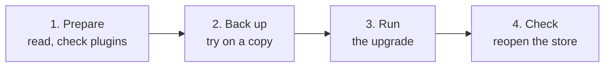

> 🌐 **Language:** [🇻🇳 Tiếng Việt](./upgrade_vi.md) · 🇬🇧 English (current) · [🇯🇵 日本語](./upgrade_ja.md)

# Upgrading to the 3.x line

## Introduction
This page explains how to move a running GP247 site — an S-Cart store, a GP247 CMS website, or a Laravel app that uses only
core — **from the 2.x line to the 3.x line** while keeping all its data (content, users, orders, customers, products).
It is written for site owners and the people who look after the site technically. After reading it you will know whether your
site can be upgraded, what to prepare, which commands to run, how to check the result, and how to roll back if something goes wrong.

## Pick the right page
Three pages cover three different situations, and **the commands on this page do not work for the other two**:

| Your situation | Read |
| --- | --- |
| No site yet, you want to create one | [Installing GP247 and S-Cart](./install.md) |
| Site running the **3.x** line, you want a newer release | [Updating GP247 and S-Cart](./update.md) |
| Site running the **2.x** line or older | **Upgrading to the 3.x line** (this page) |

Not sure which line your site is on? Run `php artisan gp247:info` and look at the `gp247/core` line.

## At a glance
The path depends on the version you are running:

| `gp247/core` is | How to get to 3.x |
| --- | --- |
| **2.1.x / 2.2** | ✅ Automatic upgrade, following this page |
| **2.0.x** | ⚠️ Not guaranteed — try on a copy first, see [Sites on 1.x and 2.0](#sites-on-1x-and-20-cannot-be-upgraded-directly) |
| **1.x** | ⛔ Cannot be upgraded — install 3.x fresh, then move the data |

For a 2.1 / 2.2 site the whole process has four stages:



**Command summary** — for experienced users, run after backing up and testing on a copy; pick **one** `composer require` line
for the packages your site uses:

```bash
php artisan gp247:info

composer require "gp247/core:^3.10.3" "gp247/front:^3.5.2" "gp247/shop:^3.8.1" "gp247/mcp:^2.0.1" -W # S-Cart
composer require "gp247/core:^3.10.3" "gp247/front:^3.5.2" -W                                        # GP247 CMS
composer require "gp247/core:^3.10.3" -W                                                             # core only

php artisan gp247:update
php artisan gp247:info
```

- **Use `composer require … -W`, not `composer update`** — a 2.x site pins `^2.…`, so Composer will not move to 3.0 on its own.
- **No PHP or Laravel change needed** — the 2.x line already runs on PHP 8.3 and Laravel 13, like 3.x.
- **Sites with the shop: some figures are calculated differently** (order money, cash flow) — read [what changes](#what-changes-in-the-3x-line) first.
- **Plugins written for core 2.x do not run on core 3.x** — get a core 3 version before upgrading.

## On this page
- [Before you start](#before-you-start) — changes to know about, plugins, backups
- [Steps](#steps) — the exact commands
- [Check the result](#check-the-result) — before reopening the store
- [Troubleshooting](#troubleshooting) — symptoms, fixes, rolling back
- [Sites on 1.x and 2.0 cannot be upgraded directly](#sites-on-1x-and-20-cannot-be-upgraded-directly) — what to do instead

## Before you start
Three preparation tasks; nothing on the site changes yet.

### What changes in the 3.x line
Upgrading **deletes no data**. Sites **with the shop** should know that 3.0 reworked how money is recorded, so a few figures
will look different after the upgrade; sites with only core, or core + front, only need the last row of the table.

| Change | What you will see |
| --- | --- |
| **Order money is a ledger** (with shop) | Every payment / refund is its own line with a date and method. Existing orders get their ledger automatically; the "Received" amount does not change |
| **Cash flow by payment date** (InOut plugin) | An order placed in July and paid in August now counts in August |
| **Discount taken before tax** (with shop) | New orders calculate tax on the discounted amount |
| **Old `sc:*` commands removed** (all sites) | Use `gp247:install`, `gp247:update`, `gp247:info`, `gp247:doctor`. Older S-Cart sites may still have `app/Console/Commands/{Install,Update,Sample,Information}.php` — you can delete them |

Details with examples: [Release notes v3.0](../system/release-notes-3.0.md). New features from 3.0 onwards:
[S-Cart releases and security](../release/release.md).

### Plugins and templates
Each plugin declares which core versions it runs on; plugins written for core 2.x are **blocked from activating** on core 3.x
so they cannot break the site.

1. List what you are using:

   ```bash
   php artisan gp247:ext-list --type=plugin
   php artisan gp247:ext-list --type=template
   ```

2. Decide what to do for each extension:

   | Your extension | What to do |
   | --- | --- |
   | Downloaded from the GP247 library | After upgrading, update it to the version marked "Core 3.x+" |
   | Paid plugin | Get the core 3 version from the seller |
   | Written by you | Adapt it to core 3 first: [Convert a plugin from v1 to v2](../extension/convert-plugin-v1-to-v2.md), [Plugins that update safely](../extension/create-plugin-update-safety.md) |
   | No longer used | Remove it before upgrading |

3. Storefront template files you edited (in `app/GP247/Templates/…`): note which files you changed so you can compare them
   with the new version after the upgrade.

### Back up and test on a copy

- [ ] **Full backup** — database, `.env`, `composer.json`, `composer.lock`, and the `app/GP247`, `public/GP247`, `storage`
      folders. Open the database backup once to make sure it is usable.
- [ ] **Note the version** — `php artisan gp247:info`.
- [ ] **Test on a copy** — copy the site to another folder / machine, import the backup into a separate database, and run the
      [steps](#steps) on the copy. Only touch the live site once the copy works.

## Steps

1. **Pause taking orders** (maintenance mode, or tell your customers) so no order lands between the two versions.

2. Open a **Terminal** and go to the site's root folder.

3. **Widen the version constraints and download the 3.x code** — pick the row for the packages your site uses (check with
   `php artisan gp247:info`) and run the whole line:

   | Your site | Command |
   | --- | --- |
   | S-Cart | `composer require "gp247/core:^3.10.3" "gp247/front:^3.5.2" "gp247/shop:^3.8.1" "gp247/mcp:^2.0.1" -W` |
   | GP247 CMS (core + front) | `composer require "gp247/core:^3.10.3" "gp247/front:^3.5.2" -W` |
   | Core + front + shop, no MCP needed | `composer require "gp247/core:^3.10.3" "gp247/front:^3.5.2" "gp247/shop:^3.8.1" -W` |
   | Core only | `composer require "gp247/core:^3.10.3" -W` |

   The command switches the site's `composer.json` to the 3.x line and downloads the new versions; `-W` lets Composer upgrade
   the related libraries too. On success Composer lists the changed packages, with `gp247/core` now on `3.x`. The S-Cart row
   also adds the MCP server package (included since S-Cart 3.5).

   > ℹ️ **Info:** the numbers above are the minimums of S-Cart 3.5.2. Newer S-Cart releases may raise them — compare with
   > [the latest S-Cart `composer.json`](https://github.com/gp247net/s-cart/blob/master/composer.json).

4. **Convert the data to the 3.x line**:

   ```bash
   php artisan gp247:update
   ```

   The command detects which packages are present, runs core, front, shop, MCP server (whichever exist), plugins / templates,
   refreshes the cache, and prints each step. No line reporting an error means it is done.

5. **Check** following [Check the result](#check-the-result), then reopen the store.

> 💡 **Tip:** with Docker, put `docker compose exec app` before each command (on a real server add `-f docker-compose.prod.yml`).
> Without a command line on your hosting, do everything on a copy on your own computer and upload the result, as in
> [Updating on hosting without a command line](./update.md#hosting-without-a-command-line).

## Check the result

- [ ] `php artisan gp247:info` — `gp247/core` starts with `3.`.
- [ ] `php artisan gp247:doctor` shows no **fail** items; the **System alerts** block on the admin home page shows no red alert.
- [ ] **Plugin** / **Template** screens — update extensions to their core 3 versions; click **Apply data update** on any
      extension with a yellow label.
- [ ] Website — open the home page and a few content pages; log in to the admin.
- [ ] *(With shop)* Store — open a product page, place a test order (then cancel it).
- [ ] *(With shop)* Old orders — open a few paid orders: the **payment history** has a payment line, "Received" is the same as
      before the upgrade.
- [ ] *(With shop)* Reports — compare an old month's revenue with the figure before the upgrade (remember InOut cash flow now
      follows the payment date).
- [ ] Edited templates — compare with the package's new version and fix what is needed.
- [ ] Admin account — if `admin` / `admin` still exists, replace it now:
      [Accounts & permissions](../security/security-accounts-and-access.md).

## Troubleshooting

| Symptom | Common cause | Fix |
| --- | --- | --- |
| Still on 2.x after `composer update` | The `^2.…` constraint does not allow 3.0 | Use the `composer require … -W` command in [step 3](#steps) |
| Composer reports a version conflict | `-W` missing, or another package locks an old library | Run the whole line from step 3; read the package named in Composer's error |
| A plugin reports it is incompatible | The plugin declares core 2.x | Update to its core 3 version, see [Plugins and templates](#plugins-and-templates) |
| An old month's revenue differs | Cash flow now follows the payment date | Expected — compare with [Release notes v3.0](../system/release-notes-3.0.md) |
| `gp247:update` stops halfway | One step reported an error | Fix the cause and run it again — every conversion is safe to rerun |
| Ran `gp247:install` instead of `gp247:update` by mistake | The install command recreated the tables | Stop at once, restore the database from the backup, redo from step 3 |

### Rolling back to 2.x
The upgrade has converted the database, so you must restore **both code and data** from the backup — restoring only the code
breaks the site:

1. Restore the database from the backup.
2. Copy `composer.json`, `composer.lock` (and `app/GP247`, `public/GP247` if they changed) back from the backup.
3. Reinstall exactly the old packages:

   ```bash
   composer install
   ```

4. `php artisan gp247:info` — `gp247/core` is back to the number you noted. Open the site to check.

> ⚠️ **Warning:** orders placed after the backup are lost when you restore the database — that is why you pause orders during
> the upgrade.

## Sites on 1.x and 2.0 cannot be upgraded directly
Automatic data conversion exists only **from the public 2.1 release** onwards.

- **1.x sites** — a completely different structure, **no upgrade path**. [Install 3.x fresh](./install.md) (same package set)
  on a new database, set the site up again, then move the data you need (content, products, categories, customers) with your
  own export / import tools or with help from a technical partner. Keep the 1.x site running until the new one is ready.
- **2.0.x sites** — not guaranteed. Try **on a copy**: `composer update` (to the latest 2.x) → `php artisan gp247:update` →
  check carefully; if it is fine, continue with the [steps](#steps). If the copy fails or figures do not match, follow the 1.x
  approach.

## Conditions & Rules (know before you act)

**Before upgrading**

- **Supported starting point is 2.1 / 2.2** — automatic data conversion only exists from the public 2.1 release.
- **Plugins need a core 3 version** — plugins declaring core 2.x are blocked from activating on core 3.x.

**While upgrading**

- **Only `gp247:update`, never `gp247:install`** — the install command recreates tables and deletes data.
- **Do not run `php artisan migrate` yourself** — `gp247:update` already runs the right conversions in the right order.
- **`gp247:update` can be rerun** — each conversion checks the real state before acting; a second run changes nothing more.

**When rolling back**

- **Restore the database too** — the data is already in the 3.x shape, which 2.x code cannot read correctly.

## Q&A
**Q1: How long does the upgrade take?**

→ The commands usually finish within minutes, longer for sites with many orders. Add time for testing on a copy and checking.

**Q2: Can I jump straight from 2.1 to the latest 3.x?**

→ Yes. `gp247:update` runs every missing conversion in order; you do not need to go through 3.0, 3.1… one by one.

**Q3: Do I need to upgrade PHP or Laravel?**

→ No, for 2.x sites: the 2.x line already uses PHP 8.3 and Laravel 13, like 3.x.

**Q4: Is there a ready-made tool to move data from a 1.x site?**

→ There is no official tool — see [Sites on 1.x and 2.0](#sites-on-1x-and-20-cannot-be-upgraded-directly).

**Q5: Once on 3.x, what do I do next time?**

→ Just [Updating GP247 and S-Cart](./update.md): `composer update` then `php artisan gp247:update`. `composer require … -W` is
only for changing lines.

---

<sub>📅 **Last updated:** 2026-11-07 · ✍️ **Author:** GP247</sub>
