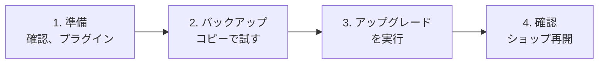

> 🌐 **言語:** [🇻🇳 Tiếng Việt](./upgrade_vi.md) · [🇬🇧 English](./upgrade.md) · 🇯🇵 日本語（現在）

# 3.x 系へのアップグレード

## はじめに
このページでは、稼働中の GP247 サイト — S-Cart のショップ、GP247 CMS のウェブサイト、または core だけを使う Laravel アプリケーション —
を、データ（コンテンツ、ユーザー、注文、顧客、商品）をそのまま残して **2.x 系から 3.x 系へ**移す方法を説明します。
サイトのオーナーと技術担当者向けのドキュメントです。読み終えると、自分のサイトがアップグレードできるか、何を準備するか、
どのコマンドを実行するか、どう確認するか、問題があったときにどう戻すかがわかります。

## ページの選び方
3 つのページはそれぞれ別の状況向けです。**このページのコマンドを、ほかの 2 つのページの作業に使うことはできません。**

| あなたの状況 | 読むページ |
| --- | --- |
| まだサイトがなく、新しく作りたい | [GP247 と S-Cart のインストール](./install_ja.md) |
| **3.x** 系のサイトを、より新しいバージョンにしたい | [GP247 と S-Cart の更新](./update_ja.md) |
| **2.x** 系またはそれより古いサイトを運用している | **3.x 系へのアップグレード**（このページ） |

サイトがどの系列かわからない場合は、`php artisan gp247:info` を実行して `gp247/core` の行を確認します。

## ひと目でわかる
進め方は、現在のバージョンによって決まります。

| 現在の `gp247/core` | 3.x への移り方 |
| --- | --- |
| **2.1.x / 2.2** | ✅ このページに沿って自動でアップグレード |
| **2.0.x** | ⚠️ 保証されません — 先にコピーで試してください。[1.x と 2.0 のサイト](#1x-と-20-のサイトは直接アップグレードできません)を参照 |
| **1.x** | ⛔ アップグレードできません — 3.x を新しくインストールしてからデータを移します |

2.1 / 2.2 のサイトでは、全体が 4 つの段階でできています。



**コマンドの要約** — 慣れている方向けです。バックアップを取り、コピーで試した後に実行します。サイトのパッケージ構成に合わせて
`composer require` を**どれか 1 行**選びます。

```bash
php artisan gp247:info

composer require "gp247/core:^3.10.2" "gp247/front:^3.5.2" "gp247/shop:^3.7" "gp247/mcp:^2.0.1" -W   # S-Cart
composer require "gp247/core:^3.10.2" "gp247/front:^3.5.2" -W                                        # GP247 CMS
composer require "gp247/core:^3.10.2" -W                                                             # core のみ

php artisan gp247:update
php artisan gp247:info
```

- **`composer update` ではなく `composer require … -W` を使います** — 2.x のサイトには `^2.…` の制約が書かれているため、
  Composer は自動では 3.0 に上がりません。
- **PHP や Laravel を変える必要はありません** — 2.x 系はすでに 3.x 系と同じ PHP 8.3 と Laravel 13 で動いています。
- **shop のあるサイトでは、一部の数字の計算方法が変わります**（注文のお金、キャッシュフロー）— 先に
  [変更点](#3x-系での変更点)を読んでください。
- **core 2.x 向けのプラグインは core 3.x では動きません** — アップグレードの前に core 3 向けのバージョンを用意します。

## このページの内容
- [始める前に](#始める前に) — 知っておくべき変更点、プラグイン、バックアップ
- [手順](#手順) — 実行するコマンド
- [結果の確認](#結果の確認) — ショップを再開する前に
- [問題が起きたとき](#問題が起きたとき) — 症状、対処方法、元に戻す方法
- [1.x と 2.0 のサイトは直接アップグレードできません](#1x-と-20-のサイトは直接アップグレードできません) — 代わりにやること

## 始める前に
準備は 3 つです。この段階ではサイトに何も変更しません。

### 3.x 系での変更点
アップグレードでデータが**削除されることはありません**。ただし、**shop のある**サイトは、3.0 でお金の記録方法が変わり、
アップグレード後に一部の数字が変わることを知っておいてください。core だけ、または core + front だけのサイトは、表の最後の行だけ
読めば十分です。

| 変更 | 見えること |
| --- | --- |
| **注文のお金は台帳になります**（shop あり） | 入金／返金のたびに、日付と支払方法の付いた行が記録されます。既存の注文には台帳が自動で作られ、「入金済み」の金額は変わりません |
| **キャッシュフローは入金日で集計**（InOut プラグイン） | 7 月に注文し 8 月に支払われた金額は、8 月に計上されます |
| **割引は税の前に差し引き**（shop あり） | 新しい注文では、割引後の金額に税がかかります |
| **古い `sc:*` コマンドの廃止**（すべてのサイト） | `gp247:install`、`gp247:update`、`gp247:info`、`gp247:doctor` を使います。古い S-Cart サイトに `app/Console/Commands/{Install,Update,Sample,Information}.php` が残っていれば削除してかまいません |

例付きの詳しい説明: [GP247 v3.0 リリースノート](../system/release-notes-3.0_ja.md)。3.0 以降の新機能:
[S-Cart のリリースとセキュリティ](../release/release_ja.md)。

### プラグインとテンプレート
プラグインは、動作できる core のバージョンを宣言しています。core 2.x 向けのプラグインは、サイトを壊さないよう core 3.x では
**有効化が止められます**。

1. 使っているものを一覧表示します。

   ```bash
   php artisan gp247:ext-list --type=plugin
   php artisan gp247:ext-list --type=template
   ```

2. 拡張機能ごとにやることを決めます。

   | お使いの拡張機能 | やること |
   | --- | --- |
   | GP247 のライブラリから入手 | アップグレード後に「Core 3.x+」と表示されたバージョンへ更新 |
   | 有料プラグイン | 購入元から core 3 向けのバージョンを入手 |
   | 自作 | 先に core 3 に対応させる: [プラグイン v1 から v2 への変換](../extension/convert-plugin-v1-to-v2_ja.md)、[安全に更新できるプラグイン](../extension/create-plugin-update-safety_ja.md) |
   | もう使っていない | アップグレード前にアンインストール |

3. 修正したショップのテンプレート（`app/GP247/Templates/…` 内のファイル）: アップグレード後に新しいバージョンと比べられるよう、
   修正したファイルの一覧を控えておきます。

### バックアップとコピーでの試行

- [ ] **完全なバックアップ** — DB、`.env`、`composer.json`、`composer.lock`、`app/GP247`、`public/GP247`、`storage` フォルダ。
      DB のバックアップファイルを実際に開き、使えることを確かめます。
- [ ] **バージョンを控える** — `php artisan gp247:info`。
- [ ] **コピーで試す** — サイトを別のフォルダ／マシンにコピーし、バックアップを別の DB に取り込んで、コピーで[手順](#手順)を
      実行します。コピーが問題なく動いてから本番サイトで行ってください。

## 手順

1. **注文の受付を一時停止**します（メンテナンスモードにするか、お客様に告知）。2 つのバージョンの間に注文が入らないようにするためです。

2. **ターミナル**を開き、サイトのルートフォルダに移動します。

3. **制約を広げて 3.x 系のコードを取得**します — サイトのパッケージ構成に合う行を選び（`php artisan gp247:info` で確認できます）、
   1 行をそのまま実行します。

   | お使いのサイト | コマンド |
   | --- | --- |
   | S-Cart | `composer require "gp247/core:^3.10.2" "gp247/front:^3.5.2" "gp247/shop:^3.7" "gp247/mcp:^2.0.1" -W` |
   | GP247 CMS（core + front） | `composer require "gp247/core:^3.10.2" "gp247/front:^3.5.2" -W` |
   | core + front + shop、MCP 不要 | `composer require "gp247/core:^3.10.2" "gp247/front:^3.5.2" "gp247/shop:^3.7" -W` |
   | core のみ | `composer require "gp247/core:^3.10.2" -W` |

   このコマンドはサイトの `composer.json` を 3.x 系に書き換え、新しいバージョンを取得します。`-W` は依存ライブラリの更新も許可します。
   成功すると、Composer が変更されたパッケージの一覧を表示し、`gp247/core` が `3.x` になっています。S-Cart の行は MCP サーバーの
   パッケージ（S-Cart 3.5 から）も追加します。

   > ℹ️ **情報:** 上の番号は S-Cart 3.5.1 の最低バージョンです。より新しい S-Cart ではこの値が上がることがあります —
   > [最新の S-Cart の `composer.json`](https://github.com/gp247net/s-cart/blob/master/composer.json) と照らし合わせてください。

4. **データを 3.x 系に変換**します。

   ```bash
   php artisan gp247:update
   ```

   コマンドはどのパッケージがあるかを自動で判別し、core、front、shop、MCP サーバー（あるもの）、プラグイン／テンプレートの順に
   実行し、キャッシュを再作成して、各手順の名前を表示します。エラーの行がなければ完了です。

5. [結果の確認](#結果の確認)に沿って**確認**し、ショップを再開します。

> 💡 **ヒント:** Docker では各コマンドの前に `docker compose exec app` を付けます（本番サーバーでは `-f docker-compose.prod.yml` も）。
> コマンドラインのないホスティングでは、パソコン上のコピーで作業してから転送します —
> [コマンドラインのないホスティングでの更新](./update_ja.md#コマンドラインのないホスティング)と同じ方法です。

## 結果の確認

- [ ] `php artisan gp247:info` — `gp247/core` が `3.` で始まっている。
- [ ] `php artisan gp247:doctor` に **fail** の項目がない。管理画面トップの「**システムアラート**」ブロックに赤い警告がない。
- [ ] 「**プラグイン**」／「**テンプレート管理**」画面 — 拡張機能を core 3 向けのバージョンに更新し、黄色のラベルがある拡張機能で
      「**データ更新を適用**」を押す。
- [ ] ウェブサイト — トップページといくつかのコンテンツページを開き、管理画面にログインする。
- [ ] *（shop あり）* ショップ — 商品ページを開き、テスト注文を 1 件入れる（その後キャンセル）。
- [ ] *（shop あり）* 既存の注文 — 支払済みの注文をいくつか開き、**支払履歴**に入金の行があり、「入金済み」の金額がアップグレード前と
      同じであること。
- [ ] *（shop あり）* レポート — 過去のある月の売上をアップグレード前の数字と比べる（InOut のキャッシュフローは入金日で集計される
      ようになった点に注意）。
- [ ] 修正したテンプレート — パッケージの新しいバージョンと比べ、必要な箇所を直す。
- [ ] 管理者アカウント — `admin` / `admin` が残っていればすぐに置き換える:
      [アカウントと権限](../security/security-accounts-and-access_ja.md)。

## 問題が起きたとき

| 症状 | よくある原因 | 対処方法 |
| --- | --- | --- |
| `composer update` の後も 2.x のまま | `^2.…` の制約が 3.0 への更新を許さない | [手順 3](#手順) の `composer require … -W` を使う |
| Composer がバージョンの衝突を報告する | `-W` がない、または別のパッケージが古いライブラリを固定している | 手順 3 の行をそのまま実行し、エラーに出ているパッケージ名を確認 |
| プラグインが非互換と表示される | プラグインが core 2.x 向けと宣言している | core 3 向けのバージョンに更新。[プラグインとテンプレート](#プラグインとテンプレート)を参照 |
| 過去の月の売上が以前と違う | キャッシュフローが入金日で集計されるようになった | 正常な動作 — [GP247 v3.0 リリースノート](../system/release-notes-3.0_ja.md)と照らし合わせる |
| `gp247:update` が途中で止まる | ある手順がエラーになった | 原因を直して再実行 — 各変換処理は再実行しても安全 |
| `gp247:update` の代わりに `gp247:install` を実行してしまった | インストールコマンドがテーブルを作り直した | すぐに止め、バックアップから DB を復元し、手順 3 からやり直す |

### 2.x 系に戻す
アップグレードで DB が変換されているため、**コードとデータの両方**をバックアップに戻す必要があります — コードだけを戻すとサイトは
エラーになります。

1. バックアップから DB を復元します。
2. バックアップの `composer.json`、`composer.lock`（変更していれば `app/GP247`、`public/GP247` も）で上書きします。
3. 古いパッケージを正確に入れ直します。

   ```bash
   composer install
   ```

4. `php artisan gp247:info` — `gp247/core` が控えておいた番号に戻っていること。サイトを開いて確認します。

> ⚠️ **注意:** バックアップ以降に入った注文は、DB の復元で失われます — これが、アップグレード中に注文の受付を止める理由です。

## 1.x と 2.0 のサイトは直接アップグレードできません
データの自動変換があるのは、**公開版 2.1 以降**だけです。

- **1.x のサイト** — 構造がまったく異なり、**アップグレードの道はありません**。新しい DB に[3.x を新規インストール](./install_ja.md)
  （同じパッケージ構成）し、サイトを設定し直してから、残したいデータ（コンテンツ、商品、カテゴリ、顧客）をお使いのエクスポート／
  インポートツールで移すか、技術パートナーに依頼します。新しいサイトの準備ができるまで、1.x のサイトは動かしたままにしておきます。
- **2.0.x のサイト** — 保証されません。**コピーで**試してください: `composer update`（2.x の最新版へ）→ `php artisan gp247:update`
  → 入念に確認。問題がなければ[手順](#手順)に進みます。コピーでエラーが出たり数字が合わなかったりした場合は、1.x のサイトと同じ
  方法をとります。

## 条件と制約（操作の前に確認）

**アップグレードの前**

- **サポートされる出発点は 2.1 / 2.2** — データの自動変換は公開版 2.1 以降にしかありません。
- **プラグインには core 3 向けのバージョンが必要** — core 2.x 向けと宣言したプラグインは、core 3.x では有効化が止められます。

**アップグレード中**

- **使うのは `gp247:update` だけ。`gp247:install` は絶対に使いません** — インストールコマンドはテーブルを作り直し、データを削除します。
- **`php artisan migrate` を自分で実行しません** — `gp247:update` が必要な変換を正しい順番で実行します。
- **`gp247:update` は再実行できます** — 各変換処理は実際の状態を確認してから動くため、2 回目は何も変わりません。

**元に戻すとき**

- **DB も復元が必要です** — データはすでに 3.x 系の形式になっており、2.x のコードでは正しく読めません。

## よくある質問（Q&A）
**Q1: アップグレードにはどのくらい時間がかかりますか？**

→ コマンド自体は通常数分で終わり、注文の多いサイトではもう少しかかります。これに、コピーでの試行と確認の時間が加わります。

**Q2: 2.1 から最新の 3.x に直接上げられますか？**

→ はい。`gp247:update` が足りない変換をすべて正しい順番で実行するため、3.0、3.1… と順に上げる必要はありません。

**Q3: PHP や Laravel を上げる必要はありますか？**

→ 2.x のサイトなら不要です。2.x 系はすでに 3.x 系と同じ PHP 8.3 と Laravel 13 を使っています。

**Q4: 1.x のサイト用のデータ移行ツールはありますか？**

→ 公式のツールはありません — [1.x と 2.0 のサイト](#1x-と-20-のサイトは直接アップグレードできません)を参照してください。

**Q5: 3.x に上げた後は、どうやって更新しますか？**

→ [GP247 と S-Cart の更新](./update_ja.md)だけで十分です: `composer update` の後に `php artisan gp247:update`。
`composer require … -W` は系列を変えるときだけ使います。

---

<sub>📅 **最終更新:** 2026-11-07 · ✍️ **作成者 (Author):** GP247</sub>
