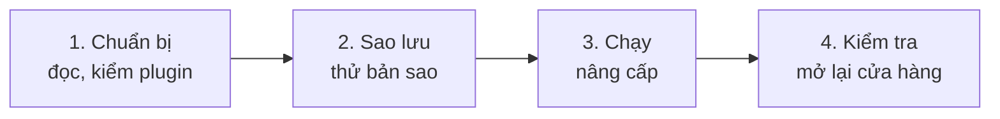

> 🌐 **Ngôn ngữ:** 🇻🇳 Tiếng Việt (hiện tại) · [🇬🇧 English](./upgrade.md) · [🇯🇵 日本語](./upgrade_ja.md)

# Nâng cấp lên dòng 3.x

## Giới thiệu
Trang này hướng dẫn đưa một site GP247 đang chạy — cửa hàng S-Cart, website GP247 CMS, hay ứng dụng Laravel chỉ dùng core —
**từ dòng 2.x lên dòng 3.x**, vẫn giữ nguyên dữ liệu (nội dung, người dùng, đơn hàng, khách hàng, sản phẩm).
Tài liệu dành cho chủ site và người phụ trách kỹ thuật. Đọc xong, bạn biết site mình nâng được hay không, cần chuẩn bị gì, chạy
lệnh nào, kiểm tra ra sao, và quay lui thế nào nếu có sự cố.

## Chọn đúng trang
Ba trang dùng cho ba tình huống khác nhau, và **lệnh của trang này không dùng được cho hai trang kia**:

| Tình huống của bạn | Đọc trang |
| --- | --- |
| Chưa có site, muốn tạo site mới | [Cài đặt GP247 và S-Cart](./install_vi.md) |
| Site đang chạy dòng **3.x**, muốn lên bản mới hơn | [Cập nhật GP247 và S-Cart](./update_vi.md) |
| Site đang chạy dòng **2.x** hoặc cũ hơn | **Nâng cấp lên dòng 3.x** (trang này) |

Không biết site đang ở dòng nào? Chạy `php artisan gp247:info` rồi xem dòng `gp247/core`.

## Nhìn nhanh
Đường đi phụ thuộc vào bản đang chạy:

| `gp247/core` đang là | Lên 3.x thế nào |
| --- | --- |
| **2.1.x / 2.2** | ✅ Nâng cấp tự động theo trang này |
| **2.0.x** | ⚠️ Không được bảo đảm — thử trên bản sao trước, xem [Site 1.x và 2.0](#site-1x-và-20-không-nâng-cấp-trực-tiếp-được) |
| **1.x** | ⛔ Không nâng cấp được — cài mới 3.x rồi chuyển dữ liệu |

Với site 2.1 / 2.2, cả quá trình gồm bốn chặng:



**Lệnh tóm tắt** — dành cho người đã quen, chạy sau khi đã sao lưu và thử trên bản sao; chọn **một** dòng `composer require`
theo bộ gói của site:

```bash
php artisan gp247:info

composer require "gp247/core:^3.10.2" "gp247/front:^3.5.2" "gp247/shop:^3.7" "gp247/mcp:^2.0.1" -W   # S-Cart
composer require "gp247/core:^3.10.2" "gp247/front:^3.5.2" -W                                        # GP247 CMS
composer require "gp247/core:^3.10.2" -W                                                             # chỉ core

php artisan gp247:update
php artisan gp247:info
```

- **Dùng `composer require … -W`, không phải `composer update`** — site 2.x ghi ràng buộc `^2.…`, nên Composer không tự lên 3.0.
- **Không phải đổi PHP hay Laravel** — dòng 2.x đã chạy PHP 8.3 và Laravel 13 như dòng 3.x.
- **Site có shop: một số con số đổi cách tính** (tiền của đơn, dòng tiền) — đọc [những gì thay đổi](#những-gì-thay-đổi-ở-dòng-3x) trước.
- **Plugin viết cho core 2.x không chạy trên core 3.x** — chuẩn bị bản cho core 3 trước khi nâng.

## Trong trang này
- [Trước khi bắt đầu](#trước-khi-bắt-đầu) — thay đổi cần biết, plugin, sao lưu
- [Các bước](#các-bước) — lệnh cụ thể
- [Kiểm tra kết quả](#kiểm-tra-kết-quả) — trước khi mở lại cửa hàng
- [Khi gặp sự cố](#khi-gặp-sự-cố) — triệu chứng, cách xử lý, quay lui
- [Site 1.x và 2.0 không nâng cấp trực tiếp được](#site-1x-và-20-không-nâng-cấp-trực-tiếp-được) — làm gì thay thế

## Trước khi bắt đầu
Ba việc chuẩn bị, chưa đổi gì trên site.

### Những gì thay đổi ở dòng 3.x
Nâng cấp **không xoá** dữ liệu. Site **có shop** cần biết dòng 3.0 sửa lại cách ghi nhận tiền, nên vài con số sẽ khác sau khi
nâng; site chỉ có core hoặc core + front chỉ cần đọc dòng cuối của bảng.

| Thay đổi | Bạn sẽ thấy |
| --- | --- |
| **Tiền của đơn là một cuốn sổ** (có shop) | Mỗi lần thu / hoàn tiền là một dòng có ngày, phương thức. Đơn cũ được tự tạo sổ, số "Đã nhận" không đổi |
| **Dòng tiền tính theo ngày thu** (plugin InOut) | Khoản đặt tháng 7, trả tháng 8 nay nằm ở tháng 8 |
| **Giảm giá trừ trước thuế** (có shop) | Đơn mới tính thuế trên số tiền đã giảm |
| **Bỏ lệnh `sc:*` cũ** (mọi site) | Dùng `gp247:install`, `gp247:update`, `gp247:info`, `gp247:doctor`. Site S-Cart cũ còn file `app/Console/Commands/{Install,Update,Sample,Information}.php` thì xoá được |

Chi tiết kèm ví dụ: [Ghi chú phát hành v3.0](../system/release-notes-3.0_vi.md). Tính năng mới từ 3.0 tới nay:
[Phát hành và bảo mật S-Cart](../release/release_vi.md).

### Plugin và giao diện
Plugin khai báo bản core mà nó chạy được; plugin viết cho core 2.x **bị chặn kích hoạt** trên core 3.x để tránh làm hỏng site.

1. Liệt kê những gì đang dùng:

   ```bash
   php artisan gp247:ext-list --type=plugin
   php artisan gp247:ext-list --type=template
   ```

2. Xác định việc cần làm cho từng extension:

   | Extension của bạn | Việc cần làm |
   | --- | --- |
   | Tải từ thư viện GP247 | Sau khi nâng, cập nhật lên bản ghi "Core 3.x+" |
   | Plugin trả phí | Lấy bản cho core 3 từ nơi bán |
   | Tự viết | Sửa cho core 3 trước: [Chuyển đổi Plugin v1 lên v2](../extension/convert-plugin-v1-to-v2_vi.md), [Plugin an toàn khi cập nhật](../extension/create-plugin-update-safety_vi.md) |
   | Không còn dùng | Gỡ trước khi nâng |

3. Giao diện cửa hàng đã sửa (file trong `app/GP247/Templates/…`): ghi lại danh sách file đã sửa để so với bản mới sau khi nâng.

### Sao lưu và thử trên bản sao

- [ ] **Sao lưu đầy đủ** — CSDL, `.env`, `composer.json`, `composer.lock`, các thư mục `app/GP247`, `public/GP247`, `storage`.
      Mở thử file sao lưu CSDL để chắc nó dùng được.
- [ ] **Ghi lại phiên bản** — `php artisan gp247:info`.
- [ ] **Thử trên bản sao** — chép site sang thư mục / máy khác, nhập bản sao lưu vào một CSDL riêng, chạy [các bước](#các-bước)
      trên bản sao. Chỉ làm trên site thật khi bản sao chạy ổn.

## Các bước

1. **Tạm ngừng nhận đơn** (bật bảo trì hoặc báo khách) để không có đơn rơi vào giữa hai phiên bản.

2. Mở **Terminal**, vào thư mục gốc của site.

3. **Nới ràng buộc và tải code dòng 3.x** — chọn đúng dòng theo bộ gói của site (xem bằng `php artisan gp247:info`), chạy
   nguyên dòng:

   | Site của bạn | Lệnh |
   | --- | --- |
   | S-Cart | `composer require "gp247/core:^3.10.2" "gp247/front:^3.5.2" "gp247/shop:^3.7" "gp247/mcp:^2.0.1" -W` |
   | GP247 CMS (core + front) | `composer require "gp247/core:^3.10.2" "gp247/front:^3.5.2" -W` |
   | Core + front + shop, không cần MCP | `composer require "gp247/core:^3.10.2" "gp247/front:^3.5.2" "gp247/shop:^3.7" -W` |
   | Chỉ core | `composer require "gp247/core:^3.10.2" -W` |

   Lệnh sửa `composer.json` của site sang dòng 3.x và tải bản mới; `-W` cho phép nâng cả các thư viện đi kèm. Thành công thì
   Composer in danh sách gói đã đổi, trong đó `gp247/core` lên `3.x`. Dòng S-Cart thêm luôn gói MCP server (có từ S-Cart 3.5).

   > ℹ️ **Thông tin:** các số trên là mức tối thiểu của S-Cart 3.5.1. Bản S-Cart mới hơn có thể nâng mức này — đối chiếu
   > [`composer.json` của S-Cart mới nhất](https://github.com/gp247net/s-cart/blob/master/composer.json).

4. **Chuyển đổi dữ liệu sang dòng 3.x**:

   ```bash
   php artisan gp247:update
   ```

   Lệnh tự nhận ra gói nào đang có, chạy lần lượt core, front, shop, MCP server (phần nào có), plugin / giao diện, làm mới
   cache, và in tên từng bước. Không dòng nào báo lỗi là xong.

5. **Kiểm tra** theo [Kiểm tra kết quả](#kiểm-tra-kết-quả), rồi mở lại cửa hàng.

> 💡 **Mẹo:** Docker thì thêm `docker compose exec app` trước mỗi lệnh (máy chủ thật thêm `-f docker-compose.prod.yml`).
> Hosting không có dòng lệnh thì làm trên bản sao ở máy bạn rồi tải lên, như
> [Cập nhật trên hosting không có dòng lệnh](./update_vi.md#hosting-không-có-dòng-lệnh).

## Kiểm tra kết quả

- [ ] `php artisan gp247:info` — `gp247/core` bắt đầu bằng `3.`.
- [ ] `php artisan gp247:doctor` không còn mục **fail**; khối **Cảnh báo hệ thống** ở trang chủ quản trị không có cảnh báo đỏ.
- [ ] Màn **Plugin** / **Template** — cập nhật các extension lên bản cho core 3; bấm **Áp dụng cập nhật dữ liệu** ở extension
      có nhãn vàng.
- [ ] Website — mở trang chủ, vài trang nội dung; đăng nhập trang quản trị.
- [ ] *(Có shop)* Cửa hàng — mở trang sản phẩm, đặt thử một đơn (rồi huỷ).
- [ ] *(Có shop)* Đơn cũ — mở vài đơn đã thanh toán: **lịch sử thanh toán** có dòng thu, số "Đã nhận" như trước khi nâng.
- [ ] *(Có shop)* Báo cáo — so doanh thu một tháng cũ với số trước khi nâng (nhớ dòng tiền InOut nay tính theo ngày thu).
- [ ] Giao diện đã sửa — so với bản mới của package, sửa lại chỗ cần thiết.
- [ ] Tài khoản quản trị — còn `admin` / `admin` thì thay ngay:
      [Tài khoản & phân quyền](../security/security-accounts-and-access_vi.md).

## Khi gặp sự cố

| Triệu chứng | Nguyên nhân thường gặp | Cách xử lý |
| --- | --- | --- |
| `composer update` xong vẫn ở 2.x | Ràng buộc `^2.…` không cho lên 3.0 | Dùng lệnh `composer require … -W` ở [bước 3](#các-bước) |
| Composer báo xung đột phiên bản | Thiếu `-W`, hoặc một gói khác khoá thư viện cũ | Chạy đúng nguyên dòng ở bước 3; đọc tên gói Composer nêu trong lỗi |
| Plugin báo không tương thích | Plugin khai báo core 2.x | Cập nhật lên bản cho core 3, xem [Plugin và giao diện](#plugin-và-giao-diện) |
| Doanh thu tháng cũ khác trước | Dòng tiền nay tính theo ngày thu | Bình thường — đối chiếu [Ghi chú phát hành v3.0](../system/release-notes-3.0_vi.md) |
| `gp247:update` dừng giữa chừng | Một bước báo lỗi | Sửa nguyên nhân rồi chạy lại — mỗi phần chuyển đổi chạy lại an toàn |
| Lỡ chạy `gp247:install` thay vì `gp247:update` | Lệnh cài đã tạo lại bảng | Dừng ngay, khôi phục CSDL từ bản sao lưu, làm lại từ bước 3 |

### Quay lui về dòng 2.x
Nâng cấp đã chuyển đổi CSDL, nên phải trả **cả code lẫn dữ liệu** về bản sao lưu — chỉ trả code là site lỗi:

1. Khôi phục CSDL từ bản sao lưu.
2. Chép đè `composer.json`, `composer.lock` (và `app/GP247`, `public/GP247` nếu đã đổi) từ bản sao lưu.
3. Cài lại đúng các gói cũ:

   ```bash
   composer install
   ```

4. `php artisan gp247:info` — `gp247/core` trở về số đã ghi lại. Mở site kiểm tra.

> ⚠️ **Lưu ý:** đơn phát sinh sau lúc sao lưu sẽ mất khi khôi phục CSDL — đó là lý do phải tạm ngừng nhận đơn trong lúc nâng.

## Site 1.x và 2.0 không nâng cấp trực tiếp được
Chuyển đổi dữ liệu tự động chỉ có **từ bản public 2.1** trở đi.

- **Site 1.x** — cấu trúc khác hẳn, **không có đường nâng cấp**. [Cài mới bản 3.x](./install_vi.md) (cùng bộ gói) trên CSDL mới, cấu hình
  lại site, rồi chuyển dữ liệu cần giữ (nội dung, sản phẩm, danh mục, khách hàng) bằng công cụ xuất / nhập của bạn hoặc nhờ đơn vị kỹ
  thuật. Giữ site 1.x chạy tới khi site mới sẵn sàng.
- **Site 2.0.x** — không được bảo đảm. Thử **trên bản sao**: `composer update` (lên bản 2.x mới nhất) →
  `php artisan gp247:update` → kiểm tra kỹ; ổn thì làm tiếp [các bước](#các-bước). Bản sao lỗi hoặc số liệu lệch thì đi theo
  cách của site 1.x.

## Điều kiện & ràng buộc (hiểu trước khi thao tác)

**Trước khi nâng**

- **Điểm xuất phát được hỗ trợ là 2.1 / 2.2** — chuyển đổi dữ liệu tự động chỉ có từ bản public 2.1.
- **Plugin phải có bản cho core 3** — plugin khai báo core 2.x bị chặn kích hoạt trên core 3.x.

**Khi nâng**

- **Chỉ dùng `gp247:update`, không bao giờ `gp247:install`** — lệnh cài tạo lại bảng và xoá dữ liệu.
- **Không tự chạy `php artisan migrate`** — `gp247:update` đã chạy đúng các phần chuyển đổi theo đúng thứ tự.
- **`gp247:update` chạy lại được** — mỗi phần chuyển đổi kiểm tra trạng thái thật trước khi làm; chạy lần hai không đổi gì thêm.

**Khi quay lui**

- **Phải khôi phục cả CSDL** — dữ liệu đã ở dạng của dòng 3.x, code 2.x không đọc đúng.

## Hỏi & Đáp (Q&A)
**Câu 1: Nâng cấp mất bao lâu?**

→ Các lệnh thường xong trong vài phút, lâu hơn với site nhiều đơn. Cộng thêm thời gian thử trên bản sao và kiểm tra.

**Câu 2: Tôi nhảy thẳng từ 2.1 lên bản 3.x mới nhất được không?**

→ Được. `gp247:update` chạy mọi phần chuyển đổi còn thiếu theo đúng thứ tự, không phải đi qua từng bản 3.0, 3.1…

**Câu 3: Có phải nâng PHP hay Laravel không?**

→ Không, với site 2.x: dòng 2.x đã dùng PHP 8.3 và Laravel 13 như dòng 3.x.

**Câu 4: Site 1.x có công cụ chuyển dữ liệu sẵn không?**

→ Không có công cụ chính thức — xem [Site 1.x và 2.0](#site-1x-và-20-không-nâng-cấp-trực-tiếp-được).

**Câu 5: Lên 3.x rồi, lần sau làm thế nào?**

→ Chỉ cần [Cập nhật GP247 và S-Cart](./update_vi.md): `composer update` rồi `php artisan gp247:update`. `composer require … -W` chỉ dùng
khi đổi dòng.

---

<sub>📅 **Cập nhật lần cuối:** 2026-11-07 · ✍️ **Tác giả (Author):** GP247</sub>
