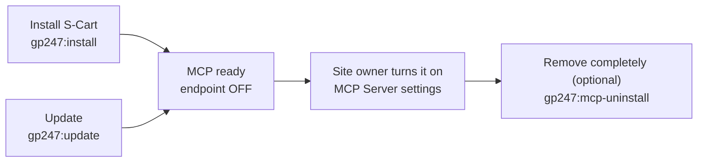
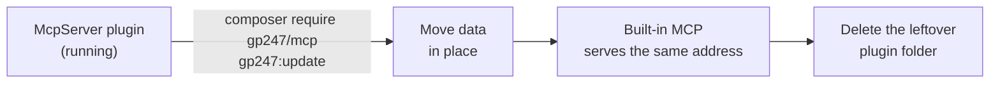

> 🌐 **Language:** [🇻🇳 Tiếng Việt](./mcp-administration_vi.md) · 🇬🇧 English (current) · [🇯🇵 日本語](./mcp-administration_ja.md)

# MCP administration & setup

## Introduction

This page is for **site owners** and the **technical person**: configuring MCP in the admin panel, granting staff permissions, and the
command-line install / update / uninstall of MCP — including moving from the old McpServer plugin. After reading it, you know what each
setting does, its default value, and how to update the site without agents losing their connection. Turning MCP on for the first time? See
[Quick start](./mcp-quickstart.md).

## At a glance

MCP follows the platform life cycle — you use the usual GP247 commands:



- **New S-Cart 3.5+ install** — `gp247:install` runs `gp247:mcp-install` itself; MCP is there but off.
- **Update** — `gp247:update` runs `gp247:mcp-update` itself; running it again is always safe.
- **Two admin screens** — **MCP Server** — token list (`<admin>/mcp/tokens`) and **MCP Server settings** (`<admin>/mcp/settings`), under **System config → MCP Server**.
- **Not using it? Leave it off** — a disabled MCP uses no resources; removing it is rarely needed.

## The MCP Server settings screen

Open **System config → MCP Server** and click **MCP Server settings** (needs the **"MCP server — configure"** permission). Settings apply to the **whole site**:

| Section | Setting | Default | Effect |
| --- | --- | --- | --- |
| Endpoint | **Turn on the MCP endpoint** | Off | When off, the MCP address answers 404 and agents cannot connect |
| Endpoint | **Extra allowed browser origins** | Empty | Origins (comma separated) allowed to call MCP from a browser, besides the site itself |
| Read tools | One switch per read tool | On | A tool switched off is not visible to agents |
| Write tools | One switch per write tool | Off | Turn on each write tool you need; there is no "turn all on" switch |
| Customer data | **Send customer contact details to agents (not masked)** | Off | When on, customer e-mail, phone and address are sent in full |
| Limits | **Requests per minute per token** | 60 | The per-IP limit is automatically 5 times this value |
| Limits | **Default token validity (days)** | 30 | Pre-filled value when creating a token |
| Limits | **Maximum token validity (days)** | 365 | No token can be created for longer |
| Limits | **Low-stock threshold** | 5 | Default threshold of `low_stock_products` |
| Limits | **Maximum date range of sales summary (days)** | 366 | Limit of each `sales_summary` question |
| Limits | **Maximum request size (KB)** | 64 | Larger requests are refused (413) |

- **Saving takes effect immediately** on the agent's next call — nothing to restart.
- **The REST API master switch** (API management screen) also turns MCP off; the separate API v1 / v2 switches do not.

> ⚠️ **Warning:** before turning a write tool on, read [Write tools](./mcp-tools.md#write-tools-preview-then-confirm) — and only give
> *Read + write* tokens to agents you trust.

## Staff permissions

MCP has two permissions of its own; grant them through **Roles** or directly to a user:

| Permission | Allows | Screen address |
| --- | --- | --- |
| **MCP server — use (own tokens)** | Open the MCP Server screen, create / revoke **their own** tokens, and use MCP | `<admin>/mcp/tokens` |
| **MCP server — configure** | Open the MCP Server settings screen | `<admin>/mcp/settings` |

- **The MCP permission opens no extra data** — a staff member's agent can still only read/edit the screens that staff member has access to.
- **The top administrator** sees and can revoke everybody's tokens.

## Command-line commands

Run them in the site's root folder (the folder with the `artisan` file). Every command supports `--json` for scripts/CI:

| Command | When to use | Destructive? |
| --- | --- | --- |
| `php artisan gp247:mcp-install` | Install the MCP data (settings, menu, 2 permissions) — `gp247:install` already calls it | No |
| `php artisan gp247:mcp-update` | Apply the data of the MCP version in place, move data from the old plugin — `gp247:update` already calls it | No |
| `php artisan gp247:mcp-uninstall` | Remove the MCP data and **revoke every MCP token** (asks to confirm; `--force` for scripts) | **Yes** — tokens are lost |
| `php artisan gp247:info` | See which `gp247/mcp` version is running | No |

You usually **do not need to call the MCP commands yourself** — the two platform commands take care of it:

1. Update the site as always:

   ```
   composer update
   php artisan gp247:update
   ```

2. If it worked, the output of the second command contains a `gp247:mcp-update` line.

> ℹ️ **Note:** sites with **route caching** on (`route:cache`) — `gp247:update` refreshes the cache itself. If you run `gp247:mcp-update` on its own,
> run `php artisan gp247:cache-rebuild` afterwards.

## Adding MCP to a site installed from an older S-Cart

A site installed from S-Cart **before 3.5** does not have the MCP package yet, because `composer update` does not add new packages to the site's own `composer.json`:

1. **Back up the database.**
2. Run:

   ```
   composer require gp247/mcp
   php artisan gp247:update
   ```

3. If it worked, the **System config → MCP Server** menu appears. Continue with [Quick start](./mcp-quickstart.md).

> ⚠️ **Warning:** `gp247/mcp` needs **`gp247/core` 3.9 or later**. If Composer cannot resolve the dependencies, update the core first (`composer update gp247/core`).

## Moving from the old McpServer plugin

From S-Cart 3.5, MCP is part of the platform, replacing the **McpServer** plugin. The first run of `gp247:mcp-update` **moves** the plugin's data automatically:



What is kept and what changes:

| Item | After the move |
| --- | --- |
| Agent tokens | **Kept** — agents need no new configuration |
| MCP address `api/core/mcp` | **Kept** |
| Settings (incl. tools on, origins, limits) | Values kept, moved to the built-in MCP |
| Plugin **disabled** | The endpoint stays **off** after the move — it does not turn itself on |
| Permissions granted to roles / users | **Kept**, renamed to "MCP server — use / configure" |
| Admin screens | Moved to `<admin>/mcp/tokens`, `<admin>/mcp/settings`; old `<admin>/mcp-server/…` bookmarks no longer work |
| Extensions list | MCP no longer appears in the plugin list |

Steps:

1. **Back up the database.**
2. Run:

   ```
   composer require gp247/mcp
   php artisan gp247:update
   ```

3. Delete the leftover plugin folder (the MCP Server screen reminds you too):

   ```
   php artisan gp247:ext-uninstall --type=plugin --key=McpServer --purge
   ```

   This **only deletes files** because the plugin is no longer registered — tokens are **not** revoked.

> ⚠️ **Warning:** **do not uninstall the McpServer plugin before step 2** (the uninstall button on the Extensions screen or the uninstall command while the
> plugin is still registered) — the plugin's uninstall revokes every MCP token. Update first, then delete the folder in step 3.

## Turning MCP off or removing it

| You want | Do | Tokens |
| --- | --- | --- |
| Pause MCP | Turn off **Turn on the MCP endpoint** in the settings | Kept; turn it back on and they work again |
| Emergency stop for API and MCP | Turn off the REST API master switch on the API management screen | Kept |
| Remove it from the site | `php artisan gp247:mcp-uninstall`, then (optional) `composer remove gp247/mcp` | **All revoked** |

## Conditions & Rules (know before you act)

- **`gp247:mcp-install` / `gp247:mcp-update` need an installed platform** — on a database without GP247 they report a clear error and write nothing.
- **`gp247:mcp-uninstall` asks for confirmation** — run non-interactively or with `--json` without `--force`, it refuses, so a script cannot revoke tokens by accident.
- **The install / update commands give the same result when run again** — no duplicated menu, permissions or settings; values you changed are not overwritten.
- **MCP settings apply to the whole site** — there are no per-store settings.

## Q&A

**Q1: After updating S-Cart, do agents need new configuration?**

→ No. The MCP address and tokens stay the same across updates, including the move from the old McpServer plugin.

**Q2: `composer require gp247/mcp` reports a dependency error?**

→ `gp247/mcp` needs `gp247/core` 3.9 or later. Run `composer update gp247/core gp247/front gp247/shop` first, then run the command again.

**Q3: I cannot see the MCP Server settings button?**

→ Your account lacks the **"MCP server — configure"** permission. Ask the top administrator to grant it through Roles.

**Q4: After the move, the Extensions screen still shows McpServer?**

→ The plugin folder is still on disk. Run `php artisan gp247:ext-uninstall --type=plugin --key=McpServer --purge` to delete it — tokens are not affected.

**Q5: I clicked Install on the McpServer plugin again after the move?**

→ The built-in MCP keeps its address and tokens. **Do not uninstall the plugin** (the button or `gp247:ext-uninstall`, even with `--only-data`): the plugin
now counts as installed, so uninstalling it revokes every MCP token. **Disable** it (`php artisan gp247:ext-disable --type=plugin --key=McpServer`)
and delete the `app/GP247/Plugins/McpServer` folder with your hosting file manager.

**Q6: Are there per-store MCP settings?**

→ No — settings apply to the whole site. The data scope follows each account's store (see [Multi-store sites](./mcp-security.md#multi-store-sites)).

**Q7: Where do I see the running MCP version?**

→ Run `php artisan gp247:info`; the `gp247/mcp` line shows the version.

**Q8: Does removing MCP delete orders or products?**

→ No. MCP has no tables of its own; removing it only deletes MCP's settings, menu and permissions and revokes MCP tokens.

---

<sub>📅 **Last updated:** 2026-11-03 · ✍️ **Author:** GP247</sub>
