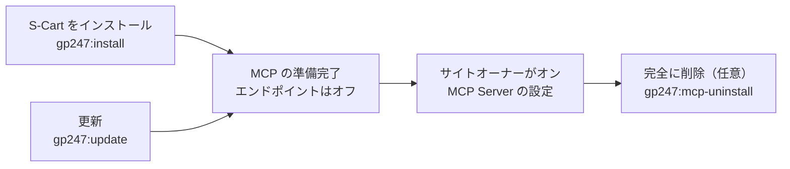
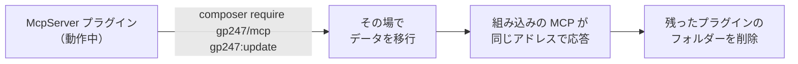

> 🌐 **言語:** [🇻🇳 Tiếng Việt](./mcp-administration_vi.md) · [🇬🇧 English](./mcp-administration.md) · 🇯🇵 日本語（現在）

# MCP の管理と設定

## はじめに

このページは**サイトオーナー**と**技術担当者**向けです。管理画面での MCP の設定、スタッフへの権限付与、そしてコマンドラインでの MCP のインストール /
更新 / 削除（旧 McpServer プラグインからの移行を含む）を説明します。読み終えると、各設定の効果と初期値、エージェントの接続を切らずにサイトを更新する
方法がわかります。初めて MCP をオンにする場合は[クイックスタート](./mcp-quickstart_ja.md)をご覧ください。

## ひと目でわかる

MCP はプラットフォームのライフサイクルに沿って動きます。いつもの GP247 のコマンドを使います。



- **S-Cart 3.5 以上の新規インストール** — `gp247:install` が `gp247:mcp-install` を自動で実行します。MCP はありますがオフです。
- **更新** — `gp247:update` が `gp247:mcp-update` を自動で実行します。何度実行しても安全です。
- **管理画面は 2 つ** — **MCP Server**（トークン一覧、`<admin>/mcp/tokens`）と **MCP Server の設定**（`<admin>/mcp/settings`）で、**システム設定 → MCP Server** メニューにあります。
- **使わないならオフのままで** — オフの MCP はリソースを使いません。削除が必要になることはほとんどありません。

## MCP Server の設定画面

**システム設定 → MCP Server** を開き、**MCP Server の設定** をクリックします（**「MCP server — configure」** 権限が必要）。設定は**サイト全体**に適用されます。

| セクション | 設定 | 初期値 | 効果 |
| --- | --- | --- | --- |
| エンドポイント | **MCPエンドポイントをオンにする** | オフ | オフのとき MCP のアドレスは 404 を返し、エージェントは接続できません |
| エンドポイント | **追加で許可するブラウザのオリジン** | 空欄 | サイト自身以外に、ブラウザから MCP を呼べるオリジン（カンマ区切り） |
| 読み取りツール | 読み取りツールごとのスイッチ | オン | オフにしたツールはエージェントに表示されません |
| 書き込みツール | 書き込みツールごとのスイッチ | オフ | 必要な書き込みツールを 1 つずつオンにします。「すべてオン」はありません |
| 顧客データ | **顧客の連絡先情報をエージェントに送信する (マスクなし)** | オフ | オンにすると、顧客のメールアドレス、電話番号、住所がそのまま送られます |
| 制限 | **トークンごとの1分あたりのリクエスト数** | 60 | IP ごとの上限は自動でこの値の 5 倍になります |
| 制限 | **トークンの既定の有効期間 (日)** | 30 | トークン作成時にあらかじめ入る値 |
| 制限 | **トークンの最大有効期間 (日)** | 365 | これより長いトークンは作成できません |
| 制限 | **在庫僅少のしきい値** | 5 | `low_stock_products` の既定のしきい値 |
| 制限 | **売上サマリーの最大期間 (日)** | 366 | `sales_summary` の 1 回あたりの上限 |
| 制限 | **最大リクエストサイズ (KB)** | 64 | これより大きいリクエストは拒否されます（413） |

- **保存するとすぐに反映されます** — エージェントの次の呼び出しから有効で、再起動は不要です。
- **REST API のマスタースイッチ**（API 管理画面）も MCP をオフにします。API v1 / v2 の個別スイッチは影響しません。

> ⚠️ **注意:** 書き込みツールをオンにする前に[書き込みツール](./mcp-tools_ja.md#書き込みツールプレビューしてから確定)を読み、*読み取り + 書き込み* の
> トークンは信頼できるエージェントだけに渡してください。

## スタッフの権限

MCP には専用の権限が 2 つあります。**ロール（Roles）** 経由、またはユーザーに直接付与します。

| 権限 | 許可する内容 | 画面のアドレス |
| --- | --- | --- |
| **MCP server — use (own tokens)** | MCP Server 画面を開き、**自分の**トークンを作成 / 無効化し、MCP を使う | `<admin>/mcp/tokens` |
| **MCP server — configure** | MCP Server の設定画面を開く | `<admin>/mcp/settings` |

- **MCP の権限で見られるデータが増えることはありません** — スタッフのエージェントが読んだり編集したりできるのは、そのスタッフが権限を持つ画面だけです。
- **最上位の管理者**は全員のトークンを表示・無効化できます。

## コマンドラインのコマンド

サイトのルートフォルダー（`artisan` ファイルがあるフォルダー）で実行します。すべてのコマンドはスクリプトや CI 向けに `--json` に対応しています。

| コマンド | 使う場面 | データを消すか |
| --- | --- | --- |
| `php artisan gp247:mcp-install` | MCP のデータ（設定、メニュー、2 つの権限）をインストール。`gp247:install` が自動で呼びます | いいえ |
| `php artisan gp247:mcp-update` | 現在の MCP バージョンのデータを適用し、旧プラグインのデータを移行。`gp247:update` が自動で呼びます | いいえ |
| `php artisan gp247:mcp-uninstall` | MCP のデータを削除し、**すべての MCP トークンを無効化**（確認あり。スクリプトでは `--force`） | **はい** — トークンが失われます |
| `php artisan gp247:info` | 動作中の `gp247/mcp` のバージョンを確認 | いいえ |

通常は MCP のコマンドを**個別に呼ぶ必要はありません**。プラットフォームの 2 つのコマンドが処理します。

1. いつもどおりサイトを更新します。

   ```
   composer update
   php artisan gp247:update
   ```

2. 成功すると、2 つ目のコマンドの出力に `gp247:mcp-update` の行があります。

> ℹ️ **情報:** **ルートキャッシュ**（`route:cache`）を使っているサイトでは、`gp247:update` がキャッシュを自動で更新します。`gp247:mcp-update` だけを実行した
> 場合は、その後に `php artisan gp247:cache-rebuild` を実行してください。

## 古い S-Cart のサイトに MCP を追加する

S-Cart **3.5 より前**からインストールしたサイトには、まだ MCP パッケージがありません。`composer update` はサイト自身の `composer.json` に新しいパッケージを追加しないためです。

1. **データベースをバックアップします。**
2. 次を実行します。

   ```
   composer require gp247/mcp
   php artisan gp247:update
   ```

3. 成功すると **システム設定 → MCP Server** メニューが表示されます。続きは[クイックスタート](./mcp-quickstart_ja.md)をご覧ください。

> ⚠️ **注意:** `gp247/mcp` には **`gp247/core` 3.9 以上**が必要です。Composer が依存関係を解決できない場合は、先に core を更新してください（`composer update gp247/core`）。

## 旧 McpServer プラグインからの移行

S-Cart 3.5 から、MCP は **McpServer** プラグインに代わってプラットフォームの一部になりました。最初の `gp247:mcp-update` の実行で、プラグインのデータが**自動で移行**されます。



引き継がれるものと変わるもの：

| 項目 | 移行後 |
| --- | --- |
| エージェントのトークン | **そのまま** — エージェントの再設定は不要 |
| MCP のアドレス `api/core/mcp` | **そのまま** |
| 設定（オンのツール、オリジン、制限を含む） | 値を引き継ぎ、組み込みの MCP に移行 |
| **無効化**していたプラグイン | 移行後もエンドポイントは**オフ**のまま。自動でオンにはなりません |
| ロール / ユーザーに付与した権限 | **そのまま**。名前は「MCP server — use / configure」に変わります |
| 管理画面 | `<admin>/mcp/tokens`、`<admin>/mcp/settings` に移動。古い `<admin>/mcp-server/…` のブックマークは使えません |
| 拡張機能の一覧 | MCP はプラグイン一覧に表示されなくなります |

手順：

1. **データベースをバックアップします。**
2. 次を実行します。

   ```
   composer require gp247/mcp
   php artisan gp247:update
   ```

3. 残ったプラグインのフォルダーを削除します（MCP Server 画面でも案内されます）。

   ```
   php artisan gp247:ext-uninstall --type=plugin --key=McpServer --purge
   ```

   プラグインはすでに登録解除されているため、このコマンドは**ファイルを削除するだけ**で、トークンは**無効化されません**。

> ⚠️ **注意:** **手順 2 の前に McpServer プラグインをアンインストールしないでください**（拡張機能画面のアンインストールボタンや、プラグインが登録されている
> 状態でのアンインストールコマンド）。プラグインのアンインストールはすべての MCP トークンを無効化します。先に更新し、その後に手順 3 でフォルダーを削除します。

## MCP をオフにする・削除する

| したいこと | 方法 | トークン |
| --- | --- | --- |
| MCP を一時停止 | 設定で **MCPエンドポイントをオンにする** をオフ | 残ります。オンに戻せばまた使えます |
| API と MCP を緊急停止 | API 管理画面で REST API のマスタースイッチをオフ | 残ります |
| サイトから削除 | `php artisan gp247:mcp-uninstall`、続けて（任意）`composer remove gp247/mcp` | **すべて無効化** |

## 条件と制約（操作の前に確認）

- **`gp247:mcp-install` / `gp247:mcp-update` にはインストール済みのプラットフォームが必要です** — GP247 がないデータベースでは明確なエラーを出し、何も書き込みません。
- **`gp247:mcp-uninstall` は確認を求めます** — 非対話モードや `--json` で `--force` なしに実行すると拒否します。スクリプトが誤ってトークンを無効化しないためです。
- **インストール / 更新コマンドは何度実行しても同じ結果です** — メニュー、権限、設定は重複せず、変更した値は上書きされません。
- **MCP の設定はサイト全体に適用されます** — ストアごとの設定はありません。

## よくある質問（Q&A）

**Q1: S-Cart を更新したら、エージェントの再設定は必要ですか？**

→ 不要です。MCP のアドレスとトークンは、旧 McpServer プラグインからの移行を含め、更新を通じて変わりません。

**Q2: `composer require gp247/mcp` で依存関係のエラーが出ます。**

→ `gp247/mcp` には `gp247/core` 3.9 以上が必要です。先に `composer update gp247/core gp247/front gp247/shop` を実行してから、もう一度コマンドを実行してください。

**Q3: MCP Server の設定ボタンが見当たりません。**

→ アカウントに **「MCP server — configure」** 権限がありません。最上位の管理者にロール経由で付与してもらってください。

**Q4: 移行後も拡張機能画面に McpServer が表示されます。**

→ プラグインのフォルダーがまだディスクに残っています。`php artisan gp247:ext-uninstall --type=plugin --key=McpServer --purge` で削除してください。トークンには影響しません。

**Q5: 移行後に McpServer プラグインをもう一度インストールしてしまいました。**

→ 組み込みの MCP はアドレスとトークンを保ったままです。**プラグインはアンインストールしないでください**（ボタンや `gp247:ext-uninstall`、`--only-data` でも）。
このときプラグインはインストール済みの扱いなので、アンインストールするとすべての MCP トークンが無効化されます。プラグインを**無効化**し
（`php artisan gp247:ext-disable --type=plugin --key=McpServer`）、ホスティングのファイルマネージャーで `app/GP247/Plugins/McpServer` フォルダーを削除してください。

**Q6: ストアごとの MCP 設定はありますか？**

→ ありません。設定はサイト全体に適用されます。データの範囲は各アカウントのストアに従います（[複数ストアのサイト](./mcp-security_ja.md#複数ストアのサイト)を参照）。

**Q7: 動作中の MCP のバージョンはどこで確認できますか？**

→ `php artisan gp247:info` を実行してください。`gp247/mcp` の行にバージョンが表示されます。

**Q8: MCP を削除すると注文や商品のデータも消えますか？**

→ 消えません。MCP には専用のテーブルがなく、削除で消えるのは MCP の設定、メニュー、権限と、MCP トークンだけです。

---

<sub>📅 **最終更新:** 2026-11-03 · ✍️ **作成者 (Author):** GP247</sub>
