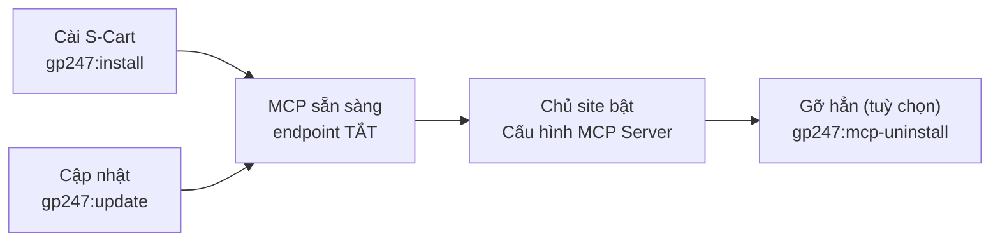
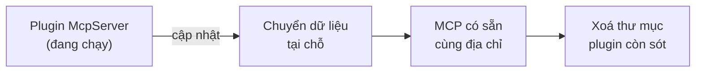

> 🌐 **Ngôn ngữ:** 🇻🇳 Tiếng Việt (hiện tại) · [🇬🇧 English](./mcp-administration.md) · [🇯🇵 日本語](./mcp-administration_ja.md)

# Quản trị & cài đặt MCP

## Giới thiệu

Trang này dành cho **chủ site** và **người phụ trách kỹ thuật**: cấu hình MCP trên trang quản trị, cấp quyền cho nhân viên, và các lệnh
cài / cập nhật / gỡ MCP bằng dòng lệnh — kể cả việc chuyển từ plugin McpServer cũ. Đọc xong, bạn biết từng thiết lập có tác dụng gì, giá
trị mặc định là bao nhiêu, và cập nhật site mà không làm agent mất kết nối. Muốn bật MCP lần đầu, xem [Bắt đầu nhanh](./mcp-quickstart_vi.md).

## Nhìn nhanh

MCP đi cùng vòng đời của nền tảng — bạn dùng đúng các lệnh quen thuộc của GP247:



- **Cài mới S-Cart 3.5+** — `gp247:install` tự chạy `gp247:mcp-install`; MCP có sẵn nhưng tắt.
- **Cập nhật** — `gp247:update` tự chạy `gp247:mcp-update`; chạy lại nhiều lần vẫn an toàn.
- **Hai màn quản trị** — **MCP Server** — danh sách token (`<admin>/mcp/tokens`) và **Cấu hình MCP Server** (`<admin>/mcp/settings`), trong menu **Cấu hình hệ thống → MCP Server**.
- **Không dùng thì cứ để tắt** — MCP tắt không tốn tài nguyên; gỡ hẳn ít khi cần.

## Màn Cấu hình MCP Server

Mở **Cấu hình hệ thống → MCP Server**, bấm **Cấu hình MCP Server** (cần quyền **"MCP server — configure"**). Các thiết lập áp dụng cho **toàn site**:

| Mục | Thiết lập | Mặc định | Tác dụng |
| --- | --- | --- | --- |
| Endpoint | **Bật endpoint MCP** | Tắt | Tắt thì địa chỉ MCP trả 404, agent không kết nối được |
| Endpoint | **Origin trình duyệt được phép thêm** | Trống | Danh sách origin (ngăn bằng dấu phẩy) được gọi MCP từ trình duyệt, ngoài chính site |
| Công cụ đọc | Một công tắc cho từng công cụ đọc | Bật | Tắt công cụ nào thì agent không thấy công cụ đó |
| Công cụ ghi | Một công tắc cho từng công cụ ghi | Tắt | Bật từng công cụ ghi cần dùng; không có công tắc bật tất cả |
| Dữ liệu khách hàng | **Gửi thông tin liên hệ của khách cho agent (không che)** | Tắt | Bật thì email, điện thoại, địa chỉ của khách được gửi nguyên văn |
| Giới hạn | **Số request mỗi phút cho mỗi token** | 60 | Giới hạn theo IP tự bằng 5 lần số này |
| Giới hạn | **Hiệu lực mặc định của token (ngày)** | 30 | Giá trị điền sẵn khi tạo token |
| Giới hạn | **Hiệu lực tối đa của token (ngày)** | 365 | Không tạo được token dài hơn |
| Giới hạn | **Ngưỡng sắp hết hàng** | 5 | Ngưỡng mặc định của `low_stock_products` |
| Giới hạn | **Khoảng ngày tối đa của tổng quan bán hàng (ngày)** | 366 | Giới hạn mỗi lần hỏi `sales_summary` |
| Giới hạn | **Kích thước request tối đa (KB)** | 64 | Request lớn hơn bị từ chối (413) |

- **Lưu là có hiệu lực ngay** ở lần gọi kế tiếp của agent — không cần khởi động lại gì.
- **Công tắc tổng REST API** (màn quản lý API) cũng tắt MCP; công tắc riêng của API v1 / v2 không ảnh hưởng.

> ⚠️ **Lưu ý:** trước khi bật công cụ ghi, đọc [Công cụ ghi](./mcp-tools_vi.md#công-cụ-ghi-xem-trước-rồi-mới-xác-nhận) — và chỉ cấp token
> *Đọc + ghi* cho agent bạn tin cậy.

## Quyền cho nhân viên

MCP có hai quyền riêng; gán qua **Vai trò (Roles)** hoặc trực tiếp cho người dùng:

| Quyền | Cho phép | Địa chỉ màn |
| --- | --- | --- |
| **MCP server — use (own tokens)** | Mở màn MCP Server, tạo / thu hồi token **của mình**, và dùng MCP | `<admin>/mcp/tokens` |
| **MCP server — configure** | Mở màn Cấu hình MCP Server | `<admin>/mcp/settings` |

- **Quyền MCP không mở thêm dữ liệu** — agent của nhân viên vẫn chỉ đọc/sửa được những màn mà nhân viên đó có quyền.
- **Quản trị viên cao nhất** thấy và thu hồi được token của mọi người.

## Lệnh dòng lệnh

Chạy tại thư mục gốc của site (thư mục có file `artisan`). Mọi lệnh hỗ trợ `--json` để dùng trong script/CI:

| Lệnh | Khi nào dùng | Phá dữ liệu? |
| --- | --- | --- |
| `php artisan gp247:mcp-install` | Cài dữ liệu MCP (cấu hình, menu, 2 quyền) — `gp247:install` đã tự gọi | Không |
| `php artisan gp247:mcp-update` | Áp dụng dữ liệu cho bản MCP đang có, chuyển dữ liệu từ plugin cũ — `gp247:update` đã tự gọi | Không |
| `php artisan gp247:mcp-uninstall` | Gỡ dữ liệu MCP và **thu hồi mọi token MCP** (hỏi xác nhận; `--force` cho script) | **Có** — mất token |
| `php artisan gp247:info` | Xem phiên bản `gp247/mcp` đang chạy | Không |

Thường bạn **không cần gọi riêng** lệnh MCP — hai lệnh chung của nền tảng đã lo:

1. Cập nhật site như mọi khi:

   ```
   composer update
   php artisan gp247:update
   ```

2. Nếu thành công, phần kết quả của lệnh thứ hai có dòng `gp247:mcp-update`.

> ℹ️ **Thông tin:** site đang bật **cache route** (`route:cache`) — `gp247:update` tự làm mới cache. Chạy riêng `gp247:mcp-update` thì sau đó
> chạy thêm `php artisan gp247:cache-rebuild`.

## Thêm MCP vào site cài từ S-Cart cũ

Site cài từ S-Cart **trước 3.5** chưa có gói MCP, vì `composer update` không tự thêm gói mới vào `composer.json` của site:

1. **Sao lưu cơ sở dữ liệu.**
2. Chạy:

   ```
   composer require gp247/mcp -W
   php artisan gp247:update
   ```

3. Nếu thành công, menu **Cấu hình hệ thống → MCP Server** xuất hiện. Tiếp tục ở [Bắt đầu nhanh](./mcp-quickstart_vi.md).

> ⚠️ **Lưu ý:** `gp247/mcp` cần **`gp247/core` 3.9 trở lên**. Cờ `-W` cho phép Composer nâng core (và các gói GP247 khác) lên bản đủ mới cùng lúc — thiếu `-W`, site còn core 3.8 sẽ báo không giải được phụ thuộc.

## Chuyển từ plugin McpServer cũ

Từ S-Cart 3.5, MCP là một phần của nền tảng, thay cho plugin **McpServer**. Lần chạy `gp247:mcp-update` đầu tiên **tự chuyển** dữ liệu của plugin:



Những gì được giữ và đổi:

| Thứ | Sau khi chuyển |
| --- | --- |
| Token của agent | **Giữ nguyên** — agent không phải cấu hình lại |
| Địa chỉ MCP `api/core/mcp` | **Giữ nguyên** |
| Cấu hình (kể cả công cụ đang bật, origin, giới hạn) | Giữ giá trị, chuyển sang MCP có sẵn |
| Plugin đang **tắt** | Endpoint vẫn **tắt** sau khi chuyển — không tự bật lại |
| Quyền đã gán cho vai trò / người dùng | **Giữ nguyên**, đổi tên thành "MCP server — use / configure" |
| Màn quản trị | Chuyển sang `<admin>/mcp/tokens`, `<admin>/mcp/settings`; bookmark cũ `<admin>/mcp-server/…` không còn dùng được |
| Danh sách Extension | MCP không còn nằm trong danh sách plugin |

Các bước:

1. **Sao lưu cơ sở dữ liệu.**
2. Chạy:

   ```
   composer require gp247/mcp -W
   php artisan gp247:update
   ```

3. Xoá thư mục plugin còn sót (màn MCP Server cũng nhắc việc này):

   ```
   php artisan gp247:ext-uninstall --type=plugin --key=McpServer --purge
   ```

   Lệnh này **chỉ xoá file** vì plugin đã hết đăng ký — token **không** bị thu hồi.

> ⚠️ **Lưu ý:** **đừng gỡ plugin McpServer trước bước 2** (nút gỡ trên màn Extension hay lệnh gỡ khi plugin còn đăng ký) — thao tác gỡ của
> plugin thu hồi mọi token MCP. Hãy cập nhật trước, rồi mới xoá thư mục ở bước 3.

## Tắt hoặc gỡ MCP

| Muốn | Làm | Token |
| --- | --- | --- |
| Tạm ngừng MCP | Tắt **Bật endpoint MCP** trong cấu hình | Giữ nguyên, bật lại là dùng tiếp |
| Ngắt khẩn cấp cả API lẫn MCP | Tắt công tắc tổng REST API trên màn quản lý API | Giữ nguyên |
| Gỡ hẳn khỏi site | `php artisan gp247:mcp-uninstall`, rồi (tuỳ chọn) `composer remove gp247/mcp` | **Bị thu hồi hết** |

## Điều kiện & ràng buộc (hiểu trước khi thao tác)

- **`gp247:mcp-install` / `gp247:mcp-update` cần nền tảng đã cài** — chạy trên cơ sở dữ liệu chưa cài GP247 thì báo lỗi rõ và không ghi gì.
- **`gp247:mcp-uninstall` hỏi xác nhận** — chạy không tương tác hay với `--json` mà thiếu `--force` thì từ chối, để script không lỡ tay thu hồi token.
- **Hai lệnh install / update chạy lại nhiều lần cho cùng kết quả** — không nhân đôi menu, quyền hay cấu hình; không ghi đè giá trị bạn đã chỉnh.
- **Cấu hình MCP áp dụng toàn site** — không có cấu hình riêng từng cửa hàng.

## Hỏi & Đáp (Q&A)

**Câu 1: Cập nhật S-Cart xong agent có phải cấu hình lại không?**

→ Không. Địa chỉ MCP và token giữ nguyên qua các lần cập nhật, kể cả khi chuyển từ plugin McpServer cũ.

**Câu 2: `composer require gp247/mcp` báo lỗi phụ thuộc?**

→ `gp247/mcp` cần `gp247/core` 3.9 trở lên, mà core của site đang khoá ở bản cũ hơn. Chạy lại kèm `-W`: `composer require gp247/mcp -W`.

**Câu 3: Tôi không thấy nút Cấu hình MCP Server?**

→ Tài khoản thiếu quyền **"MCP server — configure"**. Nhờ quản trị viên cao nhất gán quyền này qua Vai trò.

**Câu 4: Sau khi chuyển từ plugin, màn Extension vẫn hiện McpServer?**

→ Thư mục plugin còn trên đĩa. Chạy `php artisan gp247:ext-uninstall --type=plugin --key=McpServer --purge` để xoá — token không bị ảnh hưởng.

**Câu 5: Lỡ bấm Cài lại plugin McpServer sau khi đã chuyển?**

→ MCP có sẵn vẫn giữ địa chỉ và token. **Đừng gỡ plugin** (nút gỡ hay `gp247:ext-uninstall`, kể cả `--only-data`): plugin lúc này đang ở
trạng thái đã cài nên thao tác gỡ sẽ thu hồi mọi token MCP. Hãy **tắt** plugin (`php artisan gp247:ext-disable --type=plugin --key=McpServer`)
rồi xoá thư mục `app/GP247/Plugins/McpServer` bằng trình quản lý file của hosting.

**Câu 6: Có cấu hình MCP riêng cho từng cửa hàng không?**

→ Không — cấu hình áp dụng toàn site. Phạm vi dữ liệu thì theo cửa hàng của từng tài khoản (xem [Site nhiều cửa hàng](./mcp-security_vi.md#site-nhiều-cửa-hàng)).

**Câu 7: Xem phiên bản MCP đang chạy ở đâu?**

→ Chạy `php artisan gp247:info`; dòng `gp247/mcp` cho biết phiên bản.

**Câu 8: Gỡ MCP có xoá dữ liệu đơn hàng, sản phẩm không?**

→ Không. MCP không có bảng dữ liệu riêng; gỡ chỉ xoá cấu hình, menu, quyền của MCP và thu hồi token MCP.

---

<sub>📅 **Cập nhật lần cuối:** 2026-11-04 · ✍️ **Tác giả (Author):** GP247</sub>
