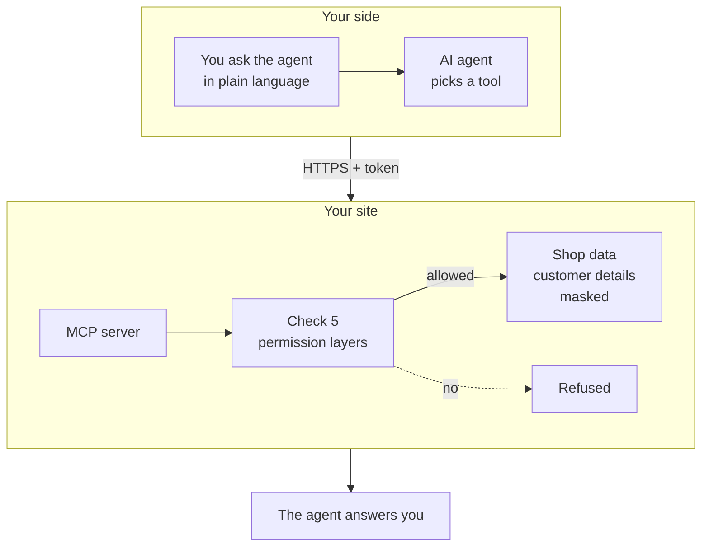
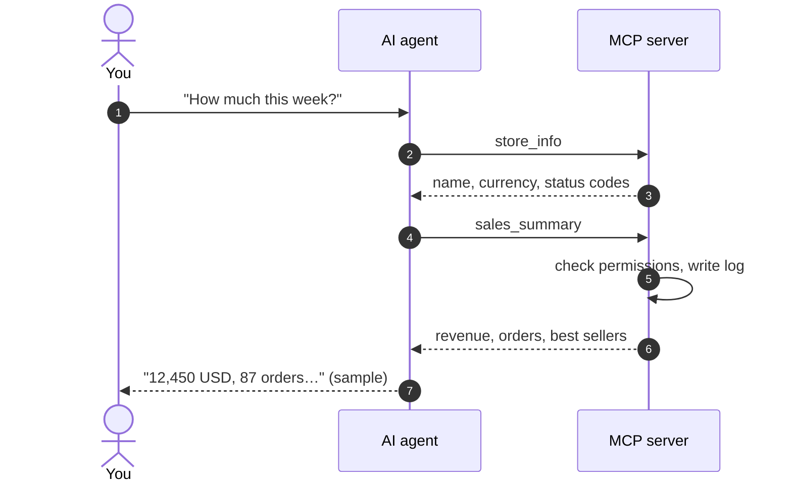

> 🌐 **Language:** [🇻🇳 Tiếng Việt](./mcp-introduction_vi.md) · 🇬🇧 English (current) · [🇯🇵 日本語](./mcp-introduction_ja.md)

# Introduction to the GP247 MCP server

## Introduction

This document introduces the **MCP server built into S-Cart** (package `gp247/mcp`) — the way for the AI agent you already use (Claude,
Cursor, VS Code…) to work directly with your shop: look up orders, check stock, summarise sales and — when you allow it — change an order
status or receive/issue stock. It is written for **shop owners**, **admin staff** and the **technical person** who runs the site. After
reading it, you know what MCP can do, how it differs from the REST API, how safe it is and which page to read next for your job.

> ℹ️ **What is MCP (in plain words):** MCP (Model Context Protocol) is an open "plug standard" that lets AI agents use the tools of other
> applications. Picture the agent as a new assistant: MCP hands the assistant a staff badge (a token) and a list of allowed jobs (tools).
> The assistant can only do the jobs on that list, with exactly the permissions of the person who issued the badge.

> ℹ️ **Available since:** S-Cart 3.5 (package `gp247/mcp` 2.0, requires `gp247/core` 3.9 or later). Before that, MCP was the **McpServer**
> plugin — sites using the plugin are moved over automatically on update ([see Administration & setup](./mcp-administration.md#moving-from-the-old-mcpserver-plugin)).

## At a glance

You ask in plain language; the agent picks a tool, calls your site, and the site only returns what your account is allowed to see:

- **Built in, off by default** — MCP ships with S-Cart but stays **off** until you turn it on; unused it costs nothing, no cron or background service needed.
- **15 tools** — 11 read tools (products, stock, orders, customers, sales, recent changes) and 4 write tools, off by default ([Tool catalogue](./mcp-tools.md)).
- **Never more than its owner** — the agent acts for one admin account and can never do more than that account can in the admin panel ([Security & permissions](./mcp-security.md)).
- **Writes are previewed first** — changing an order status, a shipping status or stock always comes with a preview and a single-use confirm code.
- **Every call is logged** — you know which agent, whose token, read or changed what, and when.

## What MCP can do for your shop

MCP turns admin screens into jobs you just **say out loud**. A few typical questions:

| You ask the agent | The agent uses |
| --- | --- |
| "How much did we sell this week, what is the best seller?" | `sales_summary` |
| "Which products are running low?" | `low_stock_products` |
| "What is the status of order OR-1024, has the customer paid?" | `search_orders`, `get_order` |
| "What has changed since this morning?" | `recent_changes` |
| "Move order OR-1024 to Shipping" *(when you turn write tools on)* | `update_shipping_status` |
| "Add 20 units to SKU SHIRT-01" *(when you turn write tools on)* | `adjust_stock` |

- **Less time compiling numbers** — instead of opening 3–4 screens, filtering and adding up yourself, you get the summarised answer.
- **Use the agent you already know** — no new software to learn; the agent reads the tool descriptions to know when to use them.
- **Your data stays on your site** — the site keeps no AI provider key and runs no agent; only each tool's result goes to the agent you chose.

## How MCP differs from the REST API

GP247 has two "doors" for outside software. Both use the same admin accounts, permissions and stores, but they serve two different kinds of user:

| | **MCP server** | **REST API v2** ([API introduction](../api/api-introduction.md)) |
| --- | --- | --- |
| **Who uses it** | Site owners, staff — through an AI agent | Developers — mobile apps, ERP, other websites |
| **How** | Ask in plain language, the agent calls the tools | Write code that calls each address (endpoint) |
| **Address** | A single address: `https://<your-domain>/api/core/mcp` | Many addresses under `api/v2/core`, `api/v2/front` |
| **Key** | An MCP token created on the **MCP Server** screen, with an expiry | The API login token (`login`) |
| **Can do** | 15 selected jobs that are safe for an AI assistant | The whole business: cart, checkout, sync, bulk writes… |
| **Writes** | One record at a time, always preview + confirm | As defined by each endpoint |

- **Tokens are not interchangeable** — an MCP token cannot call the REST API and vice versa.
- **The REST API master switch also turns MCP off**; the separate API v1 / v2 switches do not affect MCP.

## Where to start — reading path by role

Each role only needs a few pages, in this order:

| You are | Read in this order |
| --- | --- |
| **Site owner** turning MCP on for yourself and your staff | [Quick start](./mcp-quickstart.md) → [Security & permissions](./mcp-security.md) → [Administration & setup](./mcp-administration.md) |
| **Staff member** allowed to use an agent | [Quick start](./mcp-quickstart.md) (from *Create a token*) → [Tool catalogue](./mcp-tools.md) |
| **Technical person** installing/updating the site | [Administration & setup](./mcp-administration.md) → [Troubleshooting](./mcp-troubleshooting.md) |
| **Getting an error when connecting** | [Troubleshooting](./mcp-troubleshooting.md) |

## The MCP documentation set

| Page | Helps you |
| --- | --- |
| [Quick start](./mcp-quickstart.md) | Turn MCP on, create a token, connect Claude Code / Cursor / VS Code / Claude Desktop and ask your first question — step by step, copy and run |
| [Tool catalogue](./mcp-tools.md) | What each tool does, which permission it needs, which parameters it takes, sample questions; the preview → confirm flow of write tools |
| [Security & permissions](./mcp-security.md) | 5 permission layers, tokens, customer masking, untrusted content, audit log, multi-store sites |
| [Administration & setup](./mcp-administration.md) | Settings screen, staff permissions, install / update / uninstall commands, moving from the old plugin |
| [Troubleshooting](./mcp-troubleshooting.md) | Look up errors by symptom and by code (401, 403, 404, 413, 429…) |

## How a question travels through the system

For example you ask *"How much did we sell this week?"* — the agent usually calls two tools in a row:

- **`store_info` is usually called first** — so the agent knows the currency and status codes of your own shop.
- **Every call is checked again from scratch** — changing a staff member's permissions takes effect on the very next question.
- **Revenue is never added across currencies** — USD and VND come back separately.

## For developers

MCP uses the official `laravel/mcp` library and a **session-less Streamable HTTP** endpoint (every request stands alone and returns JSON), so
it runs on shared hosting. A store-partitioning plugin plugs into MCP through the same hook as the admin REST API (`gp247-config.api.admin_fence`)
or the dedicated key `gp247-config.mcp.store_resolver` — see [Multi-store sites](./mcp-security.md#multi-store-sites). Source code:
[github.com/gp247net/mcp](https://github.com/gp247net/mcp).

## Q&A

**Q1: Does MCP cost anything?**

→ No. MCP is an open-source part of S-Cart, MIT licensed like S-Cart.

**Q2: I do not use AI agents — does MCP slow my site down?**

→ No. MCP is off by default, creates no tables and runs no background process. When off, the MCP address answers "not found" (404) as if it did not exist.

**Q3: Which agents work?**

→ Agents that support MCP over HTTP and let you set an `Authorization` header: Claude Code, Cursor, VS Code, Claude Desktop / claude.ai (when
your account has a header field). Agents that only support OAuth sign-in (e.g. ChatGPT) do not work yet. How to connect each one is in [Quick start](./mcp-quickstart.md).

**Q4: Can the agent delete or change my data on its own?**

→ There is no delete tool. The four write tools are all **off by default**, need a *Read + write* token, and three of them (order status,
shipping status, stock receive/issue) always go through a preview — the agent must ask you before confirming. Details in [Tool catalogue](./mcp-tools.md#write-tools-preview-then-confirm).

**Q5: Is my shop data sent to the AI?**

→ Only the result of a tool the agent calls is sent to the agent and its AI provider. Customer e-mails, phone numbers and addresses are masked by
default. See [Security & permissions](./mcp-security.md).

**Q6: Do staff using MCP see more than in the admin panel?**

→ No. Each tool requires the token owner to have permission on the matching admin screen; a staff member who can only view orders has an agent that can only view orders.

**Q7: I use the old McpServer plugin — what now?**

→ Update S-Cart as usual (`composer require gp247/mcp -W` once, then `php artisan gp247:update`). Tokens, settings and permissions move to the
built-in MCP automatically, and agents need no new configuration. See [Administration & setup](./mcp-administration.md#moving-from-the-old-mcpserver-plugin).

**Q8: Does MCP work on shared hosting?**

→ Yes. MCP needs no cron, queue worker, websocket or Node. The only requirement is that the server passes the `Authorization` header to PHP —
the **Check connection** button on the MCP Server screen tells you.

**Q9: On a multi-store site, can each store manager use it?**

→ Yes, when the store-partitioning plugin supports it (e.g. MultiStore Pro): a store manager connects the agent to the MCP address on their own
store's domain and only sees that store's data. Without that support, only the top administrator can use MCP.

---

📅 **Last updated:** 2026-11-04 · ✍️ **Author:** GP247
