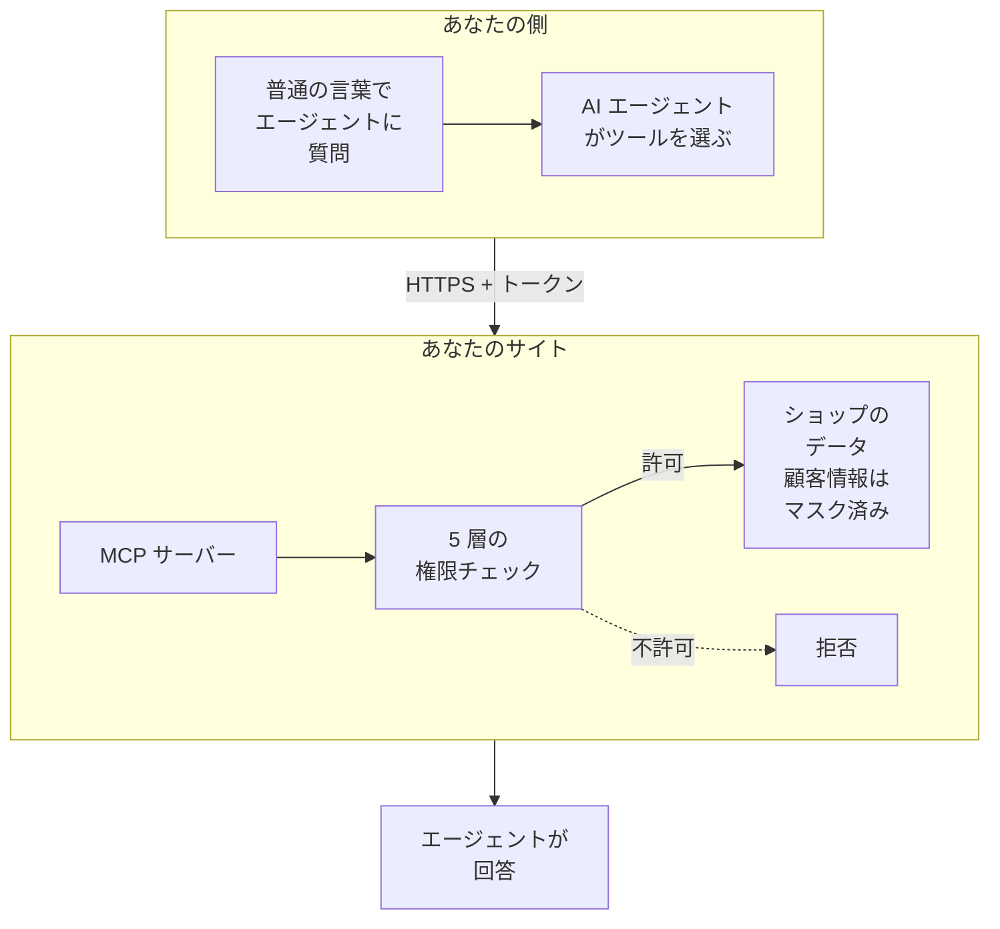
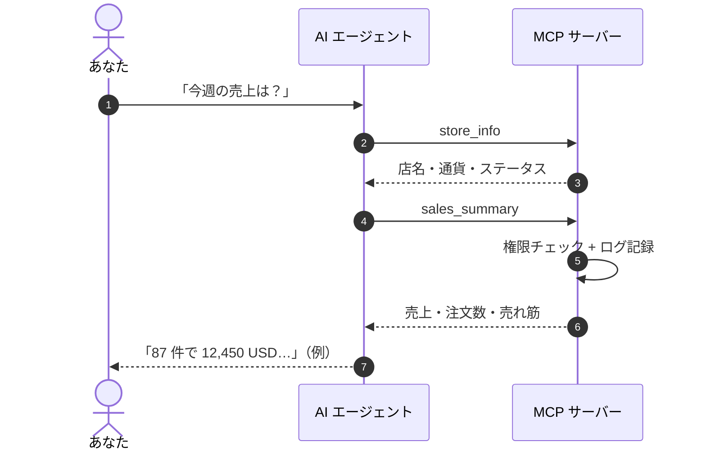

> 🌐 **言語:** [🇻🇳 Tiếng Việt](./mcp-introduction_vi.md) · [🇬🇧 English](./mcp-introduction.md) · 🇯🇵 日本語（現在）

# GP247 の MCP サーバーの紹介

## はじめに

このドキュメントでは、**S-Cart に組み込まれた MCP サーバー**（パッケージ `gp247/mcp`）を紹介します。お使いの AI エージェント（Claude、Cursor、
VS Code など）がショップと直接やり取りできるようにする仕組みで、注文の確認、在庫の確認、売上のまとめ、そして許可した場合は注文ステータスの変更や
入出庫もできます。対象は**ショップのオーナー**、**管理スタッフ**、サイトを運用する**技術担当者**です。読み終えると、MCP で何ができるか、REST API と
どう違うか、どこまで安全か、次にどのページを読めばよいかがわかります。

> ℹ️ **情報:** **MCP とは（やさしい説明）**：MCP（Model Context Protocol）は、AI エージェントが他のアプリケーションのツールを使えるようにするオープンな
> 「接続規格」です。エージェントを新しく入ったアシスタントだと考えてください。MCP はアシスタントに社員証（トークン）と、してよい仕事の一覧（ツール）を
> 渡します。アシスタントは一覧にある仕事だけを、社員証を発行した人の権限の範囲でしか行えません。

> ℹ️ **対応バージョン:** S-Cart 3.5（パッケージ `gp247/mcp` 2.0、`gp247/core` 3.9 以上が必要）。それ以前は **McpServer** プラグインでした。プラグインを
> 使っているサイトは更新時に自動で移行されます（[管理と設定を参照](./mcp-administration_ja.md#旧-mcpserver-プラグインからの移行)）。

## ひと目でわかる

普通の言葉で質問すると、エージェントがツールを選んでサイトを呼び出し、サイトはあなたのアカウントが見てよいデータだけを返します。

- **組み込み済み・初期状態はオフ** — MCP は S-Cart に含まれていますが、オンにするまで**オフ**です。使わなければ負荷はなく、cron や常駐サービスも不要です。
- **15 個のツール** — 読み取りツール 11 個（商品、在庫、注文、顧客、売上、最近の変更）と、初期状態でオフの書き込みツール 4 個です（[ツール一覧](./mcp-tools_ja.md)）。
- **権限を超えることはありません** — エージェントは 1 つの管理アカウントの代わりに動き、そのアカウントが管理画面でできること以上はできません（[セキュリティと権限](./mcp-security_ja.md)）。
- **書き込みは必ずプレビューから** — 注文ステータス、配送ステータス、在庫の変更には、必ずプレビューと 1 回限りの確認コードが伴います。
- **すべての呼び出しが記録されます** — どのエージェントが、誰のトークンで、何を見たり変更したりしたか、いつだったかがわかります。

## MCP がショップのためにできること

MCP を使うと、管理画面での作業を**口で伝えるだけ**で済ませられます。よくある質問の例です。

| エージェントへの質問 | エージェントが使うツール |
| --- | --- |
| 「今週の売上はいくら？一番売れている商品は？」 | `sales_summary` |
| 「在庫が少なくなっている商品は？」 | `low_stock_products` |
| 「注文 OR-1024 の状況は？お客様は支払い済み？」 | `search_orders`、`get_order` |
| 「今朝から何が変わった？」 | `recent_changes` |
| 「注文 OR-1024 を配送中にして」 *（書き込みツールをオンにした場合）* | `update_shipping_status` |
| 「SKU SHIRT-01 を 20 個入庫して」 *（書き込みツールをオンにした場合）* | `adjust_stock` |

- **集計の手間が減ります** — 3〜4 画面を開いて絞り込み、自分で数字を足す代わりに、まとめた答えを受け取れます。
- **使い慣れたエージェントのまま** — 新しいソフトを覚える必要はありません。エージェントはツールの説明を読んで、いつ使うかを判断します。
- **データはサイトに残ります** — サイトは AI 事業者のキーを持たず、エージェントも動かしません。選んだエージェントに送られるのは各ツールの結果だけです。

## MCP と REST API の違い

GP247 には外部ソフト向けの「入口」が 2 つあります。どちらも同じ管理アカウント、権限、ストアを使いますが、利用者の種類が異なります。

| | **MCP サーバー** | **REST API v2**（[API の紹介](../api/api-introduction_ja.md)） |
| --- | --- | --- |
| **利用者** | サイトオーナー、スタッフ（AI エージェント経由） | 開発者（モバイルアプリ、ERP、他のサイト） |
| **使い方** | 普通の言葉で質問し、エージェントがツールを呼ぶ | 各アドレス（エンドポイント）を呼ぶコードを書く |
| **アドレス** | 1 つだけ：`https://<ドメイン>/api/core/mcp` | `api/v2/core`、`api/v2/front` 以下の多数のアドレス |
| **鍵** | **MCP Server** 画面で作成する、期限付きの MCP トークン | API のログイントークン（`login`） |
| **できること** | AI アシスタント向けに厳選した安全な 15 の仕事 | カート、チェックアウト、同期、一括書き込みなど業務全体 |
| **書き込み** | 1 件ずつ、必ずプレビュー + 確定 | 各エンドポイントの仕様どおり |

- **トークンは共用できません** — MCP トークンで REST API は呼べず、その逆もできません。
- **REST API のマスタースイッチは MCP もオフにします**。API v1 / v2 の個別スイッチは MCP に影響しません。

## どこから読むか — 役割別の読み方

各役割は数ページを、次の順に読むだけで十分です。

| あなたは | 読む順番 |
| --- | --- |
| 自分とスタッフ用に MCP をオンにする**サイトオーナー** | [クイックスタート](./mcp-quickstart_ja.md) → [セキュリティと権限](./mcp-security_ja.md) → [管理と設定](./mcp-administration_ja.md) |
| エージェントの利用を許可された**スタッフ** | [クイックスタート](./mcp-quickstart_ja.md)（「トークンを作成する」から） → [ツール一覧](./mcp-tools_ja.md) |
| サイトのインストールや更新を行う**技術担当者** | [管理と設定](./mcp-administration_ja.md) → [トラブルシューティング](./mcp-troubleshooting_ja.md) |
| **接続時にエラーが出る** | [トラブルシューティング](./mcp-troubleshooting_ja.md) |

## MCP ドキュメント一覧

| ページ | できること |
| --- | --- |
| [クイックスタート](./mcp-quickstart_ja.md) | MCP のオン、トークン作成、Claude Code / Cursor / VS Code / Claude Desktop の接続、最初の質問までを、コピーして実行できる手順で |
| [ツール一覧](./mcp-tools_ja.md) | 各ツールの役割、必要な権限、パラメーター、質問例。書き込みツールのプレビュー → 確定の流れ |
| [セキュリティと権限](./mcp-security_ja.md) | 5 層の権限、トークン、顧客情報のマスク、信頼できない内容、ログ、複数ストアのサイト |
| [管理と設定](./mcp-administration_ja.md) | 設定画面、スタッフの権限、インストール / 更新 / 削除のコマンド、旧プラグインからの移行 |
| [トラブルシューティング](./mcp-troubleshooting_ja.md) | 症状別・コード別（401、403、404、413、429 など）のエラーの調べ方 |

## 質問がシステムを通る流れ

たとえば「今週の売上はいくら？」と聞くと、エージェントは通常 2 つのツールを続けて呼びます。

- **最初に `store_info` が呼ばれるのが普通です** — エージェントがあなたのショップの通貨とステータスコードを知るためです。
- **呼び出しのたびに権限を最初からチェックします** — スタッフの権限を変えると、次の質問からすぐに反映されます。
- **売上は通貨をまたいで合算しません** — USD と VND は別々に返されます。

## 開発者の方へ

MCP は公式ライブラリ `laravel/mcp` と、**セッションを持たない Streamable HTTP** のエンドポイント（各リクエストが独立し JSON を返す）を使うため、
共有ホスティングでも動作します。ストアを分割するプラグインは、管理用 REST API と同じフック（`gp247-config.api.admin_fence`）または専用キー
`gp247-config.mcp.store_resolver` で MCP に接続します。[複数ストアのサイト](./mcp-security_ja.md#複数ストアのサイト)を参照してください。ソースコード：
[github.com/gp247net/mcp](https://github.com/gp247net/mcp)。

## よくある質問（Q&A）

**Q1: MCP は有料ですか？**

→ いいえ。MCP は S-Cart のオープンソースの一部で、S-Cart と同じ MIT ライセンスです。

**Q2: AI エージェントを使わない場合、MCP でサイトが遅くなりますか？**

→ いいえ。MCP は初期状態でオフで、テーブルも作らず、常駐プロセスもありません。オフのとき MCP のアドレスは、存在しないかのように「見つかりません」（404）を返します。

**Q3: どのエージェントが使えますか？**

→ HTTP で MCP に対応し、`Authorization` ヘッダーを設定できるエージェントです：Claude Code、Cursor、VS Code、Claude Desktop / claude.ai（アカウントに
ヘッダーの設定欄がある場合）。OAuth ログインにしか対応しないエージェント（例：ChatGPT）はまだ使えません。接続方法は[クイックスタート](./mcp-quickstart_ja.md)にあります。

**Q4: エージェントが勝手にデータを削除・変更することはありますか？**

→ 削除するツールはありません。4 つの書き込みツールはすべて**初期状態でオフ**で、*読み取り + 書き込み* のトークンが必要です。そのうち 3 つ（注文ステータス、
配送ステータス、入出庫）は必ずプレビューを経由し、エージェントは確定の前にあなたに確認します。詳しくは[ツール一覧](./mcp-tools_ja.md#書き込みツールプレビューしてから確定)をご覧ください。

**Q5: ショップのデータは AI に送られますか？**

→ エージェントとその AI 事業者に送られるのは、エージェントが呼んだツールの結果だけです。顧客のメールアドレス、電話番号、住所は初期状態でマスクされます。
[セキュリティと権限](./mcp-security_ja.md)を参照してください。

**Q6: MCP を使うスタッフは、管理画面より多くのものを見られますか？**

→ いいえ。各ツールは、トークン所有者が対応する管理画面の権限を持っていることを求めます。注文を見るだけのスタッフのエージェントは、注文を見ることしかできません。

**Q7: 旧 McpServer プラグインを使っている場合は？**

→ いつもどおり S-Cart を更新してください（`composer require gp247/mcp -W` を 1 回、続けて `php artisan gp247:update`）。トークン、設定、権限は組み込みの MCP に
自動で移行され、エージェントの再設定は不要です。[管理と設定](./mcp-administration_ja.md#旧-mcpserver-プラグインからの移行)を参照してください。

**Q8: 共有ホスティングで使えますか？**

→ はい。MCP は cron、キューワーカー、websocket、Node を必要としません。条件はサーバーが `Authorization` ヘッダーを PHP に渡すことだけで、MCP Server 画面の
**接続を確認** ボタンで確かめられます。

**Q9: 複数ストアのサイトでは、各ストアの管理者も使えますか？**

→ ストア分割プラグインが対応していれば使えます（例：MultiStore Pro）。ストア管理者は自分のストアのドメイン上の MCP アドレスにエージェントを接続し、
そのストアのデータだけを見ます。対応していない場合は最上位の管理者だけが使えます。

---

📅 **最終更新:** 2026-11-04 · ✍️ **作成者 (Author):** GP247
