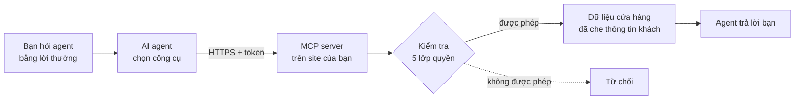
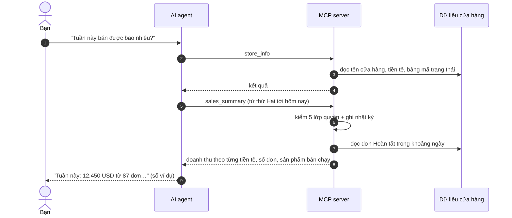

> 🌐 **Ngôn ngữ:** 🇻🇳 Tiếng Việt (hiện tại) · [🇬🇧 English](./mcp-introduction.md) · [🇯🇵 日本語](./mcp-introduction_ja.md)

# Giới thiệu MCP server của GP247

## Giới thiệu

Tài liệu này giới thiệu **MCP server có sẵn trong S-Cart** (gói `gp247/mcp`) — cách để AI agent bạn đang dùng (Claude, Cursor,
VS Code…) làm việc trực tiếp với cửa hàng của bạn: tra đơn, xem tồn kho, tóm tắt doanh thu, và — khi bạn cho phép — đổi trạng thái
đơn hay nhập/xuất kho. Tài liệu dành cho **chủ cửa hàng**, **nhân viên quản trị** và **người phụ trách kỹ thuật** của site. Đọc xong,
bạn biết MCP làm được gì, khác REST API ra sao, an toàn tới đâu và nên đọc trang nào tiếp theo cho việc của mình.

> ℹ️ **MCP là gì (giải thích đời thường):** MCP (Model Context Protocol) là một "chuẩn cắm" mở giúp AI agent dùng được công cụ của
> ứng dụng khác. Hãy hình dung agent là một trợ lý mới vào làm: MCP đưa cho trợ lý một bộ thẻ nhân viên (token) và một danh sách việc
> được làm (công cụ). Trợ lý chỉ làm được đúng những việc trong danh sách, với đúng quyền của người cấp thẻ.

> ℹ️ **Có từ:** S-Cart 3.5 (gói `gp247/mcp` 2.0, cần `gp247/core` 3.9 trở lên). Trước đó MCP là plugin **McpServer** — site đang dùng
> plugin được chuyển tự động khi cập nhật ([xem Quản trị & cài đặt](./mcp-administration_vi.md#chuyển-từ-plugin-mcpserver-cũ)).

## Nhìn nhanh

Bạn hỏi bằng lời thường; agent tự chọn công cụ, gọi vào site của bạn, và site chỉ trả về những gì tài khoản của bạn được xem:

- **Có sẵn, tắt sẵn** — MCP đi cùng S-Cart nhưng **tắt** cho tới khi bạn bật; không dùng thì không tốn gì, không cần cron hay dịch vụ chạy nền.
- **15 công cụ** — 11 công cụ đọc (sản phẩm, kho, đơn, khách, doanh thu, thay đổi gần đây) và 4 công cụ ghi, mặc định tắt ([Danh mục công cụ](./mcp-tools_vi.md)).
- **Không bao giờ vượt quyền** — agent hành động thay một tài khoản quản trị, không làm được nhiều hơn tài khoản đó trên trang quản trị ([An toàn & phân quyền](./mcp-security_vi.md)).
- **Ghi thì phải xem trước** — đổi trạng thái đơn, giao hàng, tồn kho luôn có bản xem trước và mã xác nhận một lần.
- **Mọi lần gọi đều có nhật ký** — biết agent nào, của ai, đã đọc/sửa gì, lúc nào.

## MCP làm được gì cho cửa hàng của bạn

MCP biến các màn quản trị thành những việc bạn chỉ cần **nói ra**. Vài câu hỏi thường gặp:

| Bạn hỏi agent | Agent dùng công cụ |
| --- | --- |
| "Tuần này bán được bao nhiêu, sản phẩm nào chạy nhất?" | `sales_summary` |
| "Những sản phẩm nào sắp hết hàng?" | `low_stock_products` |
| "Đơn OR-1024 đang ở trạng thái nào, khách trả tiền chưa?" | `search_orders`, `get_order` |
| "Có gì thay đổi từ sáng tới giờ?" | `recent_changes` |
| "Chuyển đơn OR-1024 sang Đang giao" *(khi bạn bật công cụ ghi)* | `update_shipping_status` |
| "Nhập thêm 20 cái cho SKU ÁO-01" *(khi bạn bật công cụ ghi)* | `adjust_stock` |

- **Tiết kiệm thời gian tổng hợp** — thay vì mở 3–4 màn, lọc rồi tự cộng số, bạn nhận câu trả lời đã tổng hợp.
- **Dùng agent bạn đã quen** — không phải học phần mềm mới; agent tự đọc mô tả công cụ để biết dùng lúc nào.
- **Dữ liệu vẫn ở site của bạn** — site không giữ khoá của nhà cung cấp AI và không chạy agent; chỉ kết quả từng công cụ được gửi tới agent bạn chọn.

## MCP khác REST API thế nào

GP247 có hai "cửa" cho phần mềm bên ngoài. Cả hai dùng chung tài khoản quản trị, phân quyền và cửa hàng, nhưng phục vụ hai kiểu người dùng khác nhau:

| | **MCP server** | **REST API v2** ([Giới thiệu API](../api/api-introduction_vi.md)) |
| --- | --- | --- |
| **Ai dùng** | Chủ site, nhân viên — qua AI agent | Lập trình viên — app di động, ERP, website khác |
| **Cách dùng** | Hỏi bằng lời thường, agent tự gọi công cụ | Viết code gọi từng địa chỉ (endpoint) |
| **Địa chỉ** | Một địa chỉ duy nhất: `https://<tên-miền>/api/core/mcp` | Nhiều địa chỉ dưới `api/v2/core`, `api/v2/front` |
| **Chìa khoá** | Token MCP tạo ở màn **MCP Server**, có hạn dùng | Token đăng nhập của API (`login`) |
| **Làm được** | 15 việc chọn lọc, an toàn cho trợ lý AI | Toàn bộ nghiệp vụ: giỏ hàng, checkout, đồng bộ, ghi hàng loạt… |
| **Ghi dữ liệu** | Từng bản ghi, luôn xem trước + xác nhận | Theo hợp đồng của từng endpoint |

- **Token không dùng lẫn được** — token MCP không gọi được REST API và ngược lại.
- **Công tắc tổng của REST API cũng tắt luôn MCP**; công tắc riêng của API v1 / v2 thì không ảnh hưởng MCP.

## Bắt đầu từ đâu — lộ trình theo vai trò

Mỗi vai trò chỉ cần đọc vài trang, theo thứ tự dưới đây:

| Bạn là | Đọc theo thứ tự |
| --- | --- |
| **Chủ site** muốn bật MCP cho mình và nhân viên | [Bắt đầu nhanh](./mcp-quickstart_vi.md) → [An toàn & phân quyền](./mcp-security_vi.md) → [Quản trị & cài đặt](./mcp-administration_vi.md) |
| **Nhân viên** được cấp quyền dùng agent | [Bắt đầu nhanh](./mcp-quickstart_vi.md) (từ bước *Tạo token*) → [Danh mục công cụ](./mcp-tools_vi.md) |
| **Người phụ trách kỹ thuật** cài/cập nhật site | [Quản trị & cài đặt](./mcp-administration_vi.md) → [Xử lý sự cố](./mcp-troubleshooting_vi.md) |
| **Gặp lỗi khi kết nối** | [Xử lý sự cố](./mcp-troubleshooting_vi.md) |

## Bộ tài liệu MCP

| Trang | Giúp bạn |
| --- | --- |
| [Bắt đầu nhanh](./mcp-quickstart_vi.md) | Bật MCP, tạo token, kết nối Claude Code / Cursor / VS Code / Claude Desktop và hỏi câu đầu tiên — từng bước copy là chạy |
| [Danh mục công cụ](./mcp-tools_vi.md) | Từng công cụ làm gì, cần quyền gì, nhận tham số nào, ví dụ câu hỏi; luồng xem trước → xác nhận của công cụ ghi |
| [An toàn & phân quyền](./mcp-security_vi.md) | 5 lớp quyền, token, che thông tin khách, nội dung không tin cậy, nhật ký, site nhiều cửa hàng |
| [Quản trị & cài đặt](./mcp-administration_vi.md) | Màn cấu hình, quyền cho nhân viên, lệnh cài / cập nhật / gỡ, chuyển từ plugin cũ |
| [Xử lý sự cố](./mcp-troubleshooting_vi.md) | Tra lỗi theo triệu chứng và theo mã (401, 403, 404, 413, 429…) |

## Cách một câu hỏi đi qua hệ thống

Ví dụ bạn hỏi *"Tuần này bán được bao nhiêu?"* — agent thường gọi hai công cụ liên tiếp:

- **`store_info` thường được gọi đầu tiên** — để agent biết tiền tệ và mã trạng thái của chính cửa hàng bạn.
- **Mỗi lần gọi đều được kiểm quyền lại từ đầu** — đổi quyền của nhân viên có hiệu lực ngay ở câu hỏi kế tiếp.
- **Doanh thu không bao giờ cộng chéo tiền tệ** — USD và VND được trả riêng.

## Cho lập trình viên

MCP dùng thư viện chính chủ `laravel/mcp`, endpoint **Streamable HTTP không phiên** (mỗi request độc lập, trả JSON) nên chạy được trên
shared hosting. Plugin phân vùng cửa hàng nối vào MCP qua cùng điểm cắm của REST API quản trị (`gp247-config.api.admin_fence`) hoặc
khoá riêng `gp247-config.mcp.store_resolver` — xem [Site nhiều cửa hàng](./mcp-security_vi.md#site-nhiều-cửa-hàng). Mã nguồn:
[github.com/gp247net/mcp](https://github.com/gp247net/mcp).

## Hỏi & Đáp (Q&A)

**Câu 1: MCP có tính phí không?**

→ Không. MCP là một phần mã nguồn mở của S-Cart, giấy phép MIT như S-Cart.

**Câu 2: Tôi không dùng AI agent thì MCP có làm chậm site không?**

→ Không. MCP tắt sẵn, không tạo bảng dữ liệu, không chạy tiến trình nền. Khi tắt, địa chỉ MCP trả "không tìm thấy" (404) như chưa từng có.

**Câu 3: Agent nào dùng được?**

→ Agent hỗ trợ MCP qua HTTP và cho khai header `Authorization`: Claude Code, Cursor, VS Code, Claude Desktop / claude.ai (khi tài khoản có mục
khai header). Agent chỉ hỗ trợ đăng nhập OAuth (ví dụ ChatGPT) chưa dùng được. Cách nối từng agent ở [Bắt đầu nhanh](./mcp-quickstart_vi.md).

**Câu 4: Agent có tự ý xoá hay sửa dữ liệu của tôi không?**

→ Không có công cụ xoá. Bốn công cụ ghi đều **tắt sẵn**, cần token mức *Đọc + ghi*, và ba trong số đó (đổi trạng thái đơn, đổi trạng thái giao
hàng, nhập/xuất kho) luôn qua bước xem trước — agent phải hỏi bạn rồi mới xác nhận. Chi tiết ở [Danh mục công cụ](./mcp-tools_vi.md#công-cụ-ghi-xem-trước-rồi-mới-xác-nhận).

**Câu 5: Dữ liệu cửa hàng có bị gửi lên AI không?**

→ Chỉ kết quả của công cụ agent gọi được gửi tới agent và nhà cung cấp AI của agent đó. Email, điện thoại, địa chỉ của khách được che mặc
định. Xem [An toàn & phân quyền](./mcp-security_vi.md).

**Câu 6: Nhân viên dùng MCP có thấy nhiều hơn trên trang quản trị không?**

→ Không. Mỗi công cụ yêu cầu chủ token có quyền ở màn quản trị tương ứng; nhân viên chỉ xem đơn thì agent của họ cũng chỉ xem được đơn.

**Câu 7: Tôi đang dùng plugin McpServer cũ thì sao?**

→ Cập nhật S-Cart như thường lệ (`composer require gp247/mcp -W` một lần rồi `php artisan gp247:update`). Token, cấu hình và quyền tự chuyển sang
MCP có sẵn, agent không phải cấu hình lại. Xem [Quản trị & cài đặt](./mcp-administration_vi.md#chuyển-từ-plugin-mcpserver-cũ).

**Câu 8: MCP có dùng được trên shared hosting không?**

→ Có. MCP không cần cron, queue worker, websocket hay Node. Chỉ cần máy chủ chuyển được header `Authorization` tới PHP — nút **Kiểm tra kết nối**
trên màn MCP Server cho biết điều này.

**Câu 9: Site nhiều cửa hàng thì quản lý từng cửa hàng có dùng được không?**

→ Được, khi plugin phân vùng cửa hàng hỗ trợ (ví dụ MultiStore Pro): quản lý cửa hàng nối agent tới địa chỉ MCP trên tên miền cửa hàng của
mình và chỉ thấy dữ liệu cửa hàng đó. Không có hỗ trợ đó thì chỉ quản trị viên cao nhất dùng được.

---

📅 **Cập nhật lần cuối:** 2026-11-03 · ✍️ **Tác giả (Author):** GP247
