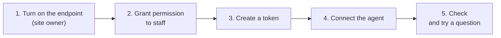

> 🌐 **Language:** [🇻🇳 Tiếng Việt](./mcp-quickstart_vi.md) · 🇬🇧 English (current) · [🇯🇵 日本語](./mcp-quickstart_ja.md)

# MCP quick start

## Introduction

This page walks you **step by step** to the point where your AI agent answers its first question about your shop, in about 10 minutes. It is
written for site owners and admin staff and needs no programming: every command and configuration snippet can be copied as is. After reading
it, MCP is on, you have your own token and your agent is connected to the site. Want to understand MCP first? See [Introduction to MCP](./mcp-introduction.md).

## At a glance

Five stages, done once:



- **Stages 1–2 are done once, by the site owner** — staff only need stage 3 onwards.
- **One token per computer, per agent** — so you can revoke them separately.
- **The configuration snippets contain no token** — the token lives in an environment variable or the agent's input box, never in the file.

## Before you start

| You need | Note |
| --- | --- |
| An S-Cart **3.5 or later** site | Site installed from an older version: do [Site installed from an older S-Cart](#site-installed-from-an-older-s-cart) first |
| An admin account | Site owner: the top administrator account; staff need the **"MCP server — use (own tokens)"** permission |
| An AI agent with MCP support | Claude Code, Cursor, VS Code or Claude Desktop / claude.ai |
| HTTPS (strongly recommended) | The token travels with every request; without HTTPS it can be read on the way |

## Stage 1 — Turn on the MCP endpoint (site owner)

The **endpoint** is the "door" agents call into. By default this door is **closed**.

1. Sign in to the admin panel and go to **System config → MCP Server**. The **MCP Server** screen opens.
2. Click the **MCP Server settings** button in the top-right corner.
3. In the **Endpoint** section, turn on **Turn on the MCP endpoint**.
4. Click **Save**.

   If it worked, go back to the **MCP Server** screen: the status card at the top says the endpoint is **on** and the "endpoint is turned off" warning is gone.

> 💡 **Tip:** on the same settings screen the read tools are already on and the write tools are off. Leave them as they are when you start —
> read the [Tool catalogue](./mcp-tools.md) before turning a write tool on.

## Stage 2 — Grant permission to staff (site owner)

Skip this stage if only you (the top administrator) use MCP.

1. Open the **Roles** screen in the admin panel.
2. Open the role of the staff who may use an AI agent, tick the **"MCP server — use (own tokens)"** permission and save.
3. (Optional) Add **"MCP server — configure"** for people allowed to change the MCP settings.

> ℹ️ **Note:** the MCP permission only allows *using* MCP. A staff member's agent still only sees the screens that staff member can see — a
> staff member without access to the Customers screen has an agent that cannot look up customers either.

## Stage 3 — Create a token

A **token** is the agent's own "key", used instead of your password.

1. Go to **System config → MCP Server** (the **MCP Server** screen).
2. In the **Create a token** box, enter a recognisable **Name**, e.g. `Laptop – Claude Code`.
3. Choose the **Access level**: **Read only** (recommended to start) or **Read + write** (only available once the site has at least one write tool on).
4. Enter **Valid for (days)** — 30 days by default.
5. (Optional) Open **Limit to these tools** and tick the tools this token may use. Empty = every tool of the chosen level.
6. Click **Create token**.

   If it worked, a green box shows the token. Click **Copy**, keep it somewhere safe (a password manager), then click **I have copied it**.

> ⚠️ **Warning:** the token is **shown only once** — the site only stores a hash, so it cannot show it again. If you lose it, revoke it and create a new one.

## Stage 4 — Connect the agent to the site

The MCP address of your site looks like:

```
https://<your-domain>/api/core/mcp
```

The **Connect your agent** section at the bottom of the **MCP Server** screen shows this exact address and a snippet for each agent, with a
**Copy** button. Pick your agent below.

### Claude Code

1. Open a **Terminal** and put the token in an environment variable (replace `<token>` with the token you copied).

   macOS / Linux:

   ```
   export GP247_MCP_TOKEN="<token>"
   ```

   Windows (PowerShell):

   ```
   $env:GP247_MCP_TOKEN = "<token>"
   ```

2. In **the same Terminal window**, type (replace `<your-domain>` with the site's domain):

   ```
   claude mcp add --transport http gp247 https://<your-domain>/api/core/mcp --header "Authorization: Bearer $GP247_MCP_TOKEN"
   ```

3. Type `claude mcp list`. If it worked, the list has a `gp247` line showing it is connected.

### Cursor

1. Put the token in the `GP247_MCP_TOKEN` environment variable as in step 1 of Claude Code, then start Cursor again from that Terminal window.
2. Open Cursor's `mcp.json` file and add (replace `<your-domain>`):

   ```json
   {
     "mcpServers": {
       "gp247": {
         "url": "https://<your-domain>/api/core/mcp",
         "headers": { "Authorization": "Bearer ${env:GP247_MCP_TOKEN}" }
       }
     }
   }
   ```

3. Save the file. If it worked, Cursor's MCP settings show `gp247` with its list of tools.

### VS Code

1. In the project folder, create the file `.vscode/mcp.json` and paste (replace `<your-domain>`):

   ```json
   {
     "servers": {
       "gp247": {
         "type": "http",
         "url": "https://<your-domain>/api/core/mcp",
         "headers": { "Authorization": "Bearer ${input:gp247-mcp-token}" }
       }
     },
     "inputs": [
       { "id": "gp247-mcp-token", "type": "promptString", "description": "GP247 MCP token", "password": true }
     ]
   }
   ```

2. Start the `gp247` server in VS Code. VS Code asks for the token — paste the token you copied. VS Code stores it; it is not written into the file.

### Claude Desktop / claude.ai

1. Add a **custom connector** with the address `https://<your-domain>/api/core/mcp`.
2. If your account has a **Request headers** field, add `Authorization` with the value `Bearer <token>`.

> ℹ️ **Note:** agents or connectors **with no place for a header** (OAuth sign-in only, e.g. ChatGPT) cannot use the GP247 MCP server yet.

## Stage 5 — Check and try a question

1. At the bottom of the **MCP Server** screen, click **Check connection** and read the result:

   | Result | Meaning | What to do |
   | --- | --- | --- |
   | **Green** | The endpoint is reachable and the `Authorization` header reaches the server | The agent can be used |
   | **Red** | The web server drops the `Authorization` header — agents will get 401 | See [Troubleshooting](./mcp-troubleshooting.md#the-web-server-drops-the-authorization-header) |
   | **Yellow** | The site cannot call itself (endpoint off, firewall, hosting blocks loopback) | Re-check Stage 1; if still yellow, try directly with the agent |

2. Ask your agent a simple question: *"Give me the store information."*

   If it worked, the agent returns the shop name, base currency and time zone. Try next: *"Which products are running low?"*

Got an error? Look up the code the agent reports (401, 403, 404…) in [Troubleshooting](./mcp-troubleshooting.md).

## Site installed from an older S-Cart

A site installed from S-Cart **before 3.5** does not have the MCP package yet. Add it once (the technical person does this):

1. **Back up the database.**
2. Open a **Terminal** in the site's root folder (the folder with the `artisan` file) and run, one after the other:

   ```
   composer require gp247/mcp -W
   php artisan gp247:update
   ```

   If it worked, the second command shows a `gp247:mcp-update` line and ends without errors; the **System config → MCP Server** menu appears.
3. Go back to [Stage 1](#stage-1--turn-on-the-mcp-endpoint-site-owner).

> 💡 **Tip:** hosting without SSH/Composer — run the first command on your computer (same site source code), upload the `vendor/` folder plus
> `composer.json` and `composer.lock`, then ask your host to run the second one. Using the old McpServer plugin? See
> [Moving from the old McpServer plugin](./mcp-administration.md#moving-from-the-old-mcpserver-plugin).

## Q&A

**Q1: I cannot see the "MCP Server" menu in the admin panel?**

→ Either your account lacks the **"MCP server — use (own tokens)"** permission (ask the site owner, Stage 2), or the site does not have the MCP
package yet (do [Site installed from an older S-Cart](#site-installed-from-an-older-s-cart)).

**Q2: The "Read + write" option is greyed out?**

→ The site has no write tool on yet. The site owner turns on the write tools needed in **MCP Server settings** first; then write tokens can be created.

**Q3: The agent reports 404 when connecting?**

→ The endpoint is off (Stage 1), or the REST API master switch on the API management screen is off — that switch turns MCP off too.

**Q4: The agent reports 401 although I pasted the token?**

→ The token is wrong, expired or revoked, or the account changed its password / is locked. If the token is definitely right, click **Check connection**:
a red result means the web server drops the header — see [Troubleshooting](./mcp-troubleshooting.md).

**Q5: I use two computers — one token or two?**

→ Two tokens, named after the computer. If you lose one computer, you only revoke its token and the other keeps working.

**Q6: What happens when a token expires?**

→ The agent gets a 401 error. Create a new token (Stage 3) and put it into the agent (Stage 4). The MCP Server screen has a card counting tokens that expire soon, so you can prepare.

**Q7: Do I need HTTPS?**

→ Strongly recommended. The MCP Server screen warns when the site does not run on HTTPS. Without HTTPS the token travels over the network in readable form.

**Q8: My agent stopped working after I changed my admin password?**

→ By design: changing the password revokes every MCP token of the account, so anyone who knew the old password loses access. Create a new token
and put it into the agent.

---

<sub>📅 **Last updated:** 2026-11-03 · ✍️ **Author:** GP247</sub>
