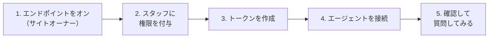

> 🌐 **言語:** [🇻🇳 Tiếng Việt](./mcp-quickstart_vi.md) · [🇬🇧 English](./mcp-quickstart.md) · 🇯🇵 日本語（現在）

# MCP クイックスタート

## はじめに

このページでは、AI エージェントがショップについて最初の質問に答えられるようになるまでを、約 10 分で**順を追って**説明します。対象はサイトオーナーと
管理スタッフで、プログラミングの知識は不要です。コマンドや設定はすべてそのままコピーして使えます。読み終えると、MCP がオンになり、自分専用のトークンを
持ち、エージェントがサイトに接続された状態になります。先に MCP について知りたい場合は [MCP の紹介](./mcp-introduction_ja.md)をご覧ください。

## ひと目でわかる

5 つのステージを 1 回行えば完了です。



- **ステージ 1〜2 はサイトオーナーが 1 回だけ行います** — スタッフはステージ 3 からで十分です。
- **パソコンごと、エージェントごとに 1 つのトークン** — 必要なときに個別に無効化できるようにするためです。
- **設定にトークンは含めません** — トークンは環境変数やエージェントの入力欄に置き、ファイルには書きません。

## 始める前に

| 必要なもの | 備考 |
| --- | --- |
| S-Cart **3.5 以上**のサイト | 古いバージョンからインストールしたサイトは、先に[古い S-Cart からインストールしたサイト](#古い-s-cart-からインストールしたサイト)を行ってください |
| 管理アカウント | サイトオーナーは最上位の管理者アカウント。スタッフには **「MCP server — use (own tokens)」** 権限が必要です |
| MCP 対応の AI エージェント | Claude Code、Cursor、VS Code、または Claude Desktop / claude.ai |
| HTTPS（強く推奨） | トークンはリクエストごとに送られます。HTTPS がないと途中で読み取られるおそれがあります |

## ステージ 1 — MCP エンドポイントをオンにする（サイトオーナー）

**エンドポイント**は、エージェントがサイトを呼び出す「入口」です。初期状態では**閉じて**います。

1. 管理画面にログインし、**システム設定 → MCP Server** を開きます。**MCP Server** 画面が表示されます。
2. 右上の **MCP Server の設定** ボタンをクリックします。
3. **エンドポイント** セクションで **MCPエンドポイントをオンにする** をオンにします。
4. **保存** をクリックします。

   成功すると、**MCP Server** 画面に戻ったとき、上部のステータスカードにエンドポイントが**オン**と表示され、「エンドポイントはオフです」という警告が消えます。

> 💡 **ヒント:** 同じ設定画面で、読み取りツールは最初からオン、書き込みツールはオフになっています。始めはそのままにし、書き込みツールをオンにする前に
> [ツール一覧](./mcp-tools_ja.md)を読んでください。

## ステージ 2 — スタッフに権限を付与する（サイトオーナー）

MCP を使うのが自分（最上位の管理者）だけなら、このステージは省略できます。

1. 管理画面の **ロール（Roles）** 管理画面を開きます。
2. AI エージェントを使うスタッフのロールを開き、**「MCP server — use (own tokens)」** 権限にチェックを入れて保存します。
3. （任意）MCP の設定を変更してよい人には **「MCP server — configure」** を追加します。

> ℹ️ **情報:** MCP の権限は MCP を*使う*ことだけを許可します。スタッフのエージェントが見られるのは、そのスタッフが見られる画面だけです。顧客画面の
> 権限がないスタッフのエージェントは、顧客を検索することもできません。

## ステージ 3 — トークンを作成する

**トークン**は、パスワードの代わりにエージェントが使う専用の「鍵」です。

1. **システム設定 → MCP Server**（**MCP Server** 画面）を開きます。
2. **トークンを作成** の枠で、わかりやすい **名前** を入力します。例：`Laptop – Claude Code`。
3. **アクセスレベル** を選びます：**読み取り専用**（始めはこちらを推奨）または **読み取り + 書き込み**（サイトで書き込みツールが 1 つ以上オンのときだけ選べます）。
4. **有効期間 (日数)** を入力します。初期値は 30 日です。
5. （任意）**使用できるツールを制限** を開き、このトークンで使ってよいツールにチェックを入れます。空欄 = 選んだレベルのすべてのツール。
6. **トークンを作成** をクリックします。

   成功すると、緑の枠にトークンが表示されます。**コピー** をクリックして安全な場所（パスワードマネージャー）に保存し、**コピーしました** をクリックします。

> ⚠️ **注意:** トークンは **1 回しか表示されません**。サイトはハッシュしか保存しないため、再表示できません。なくした場合は無効化して新しく作成してください。

## ステージ 4 — エージェントをサイトに接続する

サイトの MCP アドレスは次の形です。

```
https://<あなたのドメイン>/api/core/mcp
```

**MCP Server** 画面の下部にある **エージェントを接続** セクションに、このアドレスと各エージェント用の設定が **コピー** ボタン付きで表示されます。
お使いのエージェントを下から選んでください。

### Claude Code

1. **ターミナル** を開き、トークンを環境変数に設定します（`<token>` をコピーしたトークンに置き換えます）。

   macOS / Linux：

   ```
   export GP247_MCP_TOKEN="<token>"
   ```

   Windows（PowerShell）：

   ```
   $env:GP247_MCP_TOKEN = "<token>"
   ```

2. **同じターミナルウィンドウ** で次を入力します（`<ドメイン>` をサイトのドメインに置き換えます）。

   ```
   claude mcp add --transport http gp247 https://<ドメイン>/api/core/mcp --header "Authorization: Bearer $GP247_MCP_TOKEN"
   ```

3. `claude mcp list` と入力します。成功すると、一覧に接続済みの `gp247` が表示されます。

### Cursor

1. Claude Code の手順 1 と同様に環境変数 `GP247_MCP_TOKEN` にトークンを設定し、そのターミナルウィンドウから Cursor を起動し直します。
2. Cursor の `mcp.json` ファイルを開き、次を追加します（`<ドメイン>` を置き換えます）。

   ```json
   {
     "mcpServers": {
       "gp247": {
         "url": "https://<ドメイン>/api/core/mcp",
         "headers": { "Authorization": "Bearer ${env:GP247_MCP_TOKEN}" }
       }
     }
   }
   ```

3. ファイルを保存します。成功すると、Cursor の MCP 設定に `gp247` とツールの一覧が表示されます。

### VS Code

1. プロジェクトのフォルダーに `.vscode/mcp.json` ファイルを作り、次を貼り付けます（`<ドメイン>` を置き換えます）。

   ```json
   {
     "servers": {
       "gp247": {
         "type": "http",
         "url": "https://<ドメイン>/api/core/mcp",
         "headers": { "Authorization": "Bearer ${input:gp247-mcp-token}" }
       }
     },
     "inputs": [
       { "id": "gp247-mcp-token", "type": "promptString", "description": "GP247 MCP token", "password": true }
     ]
   }
   ```

2. VS Code で `gp247` サーバーを起動します。トークンを聞かれたら、コピーしたトークンを貼り付けます。トークンは VS Code が保管し、ファイルには書き込まれません。

### Claude Desktop / claude.ai

1. アドレス `https://<ドメイン>/api/core/mcp` で **カスタムコネクタ** を追加します。
2. アカウントに **Request headers** の欄があれば、`Authorization` に値 `Bearer <token>` を追加します。

> ℹ️ **情報:** **ヘッダーを設定する場所がない**エージェントやコネクタ（OAuth ログインのみ、例：ChatGPT）は、今のところ GP247 の MCP を使えません。

## ステージ 5 — 確認して質問してみる

1. **MCP Server** 画面の下部で **接続を確認** をクリックし、結果を確認します。

   | 結果 | 意味 | 対処 |
   | --- | --- | --- |
   | **緑** | エンドポイントに到達でき、`Authorization` ヘッダーがサーバーに届いている | エージェントを使えます |
   | **赤** | Web サーバーが `Authorization` ヘッダーを破棄している。エージェントは 401 になる | [トラブルシューティング](./mcp-troubleshooting_ja.md#web-サーバーが-authorization-ヘッダーを破棄する)を参照 |
   | **黄** | サイトが自分自身を呼び出せない（エンドポイントがオフ、ファイアウォール、ホスティングがループバックを遮断） | ステージ 1 を再確認。まだ黄なら、エージェントで直接試す |

2. エージェントに簡単な質問をします：*「ストアの情報を教えて。」*

   成功すると、エージェントはショップ名、基準通貨、タイムゾーンを返します。次に *「在庫が少なくなっている商品は？」* と聞いてみてください。

エラーが出たら、エージェントが報告したコード（401、403、404 など）を[トラブルシューティング](./mcp-troubleshooting_ja.md)で調べてください。

## 古い S-Cart からインストールしたサイト

S-Cart **3.5 より前**からインストールしたサイトには、まだ MCP パッケージがありません。1 回だけ追加します（技術担当者が行います）。

1. **データベースをバックアップします。**
2. サイトのルートフォルダー（`artisan` ファイルがあるフォルダー）で **ターミナル** を開き、順に実行します。

   ```
   composer require gp247/mcp -W
   php artisan gp247:update
   ```

   成功すると、2 つ目のコマンドの出力に `gp247:mcp-update` の行があり、エラーなく終わります。**システム設定 → MCP Server** メニューが表示されます。
3. [ステージ 1](#ステージ-1--mcp-エンドポイントをオンにするサイトオーナー) に戻ります。

> 💡 **ヒント:** SSH/Composer が使えないホスティングでは、1 つ目のコマンドをお使いのパソコン（サイトと同じソースコード）で実行し、`vendor/` フォルダーと
> `composer.json`、`composer.lock` をアップロードしてから、2 つ目のコマンドの実行をホスティング会社に依頼してください。旧 McpServer プラグインを
> 使っている場合は[旧 McpServer プラグインからの移行](./mcp-administration_ja.md#旧-mcpserver-プラグインからの移行)をご覧ください。

## よくある質問（Q&A）

**Q1: 管理画面に「MCP Server」メニューが見当たりません。**

→ アカウントに **「MCP server — use (own tokens)」** 権限がない（サイトオーナーにステージ 2 を依頼してください）か、サイトにまだ MCP パッケージが
ありません（[古い S-Cart からインストールしたサイト](#古い-s-cart-からインストールしたサイト)を行ってください）。

**Q2: 「読み取り + 書き込み」が灰色で選べません。**

→ サイトで書き込みツールがまだ 1 つもオンになっていません。サイトオーナーが **MCP Server の設定** で必要な書き込みツールをオンにすると、書き込み用トークンを作成できます。

**Q3: 接続時にエージェントが 404 を報告します。**

→ エンドポイントがオフ（ステージ 1）か、API 管理画面の REST API マスタースイッチがオフです。このスイッチは MCP もオフにします。

**Q4: トークンを貼り付けたのにエージェントが 401 を報告します。**

→ トークンが間違っている、期限切れ、無効化済み、またはアカウントがパスワードを変更した / ロックされています。トークンが確実に正しい場合は **接続を確認** を
クリックしてください。赤なら Web サーバーがヘッダーを破棄しています。[トラブルシューティング](./mcp-troubleshooting_ja.md)を参照してください。

**Q5: パソコンを 2 台使う場合、トークンは 1 つですか、2 つですか？**

→ 2 つ作り、パソコンの名前を付けてください。1 台をなくしても、そのトークンだけを無効化すればもう 1 台はそのまま使えます。

**Q6: トークンの期限が切れるとどうなりますか？**

→ エージェントは 401 エラーを受け取ります。新しいトークンを作成し（ステージ 3）、エージェントに設定し直してください（ステージ 4）。MCP Server 画面には
期限切れが近いトークンを数えるカードがあるので、前もって準備できます。

**Q7: HTTPS は必要ですか？**

→ 強く推奨します。サイトが HTTPS で動いていないと MCP Server 画面に警告が出ます。HTTPS がないと、トークンは読み取れる形でネットワークを流れます。

**Q8: 管理者パスワードを変更したらエージェントが動かなくなりました。**

→ 仕様です。パスワードを変更すると、そのアカウントのすべての MCP トークンが無効化され、古いパスワードを知っていた人はアクセスできなくなります。
新しいトークンを作成してエージェントに設定してください。

---

<sub>📅 **最終更新:** 2026-11-03 · ✍️ **作成者 (Author):** GP247</sub>
