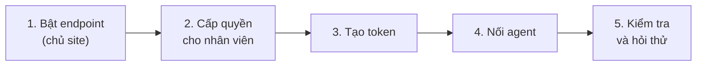

> 🌐 **Ngôn ngữ:** 🇻🇳 Tiếng Việt (hiện tại) · [🇬🇧 English](./mcp-quickstart.md) · [🇯🇵 日本語](./mcp-quickstart_ja.md)

# Bắt đầu nhanh với MCP

## Giới thiệu

Trang này hướng dẫn **từng bước** để AI agent của bạn trả lời được câu hỏi đầu tiên về cửa hàng, trong khoảng 10 phút. Tài liệu dành cho
chủ site và nhân viên quản trị, không cần biết lập trình: mọi lệnh và đoạn cấu hình đều copy là dùng được. Đọc xong, bạn đã bật MCP, có một
token riêng và agent đã kết nối với site. Muốn hiểu MCP là gì trước khi làm, xem [Giới thiệu MCP](./mcp-introduction_vi.md).

## Nhìn nhanh

Năm chặng, làm một lần là xong:



- **Chặng 1–2 chỉ chủ site làm, một lần** — nhân viên chỉ cần từ chặng 3.
- **Mỗi máy, mỗi agent một token riêng** — để thu hồi riêng khi cần.
- **Đoạn cấu hình không chứa token** — token nằm trong biến môi trường hoặc ô nhập của agent, không nằm trong file.

## Trước khi bắt đầu

| Cần có | Ghi chú |
| --- | --- |
| Site S-Cart **3.5 trở lên** | Site cài từ bản cũ hơn: làm mục [Site cài từ S-Cart cũ](#site-cài-từ-s-cart-cũ) trước |
| Tài khoản quản trị | Chủ site dùng tài khoản quản trị viên cao nhất; nhân viên cần quyền **"MCP server — use (own tokens)"** |
| Một AI agent hỗ trợ MCP | Claude Code, Cursor, VS Code hoặc Claude Desktop / claude.ai |
| HTTPS (khuyến nghị mạnh) | Token đi kèm mỗi request; không có HTTPS thì token có thể bị đọc trộm trên đường truyền |

## Chặng 1 — Bật endpoint MCP (chủ site)

**Endpoint** là "cổng" để agent gọi vào site. Mặc định cổng này **tắt**.

1. Đăng nhập trang quản trị, vào **Cấu hình hệ thống → MCP Server**. Màn **MCP Server** mở ra.
2. Bấm nút **Cấu hình MCP Server** ở góc trên bên phải.
3. Ở mục **Endpoint**, bật **Bật endpoint MCP**.
4. Bấm **Lưu**.

   Nếu thành công, quay lại màn **MCP Server**: thẻ trạng thái đầu trang báo endpoint **đang bật** và dòng cảnh báo "endpoint đang tắt" biến mất.

> 💡 **Mẹo:** ở cùng màn cấu hình, các công cụ đọc đã bật sẵn, các công cụ ghi tắt sẵn. Cứ để nguyên khi mới bắt đầu — xem
> [Danh mục công cụ](./mcp-tools_vi.md) trước khi bật công cụ ghi.

## Chặng 2 — Cấp quyền cho nhân viên (chủ site)

Bỏ qua chặng này nếu chỉ một mình bạn (quản trị viên cao nhất) dùng MCP.

1. Vào màn quản lý **Vai trò (Roles)** trong trang quản trị.
2. Mở vai trò của nhân viên được dùng AI agent, tick quyền **"MCP server — use (own tokens)"**, rồi lưu.
3. (Tuỳ chọn) Người được chỉnh cấu hình MCP thì thêm quyền **"MCP server — configure"**.

> ℹ️ **Thông tin:** quyền MCP chỉ cho phép *dùng* MCP. Agent của nhân viên vẫn chỉ xem được những màn mà nhân viên đó xem được — nhân
> viên không có quyền màn Khách hàng thì agent cũng không tra được khách.

## Chặng 3 — Tạo token

**Token** là "chìa khoá" riêng cho agent, thay cho mật khẩu của bạn.

1. Vào **Cấu hình hệ thống → MCP Server** (màn **MCP Server**).
2. Ở khung **Tạo token**, nhập **Tên** dễ nhận ra, ví dụ `Laptop – Claude Code`.
3. Chọn **Mức truy cập**: **Chỉ đọc** (nên dùng khi mới bắt đầu) hoặc **Đọc + ghi** (chỉ chọn được khi site đã bật ít nhất một công cụ ghi).
4. Nhập **Hiệu lực (ngày)** — mặc định 30 ngày.
5. (Tuỳ chọn) Mở **Chỉ cho dùng các công cụ này** và tick những công cụ token được phép dùng. Để trống = mọi công cụ cùng mức.
6. Bấm **Tạo token**.

   Nếu thành công, một khung màu xanh hiện token. Bấm **Sao chép**, lưu vào nơi an toàn (trình quản lý mật khẩu), rồi bấm **Tôi đã sao chép**.

> ⚠️ **Lưu ý:** token **chỉ hiện một lần** — site chỉ lưu bản băm nên không hiện lại được. Mất token thì thu hồi và tạo token mới.

## Chặng 4 — Nối agent với site

Địa chỉ MCP của site có dạng:

```
https://<tên-miền-của-bạn>/api/core/mcp
```

Phần **Kết nối agent** ở cuối màn **MCP Server** hiện sẵn đúng địa chỉ này và đoạn cấu hình cho từng agent, kèm nút **Sao chép**. Chọn agent
bạn dùng bên dưới.

### Claude Code

1. Mở **Terminal**, đặt token vào biến môi trường (thay `<token>` bằng token vừa sao chép).

   macOS / Linux:

   ```
   export GP247_MCP_TOKEN="<token>"
   ```

   Windows (PowerShell):

   ```
   $env:GP247_MCP_TOKEN = "<token>"
   ```

2. Trong **cùng cửa sổ Terminal**, gõ (thay `<tên-miền>` bằng tên miền site):

   ```
   claude mcp add --transport http gp247 https://<tên-miền>/api/core/mcp --header "Authorization: Bearer $GP247_MCP_TOKEN"
   ```

3. Gõ `claude mcp list`. Nếu thành công, danh sách có dòng `gp247` kèm trạng thái đã kết nối.

### Cursor

1. Đặt token vào biến môi trường `GP247_MCP_TOKEN` như bước 1 của Claude Code, rồi mở lại Cursor từ cửa sổ Terminal đó.
2. Mở file `mcp.json` của Cursor và thêm (thay `<tên-miền>`):

   ```json
   {
     "mcpServers": {
       "gp247": {
         "url": "https://<tên-miền>/api/core/mcp",
         "headers": { "Authorization": "Bearer ${env:GP247_MCP_TOKEN}" }
       }
     }
   }
   ```

3. Lưu file. Nếu thành công, phần cài đặt MCP của Cursor hiện `gp247` với danh sách công cụ.

### VS Code

1. Trong thư mục dự án, tạo file `.vscode/mcp.json` và dán (thay `<tên-miền>`):

   ```json
   {
     "servers": {
       "gp247": {
         "type": "http",
         "url": "https://<tên-miền>/api/core/mcp",
         "headers": { "Authorization": "Bearer ${input:gp247-mcp-token}" }
       }
     },
     "inputs": [
       { "id": "gp247-mcp-token", "type": "promptString", "description": "GP247 MCP token", "password": true }
     ]
   }
   ```

2. Khởi động server `gp247` trong VS Code. VS Code hỏi token — dán token vừa sao chép. Token được VS Code cất giữ, không ghi vào file.

### Claude Desktop / claude.ai

1. Thêm một **custom connector** với địa chỉ `https://<tên-miền>/api/core/mcp`.
2. Nếu tài khoản của bạn có mục **Request headers**, thêm `Authorization` với giá trị `Bearer <token>`.

> ℹ️ **Thông tin:** agent hoặc connector **không có chỗ khai header** (chỉ hỗ trợ đăng nhập OAuth, ví dụ ChatGPT) hiện chưa dùng được MCP của GP247.

## Chặng 5 — Kiểm tra và hỏi thử

1. Ở cuối màn **MCP Server**, bấm **Kiểm tra kết nối** và đọc kết quả:

   | Kết quả | Ý nghĩa | Làm gì |
   | --- | --- | --- |
   | **Xanh** | Endpoint truy cập được, header `Authorization` tới được máy chủ | Dùng được agent |
   | **Đỏ** | Máy chủ web làm mất header `Authorization` — agent sẽ bị 401 | Xem [Xử lý sự cố](./mcp-troubleshooting_vi.md#máy-chủ-web-làm-mất-header-authorization) |
   | **Vàng** | Site không tự gọi được chính nó (endpoint tắt, tường lửa, hosting chặn gọi vòng) | Kiểm tra Chặng 1; nếu vẫn vàng, thử thẳng bằng agent |

2. Hỏi agent một câu đơn giản: *"Cho tôi thông tin cửa hàng."*

   Nếu thành công, agent trả về tên cửa hàng, tiền tệ cơ sở và múi giờ. Thử tiếp: *"Những sản phẩm nào sắp hết hàng?"*

Gặp lỗi? Tra theo mã lỗi agent báo (401, 403, 404…) ở [Xử lý sự cố](./mcp-troubleshooting_vi.md).

## Site cài từ S-Cart cũ

Site cài từ S-Cart **trước 3.5** chưa có gói MCP. Thêm một lần (người phụ trách kỹ thuật làm):

1. **Sao lưu cơ sở dữ liệu.**
2. Mở **Terminal** tại thư mục gốc của site (thư mục có file `artisan`), chạy lần lượt:

   ```
   composer require gp247/mcp
   php artisan gp247:update
   ```

   Nếu thành công, lệnh thứ hai có dòng `gp247:mcp-update` và kết thúc không lỗi; menu **Cấu hình hệ thống → MCP Server** xuất hiện.
3. Quay lại [Chặng 1](#chặng-1--bật-endpoint-mcp-chủ-site).

> 💡 **Mẹo:** hosting không có SSH/Composer — chạy lệnh đầu trên máy tính của bạn (cùng mã nguồn site), tải thư mục `vendor/` cùng
> `composer.json`, `composer.lock` lên hosting, rồi nhờ hosting chạy lệnh thứ hai. Đang dùng plugin McpServer cũ? Xem
> [Chuyển từ plugin McpServer cũ](./mcp-administration_vi.md#chuyển-từ-plugin-mcpserver-cũ).

## Hỏi & Đáp (Q&A)

**Câu 1: Tôi không thấy menu "MCP Server" trong trang quản trị?**

→ Hoặc tài khoản thiếu quyền **"MCP server — use (own tokens)"** (nhờ chủ site cấp ở Chặng 2), hoặc site chưa có gói MCP (làm mục
[Site cài từ S-Cart cũ](#site-cài-từ-s-cart-cũ)).

**Câu 2: Nút "Đọc + ghi" bị mờ, không chọn được?**

→ Site chưa bật công cụ ghi nào. Chủ site bật công cụ ghi cần dùng trong **Cấu hình MCP Server** trước, rồi mới tạo được token ghi.

**Câu 3: Agent báo 404 khi kết nối?**

→ Endpoint đang tắt (Chặng 1), hoặc công tắc tổng của REST API trên màn quản lý API đang tắt — công tắc đó tắt luôn MCP.

**Câu 4: Agent báo 401 dù tôi đã dán token?**

→ Token sai, hết hạn, đã thu hồi, hoặc tài khoản đã đổi mật khẩu / bị khoá. Nếu token chắc chắn đúng, bấm **Kiểm tra kết nối**: kết quả đỏ
nghĩa là máy chủ web làm mất header — xem [Xử lý sự cố](./mcp-troubleshooting_vi.md).

**Câu 5: Tôi dùng hai máy tính thì tạo một hay hai token?**

→ Hai token, đặt tên theo máy. Khi mất một máy, bạn chỉ thu hồi token của máy đó, máy kia vẫn chạy.

**Câu 6: Token hết hạn thì sao?**

→ Agent nhận lỗi 401. Tạo token mới (Chặng 3) và thay vào agent (Chặng 4). Màn MCP Server có thẻ đếm token sắp hết hạn để bạn chuẩn bị trước.

**Câu 7: Có cần HTTPS không?**

→ Rất nên. Màn MCP Server cảnh báo khi site không chạy HTTPS. Không có HTTPS, token đi qua mạng ở dạng đọc được.

**Câu 8: Tôi đổi mật khẩu quản trị xong agent ngừng chạy?**

→ Đúng thiết kế: đổi mật khẩu thu hồi mọi token MCP của tài khoản, để người từng biết mật khẩu cũ không còn đường vào. Tạo token mới và cập
nhật vào agent.

---

<sub>📅 **Cập nhật lần cuối:** 2026-11-03 · ✍️ **Tác giả (Author):** GP247</sub>
