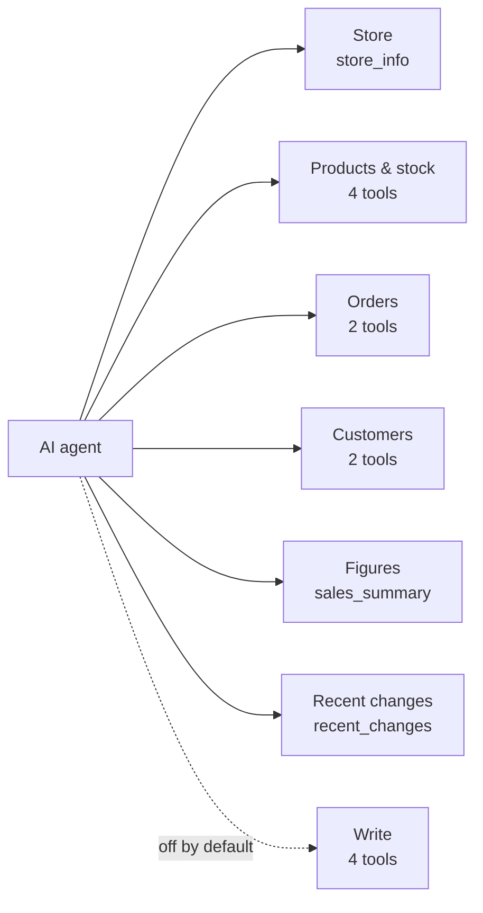
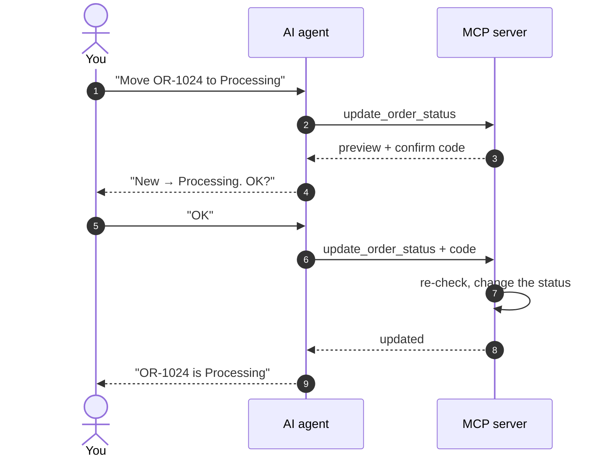

> 🌐 **Language:** [🇻🇳 Tiếng Việt](./mcp-tools_vi.md) · 🇬🇧 English (current) · [🇯🇵 日本語](./mcp-tools_ja.md)

# MCP tool catalogue

## Introduction

This page lists the **15 tools** the GP247 MCP server offers to AI agents: what each tool does, which admin permission it needs, which
parameters it takes and how you can ask the agent for it. It is written for site owners (to decide which tools to turn on) and agent users
(to know what to ask). You do not need to remember tool names — the agent picks them itself; the tables below help you understand why the
agent can or cannot do something.

## At a glance

Tools fall into 7 groups by job; the **Write** group is off by default and always needs a *Read + write* token:

- **11 read tools on by default**, **4 write tools off by default** — the site owner turns each tool on/off in **MCP Server settings**.
- **The agent only sees the tools it may use** — a tool that is off, outside the token level, or on a screen the token owner cannot open does not appear in the list.
- **Call `store_info` first** — other tools use the status codes and currency it returns.
- **Three write tools need a preview + confirm**; adding an order note does not ([see below](#write-tools-preview-then-confirm)).

## On this page

- [Summary table](#summary-table) — 15 tools, level, required permission, on by default or not
- [Store](#store) — information and code tables
- [Products & stock](#products--stock) — search, details, categories, low stock
- [Orders](#orders) — search and view orders
- [Customers](#customers) — search and view customers
- [Sales figures](#sales-figures) — revenue, best sellers
- [Recent changes](#recent-changes) — "what is new since yesterday"
- [Write tools](#write-tools-preview-then-confirm) — status changes, notes, stock receive/issue

## Summary table

Each tool requires the token owner to have permission on the matching **admin screen** (reading needs view access, writing needs edit access):

| Tool | Level | Admin screen permission | On by default |
| --- | --- | --- | --- |
| `store_info` | Read | — | Yes |
| `search_products` | Read | Products | Yes |
| `get_product` | Read | Products | Yes |
| `list_categories` | Read | Categories | Yes |
| `low_stock_products` | Read | Products | Yes |
| `search_orders` | Read | Orders | Yes |
| `get_order` | Read | Orders | Yes |
| `search_customers` | Read | Customers | Yes |
| `get_customer` | Read | Customers | Yes |
| `sales_summary` | Read | Report (products) | Yes |
| `recent_changes` | Read | The screen of each kind of change | Yes |
| `update_order_status` | Write, confirm | Edit order detail | No |
| `update_shipping_status` | Write, confirm | Edit order detail | No |
| `add_order_note` | Write | Edit order detail | No |
| `adjust_stock` | Write, confirm | Edit products | No |

> ℹ️ **Note:** the parameter lists below help you understand what the agent can ask for; in real use the agent fills them in from your question.
> Dates use `YYYY-MM-DD`. Lists are paginated: `page` (from 1), `per_page` at most **50**.

## Store

### `store_info` — store information and code tables

Returns the shop name, base currency, time zone, language, and the **code tables** of order / payment / shipping statuses. The agent should
call this tool first to learn which number "Shipping" is on your site.

- **Parameters:** none.
- **Try asking:** *"Give me the store information."* · *"What order statuses does the shop use?"*

## Products & stock

### `search_products` — search products

Search by part of the SKU, alias or name; returns id, SKU, name, price, stock, status.

- **Parameters:** `keyword` (≤ 100 characters), `category_id`, `status` (1 = active, 0 = hidden), `sort` (`created_at`, `price`, `stock`, `sku`, `sold`),
  `direction` (`asc` / `desc`), `page`, `per_page`.
- **Try asking:** *"Find products containing t-shirt, sorted by best sellers."*

### `get_product` — one product in detail

Price, stock, promotion, categories. Descriptions written by staff/vendors come back in an `untrusted_text` block (the agent treats them as data, never as instructions).

- **Parameters:** `product_id` (required).
- **Try asking:** *"What is the price of SKU SHIRT-01 and how many are left?"*

### `list_categories` — product categories

All categories as a flat list with the parent category id (parent = 0 is a top-level category).

- **Parameters:** none.
- **Try asking:** *"Which categories does the shop have?"*

### `low_stock_products` — running low

Active products whose stock is **at or below a threshold**, lowest stock first. The default threshold comes from the settings (5 by default).

- **Parameters:** `threshold` (≥ 0), `page`, `per_page`.
- **Try asking:** *"Which products have fewer than 3 left?"*

## Orders

### `search_orders` — search orders

Filter by order status, payment status, shipping status, date range and keyword (order id, buyer name, e-mail).

- **Parameters:** `status`, `payment_status`, `shipping_status` (codes from `store_info`), `from`, `to`, `keyword` (≤ 100 characters),
  `sort` (`created_at`, `total`, `id`, `status`), `direction`, `page`, `per_page`.
- **Try asking:** *"List this week's unpaid orders."*

> ℹ️ **Note:** while customer contact details are masked, searching by e-mail only matches the **whole e-mail** — so nobody can guess a masked e-mail step by step.

### `get_order` — one order in detail

Lines, totals in the order currency, status history, payments, and a flag telling whether the order is finalised (Done / Refunded / Canceled).
The customer's note comes back in `untrusted_text`.

- **Parameters:** `order_id` (required).
- **Try asking:** *"What is in order OR-1024, has the customer paid?"*

## Customers

### `search_customers` — search customers

Search by the **exact** e-mail or phone number, or by part of the name.

- **Parameters:** `keyword` (≤ 150 characters), `page`, `per_page`.
- **Try asking:** *"Find customers named Lan."*

### `get_customer` — customer profile

The customer profile with order count and total spending on Done orders, per currency. E-mail, phone and address are masked unless the site owner allows sending them.

- **Parameters:** `customer_id` (required).
- **Try asking:** *"How many orders has this customer placed and how much did they spend?"*

## Sales figures

### `sales_summary` — sales overview

Revenue **per currency** (Done orders), order counts by status and best sellers over a date range. Last 30 days by default.

- **Parameters:** `from`, `to` (end date included), `top` (number of best sellers, 1–20, default 5).
- **Try asking:** *"How much did we sell in October, and what were the 10 best sellers?"*

> ℹ️ **Note:** USD and VND revenue come back separately and are **never added together**. One question covers at most 366 days (adjustable in the settings).

## Recent changes

### `recent_changes` — what has changed

New orders, order / payment / shipping status changes, stock movements, product and customer updates — oldest first. Last 24 hours by default.

- **Parameters:** `since` (start time, ISO 8601), `types` (which event types to keep, e.g. `order.created`, `stock.changed`),
  `after` (use the `next_after` value of the previous page to read on), `limit` (1–100, default 50).
- **Try asking:** *"Any new orders since this morning, any stock movements?"*

> ⚠️ **Warning:** this tool reads the REST API **event log**. When the log is off, the tool returns `enabled: false` with a hint — turn it on on the
> API management screen (see [Data sync](../api/api-sync.md)). Each event type only appears when the token owner has permission on the matching screen.

## Write tools: preview, then confirm

The four write tools let the agent act for you, so they have the strongest safeguards:

- **Off by default, turned on one by one** — there is no "turn all on" switch.
- **They need a *Read + write* token** and the token owner must have **edit** permission on the matching screen.
- **Same rules as the admin panel** — e.g. cancelling an order restocks it, reopening a cancelled order needs enough stock.
- **There are no tools to delete, refund, change prices or work in bulk.**

| Tool | Does | Main parameters | Confirm |
| --- | --- | --- | --- |
| `update_order_status` | Change an order's status | `order_id`, `status`, `note` (≤ 500 characters) | Yes |
| `update_shipping_status` | Change an order's shipping status | `order_id`, `shipping_status`, `note` (≤ 500 characters) | Yes |
| `adjust_stock` | Receive (positive) / issue (negative) stock outside a sale | `product_id`, `delta` (≠ 0, up to 4 decimals), `reason` (≤ 255) | Yes |
| `add_order_note` | Add an internal note to the order history (labelled [MCP]) | `order_id`, `note` (≤ 1000 characters, plain text) | No |

For the three tools with confirmation, the agent always calls **twice**. For example you say *"Move order OR-1024 to Processing"*:

- **The first call changes nothing** — it only returns a preview (old → new) and a confirm code.
- **The code lives 5 minutes, works once and is bound to the exact token + record + change** — changing to another value needs a new preview; a wrong or expired code writes nothing.
- **A well-behaved agent asks you between the two calls** — only give write tokens to agents you trust.
- **`add_order_note` writes in a single call** because it only *adds* one history line, without touching money, stock or status.

## Conditions & Rules (know before you act)

**When looking things up**
- **At most 50 rows per page** — keeps the site fast on small hosting; the agent reads the next page if needed.
- **Records outside your store scope answer "not found"** — exactly like a record that does not exist, so other stores' data never leaks.
- **A sales overview covers at most 366 days per question** — split the period if you need more (the site owner can change the limit).

**When writing**
- **The target status must exist** in the code tables of `store_info` — unknown codes are refused.
- **Changing the shipping status to the one it already has gives no code** — there is nothing to change.
- **Finalised orders can still be changed, as in the admin panel**; the preview carries a note so you can think twice.
- **Stock never goes below zero** — a change that would make it negative is refused, even if stock was used up between the preview and the confirmation.
- **`adjust_stock` only adds/subtracts a difference**; it never overwrites the absolute stock and never touches the sold counter.
- **While the site runs in read-only demo mode, every write through MCP is blocked.**

## Q&A

**Q1: The agent says it has no tool for what I asked?**

→ Check three places: is the tool on in **MCP Server settings**; is the token limited to other tools; does the token's account have permission on
the matching admin screen (e.g. the Customers screen for `search_customers`).

**Q2: Does changing an order status through the agent restock like the admin panel?**

→ Yes. Write tools follow exactly the admin panel's rules: cancelling restocks, reopening a cancelled order needs enough stock, every change goes into the order history.

**Q3: Why does the agent ask me again before changing a status?**

→ That is the mandatory preview step: the first call only returns a preview and a confirm code; the agent needs your OK before the second call.

**Q4: The confirm code says it has expired?**

→ A code lives only 5 minutes and works once. Ask the agent to start over to get a new preview and code.

**Q5: `recent_changes` says it is "not enabled"?**

→ The REST API event log is off. The site owner turns it on on the API management screen; from then on new changes are recorded.

**Q6: The revenue from the agent differs from the dashboard?**

→ `sales_summary` only counts **Done** orders and keeps each currency separate. Compare with a report for the same dates and the same Done-orders condition.

**Q7: Can the agent delete orders or products?**

→ No. MCP has no tool to delete, refund, change prices or work in bulk.

**Q8: How is receiving stock with `adjust_stock` different from editing stock on the product screen?**

→ `adjust_stock` only adds or subtracts an amount (e.g. +20, −3) and never lets stock go negative; it does not set the absolute stock. The reason goes into the audit log.

**Q9: Where do notes added by the agent show up?**

→ In the order's history on the order detail screen, labelled **[MCP]**, so staff can tell them apart from notes written by people.

---

📅 **Last updated:** 2026-11-04 · ✍️ **Author:** GP247
