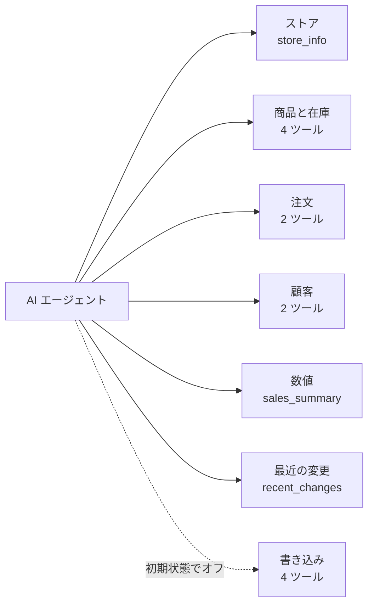
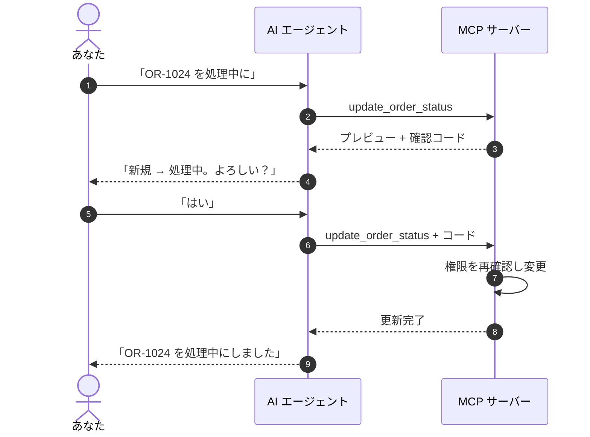

> 🌐 **言語:** [🇻🇳 Tiếng Việt](./mcp-tools_vi.md) · [🇬🇧 English](./mcp-tools.md) · 🇯🇵 日本語（現在）

# MCP ツール一覧

## はじめに

このページでは、GP247 の MCP サーバーが AI エージェントに提供する **15 個のツール**を一覧にし、それぞれの役割、必要な管理画面の権限、受け取る
パラメーター、エージェントへの聞き方を説明します。対象は、どのツールをオンにするか決めるサイトオーナーと、何を聞けばよいか知りたいエージェント利用者です。
ツール名を覚える必要はありません。エージェントが自分で選びます。下の表は、エージェントがある作業をできる理由・できない理由を理解するためのものです。

## ひと目でわかる

ツールは用途ごとに 7 つのグループに分かれます。**書き込み**グループは初期状態でオフで、必ず *読み取り + 書き込み* のトークンが必要です。

- **読み取りツール 11 個は初期状態でオン**、**書き込みツール 4 個はオフ** — サイトオーナーが **MCP Server の設定** で 1 つずつオン / オフします。
- **エージェントには使えるツールだけが見えます** — オフのツール、トークンのレベル外のツール、トークン所有者が該当画面の権限を持たないツールは一覧に出ません。
- **最初に `store_info` を呼びます** — 他のツールは、ここで返されるステータスコードと通貨を使います。
- **書き込みツールのうち 3 つはプレビュー + 確定が必要**です。注文メモの追加だけは不要です（[下記参照](#書き込みツールプレビューしてから確定)）。

## このページの内容

- [一覧表](#一覧表) — 15 ツールのレベル、必要な権限、初期状態
- [ストア](#ストア) — 情報とコード表
- [商品と在庫](#商品と在庫) — 検索、詳細、カテゴリ、在庫僅少
- [注文](#注文) — 注文の検索と表示
- [顧客](#顧客) — 顧客の検索と表示
- [売上の数値](#売上の数値) — 売上、売れ筋商品
- [最近の変更](#最近の変更) — 「昨日から何が変わった？」
- [書き込みツール](#書き込みツールプレビューしてから確定) — ステータス変更、メモ、入出庫

## 一覧表

各ツールは、トークン所有者が対応する**管理画面**の権限を持っていることを求めます（読み取りは表示権限、書き込みは編集権限）。

| ツール | レベル | 権限が必要な管理画面 | 初期状態 |
| --- | --- | --- | --- |
| `store_info` | 読み取り | — | オン |
| `search_products` | 読み取り | 商品 | オン |
| `get_product` | 読み取り | 商品 | オン |
| `list_categories` | 読み取り | カテゴリ | オン |
| `low_stock_products` | 読み取り | 商品 | オン |
| `search_orders` | 読み取り | 注文 | オン |
| `get_order` | 読み取り | 注文 | オン |
| `search_customers` | 読み取り | 顧客 | オン |
| `get_customer` | 読み取り | 顧客 | オン |
| `sales_summary` | 読み取り | レポート（商品） | オン |
| `recent_changes` | 読み取り | 変更の種類ごとの画面 | オン |
| `update_order_status` | 書き込み・確定あり | 注文詳細の編集 | オフ |
| `update_shipping_status` | 書き込み・確定あり | 注文詳細の編集 | オフ |
| `add_order_note` | 書き込み | 注文詳細の編集 | オフ |
| `adjust_stock` | 書き込み・確定あり | 商品の編集 | オフ |

> ℹ️ **情報:** 下のパラメーター一覧は、エージェントに何を頼めるかを理解するためのものです。実際にはエージェントが質問からパラメーターを埋めます。
> 日付は `YYYY-MM-DD` 形式です。一覧はページ分割され、`page`（1 から）、`per_page` は最大 **50** です。

## ストア

### `store_info` — ストア情報とコード表

ショップ名、基準通貨、タイムゾーン、言語と、注文 / 支払い / 配送の**ステータスコード表**を返します。エージェントは最初にこのツールを呼び、あなたの
サイトで「配送中」が何番なのかを知る必要があります。

- **パラメーター：** なし。
- **聞き方の例：** *「ストアの情報を教えて。」* · *「このショップの注文ステータスは何がある？」*

## 商品と在庫

### `search_products` — 商品を検索

SKU、エイリアス、名前の一部で検索し、ID、SKU、名前、価格、在庫、ステータスを返します。

- **パラメーター：** `keyword`（100 文字以内）、`category_id`、`status`（1 = 販売中、0 = 非表示）、`sort`（`created_at`、`price`、`stock`、`sku`、`sold`）、
  `direction`（`asc` / `desc`）、`page`、`per_page`。
- **聞き方の例：** *「T シャツを含む商品を、売れ筋順で探して。」*

### `get_product` — 商品 1 件の詳細

価格、在庫、プロモーション、カテゴリ。スタッフや出品者が書いた説明は `untrusted_text` ブロックで返されます（エージェントは指示ではなくデータとして扱います）。

- **パラメーター：** `product_id`（必須）。
- **聞き方の例：** *「SKU SHIRT-01 の価格と残り在庫は？」*

### `list_categories` — 商品カテゴリ

すべてのカテゴリを、親カテゴリの ID 付きのフラットな一覧で返します（親 = 0 はトップレベル）。

- **パラメーター：** なし。
- **聞き方の例：** *「このショップにはどんなカテゴリがある？」*

### `low_stock_products` — 在庫僅少の商品

在庫が**しきい値以下**の販売中商品を、在庫の少ない順に返します。既定のしきい値は設定値（初期値 5）です。

- **パラメーター：** `threshold`（0 以上）、`page`、`per_page`。
- **聞き方の例：** *「残り 3 個未満の商品は？」*

## 注文

### `search_orders` — 注文を検索

注文ステータス、支払いステータス、配送ステータス、期間、キーワード（注文 ID、購入者名、メールアドレス）で絞り込みます。

- **パラメーター：** `status`、`payment_status`、`shipping_status`（コードは `store_info` から）、`from`、`to`、`keyword`（100 文字以内）、
  `sort`（`created_at`、`total`、`id`、`status`）、`direction`、`page`、`per_page`。
- **聞き方の例：** *「今週の未払いの注文を一覧にして。」*

> ℹ️ **情報:** 顧客の連絡先がマスクされている間は、メールアドレスでの検索は**完全一致**のみです。マスクされたメールアドレスを少しずつ推測されないようにするためです。

### `get_order` — 注文 1 件の詳細

明細、注文通貨での合計、ステータス履歴、支払い記録、そして注文が確定済み（完了 / 返金済み / キャンセル）かどうかのフラグを返します。顧客のメモは
`untrusted_text` で返されます。

- **パラメーター：** `order_id`（必須）。
- **聞き方の例：** *「注文 OR-1024 の内容は？お客様は支払い済み？」*

## 顧客

### `search_customers` — 顧客を検索

メールアドレスまたは電話番号の**完全一致**、または名前の一部で検索します。

- **パラメーター：** `keyword`（150 文字以内）、`page`、`per_page`。
- **聞き方の例：** *「名前が Lan の顧客を探して。」*

### `get_customer` — 顧客プロフィール

顧客プロフィールと、注文数、完了済み注文での通貨ごとの合計支出を返します。サイトオーナーが送信を許可していない場合、メールアドレス、電話番号、住所はマスクされます。

- **パラメーター：** `customer_id`（必須）。
- **聞き方の例：** *「この顧客は何件注文して、いくら使った？」*

## 売上の数値

### `sales_summary` — 売上サマリー

期間内の**通貨ごと**の売上（完了済み注文）、ステータス別の注文数、売れ筋商品を返します。初期値は直近 30 日です。

- **パラメーター：** `from`、`to`（最終日を含む）、`top`（売れ筋商品の数、1〜20、初期値 5）。
- **聞き方の例：** *「10 月の売上と、売れ筋トップ 10 は？」*

> ℹ️ **情報:** USD と VND の売上は別々に返され、**合算されることはありません**。1 回の質問は最大 366 日です（設定で変更できます）。

## 最近の変更

### `recent_changes` — 何が変わったか

新規注文、注文 / 支払い / 配送ステータスの変更、在庫の動き、商品と顧客の更新を、古い順に返します。初期値は直近 24 時間です。

- **パラメーター：** `since`（開始時刻、ISO 8601）、`types`（残すイベントの種類。例：`order.created`、`stock.changed`）、
  `after`（前のページの `next_after` の値を使って続きを読む）、`limit`（1〜100、初期値 50）。
- **聞き方の例：** *「今朝から新しい注文や在庫の動きはあった？」*

> ⚠️ **注意:** このツールは REST API の**イベントログ**を読みます。ログがオフのときは `enabled: false` とヒントを返します。API 管理画面でオンにしてください
> （[データ同期](../api/api-sync_ja.md)を参照）。各イベントの種類は、トークン所有者が対応する画面の権限を持つ場合にだけ表示されます。

## 書き込みツール：プレビューしてから確定

4 つの書き込みツールはエージェントがあなたの代わりに作業するためのもので、最も強い安全策が取られています。

- **初期状態でオフ、1 つずつオンにします** — 「すべてオン」のスイッチはありません。
- **「読み取り + 書き込み」のトークンが必要**で、トークン所有者は対応する画面の**編集**権限を持っている必要があります。
- **管理画面と同じルール** — たとえば注文をキャンセルすると在庫が戻り、キャンセルした注文を再開するには十分な在庫が必要です。
- **削除、返金、価格変更、一括操作のツールはありません。**

| ツール | 内容 | 主なパラメーター | 確定 |
| --- | --- | --- | --- |
| `update_order_status` | 注文ステータスを変更 | `order_id`、`status`、`note`（500 文字以内） | あり |
| `update_shipping_status` | 注文の配送ステータスを変更 | `order_id`、`shipping_status`、`note`（500 文字以内） | あり |
| `adjust_stock` | 販売以外で入庫（正の数）/ 出庫（負の数） | `product_id`、`delta`（0 以外、小数 4 桁まで）、`reason`（255 文字以内） | あり |
| `add_order_note` | 注文履歴に社内メモを追加（[MCP] ラベル付き） | `order_id`、`note`（1000 文字以内、プレーンテキスト） | なし |

確定ありの 3 つのツールでは、エージェントは必ず **2 回**呼び出します。たとえば *「注文 OR-1024 を処理中にして」* と頼んだ場合：

- **1 回目の呼び出しでは何も変わりません** — プレビュー（変更前 → 変更後）と確認コードを返すだけです。
- **コードの有効期限は 5 分、1 回限りで、トークン + 対象 + 変更内容に結び付いています** — 別の値に変えるには再度プレビューが必要です。コードが間違っているか期限切れなら何も書き込まれません。
- **正しく動くエージェントは 2 回の呼び出しの間にあなたに確認します** — 書き込み用トークンは信頼できるエージェントにだけ渡してください。
- **`add_order_note` は 1 回の呼び出しで書き込みます** — 履歴を 1 行*追加*するだけで、金額、在庫、ステータスを変えないためです。

## 条件と制約（操作の前に確認）

**検索するとき**
- **1 ページは最大 50 行** — 小さなホスティングでもサイトを速く保つためです。必要ならエージェントが次のページを読みます。
- **自分のストア範囲外のレコードは「見つかりません」になります** — 存在しないレコードとまったく同じ扱いで、他のストアのデータが漏れないようにするためです。
- **売上サマリーは 1 回の質問で最大 366 日** — それ以上は期間を分けてください（上限はサイトオーナーが変更できます）。

**書き込むとき**
- **変更先のステータスは `store_info` のコード表に存在する必要があります** — 不明なコードは拒否されます。
- **配送ステータスを現在と同じ値に変えようとしても確認コードは発行されません** — 変更する内容がないためです。
- **確定済みの注文も管理画面と同じように変更できます**。プレビューに注記が付くので、よく検討できます。
- **在庫がマイナスになることはありません** — マイナスになる変更は、プレビューから確定までの間に在庫が使われた場合も含めて拒否されます。
- **`adjust_stock` は差分の加算・減算だけを行い**、在庫数を絶対値で上書きせず、販売数にも触れません。
- **サイトが読み取り専用のデモモードのときは、MCP からの書き込みはすべてブロックされます。**

## よくある質問（Q&A）

**Q1: 頼んだ作業をするツールがないとエージェントが言います。**

→ 3 か所を確認してください：**MCP Server の設定** でツールがオンになっているか、トークンが他のツールに制限されていないか、トークンを作ったアカウントが
対応する管理画面の権限を持っているか（例：`search_customers` には顧客画面）。

**Q2: エージェントで注文ステータスを変えると、管理画面と同じように在庫が戻りますか？**

→ はい。書き込みツールは管理画面とまったく同じルールに従います。キャンセルで在庫が戻り、キャンセルした注文の再開には十分な在庫が必要で、すべての変更が注文履歴に残ります。

**Q3: ステータスを変える前に、なぜエージェントがもう一度確認してくるのですか？**

→ 必須のプレビュー手順だからです。1 回目の呼び出しはプレビューと確認コードを返すだけで、2 回目の前にエージェントはあなたの同意を得る必要があります。

**Q4: 確認コードが期限切れと表示されます。**

→ コードの有効期限は 5 分で、1 回しか使えません。エージェントに最初からやり直させ、新しいプレビューとコードを取得してください。

**Q5: `recent_changes` が「オンになっていない」と返します。**

→ REST API のイベントログがオフです。サイトオーナーが API 管理画面でオンにすると、その時点から新しい変更が記録されます。

**Q6: エージェントの売上がダッシュボードの数値と違います。**

→ `sales_summary` は**完了**した注文だけを数え、通貨ごとに分けています。同じ期間、同じ「完了済み注文」の条件のレポートと比べてください。

**Q7: エージェントは注文や商品を削除できますか？**

→ いいえ。MCP には削除、返金、価格変更、一括操作のツールはありません。

**Q8: `adjust_stock` での入庫は、商品画面で在庫を編集するのとどう違いますか？**

→ `adjust_stock` は数量を加算または減算する（例：+20、−3）だけで、在庫をマイナスにさせず、在庫数を絶対値で設定しません。理由は操作ログに記録されます。

**Q9: エージェントが追加したメモはどこに表示されますか？**

→ 注文詳細画面の注文履歴に **[MCP]** ラベル付きで表示されるので、スタッフは人が書いたメモと区別できます。

---

📅 **最終更新:** 2026-11-04 · ✍️ **作成者 (Author):** GP247
