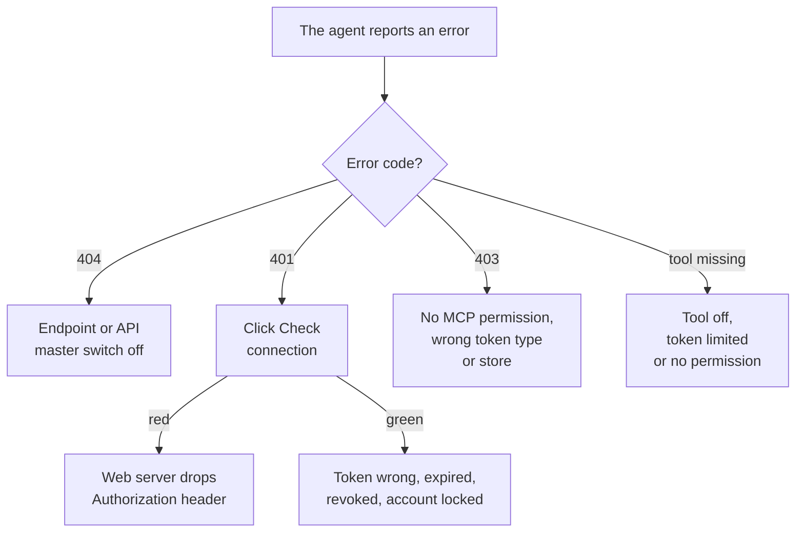

> 🌐 **Language:** [🇻🇳 Tiếng Việt](./mcp-troubleshooting_vi.md) · 🇬🇧 English (current) · [🇯🇵 日本語](./mcp-troubleshooting_ja.md)

# MCP troubleshooting

## Introduction

This page helps you **find and fix problems yourself** when an AI agent cannot connect or cannot do its job with the GP247 MCP server. It is
written for site owners, staff using agents and the technical person. Look up the **symptom** you see, or the **error code** the agent reports
(401, 403, 404…); each line gives the cause and the fix. Never connected before? Start with [Quick start](./mcp-quickstart.md).

## At a glance

Most problems sit in one of four places — following this order is the fastest:



- **The Check connection button** at the bottom of the **MCP Server** screen tells a web-server problem from a token problem.
- **Every gate error carries a `code`** in the response body (e.g. `forbidden_origin`) — look it up in [Look up by error code](#look-up-by-error-code).
- **The admin operation log** (`MCP` lines) shows which tool call was refused and why.

## Look up by symptom

| Symptom | Usual cause | Fix |
| --- | --- | --- |
| No **System config → MCP Server** menu | Missing **"MCP server — use (own tokens)"** permission, or the site has no MCP package | Ask the site owner for the permission; older site: [Adding MCP to an older site](./mcp-administration.md#adding-mcp-to-a-site-installed-from-an-older-s-cart) |
| The **Read + write** option is greyed out when creating a token | The site has no write tool on | Turn on the write tools you need in **MCP Server settings** |
| The agent connects but **cannot see a tool it needs** | Tool off; token limited to other tools; token owner lacks the screen permission | Check all three ([Tool catalogue](./mcp-tools.md#summary-table)) |
| The agent says **not found** for an existing order / product | The record belongs to a store outside the account's scope | Use an account with access to that store, or connect the agent to that store's domain |
| The **confirm code** is refused | Code expired (5 minutes), already used, or parameters differ from the preview | Ask the agent to preview again for a new code |
| `recent_changes` says **not enabled** | The REST API event log is off | Turn it on on the API management screen ([Data sync](../api/api-sync.md)) |
| The agent **stops working after a password change** | Changing the password revokes every MCP token of the account | Create a new token and put it into the agent |
| Writes are always blocked | The site runs in read-only demo mode | Turn demo mode off if this is a real site |
| `composer require gp247/mcp` reports a dependency error (*fixed to 3.8.x by a partial update*) | Core locked to a version older than 3.9 | Run it again with `-W` so Composer may upgrade the core: `composer require gp247/mcp -W` |

## Look up by error code

Errors at the MCP gate return JSON shaped like `{"error": 1, "msg": "...", "code": "..."}`:

| HTTP | `code` | Meaning | Fix |
| --- | --- | --- | --- |
| `404` | — | Endpoint off, or the REST API master switch off | Turn on **Turn on the MCP endpoint**; check the master switch on the API management screen |
| `401` | `unauthenticated` | No token, wrong token, expired, revoked, or account locked | Check the token; click **Check connection** ([see below](#the-web-server-drops-the-authorization-header)) |
| `403` | `insufficient_scope` | The account lacks "MCP server — use", or the token is not an MCP token | Grant the permission; use a token created on the **MCP Server** screen (REST API tokens do not work) |
| `403` | `store_scope_denied` | Multi-store site: the account may not use MCP on this store / domain | See [Multi-store sites](./mcp-security.md#multi-store-sites) |
| `403` | `forbidden_origin` | Browser request from an origin that is not allowed | Add the origin to **Extra allowed browser origins** |
| `405` | — | Called with `GET` / `DELETE` | Normal — MCP only accepts `POST`; well-behaved agents handle this themselves |
| `413` | `payload_too_large` | Request larger than the limit (64 KB by default) | Raise **Maximum request size (KB)** if really needed |
| `429` | `too_many_attempts` / — | Over the per-IP or per-token limit (60/minute by default) | Wait as told by the `Retry-After` header; raise **Requests per minute per token** if needed |

> ℹ️ **Note:** errors **while a tool runs** (no screen permission, wrong parameter, not enough stock…) are not HTTP errors: the agent receives the
> tool's error message and usually explains it back to you.

## The web server drops the Authorization header

Some Apache setups (CGI / FastCGI) do not pass the `Authorization` header to PHP, so every request gets `401` even with the right token.
**Check connection** shows **red** in this case.

1. Open the site's `public/.htaccess` file and make sure these two lines are still there (Laravel ships them; they sometimes get deleted during edits):

   ```
   RewriteCond %{HTTP:Authorization} .
   RewriteRule .* - [E=HTTP_AUTHORIZATION:%{HTTP:Authorization}]
   ```

2. Save the file, go back to the **MCP Server** screen and click **Check connection**.

   If it worked, the result turns **green**.
3. Still red? Ask your hosting provider to turn on `CGIPassAuth On` for the site (or the equivalent setting for Nginx / LiteSpeed).

## The three results of Check connection

This button makes the site call its own MCP address (based on `APP_URL`) and reports:

| Result | Meaning | Next step |
| --- | --- | --- |
| **Green** | Reachable, the `Authorization` header reaches PHP | Any remaining problem is in the token or the permissions |
| **Red** | The web server drops the `Authorization` header | Follow the [section above](#the-web-server-drops-the-authorization-header) |
| **Yellow** | The site cannot call itself | Endpoint off, wrong `APP_URL`, or hosting / firewall blocks loopback — try directly with the agent |

> 💡 **Tip:** the MCP Server screen also warns when the site does not run on **HTTPS** — fix that first, since the token travels with every request.

## Conditions & Rules (know before you act)

- **`401` errors are deliberately identical for every cause** — no difference between a wrong token, an expired one or a locked account, so nobody can probe accounts. Check the token and the account yourself in the admin panel.
- **Records outside the store scope answer "not found"**, not "no permission" — on purpose, so other stores' data never leaks.
- **Listing tools and `401` errors are not logged one by one** — to learn why the gate refused a request, look at the error code the agent reports.

## Q&A

**Q1: The token is definitely right but I still get 401?**

→ Click **Check connection**. Red: fix the header as in [the section above](#the-web-server-drops-the-authorization-header). Green: check whether the
token's account is locked, just changed its password, or whether the token expired / was revoked.

**Q2: The agent reports 404 although I turned the endpoint on?**

→ Check the REST API master switch on the API management screen — it turns MCP off too. Check the address as well: it must be `https://<your-domain>/api/core/mcp`.

**Q3: The agent reports 403 `insufficient_scope`?**

→ Either the account lacks **"MCP server — use (own tokens)"**, or you are using a REST API token. Create a token on the **MCP Server** screen.

**Q4: The agent cannot see the `search_customers` tool?**

→ The tool is off, the token is limited to other tools, or the token's account has no access to the Customers screen. Fix one of those three.

**Q5: The agent keeps reporting 429?**

→ The agent calls too often per minute. Wait for the time given in `Retry-After`, or raise **Requests per minute per token** in the settings.

**Q6: Check connection shows yellow but the agent works?**

→ Normal on hosting that blocks the site from calling itself. If the agent works, the real connection is fine.

**Q7: The confirm code is always rejected?**

→ A code lives only 5 minutes, works once and is bound to the exact change previewed. If the agent changes a parameter (e.g. another status) between the two steps, it must preview again.

**Q8: Where do I see refused calls?**

→ In the admin operation log, lines with method `MCP`: they show the tool name, the token, the `denied` outcome and the error code.

**Q9: The error only happens on one domain of a multi-store site?**

→ MCP determines the store from the domain you call. A store manager must connect the agent to their own store's domain; the wrong domain gives `403 store_scope_denied`.

---

<sub>📅 **Last updated:** 2026-11-04 · ✍️ **Author:** GP247</sub>
