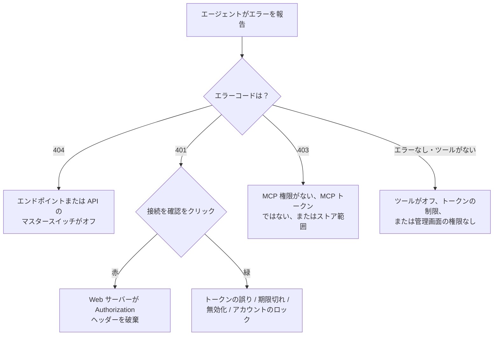

> 🌐 **言語:** [🇻🇳 Tiếng Việt](./mcp-troubleshooting_vi.md) · [🇬🇧 English](./mcp-troubleshooting.md) · 🇯🇵 日本語（現在）

# MCP のトラブルシューティング

## はじめに

このページは、AI エージェントが GP247 の MCP に接続できない、または作業をこなせないときに、**ご自身で原因を見つけて直す**ためのものです。対象は
サイトオーナー、エージェントを使うスタッフ、技術担当者です。見えている**症状**、またはエージェントが報告した**エラーコード**（401、403、404 など）で
調べてください。各行に原因と対処が書いてあります。まだ一度も接続していない場合は[クイックスタート](./mcp-quickstart_ja.md)から始めてください。

## ひと目でわかる

問題のほとんどは 4 つのどこかにあります。この順にたどるのが最も早い方法です。



- **MCP Server 画面の下部にある「接続を確認」ボタン**で、Web サーバーの問題かトークンの問題かを見分けられます。
- **入口でのエラーにはすべて `code` があります**（例：`forbidden_origin`）。[エラーコードで調べる](#エラーコードで調べる)を参照してください。
- **管理者の操作ログ**（`MCP` の行）で、どのツール呼び出しが、なぜ拒否されたかがわかります。

## 症状で調べる

| 症状 | よくある原因 | 対処 |
| --- | --- | --- |
| **システム設定 → MCP Server** メニューがない | **「MCP server — use (own tokens)」** 権限がない、またはサイトに MCP パッケージがない | サイトオーナーに権限を依頼。古いサイトは[古い S-Cart のサイトに MCP を追加する](./mcp-administration_ja.md#古い-s-cart-のサイトに-mcp-を追加する) |
| トークン作成時に **読み取り + 書き込み** が灰色 | サイトで書き込みツールが 1 つもオンになっていない | **MCP Server の設定** で必要な書き込みツールをオン |
| 接続はできるが**必要なツールが見えない** | ツールがオフ、トークンが他のツールに制限、トークン所有者に画面の権限がない | 3 つすべてを確認（[ツール一覧](./mcp-tools_ja.md#一覧表)） |
| 実在する注文 / 商品が**見つからない**と言われる | レコードがアカウントの範囲外のストアにある | そのストアの権限を持つアカウントを使うか、そのストアのドメインに接続 |
| **確認コード**が拒否される | 期限切れ（5 分）、使用済み、またはプレビュー時とパラメーターが違う | エージェントにもう一度プレビューさせて新しいコードを取得 |
| `recent_changes` が**オンになっていない**と返す | REST API のイベントログがオフ | API 管理画面でオン（[データ同期](../api/api-sync_ja.md)） |
| **パスワード変更後にエージェントが動かない** | パスワード変更でそのアカウントのすべての MCP トークンが無効化された | 新しいトークンを作成し、エージェントに設定 |
| 書き込みが常にブロックされる | サイトが読み取り専用のデモモード | 本番サイトならデモモードをオフ |
| `composer require gp247/mcp` で依存関係のエラー | core が 3.9 より古い | `composer update gp247/core gp247/front gp247/shop` の後に再実行 |

## エラーコードで調べる

MCP の入口でのエラーは `{"error": 1, "msg": "...", "code": "..."}` の形の JSON で返されます。

| HTTP | `code` | 意味 | 対処 |
| --- | --- | --- | --- |
| `404` | — | エンドポイントがオフ、または REST API のマスタースイッチがオフ | **MCPエンドポイントをオンにする** をオン。API 管理画面のマスタースイッチを確認 |
| `401` | `unauthenticated` | トークンがない・誤り・期限切れ・無効化済み、またはアカウントがロック | トークンを確認し、**接続を確認** をクリック（[下記参照](#web-サーバーが-authorization-ヘッダーを破棄する)） |
| `403` | `insufficient_scope` | アカウントに「MCP server — use」がない、またはトークンが MCP トークンではない | 権限を付与。**MCP Server** 画面で作成したトークンを使う（REST API のトークンは使えません） |
| `403` | `store_scope_denied` | 複数ストアのサイトで、このストア / ドメインでは MCP を使えないアカウント | [複数ストアのサイト](./mcp-security_ja.md#複数ストアのサイト)を参照 |
| `403` | `forbidden_origin` | 許可されていないオリジンからのブラウザのリクエスト | **追加で許可するブラウザのオリジン** に追加 |
| `405` | — | `GET` / `DELETE` で呼び出した | 正常です。MCP は `POST` だけを受け付け、正しく動くエージェントは自動で処理します |
| `413` | `payload_too_large` | リクエストが上限（初期値 64 KB）より大きい | 本当に必要なら **最大リクエストサイズ (KB)** を上げる |
| `429` | `too_many_attempts` / — | IP ごと、またはトークンごと（初期値 60 回/分）の上限を超えた | `Retry-After` ヘッダーの時間だけ待つ。必要なら **トークンごとの1分あたりのリクエスト数** を上げる |

> ℹ️ **情報:** **ツールの実行中のエラー**（画面の権限がない、パラメーターの誤り、在庫不足など）は HTTP エラーではありません。エージェントはツールの
> エラーメッセージを受け取り、たいていはあなたに説明し直します。

## Web サーバーが Authorization ヘッダーを破棄する

Apache の一部の構成（CGI / FastCGI）は `Authorization` ヘッダーを PHP に渡さないため、トークンが正しくてもすべてのリクエストが `401` になります。
この場合、**接続を確認** は**赤**になります。

1. サイトの `public/.htaccess` ファイルを開き、次の 2 行が残っているか確認します（Laravel に最初から含まれていますが、編集中に消されることがあります）。

   ```
   RewriteCond %{HTTP:Authorization} .
   RewriteRule .* - [E=HTTP_AUTHORIZATION:%{HTTP:Authorization}]
   ```

2. ファイルを保存し、**MCP Server** 画面に戻って **接続を確認** をクリックします。

   成功すると、結果が**緑**になります。
3. まだ赤の場合は、ホスティング会社にサイトで `CGIPassAuth On` を有効にするよう依頼してください（Nginx / LiteSpeed では同等の設定）。

## 「接続を確認」の 3 つの結果

このボタンはサイト自身の MCP アドレス（`APP_URL` に基づく）を呼び出して、結果を表示します。

| 結果 | 意味 | 次の手順 |
| --- | --- | --- |
| **緑** | 到達でき、`Authorization` ヘッダーが PHP まで届いている | 残っている問題はトークンか権限にあります |
| **赤** | Web サーバーが `Authorization` ヘッダーを破棄している | [上の項目](#web-サーバーが-authorization-ヘッダーを破棄する)に従う |
| **黄** | サイトが自分自身を呼び出せない | エンドポイントがオフ、`APP_URL` の誤り、またはホスティング / ファイアウォールがループバックを遮断。エージェントで直接試す |

> 💡 **ヒント:** サイトが **HTTPS** で動いていない場合も MCP Server 画面に警告が出ます。トークンはリクエストごとに送られるため、先に直してください。

## 条件と制約（操作の前に確認）

- **`401` エラーはどの原因でも意図的に同じです** — トークンの誤り、期限切れ、アカウントのロックを区別しないため、アカウントを探られることはありません。トークンとアカウントは管理画面でご自身で確認してください。
- **ストア範囲外のレコードは「権限がありません」ではなく「見つかりません」になります** — 他のストアのデータが漏れないようにするための意図的な仕様です。
- **ツールの一覧取得と `401` エラーは 1 回ずつは記録されません** — 入口で拒否された理由は、エージェントが報告したエラーコードで確認してください。

## よくある質問（Q&A）

**Q1: トークンは確実に正しいのに 401 になります。**

→ **接続を確認** をクリックしてください。赤なら[上の項目](#web-サーバーが-authorization-ヘッダーを破棄する)に従ってヘッダーを直します。緑なら、トークンの
アカウントがロックされていないか、パスワードを変更したばかりでないか、トークンが期限切れ / 無効化されていないかを確認してください。

**Q2: エンドポイントをオンにしたのに 404 になります。**

→ API 管理画面の REST API マスタースイッチを確認してください。このスイッチは MCP もオフにします。アドレスも確認してください。`https://<ドメイン>/api/core/mcp` である必要があります。

**Q3: エージェントが 403 `insufficient_scope` を報告します。**

→ アカウントに **「MCP server — use (own tokens)」** がないか、REST API のトークンを使っています。**MCP Server** 画面でトークンを作成してください。

**Q4: エージェントに `search_customers` ツールが見えません。**

→ ツールがオフ、トークンが他のツールに制限されている、またはトークンのアカウントに顧客画面の権限がありません。3 つのうちどれかを直してください。

**Q5: エージェントが 429 を繰り返し報告します。**

→ エージェントの 1 分あたりの呼び出しが多すぎます。`Retry-After` の時間だけ待つか、設定で **トークンごとの1分あたりのリクエスト数** を上げてください。

**Q6: 「接続を確認」は黄なのに、エージェントは動きます。**

→ サイトが自分自身を呼び出すことを遮断するホスティングでは普通のことです。エージェントが動いていれば、実際の接続は問題ありません。

**Q7: 確認コードがいつも拒否されます。**

→ コードの有効期限は 5 分で、1 回しか使えず、プレビューした変更内容に結び付いています。2 つの手順の間にエージェントがパラメーター（例：別のステータス）を変えた場合は、もう一度プレビューが必要です。

**Q8: 拒否された呼び出しはどこで確認できますか？**

→ 管理者の操作ログで、メソッドが `MCP` の行を見てください。ツール名、トークン、結果 `denied`、エラーコードが記録されています。

**Q9: 複数ストアのサイトの 1 つのドメインでだけエラーが出ます。**

→ MCP は呼び出したドメインからストアを判断します。ストア管理者は自分のストアのドメインにエージェントを接続する必要があり、ドメインが違うと `403 store_scope_denied` になります。

---

<sub>📅 **最終更新:** 2026-11-03 · ✍️ **作成者 (Author):** GP247</sub>
